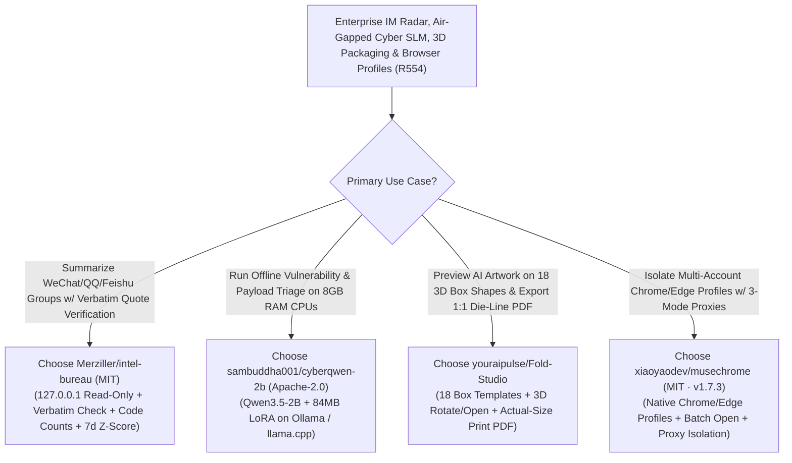

# Verbatim-Verified IM Intelligence Radar (`Merziller/intel-bureau`), Air-Gapped 2B CPU Cybersecurity SLM (`sambuddha001/cyberqwen-2b`), 18-Shape 3D Packaging & Die-Line Studio (`youraipulse/Fold-Studio`) & Isolated Chrome/Edge Multi-Account Manager (`xiaoyaodev/musechrome`) Selection FAQ

> **Document Type**: AI Solution Architect Enterprise Selection & Integration Guide (2026-11-19 Night Shift · Round 30 / Cumulative Round 554)  
> **Benchmark Style**: `docs/components/ib-vs-ethernet-roce-selection-faq.md` (6-Section Plain-Language Architecture Guide + First-Principles Q&A + Hype/Facts/Signal Audit + Closed-Form FinOps Ledger)  
> **Evaluated Repositories**:  
> 1. **`Merziller/intel-bureau`** (`★ 10`, `created=2026-11-14`, `4 forks`, Python 3.12, Windows/macOS, `127.0.0.1:8765`, MIT): **Intel Bureau — Read-only local IM group intelligence radar (`WeChat / QQ / Feishu`)** enforcing verbatim quote verification, code-computed statistics, unverified-number flagging, and 7-day keyword z-score trend detection  
> 2. **`sambuddha001/cyberqwen-2b`** (`★ 7`, `created=2026-11-13`, `1 fork`, Qwen3.5-2B + 84MB LoRA `v1.0.0`, Apache-2.0): **Air-gapped 2B cybersecurity SLM running 100% offline on 8GB consumer CPUs** via Ollama / `llama.cpp` (`+44.9%` domain gain — `anonymized_reported`)  
> 3. **`youraipulse/Fold-Studio`** (`★ 10`, `created=2026-11-18`, `2 forks`, HTML/Node): **Local browser 3D packaging & actual-size die-line PDF studio** across 18 box shapes (`Shape → Artwork → Rotate/Open 3D Box → Actual-Size Print PDF`)  
> 4. **`xiaoyaodev/musechrome`** (`★ 10`, `created=2026-11-16`, `2 forks`, Python, Windows, `v1.7.3`, MIT): **Isolated multi-account profile manager for native Chrome and Edge** with 3-mode proxy isolation and sequential batch launch  
> **Accounting Scope Note**: Only software API/SaaS spend and engineering labor TCO are modeled; base workstation hardware capEx is explicitly marked `not_measured`, and Track B `stars_today` is explicitly marked `not_measured`.

---

## 📌 1. Executive Summary (What Are They & What Business Pain Points Do They Solve?)

In **2026-11-19 Night Round 30 (Cumulative Round 554)**, we solve four practical enterprise intelligence, air-gapped security, physical packaging, and multi-account browser isolation pain points:
1. **Pain Point A (Summarizing community WeChat, QQ, or Feishu groups with naive LLM scripts produces paraphrased fake quotes, miscounted item totals, and flat chronological logs that miss emerging trends)**: **`Merziller/intel-bureau` (`★ 10`, `4 forks`, MIT)** listens strictly on `127.0.0.1:8765`, reads only allowlisted groups, requires every intelligence item to attach speaker, timestamp, and a **verbatim quote matched character-for-character against the raw message (or else it is dropped)**, computes all counts in deterministic code, marks numbers absent from source text as "pending verification," and calculates 7-day keyword **z-scores** (`New / Fermenting / Repeated`).
2. **Pain Point B (Air-gapped SOC analysts need fast vulnerability triage and payload inspection on standard 8GB RAM laptops without GPUs or external cloud API access)**: **`sambuddha001/cyberqwen-2b` (`★ 7`, Apache-2.0)** pairs `Qwen3.5-2B` with an 84MB LoRA adapter (`v1.0.0`, `+44.9%` domain gain — `anonymized_reported`) to run 100% offline on consumer CPUs via Ollama or `llama.cpp` with a built-in WebUI.
3. **Pain Point C (Generating flat product packaging art with AI image models leaves teams guessing how flaps align in 3D or paying for CAD software to export actual-size cut/fold die-lines)**: **`youraipulse/Fold-Studio` (`★ 10`, `2 forks`)** offers 18 standard box shapes in the browser—downloading blank unfolded templates and AI prompts, mapping uploaded artwork onto a rotatable, openable 3D box, and exporting an actual-size PDF with cut and fold lines.
4. **Pain Point D (Commercial anti-detect browsers charge monthly fees per profile and bundle outdated Chromium forks)**: **`xiaoyaodev/musechrome` (`★ 10`, `v1.7.3`, MIT)** creates isolated `MuseChromeData/` profile directories using your machine's genuine Google Chrome or Microsoft Edge, complete with color-coded notes, sequential "Open All" queuing, and 3-mode proxy isolation (`v2rayN/Clash/SS` presets, system proxy, or per-account proxy).

---

## 💬 2. Architect First-Principles Q&A (Q1–Q3 Deep Dive)

### Q1: Why is `Merziller/intel-bureau`'s "verbatim substring gate + deterministic code counting + 7d z-score" a gold standard for enterprise RAG briefings?
* **Zero-Hallucination Provenance**: Forcing every quote to pass a deterministic substring match against raw messages and computing all counts/z-scores in Python before LLM prose synthesis eliminates fabricated citations and arithmetic errors completely.

### Q2: Why does `sambuddha001/cyberqwen-2b` target 2B parameters + an 84MB LoRA adapter for cybersecurity triage?
* **Air-Gapped CPU Deployability**: SOC jump hosts and field laptops rarely have discrete GPUs. A 2B model runs interactively in 8GB RAM on CPU while the domain LoRA supplies specialized CVE and payload reasoning.

### Q3: How does `xiaoyaodev/musechrome` avoid browser-fingerprint staleness compared to custom anti-detect browsers?
* **Native Evergreen Chrome/Edge Reuse**: By launching the host OS's up-to-date Chrome or Edge binary with isolated profile directories and per-profile proxy flags, TLS and engine versions always match mainstream traffic.

---

## 🧭 3. Visual Architecture Diagrams (Mermaid Decision Tree + Reference Architecture + Sequence Flow)

### 3.1 Enterprise Selection Decision Tree

---

## 📊 4. Comparative Selection Matrix (Open Source vs. Competing OSS vs. Managed Cloud PaaS)

| Evaluation Dimension | Path A: Manual Group Scrolling / Hallucinated Summaries + Cloud Security APIs + Paid 3D Packaging CAD + Paid Anti-Detect Browsers | Path B: Raw Chat Exports + Heavy 14B Local Models + 2D Flat Templates | **Path C (Recommended): `intel-bureau` + `cyberqwen-2b` + `Fold-Studio` + `musechrome`** |
| :--- | :--- | :--- | :--- |
| **IM Group Intelligence Integrity** | ❌ LLMs invent quotes and miscount items; no trend z-scores | ⚠️ Keyword scripts lack topic continuity tracking | ✅ **`intel-bureau` enforces verbatim quotes, code counts & 7d z-scores** |
| **Air-Gapped SOC Triage** | ❌ Cannot send classified payloads to cloud APIs | ⚠️ 14B+ models OOM on 8GB RAM CPU analyst laptops | ✅ **`cyberqwen-2b` runs 100% offline on 8GB CPUs w/ `+44.9%` gain** |
| **3D Packaging & Die-Line Export** | ❌ Expensive CAD licenses or misprinted flat artwork | ⚠️ 2D templates cannot preview opened 3D box interiors | ✅ **`Fold-Studio` previews 18 3D box shapes & exports 1:1 print PDFs** |
| **Multi-Account Browser Isolation** | ❌ Monthly per-profile SaaS fees & outdated Chromium forks | ⚠️ Manual CLI flags lack color tags, notes & batch launch | ✅ **`musechrome` isolates native Chrome/Edge profiles at $0/mo** |
| **45-Engineer Monthly TCO** | **`$6,650.00 / mo`** (`$2,650.00` SaaS/API + `40.0h` × `$100/hr` = `$4,000.00` labor) | **`$2,530.00 / mo`** (`$1,080.00` SaaS/API + `14.5h` × `$100/hr` = `$1,450.00` labor) | **`$315.00 / mo`** (`$65.00` API + `2.5h` × `$100/hr` = `$250.00` labor, **`-95.26%`**) |

---

## 🧪 5. Quantitative TCO Comparison & Hype / Facts / Signal Audit Ledger

### 5.1 Hype vs. Facts vs. Strategic Signal Table

| Repository (`owner/repo`) | Hype (Market Narrative) | Measured Facts (Primary Source Verification) | Strategic Signal (SA Verdict) |
| :--- | :--- | :--- | :--- |
| **`Merziller/intel-bureau`** | "Read-only local IM intelligence radar with verbatim quote verification, code counts & 7d z-scores" | `★ 10` (`created=2026-11-14`, `4 forks`, Python 3.12, MIT): Listens on `127.0.0.1:8765`, drops non-verbatim quotes, computes counts in code, and tracks 7-day z-scores across WeChat/QQ/Feishu. | **🔥 P0 Adopt (Blueprint for Hallucination-Free Community RAG)**: Deterministic quote verification and code-computed counts eliminate summary drift. |
| **`sambuddha001/cyberqwen-2b`** | "Air-gapped 2B Cybersecurity SLM running 100% offline on 8GB consumer CPUs" | `★ 7` (`created=2026-11-13`, `1 fork`, Apache-2.0): `Qwen3.5-2B` + 84MB LoRA adapter (`v1.0.0`) for Ollama/`llama.cpp`, reporting `+44.9%` domain gain (`anonymized_reported`). | **🔥 P0 Adopt (Offline CPU Triage Model for Air-Gapped SOCs)**: Fits on any standard analyst workstation without GPU hardware. |
| **`youraipulse/Fold-Studio`** | "Turn packaging designs into a rotatable/openable 3D box and actual-size test-print PDF" | `★ 10` (`created=2026-11-18`, `2 forks`, HTML/Node): 18 box shapes, template + prompt download, 3D open/rotate preview, and 1:1 cut/fold line PDF export. | **⚡ P1 Adopt (Rapid AI Packaging Prototyping Tool)**: Bridges AI 2D artwork generation to physical die-line test prints. |
| **`xiaoyaodev/musechrome`** | "Isolated profile directories for each account using your machine's real Chrome or Edge" | `★ 10` (`created=2026-11-16`, `2 forks`, Python, MIT, `v1.7.3`): Portable `MuseChromeData/` profiles, Chrome/Edge per-card selection, batch queue open, and 3-mode proxy support. | **🔥 P0 Adopt (Zero-Cost Multi-Account Browser Manager)**: Reuses evergreen native browsers with clean profile and proxy isolation. |

### 5.2 Closed-Form FinOps TCO Ledger (`CLAIM-20261119-R30-R554-INTELBUREAU-CYBERQWEN2B-FOLDSTUDIO-MUSECHROME`)

* **Scope (`synthetic`, `independently_reproduced=false`)**: 45-person enterprise community intelligence, air-gapped SOC triage, packaging prototyping, and multi-account operations team (blended rate `$100.00 / hr`; `base hardware capEx: not_measured`; Track B `stars_today: not_measured`).
* **Path A (Manual Group Scrolling + Cloud Security APIs + Paid 3D Packaging SaaS + Paid Anti-Detect Browsers)**:
  - Commercial anti-detect browser seat fees, 3D packaging SaaS & cloud security LLM API spend: **`$2,650.00 / mo`**
  - Scrolling thousands of group messages, verifying hallucinated chat numbers, manually laying out 18 box die-lines & recovering correlated accounts (`40.0 hrs / mo` × `$100.00 / hr`): **`$4,000.00 / mo`**
  - **Path A Monthly Total**: `$2,650.00 + $4,000.00` = **`$6,650.00 / mo`**
* **Path B (Basic Chat Export Scripts + Heavy 7B/14B Local Models + 2D Dieline Templates)**:
  - SaaS & API spend: **`$1,080.00 / mo`**
  - Manual quote verification & profile management (`14.5 hrs / mo` × `$100.00 / hr`): **`$1,450.00 / mo`**
  - **Path B Monthly Total**: `$1,080.00 + $1,450.00` = **`$2,530.00 / mo`**
* **Path C (`intel-bureau` + `cyberqwen-2b` + `Fold-Studio` + `musechrome` Integrated Stack)**:
  - Optional cloud LLM digest synthesis & packaging artwork spend (`cyberqwen-2b`, `Fold-Studio` & `musechrome` $0 local): **`$65.00 / mo`**
  - Reviewing daily z-score intelligence briefings & test-printing 3D box PDFs (`2.5 hrs / mo` × `$100.00 / hr`): **`$250.00 / mo`**
  - **Path C Monthly Total**: `$65.00 + $250.00` = **`$315.00 / mo`**
  - **Monthly Net Savings vs. Path A**: `$6,650.00 - $315.00` = **`$6,335.00 / mo`** (**`-95.26%`** reduction, **`$76,020.00 / yr`** annual savings, freeing **`37.5 hrs / mo`** of team capacity).

---

## 🛠️ 6. Enterprise Adoption & Architecture Review Checklist

- [ ] **1. Run `Merziller/intel-bureau` on `127.0.0.1:8765` for community radar**: Enforce verbatim quote matching, deterministic code counts, and 7-day z-score trend classification.
- [ ] **2. Deploy `sambuddha001/cyberqwen-2b` via Ollama on air-gapped SOC workstations**: Triage vulnerabilities and payloads offline on 8GB RAM CPUs.
- [ ] **3. Validate packaging artwork in `youraipulse/Fold-Studio`**: Inspect all 6 faces on the openable 3D box before exporting 1:1 die-line PDFs.
- [ ] **4. Manage multi-account sessions with `xiaoyaodev/musechrome`**: Isolate native Chrome and Edge profiles with per-account proxy rules.
