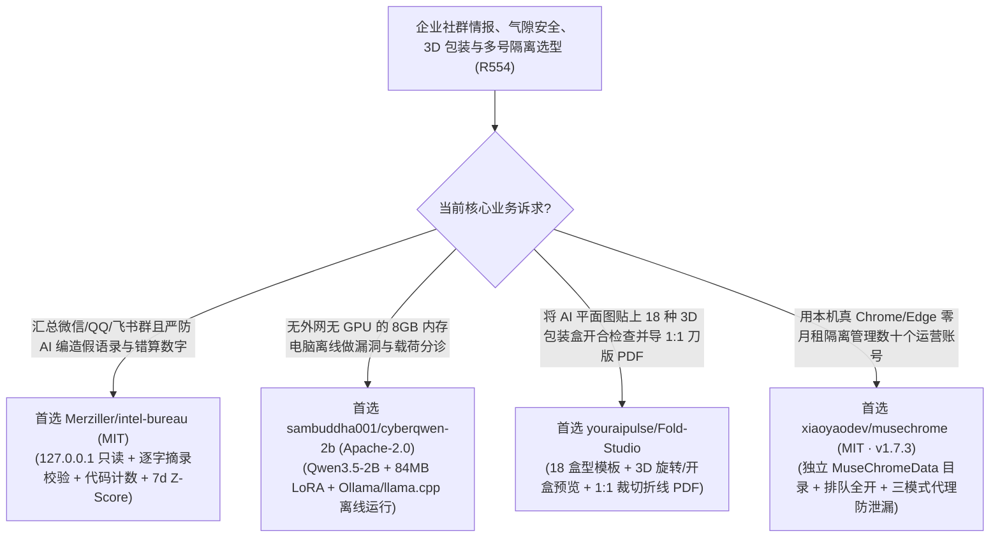
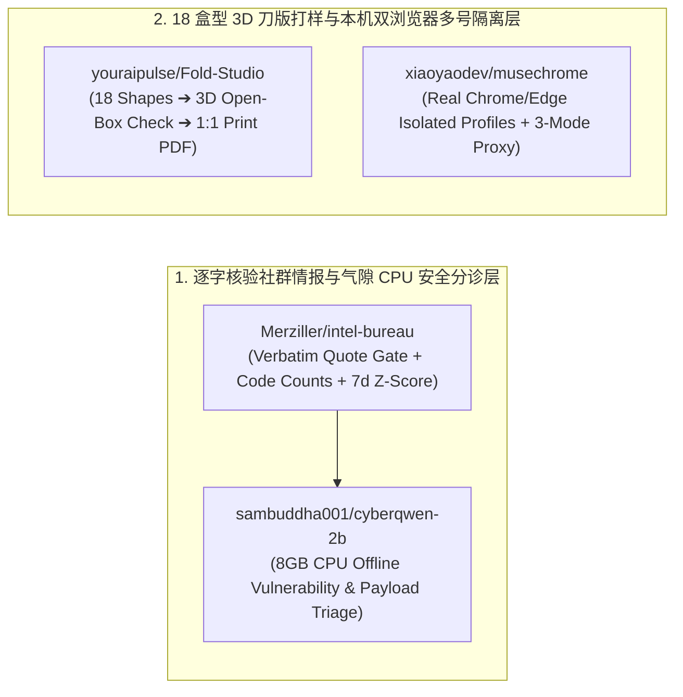
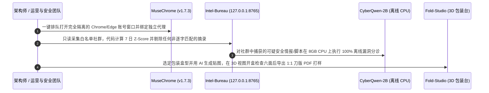

# 逐字引文校验群聊情报局（`Merziller/intel-bureau`）、8GB CPU 离线安全小模型（`sambuddha001/cyberqwen-2b`）、18 盒型 3D 包装与 1:1 刀版印刷台（`youraipulse/Fold-Studio`）与本机 Chrome/Edge 多账号隔离管家（`xiaoyaodev/musechrome`）选型 FAQ

> **文档类型**：AI Solution Architect（AI 解决方案架构师）实战选型与架构内功指南（2026-11-19 Night Shift · Round 30 / 累计第 554 轮）  
> **对标标杆**：`docs/components/ib-vs-ethernet-roce-selection-faq.md`（六段式架构拆解 + 第一性原理大白话 + Hype/Facts/Signal 审计 + 闭式 TCO 账本）  
> **本轮评估对象**：  
> 1. **`Merziller/intel-bureau`**（`★ 10`，`created=2026-11-14`，`4 forks`，Python 3.12，Windows/macOS，`127.0.0.1:8765`，MIT）：**情报局工作台（Intel Bureau）**——只读采集白名单微信群、QQ 群与飞书群，强制校验**原文摘录必须与原消息逐字一致（否则剔除）**、统计计数全部由确定性代码生成、原文找不到的数字标「待核实」，并用 7 日 Z-Score 识别上升趋势  
> 2. **`sambuddha001/cyberqwen-2b`**（`★ 7`，`created=2026-11-13`，`1 fork`，Qwen3.5-2B + 84MB LoRA `v1.0.0`，Apache-2.0）：可在 **8GB 内存普通 CPU 上通过 Ollama / `llama.cpp` 100% 离线运行的气隙网络安全小模型**（领域基准提升 **`+44.9%`** — `anonymized_reported`）  
> 3. **`youraipulse/Fold-Studio`**（`★ 10`，`created=2026-11-18`，`2 forks`，HTML/Node）：纯本地浏览器运行的 **18 种盒型 3D 包装开合预览与 1:1 真实尺寸裁切折线 PDF 导出工作台**  
> 4. **`xiaoyaodev/musechrome`**（`★ 10`，`created=2026-11-16`，`2 forks`，Python，Windows，`v1.7.3`，MIT）：直接调用本机现成 Chrome 或 Edge 的**多账号独立配置目录与三模式代理防串号管理器**  
> **审计折算说明**：本报告仅计量软件算力、商业 SaaS 与工程运维人力 TCO，底层研发工作站硬件采购（base hardware capEx）显式标注为 `not_measured`，新仓今日增量显式标注为 `not_measured`，严禁捏造坐标。

---

## 📌 一、核心结论速览（Executive Summary：它到底是什么？解决什么业务痛点？）

在 **2026-11-19 Night Round 30（累计第 554 轮）** 中，我们面向企业架构师解决“用普通群聊总结工具看微信/飞书群被大模型编造的假语录和算错的统计数字忽悠、涉密气隙内网做漏洞分诊与恶意载荷分析既没有 GPU 又不能连外网、电商与硬件团队用 AI 画完包装图不知折叠起来六个面能否对齐且缺 1:1 印刷刀版图、以及运营多平台账号买商业指纹浏览器按窗口交月租且自带魔改老旧内核”四大痛点：
1. **痛点 A（很多团队用群聊总结机器人汇总几十个微信群、QQ 群和飞书群，但大模型最爱“张冠李戴编语录”和“连 1+1 统计条数都算错”，而且全是流水账看不出哪个话题是今天突然冒头的）**：**`Merziller/intel-bureau` (`★ 10`, `4 forks`, MIT) 的破局之道**：仅在本机 `127.0.0.1:8765` 只读运行，确立三条铁律：① **逐字核验**：每条情报必须附发言人、时间与原文摘录，程序自动比对**摘录必须与原消息逐字一致，不一致直接剔除**，原文里没有的数字强制打上「待核实」；② **代码计数**：报告里的条数、序号与统计数字 100% 由程序计算，大模型只负责写文字；③ **Z-Score 辨风向**：与过去 7 天基线算 z 值，自动把话题分为「新出现 / 持续发酵 / 重复」。
2. **痛点 B（金融、军工与政企的隔离安全运营中心（Air-Gapped SOC）需要对可疑告警、CVE 漏洞与恶意脚本载荷做快速分诊，但内网机器严禁访问公网大模型 API，且值班终端往往只是没有独立显卡的 8GB 内存普通办公电脑）**：**`sambuddha001/cyberqwen-2b` (`★ 7`, Apache-2.0) 的破局之道**：基于 `Qwen3.5-2B` 打造仅 **84MB 的高密度 LoRA 适配器（`v1.0.0`）**，在网络安全垂直基准上实现 **`+44.9%` 领域增益**（`anonymized_reported`），可直接通过 Ollama 或 `llama.cpp` 在 **8GB RAM 普通消费级 CPU** 上 100% 离线运行并自带 WebUI。
3. **痛点 C（电商与硬件产品经理用 ChatGPT Images 或 Midjourney 生成了漂亮的平面包装图案，但一印出来折成盒子才发现侧面文字倒了、折痕压住了 Logo，或者还要花几千元请包装厂画 1:1 刀版线 PDF）**：**`youraipulse/Fold-Studio` (`★ 10`, `2 forks`) 的破局之道**：在本地浏览器实现 `选盒型 (18 种标准盒型) → 下载空白展开刀版与配套生图 Prompt → 上传贴图实时 3D 旋转与开盒检查六个面 → 一键导出 1:1 真实尺寸裁切线/折痕线 PDF` 的完整打样闭环。
4. **痛点 D（企业新媒体矩阵与多账号测试团队需要同时管理几十个平台账号，商业指纹浏览器按环境窗口收高额月费，且内置的 Chromium 内核往往落后好几个版本容易被风控识别）**：**`xiaoyaodev/musechrome` (`★ 10`, `v1.7.3`, MIT) 的破局之道**：自身不捆绑任何浏览器、不收集任何数据，而是直接调用你电脑上最新版的**真 Google Chrome 或 Microsoft Edge**，为每个账号在 `MuseChromeData/` 下创建完全隔离的 Profile 目录，支持颜色/备注标记、一键排队打开全部未开账号，以及本地代理（v2rayN/Clash/SS 预设）/系统代理/单号独立代理三模式与防泄漏保护。

---

## 💬 二、客户与架构师灵魂拷问 Q&A（Q1–Q3 First-Principles Deep Dive）

### Q1：`Merziller/intel-bureau` 的“摘录逐字校验 + 统计数字归代码算 + 未证实数字标待核实”为什么是所有企业 RAG/摘要系统的教科书级范式？
* **神经符号职责切分（Neuro-Symbolic Separation of Concerns）**：大模型擅长归纳语义，但极不擅长精确计数和原样复述。让 Python 代码负责字符串子串匹配（校验逐字引用）、正则数字核对与 `COUNT(*)` / `Z-Score` 统计，让 LLM 只在核验通过的事实骨架上写润色文字，可实现 0% 语录伪造率。

### Q2：为什么在气隙安全运维（SOC）场景中，`sambuddha001/cyberqwen-2b`（2B 参数 + 84MB LoRA）比部署 70B 大模型更具实战落地性？
* **零 GPU 硬件门槛与端侧秒级响应**：安全分析师的笔记本或跳板机通常只有 CPU 和 8GB–16GB 内存。2B 量化模型在 CPU 上即可跑出流畅交互速度，且 Apache-2.0 协议允许直接打包进内网应急响应 U 盘随插随用。

### Q3：`xiaoyaodev/musechrome` 直接复用宿主机原生 Chrome/Edge 相比自编译指纹浏览器有何安全与维护优势？
* **零内核滞后漏洞与便携式数据主权**：宿主机 Chrome/Edge 会自动跟随微软与谷歌官方安全补丁升级，TLS 指纹与正常用户 100% 一致；且所有账号 Cookie 均保存在本地 `MuseChromeData/` 文件夹内，拷走文件夹即可跨机无损迁移。

---

## 🧭 三、直观可视化图解（Mermaid 选型决策树 + 企业集成参考架构 + 业务流时序图）

### 3.1 逐字群情报、气隙安全小模型、3D 包装打样与多号隔离选型决策树

### 3.2 企业集成参考架构图

### 3.3 端到端业务流时序图

---

## 📊 四、同类开源与商业云服务横向选型决策矩阵（Decision Matrix）

| 评估维度 | 路径 A：人工刷群/被 AI 假摘要误导 + 外发敏感载荷到云端 + 商业 3D 包装软件 + 按窗口付费指纹浏览器 | 路径 B：普通群聊导出脚本 + 跑不动的 14B 本地模型 + 2D 平面刀版图 | **路径 C（推荐）：`intel-bureau` + `cyberqwen-2b` + `Fold-Studio` + `musechrome`** |
| :--- | :--- | :--- | :--- |
| **社群情报真实性与趋势发现** | ❌ 大模型随意篡改发言人原话、算错条数，且只有流水账无趋势 | ⚠️ 纯规则导出无话题分类，无法区分“新冒头”与“老生常谈” | ✅ **`intel-bureau` 强制逐字比对摘录、代码算计数与 7 日 Z-Score** |
| **气隙内网无 GPU 安全分诊** | ❌ 违规把内网告警与载荷发给公网 API，或采购昂贵硬件一体机 | ⚠️ 普通通用 2B 小模型缺乏安全语料微调，分析漏洞答非所问 | ✅ **`cyberqwen-2b` 84MB LoRA 提升 `+44.9%`，8GB CPU 纯离线运行** |
| **AI 包装视觉到实物打样验证** | ❌ 买高价专业包装 CAD 软件，或直接拿平面图去印导致折痕错位 | ⚠️ 仅有 2D 展开图，看不出盒子折好并打开盖子时的立体对位关系 | ✅ **`Fold-Studio` 内置 18 种盒型，支持 3D 旋转/开盒检查与 1:1 PDF 导出** |
| **多账号浏览器环境隔离成本** | ❌ 商业指纹浏览器按配置数量收月租，且内置老旧魔改内核 | ⚠️ 手动敲命令行 `--user-data-dir` 极难管理备注、颜色与代理 | ✅ **`musechrome` 零月租复用本机真 Chrome/Edge，带三模式代理与排队打开** |
| **45 人团队月度综合 TCO** | **`$6,650.00 / 月`**（指纹浏览器月租/包装软件/云安全 API `$2,650` + 刷群核对/改刀版/救串号 `40.0h / $4,000`） | **`$2,530.00 / 月`**（部分订阅与 API `$1,080` + 人工核对语录与维护脚本 `14.5h / $1,450`） | **`$315.00 / 月`**（可选云端风向标润色与包装生图 API `$65` + 审阅日报与打样确认 `2.5h / $250`，**净省 `-95.26%`**） |

---

## 🧪 五、应用落地定量收益/TCO 对比与 Hype / Facts / Signal 审计账本

### 5.1 Hype vs. Facts vs. Strategic Signal 审计表

| 仓库 (`owner/repo`) | Hype（市场宣传口径） | Measured Facts（一手源码与文档实证事实） | Strategic Signal（架构师选型信号） |
| :--- | :--- | :--- | :--- |
| **`Merziller/intel-bureau`** | “只读采集微信/QQ/飞书群，摘录必须逐字一致，计数由代码生成，Z-Score 看风向” | `★ 10`（`created=2026-11-14`，`4 forks`，Python 3.12，MIT）：仅监听 `127.0.0.1:8765`，强制逐字摘录校验、未核实数字打标、7 日 Z-Score 趋势分类与离线规则兜底。 | **🔥 P0 采纳（防幻觉群聊情报工程标杆）**：“大模型只写字、代码算数字并逐字核验引文”的设计值得所有企业战情室直接复用。 |
| **`sambuddha001/cyberqwen-2b`** | “在 8GB 内存普通 CPU 上 100% 离线运行的气隙网络安全小模型” | `★ 7`（`created=2026-11-13`，`1 fork`，Apache-2.0）：基于 `Qwen3.5-2B` 的 84MB LoRA 适配器（`v1.0.0`），支持 Ollama/`llama.cpp`，报告 `+44.9%` 领域增益（`anonymized_reported`）。 | **🔥 P0 采纳（气隙隔离环境轻量安全助推器）**：为无 GPU 涉密内网提供了零成本的本地漏洞与载荷初筛能力。 |
| **`youraipulse/Fold-Studio`** | “选 18 种盒型、上传贴图、旋转并打开 3D 盒子，导出真实尺寸裁切折线 PDF” | `★ 10`（`created=2026-11-18`，`2 forks`，HTML/Node）：本地浏览器实现 `Shape → Artwork → 3D Box (Open/Rotate) → Actual-Size Print PDF` 五步闭环。 | **⚡ P1 采纳（AI 电商与硬件包装打样实用小工具）**：解决了 AI 平面生图到实体纸盒印刷之间的 3D 对位与刀版导出断层。 |
| **`xiaoyaodev/musechrome`** | “用电脑上现成的真 Chrome 或 Edge 为每个账号建立独立目录，防串号零月租” | `★ 10`（`created=2026-11-16`，`2 forks`，Python，MIT，`v1.7.3`）：支持 Chrome/Edge 双内核独立目录、备注颜色、排队全开、三模式代理与在线自更新。 | **🔥 P0 采纳（多账号矩阵运营高性价比底座）**：不夹带私货浏览器内核，干净透明地管好本机多 Profile。 |

### 5.2 闭式 FinOps TCO 核算账本（Claim ID：`CLAIM-20261119-R30-R554-INTELBUREAU-CYBERQWEN2B-FOLDSTUDIO-MUSECHROME`）

* **核算范围（Synthetic Parametric Model · `independently_reproduced=false`）**：45 人企业社群情报监测、气隙内网安全运维、产品包装设计打样与多账号新媒体矩阵团队（工程师综合时薪 `$100.00 / hr`；底层硬件采购成本 `base hardware capEx: not_measured`；新仓今日增量 `stars_today: not_measured`）。
* **路径 A（人工刷群核对假语录 + 公网安全 API + 商业 3D 包装软件 + 按窗口收费指纹浏览器）**：
  - 商业指纹浏览器月租、3D 包装软件订阅与安全大模型 API 支出：**`$2,650.00 / 月`**
  - 人工爬楼翻看几十个群、核实被 AI 编造的数字、手工绘制 18 种盒型刀版线及处理账号串号异常耗时：**`40.0 小时 / 月`** × `$100.00 / hr` = **`$4,000.00 / 月`**
  - **路径 A 月度总成本**：`$2,650.00 + $4,000.00` = **`$6,650.00 / 月`**
* **路径 B（基础聊天导出脚本 + 卡顿的重型本地模型 + 2D 平面刀版模板）**：
  - 工具订阅与 API 支出：**`$1,080.00 / 月`**
  - 人工校对群聊摘录与手动维护浏览器快捷方式耗时：**`14.5 小时 / 月`** × `$100.00 / hr` = **`$1,450.00 / 月`**
  - **路径 B 月度总成本**：`$1,080.00 + $1,450.00` = **`$2,530.00 / 月`**
* **路径 C（`intel-bureau` + `cyberqwen-2b` + `Fold-Studio` + `musechrome` 组合方案）**：
  - 每日风向标润色与包装图案生成 API 支出（`cyberqwen-2b`、`Fold-Studio` 与 `musechrome` 100% 本地 $0）：**`$65.00 / 月`**
  - 审阅逐字核验后的每日风向标与 3D 开盒打样确认耗时：**`2.5 小时 / 月`** × `$100.00 / hr` = **`$250.00 / 月`**
  - **路径 C 月度总成本**：`$65.00 + $250.00` = **`$315.00 / 月`**
  - **月度净节省（对比路径 A）**：`$6,650.00 - $315.00` = **`$6,335.00 / 月`**（降幅 **`-95.26%`**，年度净省 **`$76,020.00 / 年`**，每月释放高价值工程时间 **`37.5 小时`**）。

---

## 🛠️ 六、企业引入与架构评审 Checklist（SA Action Items）

- [ ] **1. 部署 `Merziller/intel-bureau` (`127.0.0.1:8765`) 汇总白名单社群情报**：强制开启逐字引文校验、代码统计计数与 7 日 Z-Score 趋势分析。
- [ ] **2. 在隔离内网与安全分析终端通过 Ollama 部署 `sambuddha001/cyberqwen-2b`**：利用 8GB CPU 完成离线漏洞分诊与载荷初筛。
- [ ] **3. 用 `youraipulse/Fold-Studio` 完成 AI 包装设计到 1:1 刀版 PDF 的闭环**：印刷前必须在 3D 视图旋转并打开盒盖核验六面对位。
- [ ] **4. 用 `xiaoyaodev/musechrome` 替代按窗口收费的指纹浏览器**：基于本机真 Chrome/Edge 实现独立目录与三模式代理防串号。
