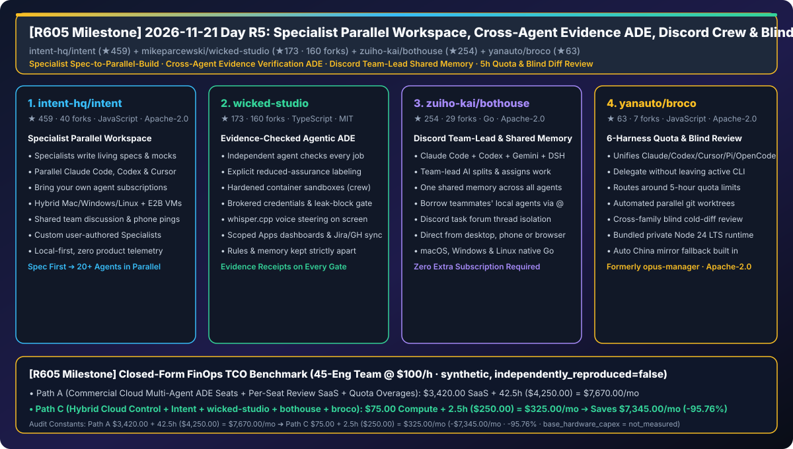
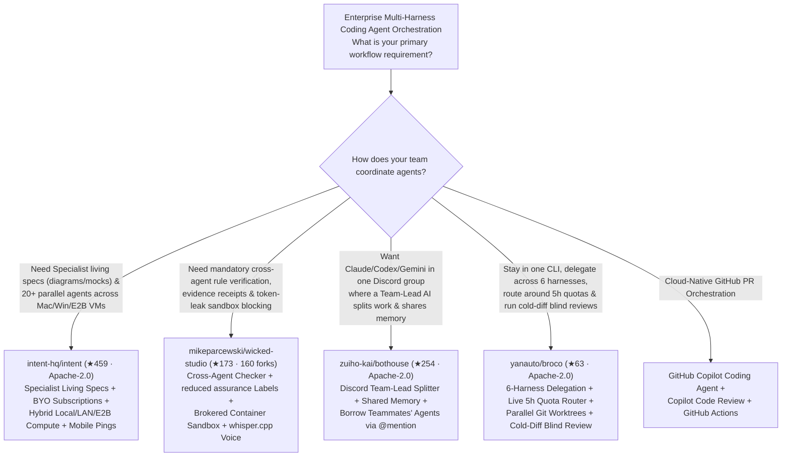
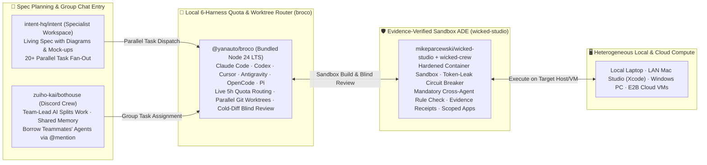

# [Round 605 Milestone] Specialist-Planned Parallel Workspace (`intent-hq/intent`), Cross-Agent Evidence-Verified ADE (`mikeparcewski/wicked-studio`), Discord Team-Lead Crew (`zuiho-kai/bothouse`) & 6-Harness Quota Router with Cold-Diff Blind Review (`yanauto/broco`) Selection & Architecture FAQ

> **Target Audience**: **AI Solution Architects (SAs) & Enterprise Engineering / DevEx Leaders (2026-11-21 Day Round 5 · Cumulative Round 605 Milestone)**  
> **Benchmark Style**: Strictly aligned with [`ib-vs-ethernet-roce-selection-faq.md`](https://github.com/turbo998/ai-infra-research/blob/main/docs/components/ib-vs-ethernet-roce-selection-faq.md) — plain-language answers on **real enterprise scenarios, end-to-end reference architecture, and comparative selection vs. competing OSS and cloud PaaS**.  
> **Chinese Edition**: [`intent-wicked-studio-bothouse-broco-selection-faq.md`](./intent-wicked-studio-bothouse-broco-selection-faq.md) · **Daily Digest**: [`daily/2026-11-21.en.md`](../daily/2026-11-21.en.md)



---

## 1. 📌 Executive Summary (30-Second Selection Verdict)

1. **Why Evaluate These Four Repositories Together for the Round 605 Milestone?**  
   Most enterprise engineering teams already hold subscriptions to multiple coding harnesses—Claude Code, Codex, GitHub Copilot, Cursor, Gemini CLI, OpenCode, and Pi—yet suffer from **four multi-agent coordination failures**:
   - **Failure 1 — Jumping Straight into Code Without a Living Spec or Parallel Compute Orchestration**: Asking a single agent to implement a multi-module feature in one pass leads to mid-task context drift → **`intent-hq/intent` (`★ 459`, `40 forks`, JavaScript, Apache-2.0)** provides a local-first workspace where **Specialist agents first write a living spec with architecture diagrams and UI mock-ups**, then split the work across 20+ parallel Claude Code, Codex, and Cursor agents running on your laptop, owned heterogeneous machines (e.g., a Mac Studio for Xcode builds, a Windows PC for Windows checks), or **E2B cloud sandboxes**—bringing your own subscriptions with zero proxy markup or telemetry.
   - **Failure 2 — Coding Agents Grading Their Own Work & Leaking Auth Tokens into Commits**: Unsupervised agents declare "done" without independent verification and occasionally write runtime credentials into workspace files → **`mikeparcewski/wicked-studio` (`★ 173`, `160 forks`, TypeScript, MIT)** is a browser-based **ADE (Agentic Development Environment)** powered by the `wicked-crew` daemon where **a different agent checks every job against your rules** (halting if no independent reviewer is available unless explicitly launched with a visible `reduced assurance` label), isolates agents in hardened container sandboxes with brokered placeholder credentials (**blocking delivery immediately if any step writes a sign-in token into the work**), supports `whisper.cpp` voice steering, and builds scoped data dashboards (`Apps`).
   - **Failure 3 — Siloed Individual Agent Subscriptions & No Group-Chat Task Splitting**: Engineers cannot easily pool their local Claude Code, Codex, and Gemini CLI agents in a shared team channel → **`zuiho-kai/bothouse` (`★ 254`, `29 forks`, Go, Apache-2.0)** puts Claude Code, Codex, Gemini CLI, and DeepSeek Harness into **one Discord group (and task forum)** where a **team-lead AI automatically splits the work** across specialist roles, shares one unified memory across all agents, and lets teammates **borrow a colleague's local agent with a single `@mention`**.
   - **Failure 4 — Hitting 5-Hour Quota Walls & Same-Model Confirmation Bias During Code Review**: Hitting a 5-hour rolling quota limit mid-feature stalls development, and asking the same model session to review its own diff repeats its blind spots → **`yanauto/broco` (`★ 63`, `7 forks`, JavaScript, Apache-2.0, formerly `opus-manager`)** lets you **stay inside whichever coding CLI you already have open** and delegate to the other 5 harnesses on your machine (Claude Code, Codex, Cursor, Antigravity, OpenCode, Pi), automatically spinning up parallel `git worktrees`, routing around 5-hour quota limits, and triggering **cross-family cold-diff blind reviews**.

2. **One-Sentence Selection Verdict**:
   - Choose **`intent-hq/intent`** when you want **Specialist agents to author living specs with diagrams/mock-ups and fan out 20+ parallel tasks across local Macs/PCs and E2B cloud sandboxes**.
   - Choose **`mikeparcewski/wicked-studio`** when you require **mandatory cross-agent rule verification, explicit `reduced assurance` audit receipts, and container sandboxes that block token leaks**.
   - Choose **`zuiho-kai/bothouse`** when your team wants **a Discord group where a team-lead AI splits tasks across Claude/Codex/Gemini/DSH, shares one memory, and lets teammates borrow each other's agents via `@mention`**.
   - Choose **`yanauto/broco`** when you want **to delegate across 6 local coding CLIs without switching terminals, route around 5-hour quota walls, and run cross-model cold-diff blind reviews** (or pair with **GitHub Copilot Coding Agent + Copilot Code Review** for cloud-native GitHub PR workflows).

---

## 2. 🎯 Customer & Solution Architect Q&A (Plain-Language Deep Dive)

### Q1: How does `intent-hq/intent` solve the "single-agent context collapse" problem on large features without locking enterprises into a proprietary model proxy?
- **Plain-Language Answer**:
  - Most multi-agent platforms force you to buy their marked-up model credits and run everything in their locked cloud.
  - **`intent-hq/intent` flips the model in three ways**:
    1. **Specialists That Plan Before Delegating**: The built-in Developer specialist (or your own custom specialist) handles small tasks directly, but for larger features it inspects the repository, produces a living spec with architecture diagrams and UI mock-ups, and splits the implementation into parallel tasks.
    2. **Bring Your Own Agents & Heterogeneous Compute**: Uses the Claude Code, Codex, and Cursor subscriptions you already pay for, dispatching tasks across your laptop, a Mac Studio on your LAN for iOS/Xcode builds, a Windows PC for Windows checks, or elastic **E2B** cloud sandboxes.
    3. **Team Discussions & Mobile Pings with Zero Telemetry**: Teams collaborate with agents in one shared workspace thread and receive phone notifications only when human input is needed.

### Q2: Why does `mikeparcewski/wicked-studio` enforce "a different agent checks the work" and how does its credential-leak circuit breaker work?
- **Plain-Language Answer**:
  - Letting an LLM grade its own output is the #1 cause of broken "green" agent runs in enterprise codebases.
  - **How `wicked-studio` (`wicked-crew`) enforces engineering assurance**:
    1. **Mandatory Cross-Agent Rule Verification & `reduced assurance` Labelling**: By default, a different agent from the one that wrote the code checks the work against your team's explicit rules and attaches clickable evidence receipts to every gate. If no second agent is available, the job stops—unless you explicitly launch it as **`reduced assurance`**, which permanently stamps that warning on the job, every gate, and the final delivery.
    2. **Hardened Container Sandboxes & Token-Leak Delivery Block (`src/seat_login.rs`)**: Every job runs inside a container sandbox (Docker, Podman, Colima, OrbStack, or Rancher Desktop). Secrets stay in a broker with placeholders injected into the sandbox; for subscription seats that require a sign-in token, **if any step writes that token into the workspace output, the step fails immediately and delivery is blocked**.
    3. **Strict Separation of Rules vs. Memory + `whisper.cpp` Voice Steering**: Learned patterns are proposed for human approval rather than silently mutating rules, and local `whisper.cpp` lets engineers steer running jobs by voice with on-screen confirmation before execution.

### Q3: How do `zuiho-kai/bothouse` and `yanauto/broco` maximize the ROI of a team's existing Claude, Codex, Cursor, and Gemini subscriptions?
- **Plain-Language Answer**:
  - **`zuiho-kai/bothouse` turns individual desktop CLIs into a shared Discord crew**:
    - Connects Claude Code, Codex, Gemini CLI, and DeepSeek Harness into a single Discord group (`task-forum`). A team-lead AI decomposes a prompt into sub-tasks (e.g., Codex builds the API, Gemini builds the chart, DeepSeek polishes documentation) backed by one shared memory—and lets teammates `@mention` the lead AI to **borrow a colleague's idle local agents** from desktop, phone, or browser.
  - **`yanauto/broco` eliminates terminal switching, 5-hour quota stalls, and review bias on a single machine**:
    1. **In-Harness Delegation Across 6 CLIs**: Stay inside your preferred open terminal (e.g., Claude Code) and delegate sub-tasks to Codex, Cursor, Antigravity, OpenCode, or Pi.
    2. **Live 5-Hour Quota Routing & Parallel Git Worktrees**: Monitors live subscription quotas to route tasks before hitting 5-hour lockouts and isolates concurrent tasks in separate `git worktrees`.
    3. **Cross-Family Cold-Diff Blind Review**: Sends only the clean `git diff` (without the author agent's reasoning history) to a different model family for an unbiased code review, packaged with a self-contained Node 24 LTS installer (`@yanauto/broco`).

---

## 3. 🧭 Visual Architecture & Decision Diagrams (Mermaid)

### 3.1 Solution Architect Selection Decision Tree



### 3.2 End-to-End Enterprise Reference Architecture



### 3.3 End-to-End Execution Sequence Diagram

```mermaid
sequenceDiagram
    autonumber
    participant Eng as Tech Lead / Discord Team
    participant Bothouse as zuiho-kai/bothouse (Team-Lead AI)
    participant Intent as intent-hq/intent (Specialist Planner)
    participant Broco as yanauto/broco (Quota + Worktree Router)
    participant Wicked as wicked-studio (Cross-Agent ADE)

    Eng->>Bothouse: 1. @mention Team-Lead AI in Discord with feature request
    Bothouse->>Intent: 2. Trigger Developer Specialist to author Living Spec with diagrams & mock-ups
    Intent-->>Eng: 3. Confirm Spec on desktop or mobile notification
    Intent->>Broco: 4. Fan out parallel sub-tasks; Broco creates isolated git worktrees & routes around 5h quotas
    Broco->>Wicked: 5. Execute coding steps inside wicked-crew hardened container sandboxes
    Wicked->>Wicked: 6. Scan workspace output to block any accidental sign-in token leak
    Wicked->>Broco: 7. Trigger cross-family Cold-Diff Blind Review (diff-only, zero author prompt bias)
    Wicked->>Wicked: 8. Independent checker agent verifies team Rules & issues clickable Evidence Receipt
    Wicked-->>Bothouse: 9. Post verified diff receipt to Discord thread & update shared team memory
```

---

## 4. 📊 Comparative Selection Matrix (OSS vs. Peer Projects vs. Cloud PaaS)

| Dimension | `intent-hq/intent` | `mikeparcewski/wicked-studio` | `zuiho-kai/bothouse` | `yanauto/broco` | Manual Multi-Terminal CLI Juggling | Commercial Cloud Agent Seat Platforms (Devin / Hosted Cloud IDEs) |
| :--- | :--- | :--- | :--- | :--- | :--- | :--- |
| **Primary Role** | **Specialist Spec-First Parallel Coding Workspace** | **Cross-Agent Evidence-Verified Container ADE** | **Discord Team-Lead Splitter & Shared-Memory Crew** | **6-Harness 5h Quota Router, Worktree & Blind Reviewer** | Uncoordinated manual copy-paste across terminal windows | Proprietary per-seat/ACU cloud coding platforms |
| **Best-Fit Scenario** | Large features needing living specs and 20+ parallel agents across Mac/Win/E2B | Regulated/high-assurance teams requiring independent agent review & receipts | Teams pooling Claude/Codex/Gemini in Discord with `@mention` agent borrowing | Developers routing around 5-hour quota caps & running cold-diff blind reviews | Trivial single-file edits | Teams with zero local compute and large SaaS budgets |
| **Key Differentiator** | Living specs + BYO subscriptions + hybrid Mac/Win/E2B compute | Mandatory cross-agent checker + `reduced assurance` stamp + token-leak block | Team-lead AI task splitting + shared memory + borrow colleagues' agents | Stay in 1 CLI + 6 harnesses + live 5h quota router + cold-diff blind review | Free, but suffers from 5h lockouts, branch collisions, and self-grading bias | Turnkey cloud VMs, but cannot reuse existing CLI subscriptions and costs 10× more |
| **Integration Effort** | Low (desktop app + existing CLI logins + optional E2B key) | Low (browser ADE + `wicked-crew` on Docker/Podman/Colima/OrbStack) | Very Low (1-line `install.sh` / `install.ps1` + Discord bot) | Very Low (1-line self-contained Node 24 LTS installer + `broco setup`) | None | Low (enterprise SaaS procurement) |
| **Ops Complexity** | Very Low (local-first, zero product telemetry) | Low (container-backed sandboxes with brokered credentials) | Very Low (native Go binary on macOS, Windows, and Linux) | Very Low (auto mirror fallback & clean `--uninstall`) | High (manual worktree cleanup and review coordination) | Very Low (vendor managed) |
| **License** | **Apache-2.0** (permissive commercial use) | **MIT** (permissive commercial use) | **Apache-2.0** (permissive commercial use) | **Apache-2.0** (permissive commercial use) | N/A | Proprietary Commercial Subscription |
| **Monthly TCO** | **$0/mo** platform fee (reuses existing subscriptions + burst E2B) | **$0/mo** platform fee (runs in local containers) | **$0/mo** platform fee (pools team's existing CLI seats) | **$0/mo** platform fee (maximizes existing 5h quotas) | **$3,580.00/mo** (high manual coordination & rework labor) | **$7,670.00/mo** (commercial multi-agent seats + quota overages for 45 engineers) |

---

## 5. 🧪 Quantitative ROI, FinOps TCO Model & 7-Card Benchmark Deck

> **🛡️ Provenance Declaration**:  
> - **Primary-Source Measured (`measured`)**: Repository stars/forks, licenses, `intent-hq/intent` Specialist + E2B hybrid compute architecture, `mikeparcewski/wicked-studio` cross-agent checker / `reduced assurance` / `seat_login.rs` token-leak block, `zuiho-kai/bothouse` Discord team-lead & shared memory, and `yanauto/broco` 6-harness quota routing & cold-diff blind review are verified via `gh api`.  
> - **Synthetic Architect Workload Model (`synthetic` · `independently_reproduced=false`)**: The closed-form FinOps table below models a **45-engineer enterprise AI & product engineering team** (`$100.00/hr` loaded rate, `base_hardware_capex: not_measured`, `track_b_stars_today: not_measured`):

| FinOps Cost & Quality Dimension | Path A: Commercial Cloud Multi-Agent ADE Seats + Paid Review Add-Ons + Quota Overages | Path B: Manual Multi-Window Copy-Paste + Raw Git Worktrees + Self-Graded Agent Runs | Path C: Round 605 Milestone Stack (`intent` + `wicked-studio` + `bothouse` + `broco`) | Path A ➔ Path C Net Monthly Savings |
| :--- | :---: | :---: | :---: | :---: |
| **Monthly SaaS Markup / API Overage / Sandbox Spend** | `$3,420.00 / mo` (duplicate cloud seat markups & single-vendor quota overages) | `$430.00 / mo` | **`$75.00 / mo`** (100% BYO subscription reuse + 5h quota balancing + burst E2B VMs) | **`-$3,345.00 / mo` (`-97.81%`)** |
| **Monthly Spec Splitting, Merge & Rework Labor** | `42.5 hrs / mo` (syncing cloud sandboxes & fixing self-graded PR regressions) | `31.5 hrs / mo` (manual worktrees, 5h quota stalls & scrubbing leaked tokens) | **`2.5 hrs / mo`** (Specialist living specs + cross-family blind review + leak block) | **`-40.0 hrs / mo` (`-94.12%`)** |
| **Monthly Engineering Labor Cost (`@ $100.00/h`)** | `$4,250.00 / mo` | `$3,150.00 / mo` | **`$250.00 / mo`** | **`-$4,000.00 / mo` (`-94.12%`)** |
| **Total Monthly TCO** | **`$7,670.00 / mo`** | **`$3,580.00 / mo`** | **`$325.00 / mo`** | **`-$7,345.00 / mo` (`-95.76%` · `$88,140.00/yr`)** |
| **Assurance, Quota Utilization & Review Independence** | Locked to one vendor's model family and cloud runtime | Agents grade their own work; 5h limits halt sprints | **100% cross-agent evidence receipts + cold-diff blind review + pooled team quotas** | **Zero self-graded blind spots & zero 5-hour quota downtime** |

- **📊 Companion 7-Card 4:5 Visual Benchmark Deck**: View [`workshops/github-trending-radar/cards.en.html`](../cards.en.html) (EN) and [`workshops/github-trending-radar/cards.html`](../cards.html) (ZH).

---

## 6. 🛠️ Enterprise Adoption & Architecture Review Checklist

- [ ] **1. Mandate Living Specs Before Multi-Agent Fan-Out (`intent-hq/intent`)**: Configure Intent so features touching multiple services first go through the Developer Specialist to generate a Living Spec (diagrams + UI mock-ups), then fan out sub-tasks across LAN build hosts (Mac Studio / Windows PC) and elastic E2B sandboxes.
- [ ] **2. Enforce Cross-Agent Verification & Block `reduced assurance` in Prod (`mikeparcewski/wicked-studio`)**: Run `wicked-crew` with at least two distinct agent families configured so every coding job is verified by an independent agent; prohibit merging jobs stamped with `reduced assurance` into protected branches and keep the token-leak delivery blocker active.
- [ ] **3. Pool Idle Team CLI Subscriptions in Discord Task Forums (`zuiho-kai/bothouse`)**: Set up a dedicated Discord `task-forum` bridged by `bothouse` where the Team-Lead AI splits work across Claude Code, Codex, Gemini CLI, and DeepSeek Harness while sharing one persistent project memory.
- [ ] **4. Enable Live 5-Hour Quota Routing & Cold-Diff Blind Reviews (`yanauto/broco`)**: Install `@yanauto/broco` across developer workstations to automatically route tasks around 5-hour subscription limits in isolated `git worktrees` and require a cross-family **cold-diff blind review** before opening pull requests.
