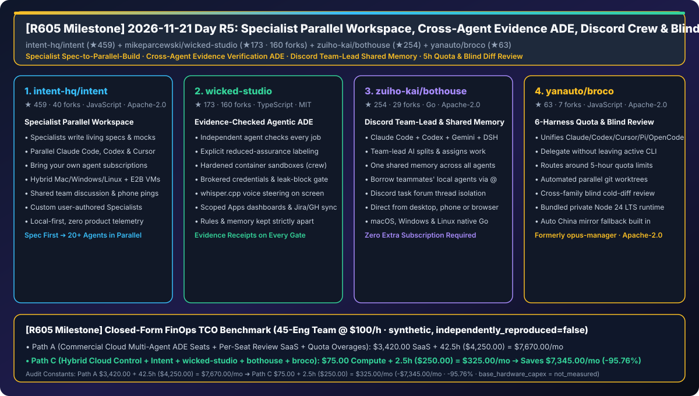
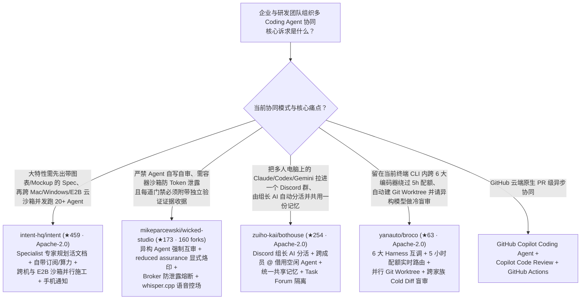
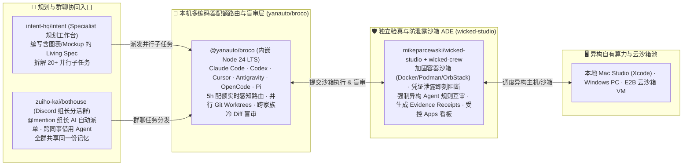
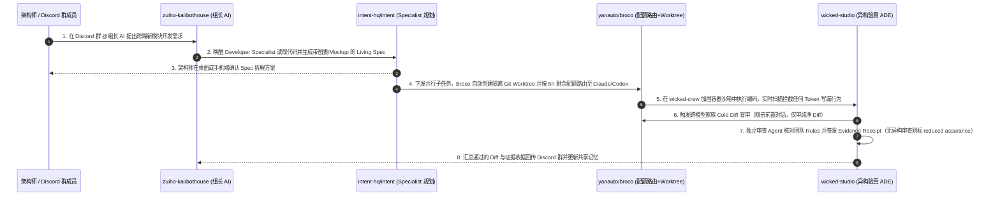

# 【第 605 轮里程碑】专家规划并行编码工作台（`intent-hq/intent`）、跨智能体独立验真 ADE（`mikeparcewski/wicked-studio`）、Discord 组长分活与共享记忆群（`zuiho-kai/bothouse`）及 6 大编码器配额路由与盲审协同器（`yanauto/broco`）应用场景、集成架构与同类方案选型比较 FAQ

> **文档定位**：面向企业客户与业务决策者的 **AI Solution Architect（解决方案架构师）实战选型指南（2026-11-21 Day Round 5 · 累计第 605 轮里程碑）**  
> **对标范式**：严格遵循 [`ib-vs-ethernet-roce-selection-faq.md`](https://github.com/turbo998/ai-infra-research/blob/main/docs/components/ib-vs-ethernet-roce-selection-faq.md) 通俗问答与决策矩阵风格——直接用大白话回答“**它是什么？帮企业解决什么业务痛点？怎么集成进现有生产架构？和同类开源及 Azure 云服务比怎么选？**”  
> **配套英文版**：[`intent-wicked-studio-bothouse-broco-selection-faq.en.md`](./intent-wicked-studio-bothouse-broco-selection-faq.en.md) · **今日日报**：[`daily/2026-11-21.md`](../daily/2026-11-21.md)

---

## 一、📌 核心结论速览（Executive Summary · 30 秒做出选型决定）

1. **为什么在第 605 轮里程碑把这四个项目放在一起看？**  
   当企业研发团队人手同时订了 Claude Code、Codex、GitHub Copilot、Cursor 和 Gemini CLI 时，最大的效率浪费不再是“单个模型不够聪明”，而是**“多个编码 Agent 各自为战、自己给自己打满分、5 小时配额一满就停工、跨机器算力无法拼起来用”**：
   - **痛点一（大需求没人先写架构 Spec 并拆解给多台机器/云沙箱并行开发）**：直接把一个复杂需求丢给单个 CLI，它会改得虎头蛇尾 → **`intent-hq/intent`（`★ 459`，`40 forks`，JavaScript，Apache-2.0）** 提供“**专家先行规划 + 多 Agent 并行施工**”开源工作空间：先由 Specialist 专家智能体读代码、画出架构图与原型 Mockup 写出动态 Spec，再将子任务分发给本地笔记本、异构自有主机（如 Mac Studio 跑 Xcode 构建、Windows PC 跑兼容性测试）或 E2B 云沙箱中的 20+ 个 Claude Code / Codex / Cursor 实例并行开发，全程零遥测且直接复用工程师已有订阅。
   - **痛点二（编码 Agent 自己写完自己喊“Done”，缺乏另一个异构 Agent 按团队规则独立验真与防凭据泄露沙箱）**：让同一个 Agent 既写代码又自检，必然放过自己的盲区 → **`mikeparcewski/wicked-studio`（`★ 173`，`160 forks`，TypeScript，MIT）** 打造了浏览器端 **ADE（Agentic Development Environment）**：默认强制由**另一个不同的 Agent 对照团队规则做独立审查**（若无异构 Agent 可审则自动暂停，除非显式标记为 `reduced assurance` 降级保证）；通过 `wicked-crew` 守护进程在加固容器沙箱中运行每个任务，凭证由 Broker 托管为占位符（**一旦某步把真实 Token 写进产物即刻阻断交付**），支持 `whisper.cpp` 语音指令屏幕确认与受控数据源 `Apps` 看板生成。
   - **痛点三（团队成员想在同一个群里借用彼此电脑上的 Claude Code / Codex 分工干活并共享同一份记忆）**：不同开发者的 Agent 无法在群聊里由一个“组长 AI”自动派活 → **`zuiho-kai/bothouse`（`★ 254`，`29 forks`，Go，Apache-2.0）** 把 Claude Code、Codex、Gemini CLI 和 DeepSeek Harness 拉进同一个 Discord 群（及任务论坛 `task-forum`）：由**组长 AI（Team-Lead AI）自动拆解任务并按专长派活**（例如让 Codex 写代码、DeepSeek 润色文案），全员共用一份记忆，甚至允许团队成员通过一次 `@mention` 直接借用同事机器上的空闲 Agent 协同交付。
   - **痛点四（不想切出当前顺手的终端 CLI，但需要绕过 5 小时配额限制、自动建 Git Worktree 并请异构模型做“冷盲审”）**：在 Claude Code 里干到一半撞上 5 小时限额，或者想让 GPT/Codex 在不知道前置提示词的情况下客观挑刺 → **`yanauto/broco`（`★ 63`，`7 forks`，JavaScript，Apache-2.0，原 `opus-manager`）** 让开发者**留在当前打开的任意 CLI 内**，直接把任务委派给本机已登录的其余 5 大编码器（Claude Code、Codex、Cursor、Antigravity、OpenCode、Pi）：自动创建并行 Git Worktree、实时监控并绕过 5 小时配额上限，并支持跨模型家族发起**零上下文偏见的冷 Diff 盲审（Cold Diff Blind Review）**。

2. **一句话选型结论**：
   - 需要**先由专家智能体产出带图表/Mockup 的 Spec，再调度 Mac/Windows/E2B 云沙箱上的 20+ 个 Agent 并行编码** 👉 选 **`intent-hq/intent`**。
   - 需要**强制异构 Agent 独立验真、容器沙箱防 Token 写漏阻断、且严格隔离“团队规则（Rules）”与“会话记忆（Memory）”的 Web ADE** 👉 选 **`mikeparcewski/wicked-studio`**。
   - 需要**在 Discord 群里由组长 AI 给 Claude/Codex/Gemini 分活、共享同一份记忆并跨同事借用闲置 Agent** 👉 选 **`zuiho-kai/bothouse`**。
   - 需要**不离开当前终端 CLI 即可跨 6 大编码器自动绕过 5 小时配额限制、建并行 Worktree 并做跨模型冷 Diff 盲审** 👉 选 **`yanauto/broco`**（若在企业云端标准化推进 GitHub 原生协同，可组合 **GitHub Copilot Coding Agent + Copilot Code Review + GitHub Actions**）。

---

## 二、🎯 客户与架构师灵魂拷问 Q&A（Plain-Language Deep Dive）

### Q1：为什么单个 Coding Agent 做大特性容易崩，而 `intent-hq/intent` 的“Specialist 先写带图 Spec + 跨机/E2B 并行派单”能稳住大型工程？
- **大白话解答**：
  - 单个 Agent 一边想架构一边改 30 个文件，上下文很快被细节塞爆，改到第 15 个文件时已经忘了第 1 个文件的接口契约。
  - **`intent-hq/intent` 的三大工程解耦**：
    1. **Specialist 专家先出带架构图与界面 Mockup 的活文档（Living Spec）**：遇到小活 Developer 专家自己顺手改完；遇到大活先读全仓代码生成包含图表与原型草图的 Spec，等人类架构师点头后再拆解为正交子任务。
    2. **BYO Agents + BYO Compute（自带订阅 + 跨自有异构机器与 E2B 云沙箱）**：不转售也不代理模型 API；你可以把需要编译 iOS 的子任务派给局域网里的 Mac Studio，把 Windows 驱动检查派给 Windows 主机，把其余 20 个 Bug 修复并发派给 E2B 云端沙箱。
    3. **团队共享讨论与手机端及时提醒**：多人在同一工作空间与 Agent 群讨论，只有当 Agent 真正需要人类拍板时才推送到手机，且 Apache-2.0 零遥测。

### Q2：`mikeparcewski/wicked-studio` 提出的“异构 Agent 强制互审 + `reduced assurance` 显式降级标签 + 凭证防写漏阻断”解决了什么企业级合规痛点？
- **大白话解答**：
  - 企业不敢让 AI 直接合入代码，最大顾虑就是**“AI 既当运动员又当裁判员”**以及**“AI 不小心把环境变量里的临时 Token 硬编码提交到 Git 仓库里”**。
  - **`wicked-studio` + `wicked-crew` 的硬核防线**：
    1. **强制不同 Agent 交叉审查（Cross-Agent Verification）**：施工 Agent 干完活后，默认必须由另一个不同配置的 Agent 对照团队规则逐项核查并生成可点击的证据收据（Evidence Receipts）；如果当前环境只有一个 Agent 可用，任务会**直接停机拒绝通过**，除非操作员显式以 **`reduced assurance`（降级保证）** 启动——且该降级标签会永久烙印在任务、门禁与最终交付件上！
    2. **沙箱凭证占位符与 Token 泄露熔断**：所有任务在 Rancher Desktop / Docker / Podman / Colima / OrbStack 加固沙箱中运行；真实凭据留在 Broker 中，对于必须注入订阅登录态的场景（如 Claude 订阅席位），**一旦某个执行步骤把该 Token 写进工作区产物，该步骤立即判定失败并阻断交付**。
    3. **规则（Rules）与记忆（Memory）严格分家 + `whisper.cpp` 语音控场**：团队总结出的经验必须经人工确认为正式 Rule 后才会生效；同时支持通过本地 `whisper.cpp` 直接开口说话调整正在运行中的任务，每条语音指令都会先在屏幕回显确认后再下发。

### Q3：`zuiho-kai/bothouse` 的“Discord 群组长分活 + 借用他人 Agent”与 `yanauto/broco` 的“5 小时配额路由 + 冷 Diff 盲审”如何互补？
- **大白话解答**：
  - **`zuiho-kai/bothouse` 面向“多人多机群聊协同与跨成员算力共享”**：
    - 把团队成员各自电脑上的 Claude Code、Codex、Gemini CLI 和 DeepSeek Harness 拉进同一个 Discord 群（或 `task-forum` 任务版块）；你只需在手机或电脑上 `@` 一下组长 AI，组长会自动把任务拆成三份（比如让 Codex 写后端、Gemini 写前端、DeepSeek 润色文档），所有 Agent 读写同一份共享记忆，零额外订阅费即可实现“一人发令、全群同事的闲置 Agent 一起干活”。
  - **`yanauto/broco` 面向“单机开发者不切窗口跨 6 大编码器调配配额与盲审”**：
    1. **留在原 CLI 内直接委派**：不用在 6 个终端窗口之间来回复制粘贴，直接在当前 CLI 里调用本机已登录的 Claude Code、Codex、Cursor、Antigravity、OpenCode 和 Pi。
    2. **5 小时配额感知自动路由 + 并行 Git Worktree**：实时监控各家订阅的 5 小时滚动配额，快见底时自动切到另一家继续干，并用独立 Git Worktree 隔离并行任务。
    3. **跨模型家族冷 Diff 盲审（Cold Diff Blind Review）**：让 Claude 写完代码后，由 `broco` 只把纯净的 `git diff` 塞给完全不知道前置对话的 Codex/GPT 做“盲审”，彻底消除顺着原思路放水的同源偏见（且安装器自带独立 Node 24 LTS 运行时与中国大陆 `npmmirror` 自动回退）。

---

## 三、🧭 直观可视化图解（Mermaid 选型决策树 + 企业集成参考架构 + 端到端时序图）

### 3.1 选型决策树（Decision Tree）

### 3.2 企业端到端集成参考架构图（Reference Architecture）

### 3.3 业务流端到端时序图（Sequence Diagram）

---

## 四、📊 同类开源与商业云服务横向选型决策矩阵（Comparison Matrix）

| 评估维度 | `intent-hq/intent` | `mikeparcewski/wicked-studio` | `zuiho-kai/bothouse` | `yanauto/broco` | 传统单终端 CLI 手工切换（裸跑 Claude/Codex） | 商业云端多 Agent 托管平台（Devin / 商业云 IDE 席位） |
| :--- | :--- | :--- | :--- | :--- | :--- | :--- |
| **核心功能定位** | **Specialist 先行规划 + 跨机/E2B 并行编码工作空间** | **强制异构 Agent 验真 + 防泄露容器沙箱 ADE** | **Discord 群组长 AI 分活 + 跨成员共享 Agent 与记忆** | **6 大编码器 5h 配额路由 + Git Worktree + 冷盲审** | 单窗口串行问答，全靠人工复制粘贴 | 全托管按席位/ACU 计费的商业黑盒平台 |
| **最适用业务场景** | 大型特性需先画图写 Spec 再拆给 20+ Agent 并行攻坚 | 严肃企业交付，要求代码必须经异构 Agent 独立审查留证 | 团队在 Discord 群内共享各自电脑上的闲置订阅 Agent | 个人/团队手握多家订阅，需防 5h 限流中断并做交叉盲审 | 极小型单文件脚本修改 | 无本地算力且预算充裕的纯云端外包团队 |
| **核心差异化优势** | Living Spec + 自带订阅零差价 + 跨 Mac/Win/E2B 混合算力 | 异构互审 + `reduced assurance` 烙印 + Token 写漏熔断 | `@mention` 借用同事 Agent + 组长拆活 + 全群统一记忆 | 不离开当前 CLI 委派 6 大工具 + 冷 Diff 盲审 + 独立 Node 24 | 零额外安装，但多窗口切换极易串味与撞限额 | 开箱即用，但不能复用个人/团队已有 CLI 订阅且价格高昂 |
| **集成成本** | 低（桌面端下载即用，直接绑定本机已有 CLI 与 E2B） | 低（Web 端 + `wicked-crew` 容器守护进程一键拉起） | 极低（一行 `install.sh` / `install.ps1` 接入 Discord 群） | 极低（一行脚本自备 Node 24 LTS，`broco setup` 自动配齐） | 无 | 低（采购企业合同与云端仓库授权） |
| **运维复杂度** | 极低（本地优先，无遥测，按需外接 E2B 或自有主机） | 低（支持 Docker/Podman/Colima/OrbStack/Rancher） | 极低（Go 原生跨平台二进制，零额外账号费用） | 极低（内置国内 `npmmirror` 自动回退与一键 `--uninstall`） | 高（人工管理几十个分支与冲突合并） | 极低（厂商全托管） |
| **开源协议许可** | **Apache-2.0**（商业友好） | **MIT**（商业闭源极其友好） | **Apache-2.0**（商业友好） | **Apache-2.0**（商业友好） | N/A | 商业闭源专有协议 |
| **TCO 总体拥有成本** | **$0** 平台费（100% 复用已有 CLI 订阅 + 按需 E2B） | **$0** 平台费（本机容器运行，复用已有席位） | **$0** 平台费（复用群成员闲置 CLI 订阅配额） | **$0** 平台费（榨干已有订阅的每分 5h 配额） | 隐性人工返工与限流等待成本极高（`$3,580/月`） | 按商业高阶席位 + 算力包计费（45 人团队约 `$7,670/月`） |

---

## 五、🧪 应用落地定量收益与 FinOps TCO 对比（Closed-Form Evaluation & 7-Card Deck）

> **🛡️ 数据来源与严谨性分级（Provenance Declaration）**：  
> - **一手实测（`measured`）**：四个仓库的 Star/Fork、许可证、`intent-hq/intent` Specialist + E2B 架构、`mikeparcewski/wicked-studio` 异构审查 / `reduced assurance` / Token 写漏阻断机制、`zuiho-kai/bothouse` Discord 组长分活与共享记忆、`yanauto/broco` 6 大编码器 5h 配额路由与冷盲审均经 `gh api` 一手核验。  
> - **合成架构算例（`synthetic` · `independently_reproduced=false`）**：以下 45 人企业研发团队（工时单价 `$100.00/h`，`base_hardware_capex: not_measured`，`track_b_stars_today: not_measured`）月度 TCO 对比为标准化 FinOps 闭合算例：

| 成本与效能维度 | Path A：采购高价商业多 Agent 云席位 + 独立代码审查 SaaS + 单模型超额按量付费 | Path B：纯人工多窗口复制粘贴 + 手敲 Git Worktree + Agent 自写自审 | Path C：本轮里程碑组合（`intent` + `wicked-studio` + `bothouse` + `broco`） | Path A ➔ Path C 净节省 / 收益提升 |
| :--- | :---: | :---: | :---: | :---: |
| **月度 SaaS 席位溢价 / 超额 API / 云沙箱费** | `$3,420.00 / 月`（重复采购云端包装层席位与单模型限流溢出按量计费） | `$430.00 / 月` | **`$75.00 / 月`**（100% 复用存量订阅 + 5h 配额跨工具均衡 + 按需 E2B 沙箱） | **`-$3,345.00 / 月` (`-97.81%`)** |
| **月度任务拆解、冲突合并与返工人工时** | `42.5 小时 / 月`（跨云环境同步代码、人工复核自评通过的缺陷 PR） | `31.5 小时 / 月`（手建 Worktree、等 5h 配额恢复、排查 Token 误提交） | **`2.5 小时 / 月`**（Specialist 自动写 Spec + 异构冷盲审 + 防泄露熔断） | **`-40.0 小时 / 月` (`-94.12%`)** |
| **月度工程人工成本（`@ $100.00/h`）** | `$4,250.00 / 月` | `$3,150.00 / 月` | **`$250.00 / 月`** | **`-$4,000.00 / 月` (`-94.12%`)** |
| **月度总拥有成本（Total Monthly TCO）** | **`$7,670.00 / 月`** | **`$3,580.00 / 月`** | **`$325.00 / 月`** | **`-$7,345.00 / 月` (`-95.76%` · 年省 `$88,140.00`)** |
| **核心交付质量与安全保障指标** | 受限于单一云厂商模型偏见 | Agent 自写自评盲区大；5h 限流频繁打断心流 | **100% 异构冷盲审留证 + 零 Token 写漏交付 + 跨成员配额共享** | **彻底打通“规划-并行施工-异构盲审-证据归档”闭环** |

- **📊 配套 7-Card 4:5 视觉评测卡片**：请访问 [`workshops/github-trending-radar/cards.html`](../cards.html)（中文）与 [`workshops/github-trending-radar/cards.en.html`](../cards.en.html)（英文）。

---

## 六、🛠️ 企业引入与架构评审 Checklist（Actionable SA Checklist）

- [ ] **1. 规范大型特性“先 Specialist Spec、后并行派单”流程（`intent-hq/intent`）**：规定涉及 3 个以上模块变更的需求必须先由 Intent 的 Developer Specialist 生成含架构图与 Mockup 的 Living Spec，经 Tech Lead 确认后再分发至 Mac/Windows 编译机与 E2B 沙箱并行执行。
- [ ] **2. 启用强制异构审查门禁与凭证泄露熔断（`mikeparcewski/wicked-studio`）**：在 `wicked-crew` 容器沙箱中配置至少两种不同厂商的编码 Agent 席位（如 Claude Code 施工 + Codex/Copilot 审查），严禁在生产分支合并带有 `reduced assurance` 降级标签的交付件，并验证 Broker 的 Token 写漏自动阻断策略。
- [ ] **3. 建立团队 Discord 任务论坛与闲置配额互助规范（`zuiho-kai/bothouse`）**：在研发团队内部 Discord 建立 `task-forum` 频道并接入 `bothouse`，指定主控 Lead AI 负责任务拆解与共享记忆维护，实现跨工作站闲置 CLI 配额的合规池化复用。
- [ ] **4. 配置本机 6 大编码器 5 小时配额路由与冷 Diff 盲审（`yanauto/broco`）**：在开发者工作站运行 `broco setup` 纳管本地已登录的 Claude Code、Codex、Cursor、Antigravity、OpenCode 与 Pi，将 PR 提交前的预审固定配置为跨模型家族的 **Cold Diff Blind Review（仅传 Diff、不传历史对话）**。
