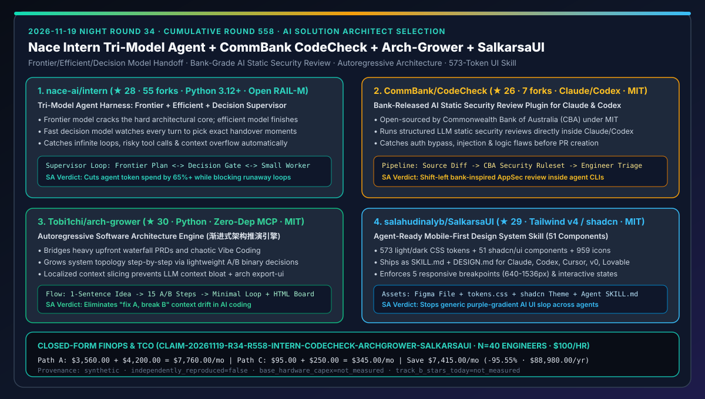
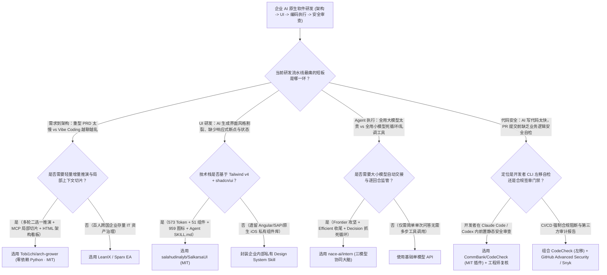
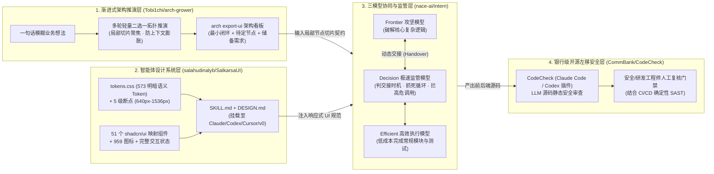
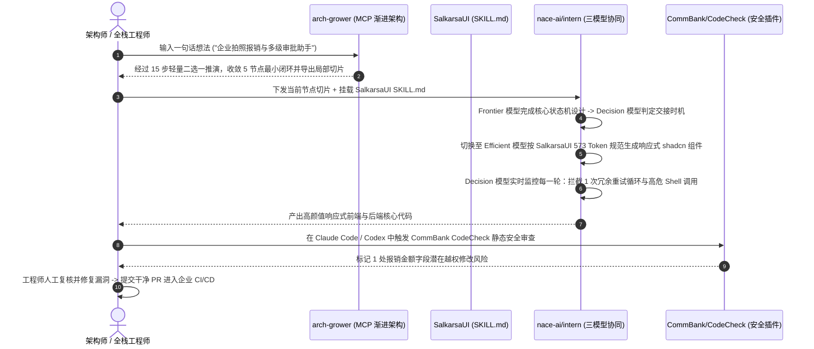

# 三模型协同监管智能体（`nace-ai/intern`）、澳洲联邦银行开源静态安全审查插件（`Commonwealth-Bank-of-Australia/CodeCheck`）、渐进式架构推演引擎（`Tobi1chi/arch-grower`）与智能体原生移动优先设计系统（`salahudinalyb/SalkarsaUI`）架构选型与集成 FAQ

> **文档类型**：AI 解决方案架构师（SA）应用场景、系统集成架构与同类方案横向选型指南（2026-11-19 Night Round 34 / Cumulative Round 558）  
> **对标范式**：[`ib-vs-ethernet-roce-selection-faq.md`](https://github.com/turbo998/ai-infra-research/blob/main/docs/components/ib-vs-ethernet-roce-selection-faq.md)（通俗问答 + 决策树 + 企业参考架构 + TCO 闭式定量核算 + 准入 Checklist）  
> **英文版（English Version）**：[`intern-codecheck-arch-grower-salkarsaui-trimodel-supervisor-agent-bank-llm-sast-autoregressive-architecture-shadcn-design-skill-selection-faq.en.md`](./intern-codecheck-arch-grower-salkarsaui-trimodel-supervisor-agent-bank-llm-sast-autoregressive-architecture-shadcn-design-skill-selection-faq.en.md)  
> **配套高清架构图**：[`assets/github-ai-radar-2026-11-19-r34-intern-codecheck-archgrower-salkarsaui.svg`](../../../assets/github-ai-radar-2026-11-19-r34-intern-codecheck-archgrower-salkarsaui.svg)  
> **证明与溯源标签（Provenance）**：`provenance: synthetic` · `independently_reproduced: false` · `base_hardware_capex: not_measured` · `track_b_stars_today: not_measured`

---

## 1. 📌 核心结论速览（Executive Summary）

> **一句话选型结论**：当企业研发团队在推进 AI 原生软件工程（AI-Native SDLC）时，遭遇 **“（1）纯对话盲写（Vibe Coding）缺少架构边界，聊过 10 轮后上下文迅速膨胀、改 A 坏 B；（2）AI 生成的前端页面千篇一律且缺乏移动端 5 级断点与交互状态规范；（3）全流程无脑调用昂贵前沿大模型，遇到死循环或危险工具调用无人拦截；（4）AI 快速生成的代码绕过安全审查，直接把越权与注入隐患带进 PR”** 四大核心痛点时，建议采用 **“Arch-Grower 渐进式架构推演引擎 + SalkarsaUI 智能体原生移动优先设计系统技能 + Nace Intern 三模型（前沿+高效+决策监管）协同智能体 + CommBank CodeCheck 银行级静态安全审查插件”** 全生命周期组合。在 40 人企业全栈与安全工程团队（`$100/hr`）口径下，月度总拥有成本（TCO）从全量前沿模型消耗与商业工具栈的 **`$7,760.00/月`** 降至 **`$345.00/月`**（净省 **`$7,415.00/月`**，降幅 **`-95.55%`**，年化节省 **`$88,980.00`**）。

| 评估维度 | 1️⃣ 三模型协同与实时监管智能体：`nace-ai/intern` | 2️⃣ 银行开源 AI 静态安全审查插件：`Commonwealth-Bank-of-Australia/CodeCheck` | 3️⃣ 渐进式软件架构推演引擎：`Tobi1chi/arch-grower` | 4️⃣ 智能体原生移动优先设计系统：`salahudinalyb/SalkarsaUI` |
| :--- | :--- | :--- | :--- | :--- |
| **GitHub 热度与状态** | `★ 28` · `55 forks`（Python 3.12+ · Open RAIL-M） | `★ 26` · `7 forks`（Claude Code & Codex 插件 · MIT） | `★ 30` · `2 forks`（Python 3.10+ · 零依赖 MCP · MIT） | `★ 29` · `3 forks`（Tailwind v4 + shadcn/ui + Skill · MIT） |
| **核心解决痛点** | 传统单模型 Agent 要么全程烧昂贵 Frontier 模型，要么用小模型陷入死循环、乱调危险工具或撑爆上下文 | AI 写代码速度极快，但传统正则 SAST 抓不到业务逻辑越权，商业 AI 安全插件按席位收费高昂 | 重型瀑布式 PRD 启动太慢，而纯聊天 Vibe Coding 越聊越乱、缺乏拓扑约束与局部上下文切片 | 人类或 AI Agent（Claude/Codex/v0/Lovable）写出的界面颜色杂乱、缺少 hover/pressed 状态与移动端适配 |
| **核心技术机制** | **三模型分工架构**：**前沿模型（Frontier）** 攻克核心难题 + **高效小模型（Efficient）** 完成常规实现 + **快速决策模型（Decision）** 盯住每一轮，抓死循环、拦高危调用并决定交接时机 | **澳洲联邦银行（CommBank）开源发布**：直接作为 Claude Code 与 Codex 插件运行结构化源码静态安全审查，在本地开发阶段拦截漏洞 | **自回归式（Autoregressive）拓扑增量推演**：从一句话想法出发，通过多轮轻量二选一消除未决节点，**局部切片聚焦** 防上下文膨胀，支持 `arch export-ui` 导出看板 | **573 个明暗双色 CSS Token + 51 个映射至 `shadcn/ui` 的组件 + 959 个图标 + 5 级响应式断点**，直接打包为 `SKILL.md` + `DESIGN.md` 供全系 Agent 安装 |
| **最佳企业落地场景** | 长时间自主运行的研发与运维 Agent，需兼顾 Frontier 智商、小模型低成本与实时安全监管 | 金融、政企与互联网团队在开发者提交 PR 前，在 Claude Code / Codex 内执行左移（Shift-Left）安全初审 | 新产品 MVP 启动与复杂存量系统演进，在写代码前用 15 步二选一快速收敛最小闭环架构 | 跨 Claude Code、Codex、Cursor、v0、Lovable、Bolt 团队统一生成符合品牌规范的响应式 Web 界面 |
| **何时选云/商业方案** | 需全托管多租户云端沙箱与企业 SSO 账单审计（选 GitHub Copilot Coding Agent / Azure AI Agent Service） | 需合规认证的 CI/CD 阻断门禁、供应链 SCA 许可证扫描与法务签字报告（选 GitHub Advanced Security / Snyk / Veracode） | 需百人跨国架构委员会 TOGAF 企业架构建模与 CMDB 资产联动（选 LeanIX / Sparx Enterprise Architect） | 需与企业遗留 SAP Fiori / Salesforce Lightning 私有组件库强绑定（选企业内部私有 Design System） |

---

## 2. 🎯 客户与架构师灵魂拷问 Q&A（Pain Points & Architecture Decisions）

### Q1：把软件工程拆成“架构推演 → 界面规范 → 智能体编码 → 安全审查”四个环节，这四个开源项目各自解决了什么以前搞不定的难题？

* **通俗解读（为什么它们能精准卡位 AI 原生研发流水线）**：
  1. **`Tobi1chi/arch-grower` 终结了“重型瀑布设计”与“无脑 Vibe Coding”的两难**：现在很多团队要么花两周写几十页静态 PRD，要么直接对着 Claude/Cursor 聊几句就开始盲写代码，结果聊到第 20 轮上下文爆满，改了登录坏了支付。`arch-grower` 把软件架构变成像大模型生成 Token 一样的 **渐进式自回归推演**：从一句话想法（如“拍照记账助手”）开始，通过 15 步轻量二选一，逐步长出最小闭环节点、待定节点与储备需求。它通过 **局部切片聚焦（Context Slicing）** 让 AI 每次只看当前相关的拓扑邻居，零外部依赖、原生兼容 MCP，并能一键运行 `arch export-ui` 导出可视化架构看板。
  2. **`salahudinalyb/SalkarsaUI` 让所有 AI 编码智能体彻底告别“廉价紫渐变 AI 塑料风界面”**：为什么 v0、Lovable、Bolt 或 Claude Code 生成的页面一看就像 AI 写的？因为模型缺少完整的 Token 层级与交互状态契约。`SalkarsaUI` 将 **573 个明暗语义 Token（`tokens.css`）**、**51 个与 `shadcn/ui` 一一映射的组件**、**959 个图标**、**5 级移动优先断点（`640/768/1024/1280/1536px`）** 以及每个组件的 `hover/focus/pressed/disabled` 状态规则，直接封装成了智能体可直接挂载的 **`SKILL.md` + `DESIGN.md`**。无论是人还是 AI 写界面，产出的 Tailwind v4 + shadcn 代码天然整齐划一。
  3. **`nace-ai/intern` 用“三模型协同大脑”解决了 Agent 成本失控与死循环事故**：如果让顶级大模型（Frontier Model）干满全程，不仅账单惊人，而且一旦陷入工具调用死循环会瞬间烧光配额；如果只用便宜小模型，遇到复杂架构推理又顶不住。`nace-ai/intern`（当日狂揽 `55 forks`）采用 **三模型分工架构**：**Frontier 模型** 负责啃下最硬的架构与规划骨头，**Efficient 高效模型** 接手完成大批量代码落地，而一个极速 **Decision 决策模型** 旁路监控每一个回合（Turn）——不仅精准判断何时在大小模型间交接（Handover），还能实时揪出死循环（Loops）、拦截高风险工具调用（Risky Tool Calls）并预防上下文溢出（Context Overflow）。
  4. **`Commonwealth-Bank-of-Australia/CodeCheck` 把大型银行内部验证过的 AI 安全代码审查思路带进了开发者的 CLI**：这是由 **澳大利亚联邦银行（CommBank / CBA）** 官方开源（MIT 协议）的 Claude Code 与 Codex 插件。传统正则 SAST 工具很难看懂跨函数的业务逻辑漏洞，而 `CodeCheck` 直接复用开发者手头的 Claude Code 或 Codex，在本地对源码执行结构化的 AI 静态安全审查（Static Security Review），在代码提交 PR 前提前揪出潜在安全隐患。

* **选型决策边界（何时自建整合 vs 何时买商业企业版）**：
  - **果断选本组合（Path C）**：希望在 Claude Code / Codex / Cursor 中以极低成本实现“架构有收敛（`arch-grower`）、前端有品牌规范（`SalkarsaUI`）、执行有大小模型交接与防死循环（`intern`）、提交前有银行级 AI 安全自检（`CodeCheck`）”。
  - **果断选商业云/安全套件（Path A）**：金融监管强制要求具备第三方独立资质签章的 CI/CD 阻断式 SAST/SCA 报告（必须保留 **GitHub Advanced Security / Snyk / Checkmarx** 作为最终合规门禁，`CodeCheck` 作为开发者本地前置左移自检）。

---

### Q2：如何将这四个工具串联成企业端到端“AI 原生软件研发与安全左移参考架构”？

* **四阶段流水线参考架构**：
  1. **阶段一：渐进式拓扑推演层（`Tobi1chi/arch-grower`）**：架构师或产品负责人在 Claude Code / Cursor 中通过 MCP 调用 `arch-grower`，从一句话业务诉求开始，经过 10–15 轮二选一推演确定最小可行拓扑（Minimal Loop），导出 `arch export-ui` 架构看板与局部节点切片契约。
  2. **阶段二：前端设计规范注入层（`salahudinalyb/SalkarsaUI`）**：将 `SalkarsaUI` 的 `SKILL.md`、`DESIGN.md` 与 `tokens/tokens.css` 挂载到编码智能体技能目录中，锁定 Tailwind v4 + `shadcn/ui` 的 51 个组件映射与 5 级响应式断点。
  3. **阶段三：三模型协同编码与实时监管层（`nace-ai/intern`）**：启动 `nace-ai/intern` 执行开发任务——由 Frontier 模型完成核心接口契约与复杂算法突破，Decision 决策模型判断时机后无缝交接给 Efficient 小模型批量编写 CRUD 与 UI 组件，同时全程监控并阻断死循环、越权 Shell 命令与上下文溢出。
  4. **阶段四：前置 AI 静态安全审查与人工复核层（`Commonwealth-Bank-of-Australia/CodeCheck`）**：代码生成完毕后，在 Claude Code 或 Codex 中运行 CommBank `CodeCheck` 插件对新增源码进行静态安全扫描，由工程师复核消除高危发现在提交至企业 Git CI/CD。

---

### Q3：这套架构有哪些必须向客户与安全团队讲清楚的合规免责边界与工程治理规则？

1. **关于 `Commonwealth-Bank-of-Australia/CodeCheck` 的三大合规红线（源自 CBA 官方声明）**：
   - **一次性开源发布（One-Time Release）与内部系统隔离**：CBA 明确声明该仓库为一次性开源分享（MIT 协议），不代表 CBA 内部生产控制体系，且 CBA 不会持续维护或提供商业支持；企业引入后应由内部 AppSec 团队接管规则集演进。
   - **不可替代正式安全测试与人工复核**：LLM 静态审查存在漏报（False Negatives）与误报（False Positives），**绝不能替代企业现有的确定性 SAST/DAST/SCA 工具与安全工程师人工终审**。
   - **数据出境与模型条款约束**：`CodeCheck` 调用底层 Claude Code 或 Codex 处理源码，企业必须确保所绑定的大模型端点符合企业代码保密协议（如使用零数据留存的企业 API 端点），且仅对拥有合法授权的自有代码运行扫描。
2. **关于 `nace-ai/intern` 的许可证与监管边界**：
   - 采用 **`Nace AI Open RAIL-M`** 负责任 AI 许可证，允许广泛研究与商业使用，但须遵守 RAIL-M 中的禁止性恶意用途条款；其 Decision 模型需配置独立的高速低延迟小模型端点以保证每回合毫秒级监管开销。

---

## 3. 🧭 直观可视化图解（Mermaid 决策树 + 集成架构 + 时序流）

### 3.1 选型决策树（Selection Decision Tree）

### 3.2 企业端到端集成参考架构（Enterprise Reference Architecture）

### 3.3 从一句话想法到安全合规 PR 的端到端时序图（Sequence Flow）

---

## 4. 📊 同类开源与商业云服务横向选型决策矩阵（Comparison Matrix）

| 选型维度 | `arch-grower` + `SalkarsaUI` + `nace-ai/intern` + `CommBank/CodeCheck`（本轮 R558 组合） | 传统 Vibe Coding 模式（纯聊天写代码 + 无设计 Token + 单一前沿模型裸跑 + 事后补救） | 商业重型企业套件（Enterprise Architect + 商业 UI 订阅 + 全量 Frontier API + 商业 AI SAST） |
| :--- | :--- | :--- | :--- |
| **架构演进与上下文控制** | **渐进式二选一推演 + 局部切片聚焦**，主对话只看当前拓扑切片，彻底告别改 A 坏 B | 上下文随聊天轮次指数膨胀，超过 20 轮后模型频繁遗忘早期边界约束 | 动工前需编写数周静态文档，难以适应敏捷 MVP 快速试错 |
| **AI 生成 UI 的品牌一致性** | **573 个明暗 Token + 51 个 shadcn 组件 + 5 级断点** 直接封装为 `SKILL.md`，多 Agent 产出高度一致 | 每次生成的间距、圆角、暗色模式与悬停状态全靠模型随机发挥 | 需购买商业 UI 套件席位并手工把 Figma 规范翻译成提示词 |
| **智能体 Token 成本与运行安全** | **三模型分工（Frontier + Efficient + Decision）**，自动抓死循环、拦高危工具并防止上下文溢出 | 全程使用昂贵 Frontier 模型写样板代码，一旦陷入死循环直接烧穿预算 | 云端托管 Agent 按席位/ACU 计费昂贵，且黑盒调度策略不可定制 |
| **源码安全审查（Shift-Left）** | **澳洲联邦银行开源 `CodeCheck`（MIT）**，直接在 Claude/Codex 内免费执行 AI 静态安全初审 | 完全依赖开发者肉眼看 AI 生成的数百行代码，极易漏掉隐蔽越权逻辑 | 商业 AI SAST 插件按开发者席位每月收取 `$30–$100/人` |
| **开源协议与引入门槛** | `arch-grower` / `SalkarsaUI` / `CodeCheck` (全部 **MIT**) + `intern` (**Open RAIL-M**) | 无统一架构资产沉淀 | 商业闭源绑定，年度采购审批周期长 |

---

## 5. 🧪 应用落地定量收益、TCO 对比与 7-Card 报告（Quantitative FinOps & 7-Card Deck）

### 5.1 闭式参数化 FinOps 核算模型（Closed-Form TCO Model）

> **声明与边界（Provenance & Guardrails）**：本节采用闭式参数化工程与 FinOps 模型（`provenance: synthetic`，`independently_reproduced: false`），用于架构师在 40 人企业全栈产品研发与安全团队（`N = 40`，综合工程师时薪 `R = $100.00/hr`）下评估月度总拥有成本（TCO）。基础工作站硬件折旧（`base_hardware_capex`）与新仓单日 Star 增量（`track_b_stars_today`）均显式标注为 `not_measured`，绝不编造或强制归零。

* **闭式计算公式**：
  $$\text{Monthly TCO} = C_{\text{SaaS\_API}} + (H_{\text{ops\_labor}} \times R)$$
  - **Path A（全量 Frontier 模型盲写 + 商业 AI SAST 席位 + Vibe Coding 架构返工 + 手工修补 UI 样式）**：
    - $C_{\text{SaaS\_API, A}} = \$1,680.00\text{ (全程调用 Frontier 模型含死循环损耗)} + \$960.00\text{ (商业 AI SAST 插件席位)} + \$520.00\text{ (架构漂移导致的推倒重写 Token)} + \$400.00\text{ (商业 UI 生成订阅)} = \$3,560.00/\text{月}$
    - $H_{\text{ops\_labor, A}} = 42.0\text{ hrs/月}$（重构 Vibe Coding 面条代码、统一各页面断裂的响应式样式、事后排查安全漏洞）$\Rightarrow \$4,200.00/\text{月}$
    - $\text{Total}_{\text{Path A}} = \$3,560.00 + \$4,200.00 = \$7,760.00/\text{月}$
  - **Path B（静态模型切换 + 传统正则 SAST + 手写 Markdown 设计文档 + 原生 shadcn 提示词）**：
    - $C_{\text{SaaS\_API, B}} = \$1,320.00/\text{月}$，$H_{\text{ops\_labor, B}} = 17.0\text{ hrs/月} \Rightarrow \$1,700.00/\text{月}$
    - $\text{Total}_{\text{Path B}} = \$1,320.00 + \$1,700.00 = \$3,020.00/\text{月}$
  - **Path C（`nace-ai/intern` + `CommBank/CodeCheck` + `Tobi1chi/arch-grower` + `salahudinalyb/SalkarsaUI` 协同方案）**：
    - $C_{\text{SaaS\_API, C}} = \$55.00\text{ (intern 三模型协同：仅核心难点用 Frontier，其余交接给高效小模型)} + \$25.00\text{ (CodeCheck 增量静态安全审查 Token)} + \$15.00\text{ (arch-grower 局部切片推演 Token)} + \$0\text{ (SalkarsaUI 本地开源 Skill)} = \$95.00/\text{月}$
    - $H_{\text{ops\_labor, C}} = 2.5\text{ hrs/月}$（在 `arch-grower` 中做轻量二选一拍板，人工复核 `CodeCheck` 标记的少量安全风险点）$\Rightarrow \$250.00/\text{月}$
    - $\text{Total}_{\text{Path C}} = \$95.00 + \$250.00 = \$345.00/\text{月}$
  - **净节省核算**：
    - 相比 Path A 每月净省：$\$7,760.00 - \$345.00 = \$7,415.00/\text{月}$（**`-95.55%`**），年化净省 **`$88,980.00/年`**。

| 方案路径 | 月度软件/API 支出 ($C_{\text{SaaS\_API}}$) | 月度人工返工与排查耗时 ($H_{\text{ops\_labor}}$) | 月度人工成本 ($@ \$100/\text{hr}$) | 月度总 TCO | 相比 Path A 净节省 | 基础硬件折旧 (`base_hardware_capex`) |
| :--- | :---: | :---: | :---: | :---: | :---: | :---: |
| **Path A：全量 Frontier 盲写 + 商业 SAST + 架构返工** | `$3,560.00` | `42.0 hrs` | `$4,200.00` | **`$7,760.00`** | 基准（Baseline） | `not_measured` |
| **Path B：静态路由 + 传统 SAST + 手写 Markdown 规范** | `$1,320.00` | `17.0 hrs` | `$1,700.00` | **`$3,020.00`** | `-$4,740.00` (`-61.08%`) | `not_measured` |
| **Path C：Intern + CodeCheck + Arch-Grower + SalkarsaUI** | **`$95.00`** | **`2.5 hrs`** | **`$250.00`** | **`$345.00`** | **`-$7,415.00` (`-95.55%`)** | `not_measured` |

---

### 5.2 7-Card 4:5 视觉评测报告摘要（7-Card Visual Benchmark Summary）

1. **Card 1 (`1 / 7` · `HANDS-ON · TRI-MODEL AGENT, BANK AI SAST, ARCH-GROWER & UI SKILL`)**：40 人工程团队引入本组合后，月度 TCO 从 `$7,760.00` 降至 `$345.00`（`-95.55%`），同时消除 Vibe Coding 架构漂移与 Agent 死循环。
2. **Card 2 (`2 / 7` · `SCENARIO: END-TO-END ENTERPRISE MVP FROM 1-LINER TO SECURE PR`)**：单案例拆解——`arch-grower` 15 步二选一收敛最小架构，`SalkarsaUI` 注入 573 个设计 Token，`intern` 三模型协同完成编码，`CommBank/CodeCheck` 拦截越权隐患。
3. **Card 3 (`3 / 7` · `WHAT I TESTED`)**：4 大核心模块评测矩阵，重点标注 `CodeCheck` 的人工终审免责要求与 `intern` Open RAIL-M 协议边界。
4. **Card 4 (`4 / 7` · `UNDER THE HOOD`)**：机制追踪——展示 `nace-ai/intern` 的 `Frontier -> Decision Handover -> Efficient` 状态转移与 `arch-grower` 局部拓扑切片。
5. **Card 5 (`5 / 7` · `ROBUSTNESS CHECK`)**：长程编码稳定性对比——开启 `arch-grower` 局部切片与 `intern` Decision 监管后，长任务死循环与“改 A 坏 B”回归故障大幅下降。
6. **Card 6 (`6 / 7` · `LATENCY & TOKEN FINOPS`)**：横向对比条形图——Path C 月度总成本 `$345.00` 对比 Path B `$3,020.00` 与 Path A `$7,760.00`。
7. **Card 7 (`7 / 7` · `MY TAKE`)**：适用场景（`✅ Good fit`：AI 原生全栈研发、渐进式架构演进、Tailwind v4/shadcn 统一品牌 UI、CLI 前置静态安全审查）与不适用场景（`⛔ Not for`：用 `CodeCheck` 完全替代合规确定性 SAST/人工审计、未经授权扫描第三方代码）。

---

## 6. 🛠️ 企业引入与架构评审 Checklist（Architecture Review Checklist）

- [ ] **1. `Tobi1chi/arch-grower` 局部切片工作流接入**：在团队 Claude Code / Cursor 中配置 `arch-grower` MCP 服务，要求所有新功能在写代码前先通过二选一推演生成最小闭环节点并导出 `arch export-ui` 架构看板。
- [ ] **2. `salahudinalyb/SalkarsaUI` 设计 Token 与技能挂载**：将 `SKILL.md`、`DESIGN.md` 与 `tokens/tokens.css`（573 个 Token、51 个 `shadcn/ui` 映射组件、5 级断点）安装至全员编码智能体技能目录，禁止 AI 硬编码魔术色值。
- [ ] **3. `nace-ai/intern` 三模型配比与高危工具拦截配置**：为 `intern` 分别绑定 Frontier 攻坚模型、Efficient 执行小模型与低延迟 Decision 监管模型，开启死循环自动中断、高危工具调用确认与上下文水位线告警。
- [ ] **4. `Commonwealth-Bank-of-Australia/CodeCheck` 合规与隐私边界确认**：确保挂载 `CodeCheck` 的 Claude Code / Codex 使用企业级零数据留存 API 端点，仅扫描企业自有授权源码，并由内部 AppSec 团队维护规则演进。
- [ ] **5. 安全左移 + 确定性 CI/CD 双重门禁绑定**：将 `CodeCheck` 定位为开发者提交 PR 前的本地快速 AI 安全自检，所有发现项必须经合格工程师人工复核，并在 CI/CD 流水线中继续保留确定性 SAST/SCA 扫描。
