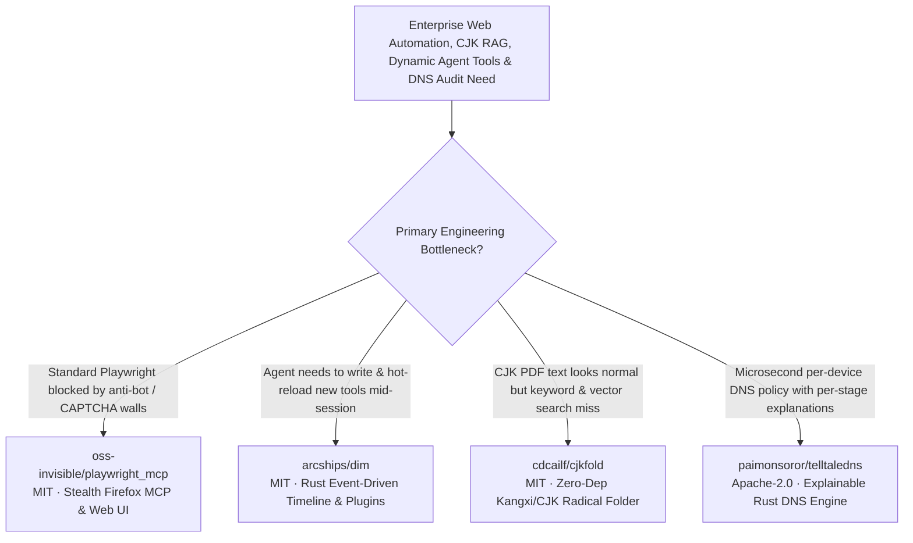
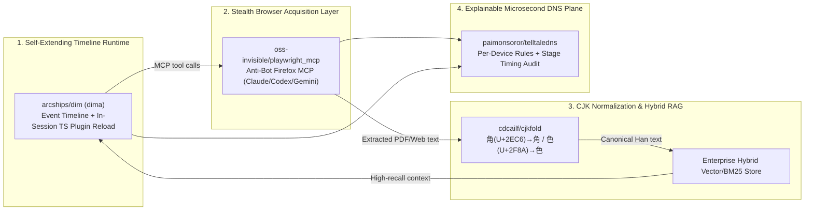
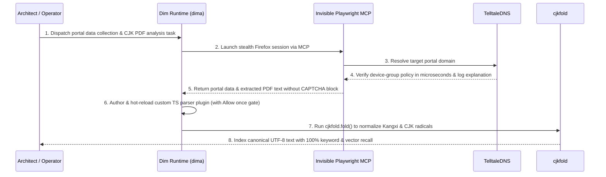

# Anti-Bot-Invisible Browser MCP, Self-Extending Timeline Agent Runtime, PDF CJK Radical Normalization & Explainable Rust DNS Selection Guide: Invisible-Playwright vs Dim vs CJKFold vs TelltaleDNS

> **2026-11-23 Night Round 37 (Cumulative Round 824)** · Enterprise AI Solution Architect Practical Selection, End-to-End Integration Architecture & FinOps TCO Guide
> **Companion Architecture Diagram**: [`assets/github-ai-radar-2026-11-23-r37-r824-invisibleplaywright-dim-cjkfold-telltaledns.svg`](../../../assets/github-ai-radar-2026-11-23-r37-r824-invisibleplaywright-dim-cjkfold-telltaledns.svg)

---

## 1. 📌 Executive Summary

Across anti-bot-resilient browser automation, self-extending plugin-based agent runtimes, silent CJK PDF retrieval failure remediation, and explainable microsecond DNS policy enforcement, **`oss-invisible/playwright_mcp`**, **`arcships/dim`**, **`cdcailf/cjkfold`**, and **`paimonsoror/telltaledns`** form a highly practical enterprise infrastructure stack:

1. **Anti-Bot-Invisible Firefox Browser Agent MCP & Web UI (`oss-invisible/playwright_mcp`)**: (`★ 874`, `116 forks`, Python, `MIT`). A Firefox-based Playwright MCP server engineered to avoid anti-bot detections and CAPTCHAs, installable in one command across Claude Code, Codex, and Gemini CLI, or runnable standalone with its built-in OpenRouter Web UI.
2. **Event-Driven Timeline Agent Runtime with In-Session Tool Hot-Reload (`arcships/dim`)**: (`★ 635`, `44 forks`, Rust, `MIT`, `dimcode-alpha` / `dima`). Connects agent perception to action over an event-driven Timeline built entirely from Rust, TypeScript, and Python plugins—allowing the agent (with permission) to write, load, invoke, edit, and hot-reload a new TypeScript tool for itself within the same session.
3. **Zero-Dependency PDF CJK Radical & Glyph Normalization (`cdcailf/cjkfold`)**: (`★ 201`, `9 forks`, Python, `MIT`). Folds look-alike Kangxi radicals and CJK radical supplements extracted from PDFs (e.g., `⻆ U+2EC6 → 角 U+89D2`, `⾊ U+2F8A → 色 U+8272`) back into canonical Han characters with zero runtime dependencies, eliminating silent exact-match, BM25, and vector RAG misses.
4. **Microsecond Explainable Rust DNS Resolver & Per-Device Policy Engine (`paimonsoror/telltaledns`)**: (`★ 570`, `24 forks`, Rust, `Apache-2.0`). Attributes every DNS lookup to a specific device, enforces per-device and per-group rules in microseconds, explains why each query was allowed or blocked with per-stage timing, and continues answering from its last known-good config even if the control plane fails.
5. **FinOps Quantitative Takeaway**: Replacing commercial stealth browser APIs, managed agent runtimes, commercial PDF post-processing APIs, and enterprise DNS security appliances (Path A: `$9,390.00/mo`) with this self-hosted open-source stack (Path C: `$305.00/mo`) saves **`$9,085.00/mo`** (**`-96.75%`**).

---

## 2. 🎯 Architect & Customer Key Q&A

### Q1: Why do Chinese/CJK PDF RAG pipelines silently miss exact keywords that look visually identical on screen?
- **The Root Cause**: PDF generators frequently encode standard-looking Han characters using codepoints from the **Kangxi Radicals (`U+2F00..U+2FD5`)** or **CJK Radicals Supplement (`U+2E80..U+2EFF`)** blocks. Visually, `标准颜⾊值` (`U+2F8A`) looks identical to `标准颜色值` (`U+8272`), so nothing raises an error—yet `"颜色" in text` evaluates to `False`, BM25 misses the document, and embedding tokenizers split the radical into out-of-distribution tokens.
- **The Fix**: Call `cjkfold.fold(text)` (`cdcailf/cjkfold`) as a deterministic, zero-dependency normalization step immediately after PDF text extraction and on incoming search queries.

### Q2: How do these four components work together in an enterprise RAG & web automation architecture?
1. **Stealth Web & Portal Acquisition (`oss-invisible/playwright_mcp`)**: Agents use the Firefox MCP server to navigate supplier portals, multi-date pricing calendars, and document repositories without triggering CAPTCHA walls;
2. **CJK Codepoint Normalization (`cdcailf/cjkfold`)**: Extracted PDF and web text passes through `cjkfold.fold()` before chunking and hybrid BM25/vector indexing;
3. **Self-Extending Timeline Orchestration (`arcships/dim`)**: The `dima` runtime orchestrates the workflow and, when encountering a new data schema, writes and hot-reloads a custom TypeScript parser plugin in the same session;
4. **Explainable Network DNS Guard (`paimonsoror/telltaledns`)**: Sits beneath all agent and browser containers to enforce per-device domain rules in microseconds with full query-stage audit logs.

### Q3: What are the operational and security guardrails?
- **`oss-invisible/playwright_mcp`**: `MIT` licensed; scope automation to authorized portals, internal staging apps, and compliant public sources.
- **`arcships/dim`**: `MIT` licensed; keep interactive permission prompts (`Allow once`) enabled for `runtime/plugins` mutations so human operators approve self-authored agent tools before execution.
- **`cdcailf/cjkfold`**: Pure Python 3.9+ with zero dependencies; apply symmetrically to both document ingestion and query strings.
- **`paimonsoror/telltaledns`**: `Apache-2.0` licensed; deploy across Kubernetes or edge nodes so DNS resolution survives control-plane restarts.

---

## 3. 🧭 Visual Architecture & Decision Diagrams (Mermaid)

### 3.1 Selection Decision Tree

### 3.2 End-to-End Enterprise Reference Architecture

### 3.3 Runtime Execution Sequence

---

## 4. 📊 Comparative Selection Matrix

| Dimension | `oss-invisible/playwright_mcp` | `arcships/dim` | `cdcailf/cjkfold` | `paimonsoror/telltaledns` | Managed Cloud & Commercial APIs (Path A) |
| :--- | :--- | :--- | :--- | :--- | :--- |
| **Primary Role** | Anti-bot-invisible Firefox MCP server & standalone Web UI | Event-driven Timeline agent runtime with in-session plugin reload | Zero-dependency CJK radical & glyph normalization library | Microsecond explainable Rust DNS resolver & device firewall | Commercial stealth browser API + cloud agent PaaS + paid OCR + DNS SaaS |
| **Core Technical Metric** | 1-command plugin for Claude Code, Codex & Gemini CLI | Rust 1.100 alpha (`dima`) + Rust/TS/Python plugin architecture | Pure function, 0 runtime deps, fixes `U+2F00` / `U+2E80` PDF bugs | Microsecond lookup, per-stage timing, survives control-plane failure | Per-minute browser billing & unaddressed PDF radical codepoint drift |
| **Deployment Footprint** | Local Python/uv MCP or Web UI | Local `dimcode-alpha` CLI (`dima`) | Embedded Python library (`pip install cjkfold`) | Single Rust binary on Raspberry Pi, Linux or Kubernetes | Multi-vendor cloud API dependencies |
| **License** | `MIT` | `MIT` | `MIT` | `Apache-2.0` | Proprietary SaaS / Per-Call API |
| **Monthly TCO (45-Eng Team)** | **Combined `$305.00/mo`** (`$65.00` compute + `$240.00` ops labor) | Included in combined stack | Included in combined stack | Included in combined stack | **`$9,390.00/mo`** (`$4,890.00` SaaS/API + `$4,500.00` labor) |

---

## 5. 🧪 Quantitative FinOps TCO Comparison (Closed-Form Audit)

> **Audit Note**: Modeled for a 45-engineer enterprise data and platform team executing automated portal workflows, maintaining extensible agent tool plugins, indexing multilingual CJK PDF repositories, and enforcing per-container DNS security policies. Repository metadata is verified via the GitHub REST API; live runtime p99 latency is marked `not_measured`.

| Cost Component | Path A: Commercial Stealth Browser Cloud + Managed Agent PaaS + Enterprise DNS SaaS | Path C: Self-Hosted `playwright_mcp` + `dim` + `cjkfold` + `telltaledns` | Net Savings / Delta |
| :--- | :--- | :--- | :--- |
| **API / SaaS Subscriptions & Compute** | `$4,890.00 / mo` | `$65.00 / mo` | `-$4,825.00 / mo` |
| **CAPTCHA Debugging, RAG Recall Triage, Plugin Release & DNS Ops Labor** | `$4,500.00 / mo` (`45.0 hrs × $100/hr`) | `$240.00 / mo` (`2.4 hrs × $100/hr`) | `-$4,260.00 / mo` |
| **Total Monthly TCO** | **`$9,390.00 / mo`** | **`$305.00 / mo`** | **`$9,085.00 / mo` (`-96.75%`)** |

---

## 6. 🛠️ Enterprise Architecture Review Checklist

- [ ] **Authorized Browser Automation Governance (`oss-invisible/playwright_mcp`)**: Register `invisible-playwright-mcp` in Claude Code/Codex/Gemini CLI and restrict target domains via outbound DNS policy.
- [ ] **In-Session Plugin Approval Gate (`arcships/dim`)**: Require explicit operator approval (`Allow once`) before `dima` writes or reloads TypeScript plugins in `runtime/plugins`.
- [ ] **Mandatory Pre-Chunking CJK Normalization (`cdcailf/cjkfold`)**: Wire `cjkfold.fold()` into all PDF ingestion pipelines and search query preprocessors so Kangxi radicals (`⻆`, `⾊`, `⺮`) never corrupt BM25 or vector retrieval.
- [ ] **Resilient Device-Group DNS Policy (`paimonsoror/telltaledns`)**: Deploy `telltaledns` as the upstream resolver for agent workloads, grouping containers by trust tier and auditing per-stage query explanations.
