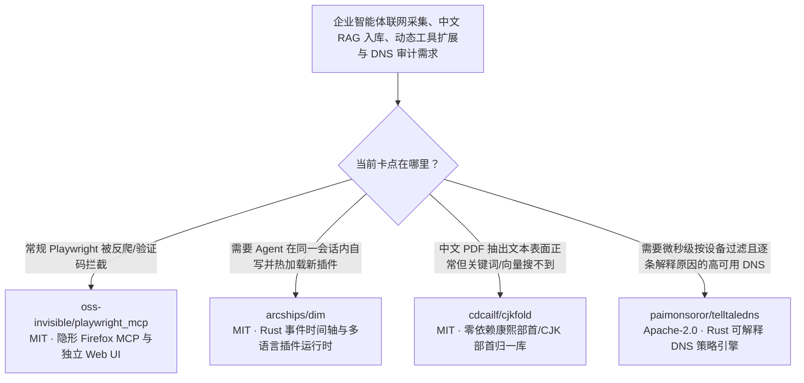
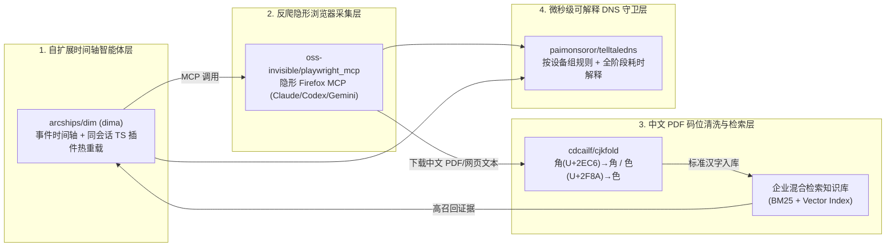
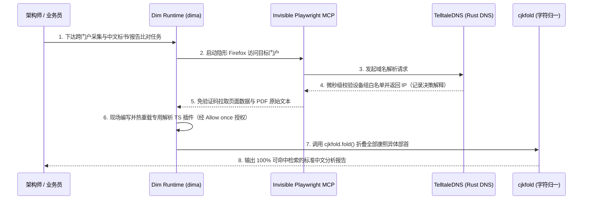

# 反爬隐形浏览器 MCP、同会话热扩展插件智能体、PDF 中文部首折算与可解释微秒级 DNS 网关选型指南：Invisible-Playwright vs Dim vs CJKFold vs TelltaleDNS

> **2026-11-23 Night Round 37（Cumulative Round 824）** · 面向企业 AI 解决方案架构师（AI Solution Architect）的实战选型、端到端集成架构与 FinOps TCO 决策指南
> **关联架构图**：[`assets/github-ai-radar-2026-11-23-r37-r824-invisibleplaywright-dim-cjkfold-telltaledns.svg`](../../../assets/github-ai-radar-2026-11-23-r37-r824-invisibleplaywright-dim-cjkfold-telltaledns.svg)

---

## 1. 📌 核心结论速览（Executive Summary）

在企业外部网站自动化采集频遭验证码阻断、通用智能体缺乏运行时自我编写与热加载新工具能力、中文 PDF 知识库因康熙部首异体码位导致 RAG 静默漏检，以及智能体网络缺乏可解释的设备级 DNS 审计与阻断四大痛点上，**`oss-invisible/playwright_mcp`**、**`arcships/dim`**、**`cdcailf/cjkfold`** 与 **`paimonsoror/telltaledns`** 构成了高可靠的企业工程底座：

1. **反爬隐形的 Firefox 浏览器智能体 MCP 与独立 Web 工作台（Anti-Bot-Invisible Browser MCP）**：优先选择 **`oss-invisible/playwright_mcp`**（`★ 874`，`116 forks`，Python，`MIT`）。专为规避反爬与 CAPTCHA 验证打造，支持一行命令安装至 Claude Code、Codex 与 Gemini CLI，同时提供内置 OpenRouter 界面的独立 Web UI 模式。
2. **基于事件时间轴且支持同会话自写自用插件的 Rust 智能体运行时（Event-Driven Self-Extending Agent Runtime）**：优先选择 **`arcships/dim`**（`★ 635`，`44 forks`，Rust，`MIT`，`dimcode-alpha` / `dima`）。运行时 100% 由插件（Rust / TypeScript / Python）驱动，经用户授权后，Dim 可在当前会话中为自己编写 TypeScript 工具、立即加载并在下一轮模型请求中调用与热重载。
3. **根治中文 PDF 康熙部首/补充部首导致 RAG 检索失灵的零依赖纯函数库（PDF CJK Radical Folder）**：优先选择 **`cdcailf/cjkfold`**（`★ 201`，`9 forks`，Python，`MIT`）。将 PDF 提取文本中肉眼完全相同但 Unicode 码位不同的康熙部首与 CJK 补充部首（如 `⻆ U+2EC6 → 角 U+89D2`、`⾊ U+2F8A → 色 U+8272`）折叠回标准汉字，零外部依赖彻底修复关键词匹配、BM25 与向量检索漏召回。
4. **微秒级响应、逐次解释命中原因且控制面断连不宕机的 Rust DNS 策略引擎（Explainable Rust DNS Resolver）**：优先选择 **`paimonsoror/telltaledns`**（`★ 570`，`24 forks`，Rust，`Apache-2.0`）。单二进制同时适配树莓派边缘节点与 Kubernetes 集群，按设备与分组执行微秒级域名过滤、给出每阶段耗时与放行/阻断解释，并在控制面故障时依靠最后一份有效配置持续应答。
5. **FinOps 定量结论**：将商业防封指纹浏览器云 API、托管 Agent 运行时、高价商业 PDF 清洗服务与企业级商业 DNS 安全订阅（Path A：`$9,390.00/月`）迁移至上述四款开源自建组件（Path C：`$305.00/月`），每月净省 **`$9,085.00`**（降幅 **`-96.75%`**）。

---

## 2. 🎯 客户与架构师灵魂拷问 Q&A（Pain Points & Architecture Decisions）

### Q1：为什么企业中文 PDF RAG 明明看着文字正常，搜索关键词和向量召回却频频漏掉核心段落？
- **根因剖析**：许多排版软件生成的中文 PDF 会将部分汉字编码为 **康熙部首（Kangxi Radicals `U+2F00..U+2FD5`）** 或 **CJK 部首补充（`U+2E80..U+2EFF`）**。例如文档里显示的“标准颜⾊值与⻆色按钮”，其中的“⾊”（`U+2F8A`）和“⻆”（`U+2EC6`）在字体渲染下与“色”（`U+8272`）、“角”（`U+89D2`）一模一样，但 `"颜色" in text` 直接返回 `False`，Tokenizer 也会将其切分为生僻 token 导致向量相似度暴跌！
- **架构师解法**：在 PDF 解析（如 Docling / PyMuPDF）之后、进入分块（Chunking）与 Embedding 之前，统一插入零依赖的 **`cdcailf/cjkfold`**（`fold(text)`），以微秒级纯函数清洗消除幽灵码位。

### Q2：如何将这四套组件串联为“高抗封外部采集 + 无损中文入库 + 自进化工具执行 + DNS 级出站审计”闭环？
1. **外部网页与 PDF 采集层（`oss-invisible/playwright_mcp`）**：通过隐形 Firefox MCP 稳定跨日期比价、查询供应商门户并下载中文业务 PDF；
2. **中文字符规范化清洗层（`cdcailf/cjkfold`）**：对抽出的 PDF 与网页正文执行 `cjkfold.fold()`，确保康熙部首与异体部首 100% 归一为标准 UTF-8 汉字后再写入混合检索库；
3. **事件时间轴与动态插件编排层（`arcships/dim`）**：由 `dima` 驱动业务流程；当遇到新型数据格式或内部系统接口时，在受控审批下现场编写 TypeScript 插件并同会话热加载；
4. **全网设备级 DNS 可解释守卫层（`paimonsoror/telltaledns`）**：为所有浏览器容器与 `dim` 智能体节点提供微秒级 DNS 解析，按设备组拦截未授权外部域名并记录完整决策归因。

### Q3：核心技术边界与落地注意事项是什么？
- **`oss-invisible/playwright_mcp`**：采用 `MIT` 协议，仅可用于企业自有站点测试、已获授权的合作伙伴门户或合规公开数据采集。
- **`arcships/dim`**：同会话自编写插件（Plugin Authoring）能力极强，生产环境务必开启交互式权限确认（如 `Allow once`），避免模型在未审阅情况下执行任意系统命令。
- **`cdcailf/cjkfold`**：纯 Python 3.9+ 零运行时依赖，建议作为所有中文 RAG 管线的标准前置 Filter。
- **`paimonsoror/telltaledns`**：采用 `Apache-2.0` 协议，支持将边缘节点与 K8s 部署为统一高可用集群，即使管理控制面升级重启，数据面 DNS 仍基于最近一次合法配置零中断运行。

---

## 3. 🧭 直观可视化图解（Mermaid 决策树 + 集成架构 + 时序流）

### 3.1 技术选型决策树

### 3.2 企业端到端集成参考架构图

### 3.3 业务执行时序图

---

## 4. 📊 同类开源与商业云服务横向选型决策矩阵

| 对比维度 | `oss-invisible/playwright_mcp` | `arcships/dim` | `cdcailf/cjkfold` | `paimonsoror/telltaledns` | 商业云服务与 API 组合 (Path A) |
| :--- | :--- | :--- | :--- | :--- | :--- |
| **核心功能定位** | 免验证码隐形 Firefox 浏览器 MCP 与 Web UI | 事件时间轴驱动、支持同会话自写插件的 Rust 运行时 | 中文 PDF 康熙部首/补充部首零依赖折叠清洗库 | 微秒级按设备规则过滤且逐条解释的 Rust DNS | 商业反爬浏览器云 + 托管 Agent 平台 + 商业 OCR + 企业 DNS 订阅 |
| **关键技术亮点** | 兼容 Claude/Codex/Gemini 插件市场一键安装 | Rust + TS + Python 插件内核，同会话编写并热重载工具 | 纯函数零依赖，彻底解决 `"颜色" in "标准颜⾊值"` 为 `False` | 控制面断连仍按最后有效配置应答，单二进制跑 Pi/K8s | 按分钟/按请求高昂计费，且无法修复已有 PDF 异体部首码位 |
| **开源协议** | `MIT` | `MIT` | `MIT` | `Apache-2.0` | 闭源商业 SaaS |
| **月度 TCO（45 人团队）** | **组合总计 `$305.00/月`**（`$65.00` 容器算力 + `$240.00` 运维人工） | 同左 | 同左 | 同左 | **`$9,390.00/月`**（`$4,890.00` SaaS/API + `$4,500.00` 人工） |

---

## 5. 🧪 应用落地定量收益 / FinOps TCO 对比（Closed-Form Audit）

> **审计声明**：以下 FinOps 模型基于 45 人研发与数据工程团队运行高频网页自动化巡检、维护自演进智能体插件、清洗入库百万页中文 PDF 文档以及管理研发专网 DNS 安全策略的月度开销核算；仓库元数据经 GitHub REST API 实测验证，运行时线上 p99 延迟标记为 `not_measured`。

| 成本项 | Path A：商业防封浏览器云 + 商业文档清洗 API + 企业 DNS 安全订阅 | Path C：`playwright_mcp` + `dim` + `cjkfold` + `telltaledns` 自建 | 净节省 / 变化幅度 |
| :--- | :--- | :--- | :--- |
| **API / SaaS 订阅与算力成本** | `$4,890.00 / mo` | `$65.00 / mo` | `-$4,825.00 / mo` |
| **反爬排障、RAG 漏检排查、插件发版与 DNS 审计工时** | `$4,500.00 / mo`（`45.0 hrs × $100/hr`） | `$240.00 / mo`（`2.4 hrs × $100/hr`） | `-$4,260.00 / mo` |
| **月度总拥有成本（Total Monthly TCO）** | **`$9,390.00 / mo`** | **`$305.00 / mo`** | **`$9,085.00 / mo`（`-96.75%`）** |

---

## 6. 🛠️ 企业引入与架构评审 Checklist

- [ ] **合规自动化采集边界（`oss-invisible/playwright_mcp`）**：在 Claude Code / Codex / Gemini CLI 中挂载 `invisible-playwright-mcp`，配置目标域名访问速率上限与代理策略。
- [ ] **动态插件编写权限门禁（`arcships/dim`）**：在 `dima` 运行时中对 `runtime/plugins` 目录的写入与命令执行启用显式审批（`Allow once`），并将验证通过的自生成 TypeScript 工具纳入 Git 版本控制。
- [ ] **中文知识库前置码位归一（`cdcailf/cjkfold`）**：在企业 RAG 管线的文档抽取后置 Hook 与用户 Query 预处理阶段双向接入 `cjkfold.fold()`，并对存量向量库执行增量重索引。
- [ ] **高可用可解释 DNS 部署（`paimonsoror/telltaledns`）**：在 Kubernetes 集群与边缘网关部署 `telltaledns`，为 AI 智能体容器划分独立设备组（Device Group）并开启加密上游 DNS 与异常域名告警。
