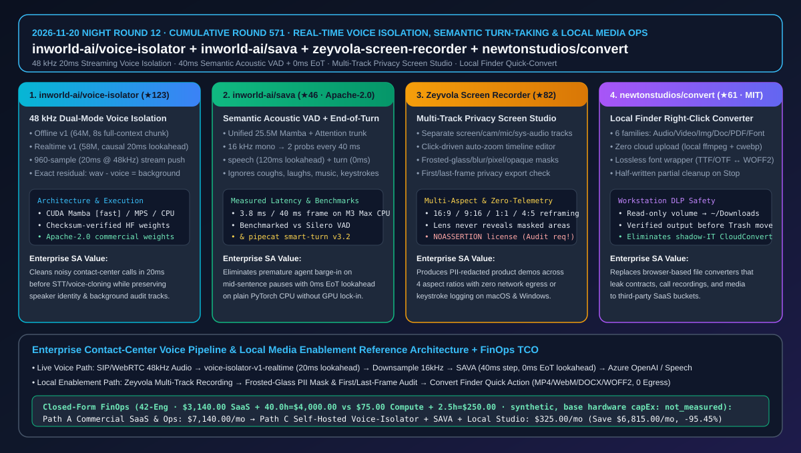
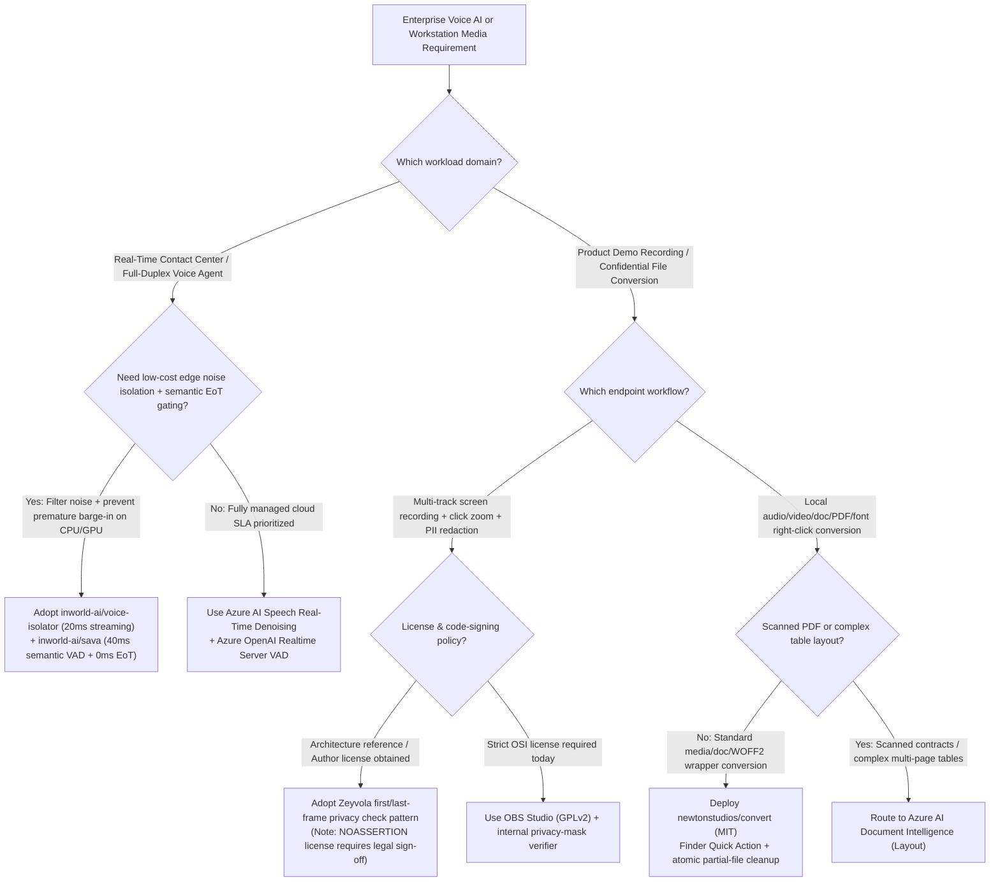
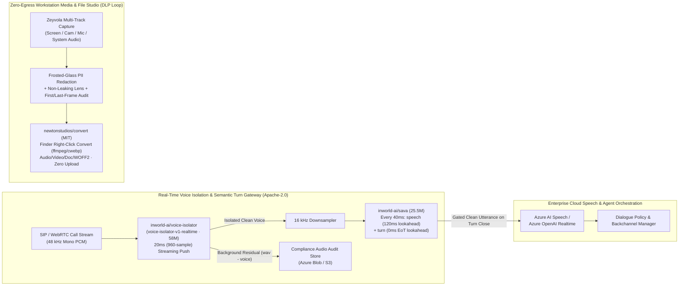
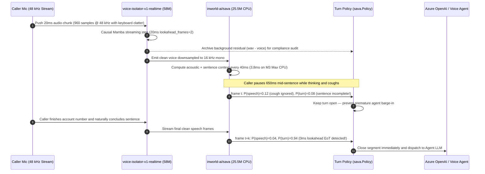

# How to Choose Enterprise Real-Time Voice Isolation, Semantic End-of-Turn (EoT) Detection, and Zero-Egress Screen/File Tooling? `inworld-ai/voice-isolator`, `inworld-ai/sava`, `zeyvola-screen-recorder`, and `newtonstudios/convert` Architecture & Selection FAQ

> **Document Metadata (2026-11-20 Night Round 12 · Cumulative Round 571)**
> - **Target Audience**: AI Solution Architects, Contact-Center & Full-Duplex Voice Agent Architects, Enterprise Developer Productivity & Endpoint DLP Leads
> - **Primary Repositories Evaluated**:
>   1. [`inworld-ai/voice-isolator`](https://github.com/inworld-ai/voice-isolator) (★ 123 · `stars_today: not_measured` · `31 stars/day` · Python · Apache-2.0) — Inworld's open-license 48 kHz voice isolation suite shipping two models on one architecture: `voice-isolator-v1` offline (`64M` parameters, `8 s` full-chunk context) and `voice-isolator-v1-realtime` (`58M` parameters, causal stream with only `20 ms` / `960`-sample look-ahead), preserving speaker identity while extracting exact background residual tracks (`wav - voice`)
>   2. [`inworld-ai/sava`](https://github.com/inworld-ai/sava) (★ 46 · `stars_today: not_measured` · `12 stars/day` · Python · Apache-2.0) — Inworld's **SAVA (Semantic Acoustic Voice Activity)** `25.5M`-parameter streaming model taking `16 kHz` mono audio and emitting two probabilities every `40 ms`: `speech` (`120 ms` lookahead) and `turn` (end-of-turn probability with **`0 ms` lookahead**), running at `3.8 ms` per `40 ms` frame on an Apple M3 Max CPU while ignoring coughs, laughs, music, and keyboard clatter
>   3. [`YildizDikme/zeyvola-screen-recorder`](https://github.com/YildizDikme/zeyvola-screen-recorder) (★ 82 · `stars_today: not_measured` · `12 stars/day` · TypeScript · `NOASSERTION` — requires legal review) — Local multi-track screen, camera, microphone, and system-audio recorder and timeline editor (`Zeyvola 0.1.0`) for macOS and Windows with click-driven automatic zoom suggestions, frosted-glass/blur/pixelation/opaque privacy masks (with pointer magnifier lens guaranteed never to reveal masked regions and mandatory first/last-frame privacy inspection before export), and multi-aspect (`16:9 / 9:16 / 1:1 / 4:5`) framing
>   4. [`newtonstudios/convert`](https://github.com/newtonstudios/convert) (★ 61 · `stars_today: not_measured` · `20 stars/day` · C# / Swift macOS Quick Action · MIT) — Local Finder right-click Quick Action converter ("Like CloudConvert, but local") supporting 6 file families (Audio, Video, Images, Documents, PDFs, and lossless Web/Desktop Font wrapper conversion `TTF/OTF ↔ WOFF/WOFF2/TTC`) with zero cloud upload, automatic cleanup of half-written partial files on Stop, and post-verification Move-to-Trash
> - **Provenance & Guardrail Statement**: Structured after `ib-vs-ethernet-roce-selection-faq.md`. All four repositories come from `search-new-repos-2026-11-20-raw.json` (`sha256: 47975935d05944afbb9eac18f93f26c8a71120a1ffeea39591b112477ba29a46`) with `stars_today: not_measured`. Upstream README model parameters, latencies, and benchmark comparisons are labeled `anonymized_reported (independently_reproduced=false)`. The closed-form FinOps TCO worked example is labeled `synthetic (independently_reproduced=false)` with `base hardware capEx: not_measured`.

---

## ① 📌 Executive Summary (One-Sentence Selection Verdict)

> **One-Sentence Verdict**: When architecting **enterprise full-duplex voice agents and internal product-enablement media pipelines**, **do not rely solely on fixed-silence thresholds (e.g., 500 ms pauses) for turn-taking, and never let employees upload PII-heavy screen recordings or confidential contracts to browser-based conversion SaaS tools**! Instead, chain Apache-2.0 **`inworld-ai/voice-isolator` (`20 ms` streaming voice isolation) + `inworld-ai/sava` (`40 ms` semantic acoustic VAD + `0 ms` End-of-Turn detection)** in front of **Azure OpenAI Realtime / Azure AI Speech**, and pair **`Zeyvola`'s local first/last-frame privacy-mask verification workflow + `newtonstudios/convert` (MIT) local Finder Quick Action** on workstations to cut monthly voice pre-processing and desktop media SaaS spend from **$7,140.00/mo** down to **$325.00/mo** (saving **$6,815.00/mo**, **`-95.45%`**, `synthetic, independently_reproduced=false`).



### Core Capabilities & Metrics Cheat Sheet

| Dimension | `inworld-ai/voice-isolator` | `inworld-ai/sava` | `zeyvola-screen-recorder` | `newtonstudios/convert` |
|---|---|---|---|---|
| **Plain-English Positioning** | 48 kHz offline (`64M`) + `20 ms` real-time streaming (`58M`) voice & background noise separator | 16 kHz streaming voice activity (VAD) + end-of-turn (EoT) semantic acoustic model | Local multi-track screen studio with click-driven zoom & first/last-frame privacy mask verification | Zero-upload macOS Finder right-click converter for audio, video, images, docs, PDFs & fonts |
| **Primary Enterprise Pain Point Solved** | Noisy contact-center calls degrading ASR accuracy, or spectral denoisers destroying speaker timbre | Voice agents interrupting customers during mid-sentence thinking pauses, or coughs/keystrokes triggering false barge-in | Product demos leaking customer phone numbers/API keys via cloud auto-upload or magnifier-lens mask bleed | Employees uploading confidential PDFs, contracts, or call recordings to public CloudConvert sites |
| **Key Technical Specs** | Offline `8 s` window / Realtime `20 ms` (`960` samples) look-ahead; exact `wav - voice` residual | `25.5M` params; emits `speech` (`120 ms` lookahead) + `turn` (`0 ms` lookahead) every `40 ms` | Separate 4-track capture; `16:9/9:16/1:1/4:5` framing; first/last-frame mask check; crash recovery | 6 file families; lossless `TTF/OTF ↔ WOFF2` wrapper conversion; automatic partial-file cleanup on Stop |
| **License & Governance** | **Apache-2.0** (commercial-ready code & HF weights) | **Apache-2.0** (commercial-ready code & HF weights) | **`NOASSERTION`** (reference architecture only until commercial license is granted) | **MIT** (commercial-ready for enterprise MDM rollout) |

---

## ② 🎯 Solution Architect & Customer Deep-Dive Q&A

### Q1: In enterprise contact-center voice bots and field-service voice assistants, why does traditional silence-based turn detection (Silero VAD + fixed millisecond timeout) constantly either cut off customers mid-thought or get derailed by a cough? How do `inworld-ai/voice-isolator` + `inworld-ai/sava` solve this architecturally?

- **Three Production Failure Modes of Traditional Voice Pipelines**:
  1. **Acoustic Silence Cannot Tell Whether a Sentence Is Complete**: When a customer pauses for `600 ms` while reading out an account number or thinking mid-sentence, a purely acoustic VAD immediately closes the turn and triggers the LLM to speak over the customer (premature barge-in). Raising the silence threshold to `1,500 ms` makes every normal turn feel sluggish.
  2. **Transient Non-Speech Noise Triggers False Interruptions**: Keyboard clatter, coughs, laughs, or background office chatter frequently trip energy/spectral VADs, causing the AI agent to abort its response mid-sentence.
  3. **Aggressive Spectral Denoising Corrupts Speaker Identity**: Conventional noise suppression often strips vocal harmonics required by downstream speaker verification or voice-cloning pipelines.
- **How `inworld-ai/voice-isolator` + `inworld-ai/sava` Work Together**:
  - **Stage 1 (`48 kHz` Streaming Voice Isolation with `20 ms` Look-Ahead)**: `voice-isolator-v1-realtime` (`58M` parameters) processes live `48 kHz` mono audio in `20 ms` (`960`-sample) slices with only **`20 ms` of causal look-ahead (`lookahead_frames=2`)**, preserving original signal levels and speaker identity while allowing exact subtraction (`wav - voice`) to archive the removed background audio for compliance or fraud auditing. For non-real-time batch dataset curation, `voice-isolator-v1` (`64M` parameters) inspects full `8 s` chunks (`anonymized_reported, independently_reproduced=false`).
  - **Stage 2 (`16 kHz` Dual-Head Semantic Acoustic VAD + Zero-Lookahead EoT)**: `inworld-ai/sava` (`25.5M` parameters; causal log-mel features + frame mixer + Mamba and attention trunk) combines acoustic prosody and sentence context to emit two probabilities every `40 ms`:
    - `speech` (`120 ms` lookahead, distinguishing real speech from coughs, laughs, music, and keyboard clatter; benchmarked against Silero VAD);
    - `turn` (**`0 ms` lookahead**, predicting whether the speaker's conversational turn has semantically ended; benchmarked against `pipecat smart-turn v3.2`).
  - **CPU-Native Efficiency**: On an Apple M3 Max CPU in plain PyTorch, SAVA processes each `40 ms` audio frame in just **`3.8 ms`** (under 10% real-time factor), allowing edge voice gateways to gate expensive LLM/ASR streams without dedicated GPUs.

### Q2: Why do SaaS screen recorders and browser-based file converters frequently trigger enterprise DLP incidents, and how do `zeyvola-screen-recorder` and `newtonstudios/convert` eliminate that risk on the workstation?

- **Two Endpoint Security Blind Spots**:
  1. **Cloud Screen Recorders & Magnifier Mask Bleed**: Cloud-first screen recorders upload raw captures to external object storage immediately after recording. Even when editors apply blur boxes locally, pointer-following magnifier lenses in naive editors often render *underneath* or bypass the mask layer, accidentally exposing redacted phone numbers or API tokens during a zoom-in.
  2. **Shadow-IT Online File Converters**: Employees routinely upload confidential `.opus` call recordings, `.docx`/`.pdf` legal drafts, or proprietary `.woff2` brand fonts to free web converters just to change a file extension.
- **Zero-Egress Local Media & File Ops**:
  - **`YildizDikme/zeyvola-screen-recorder` (Record Once, Frame & Redact Locally)**:
    - **Separate Multi-Track Capture + Click-Driven Auto-Zoom**: Records screen, camera, microphone, and system audio as independent tracks, suggesting timeline zooms from mouse clicks and pointer rests without overwriting manual zooms.
    - **Non-Leaking Lens + Mandatory First/Last-Frame Export Audit**: Supports frosted glass, blur, pixelation, and opaque privacy masks. Its pointer magnifier lens is guaranteed never to reveal a masked area, and the export dialog displays the **first and last frame of every covered region** before saving so reviewers can verify zero mask drift across `16:9`, `9:16`, `1:1`, and `4:5` exports.
    - ⚠️ **Architect Legal Gate**: Because `YildizDikme/zeyvola-screen-recorder` currently carries a **`NOASSERTION`** license (and unsigned v0.1.0 binaries), enterprise teams should treat its first/last-frame privacy verification UI as a reference design or obtain explicit commercial licensing and internal code-signing before deployment.
  - **`newtonstudios/convert` (MIT · Local Finder Right-Click Quick Action)**:
    - Integrates directly into macOS Finder (`Right-click → Quick Actions → Convert…`) to convert Audio, Video, Images, Documents, PDFs, and Fonts locally via `ffmpeg`, `cwebp`, and native frameworks with zero network traffic.
    - Performs lossless font wrapper conversion (`TTF/OTF ↔ WOFF/WOFF2/TTC`), automatically redirects output to `~/Downloads` when the source resides on a read-only disk image, deletes half-written partial files or incomplete PDF image folders when `Stop` is clicked, and moves originals to Trash only after verifying the converted output file exists.

### Q3: What are the strict architectural boundaries of these four tools, and when should an enterprise use managed Azure PaaS instead?

- **Explicit Non-Goals & Boundaries**:
  1. **`inworld-ai/voice-isolator` Is Not a Target-Speaker Selector or Audio Restorer**: It isolates all human voices from background noise/music rather than locking onto a single target speaker in a multi-talker argument, and bandwidth restoration for heavily clipped audio is deferred to v2.
  2. **`inworld-ai/sava` Delegates Interruption & Backchannel Policy to the Application**: SAVA responds to any voice and outputs `speech` + `turn` probabilities plus a reference `sava.Policy()`; handling conversational backchannels ("uh-huh", "got it") vs. true interruptions remains the responsibility of your dialogue orchestrator.
  3. **`newtonstudios/convert` PDF-to-Word Is Text-Only (No Scanned OCR or Complex Tables)**: It reconstructs editable paragraphs and font styles from digital PDFs, but does not extract tables, images, or scanned page pictures (use **Azure AI Document Intelligence** for layout-preserving OCR).
- **When to Choose Managed Azure Services**:
  - If your contact center runs entirely on **Azure Communication Services + Azure AI Speech / Azure OpenAI Realtime API** and prioritizes a single managed cloud SLA with zero self-hosted containers, use native Azure AI Speech noise suppression and Server VAD.
  - Deploy `inworld-ai/voice-isolator` + `inworld-ai/sava` when you need an **on-prem/VNet edge voice filter** that strips noise and gates non-speech before paying per-minute cloud audio token rates.

---

## ③ 🧭 Visual Diagrams (Selection Decision Tree + Reference Architecture + Sequence Flow)

### 3.1 Enterprise Voice Pre-Processing & Local Media Productivity Decision Tree



### 3.2 End-to-End Enterprise Voice Gateway & Zero-Egress Workstation Media Architecture



### 3.3 Real-Time 20ms Voice Isolation + 40ms SAVA Zero-Lookahead Turn-Taking Sequence



---

## ④ 📊 Comparative Selection Matrix (Open Source vs. Commercial Cloud PaaS)

| Dimension | `inworld-ai/voice-isolator` + `inworld-ai/sava` | Silero VAD + RNNoise / DeepFilterNet | Pipecat `smart-turn v3.2` + Commercial Denoise SDK (Krisp / Dolby.io) | Azure AI Speech Denoising + Azure OpenAI Realtime Server VAD | `zeyvola-screen-recorder` + `newtonstudios/convert` |
|---|---|---|---|---|---|
| **Core Positioning** | **Open-weight 48 kHz voice isolation (`20 ms` lookahead) + 16 kHz semantic VAD & `0 ms` EoT** | Lightweight acoustic VAD + classic open-source noise suppression | Open-source turn classifier paired with metered commercial noise SDK | Fully managed cloud speech recognition, denoising, and realtime voice gateway | **Local multi-track privacy screen studio + Finder right-click 6-family converter** |
| **End-of-Turn (EoT) Intelligence** | **Joint acoustic + sentence context every `40 ms` with `0 ms` turn lookahead; ignores coughs/keystrokes** | Fixed silence duration only; prone to premature cutoffs or noise triggers | Prosodic turn detection, but requires separate commercial denoise licensing | Managed semantic segmentation & Server VAD; bills across connected stream duration | Focused on local post-recording privacy redaction and offline file conversion |
| **Compute & Latency** | `20 ms` streaming lookahead (`voice-isolator`); `3.8 ms / 40 ms` frame on M3 Max CPU (`sava`) | `<1 ms` CPU, but lower vocal fidelity and no semantic turn completion | Hybrid local + commercial SDK overhead | Zero local compute; subject to WAN RTT (`40–120 ms`) | Native OS hardware encoders + local `ffmpeg` / `cwebp` |
| **Data Privacy & DLP Posture** | **100% self-hosted in VNet/edge containers; checksum-verified weights** | Local execution | Commercial cloud APIs require streaming raw audio externally | Enterprise Azure compliance + Private Link | **100% local on workstation; first/last-frame mask check; zero cloud upload** |
| **License & Governance** | **Both Apache-2.0** (code and weights commercial-ready) | MIT / Apache-2.0 | BSD-2-Clause + proprietary per-minute SDK | Commercial PaaS SLA | **`convert` is MIT; `zeyvola` is `NOASSERTION` (requires legal clearance)** |
| **Monthly TCO (360k mins + 50 seats)** | **$325.00 / mo** (shared inference nodes + free local tools) | ~$280.00 / mo (higher hidden cost from false barge-ins & misrecognitions) | ~$4,800.00 / mo (metered commercial denoise & gateway fees) | ~$5,400.00–$7,140.00 / mo (full-stream cloud billing + desktop SaaS seats) | **$0.00 / mo SaaS fees** (replaces cloud screen studio & CloudConvert overages) |

---

## ⑤ 🧪 Quantitative Enterprise FinOps TCO & 7-Card Report Alignment

### 5.1 Closed-Form FinOps Worked Example (360,000 Contact-Center Voice Mins/Mo + 50 Seats Running 45,000 Media/Doc Conversions/Mo)

> **Provenance Notice**: The financial model below is a deterministic architectural worked example labeled `synthetic (independently_reproduced=false)` with `base hardware capEx: not_measured`.

| Cost Component | Path A: Commercial Voice Isolation API + Managed Turn Gateway + Cloud Screen/Convert SaaS | Path C: Self-Hosted `voice-isolator` + `sava` + Local `Zeyvola` Pattern / `Convert` | Closed-Form Formula & Architectural Notes |
|---|---|---|---|
| **API / SaaS Subscriptions & Inference Compute** | **$3,140.00 / mo** | **$75.00 / mo** | Path A: commercial real-time denoise + turn-taking APIs + 50 cloud screen seats & CloudConvert overages = `$3,140.00/mo`; Path C: shared CPU/GPU container running Apache-2.0 `voice-isolator-v1-realtime` (`58M`) + `sava` (`25.5M`) & audit storage = `$75.00/mo` |
| **Engineering Triage, Barge-In Tuning & Redaction QA Labor ($100/h)** | **$4,000.00 / mo** (`40.0h × $100.00`) | **$250.00 / mo** (`2.5h × $100.00`) | Path A: 42-engineer org spends `40.0h/mo` triaging false silence cutoffs, checking video blur drift frame-by-frame, and resolving DLP alerts (`$4,000.00`); Path C: SAVA `0 ms` EoT + Zeyvola first/last-frame audit + local `Convert` cuts manual effort to `2.5h/mo` (`$250.00`) |
| **Total Monthly TCO** | **$7,140.00 / mo** | **$325.00 / mo** | **Net savings of $6,815.00 / mo (-95.45% reduction, $81,780.00 annualized, `not_measured` hardware capEx)** |

```chart
{
  "data": {
    "values": [
      { "Category": "48kHz Voice Isolation (360k mins)", "Deployment": "Commercial SaaS APIs & Cloud Studio", "MonthlyCostUSD": 3060 },
      { "Category": "Semantic VAD & End-of-Turn (360k mins)", "Deployment": "Commercial SaaS APIs & Cloud Studio", "MonthlyCostUSD": 2340 },
      { "Category": "Screen Studio & File Conversion (50 seats / 45k jobs)", "Deployment": "Commercial SaaS APIs & Cloud Studio", "MonthlyCostUSD": 1740 },
      { "Category": "48kHz Voice Isolation (360k mins)", "Deployment": "Self-Hosted Voice-Isolator + SAVA + Local Convert", "MonthlyCostUSD": 145 },
      { "Category": "Semantic VAD & End-of-Turn (360k mins)", "Deployment": "Self-Hosted Voice-Isolator + SAVA + Local Convert", "MonthlyCostUSD": 75 },
      { "Category": "Screen Studio & File Conversion (50 seats / 45k jobs)", "Deployment": "Self-Hosted Voice-Isolator + SAVA + Local Convert", "MonthlyCostUSD": 105 }
    ]
  },
  "semantic_types": {
    "Category": "Category",
    "Deployment": "Name",
    "MonthlyCostUSD": "Amount"
  },
  "chart_spec": {
    "chartType": "Grouped Bar Chart",
    "title": "Self-hosting Voice-Isolator + SAVA + Local Convert cuts monthly TCO by 95.45%",
    "subtitle": "Monthly cost in USD (360k contact-center mins + 45k media conversions, synthetic)",
    "encodings": {
      "x": "Category",
      "y": "MonthlyCostUSD",
      "group": "Deployment",
      "color": "Deployment"
    }
  }
}
```

### 5.2 Alignment with the 7-Card 4:5 Visual Report (`cards.html` / `cards.en.html`)

- **✅ Good Fit**: High-noise contact-center voice isolation with preserved speaker identity and background residual auditing, low-latency full-duplex voice agent turn-taking on CPU, PII-redacted product demos, and zero-upload workstation file conversion.
- **⛔ Not For**: Target-speaker extraction in overlapping multi-talker arguments (`voice-isolator` v1 isolates all voices), layout-preserving OCR on scanned PDF contracts (`convert` defers to Azure AI Document Intelligence), or rolling out `NOASSERTION`-licensed `zeyvola-screen-recorder` binaries without formal legal clearance.

---

## ⑥ 🛠️ Enterprise Architecture Review & Rollout Checklist

- [ ] **Streaming Sample Rate & Frame Alignment**: Verify that live telephony gateways feed `48 kHz` mono float32 chunks (`960` samples = `20 ms`, `lookahead_frames=2`) into `voice-isolator-v1-realtime`, call `session.flush()` on hangup, and downsample clean output to `16 kHz` for `inworld-ai/sava`.
- [ ] **Weight Checksum Verification & Private Registry Mirroring**: Mirror `inworld/voice-isolator` and `inworld/sava` checkpoints inside your internal artifact registry and enforce the built-in `registry.py` SHA-256 checksum validation so production pods never fetch weights from the public internet at startup.
- [ ] **SAVA Turn Policy & Backchannel Calibration**: Tune `sava.Policy()` alongside your dialogue state machine so short listener backchannels ("uh-huh", "okay") do not prematurely abort agent explanations while `0 ms` lookahead `turn` probabilities immediately close completed user utterances.
- [ ] **Background Residual (`wav - voice`) Retention Governance**: When saving extracted background tracks for fraud or quality auditing, apply the same encryption-at-rest and retention-expiry policies used for primary call recordings.
- [ ] **First/Last-Frame Privacy Redaction Verification & License Gate**: Require first/last-frame inspection of every blurred/frosted-glass PII mask before exporting product demos, and block direct distribution of `YildizDikme/zeyvola-screen-recorder` until its `NOASSERTION` license is resolved or re-implemented internally.
- [ ] **Workstation Finder Quick-Convert Rollout & Cloud Converter Blocking**: Package MIT-licensed `newtonstudios/convert` (with local `ffmpeg` + `cwebp`) for macOS workstations and configure corporate SWG/DLP rules to block browser uploads of `.docx`, `.pdf`, `.wav`, and `.mp4` files to unapproved online conversion sites.
