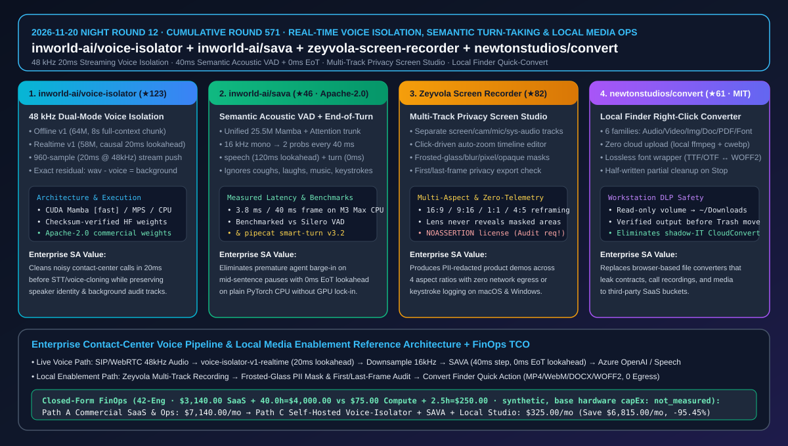
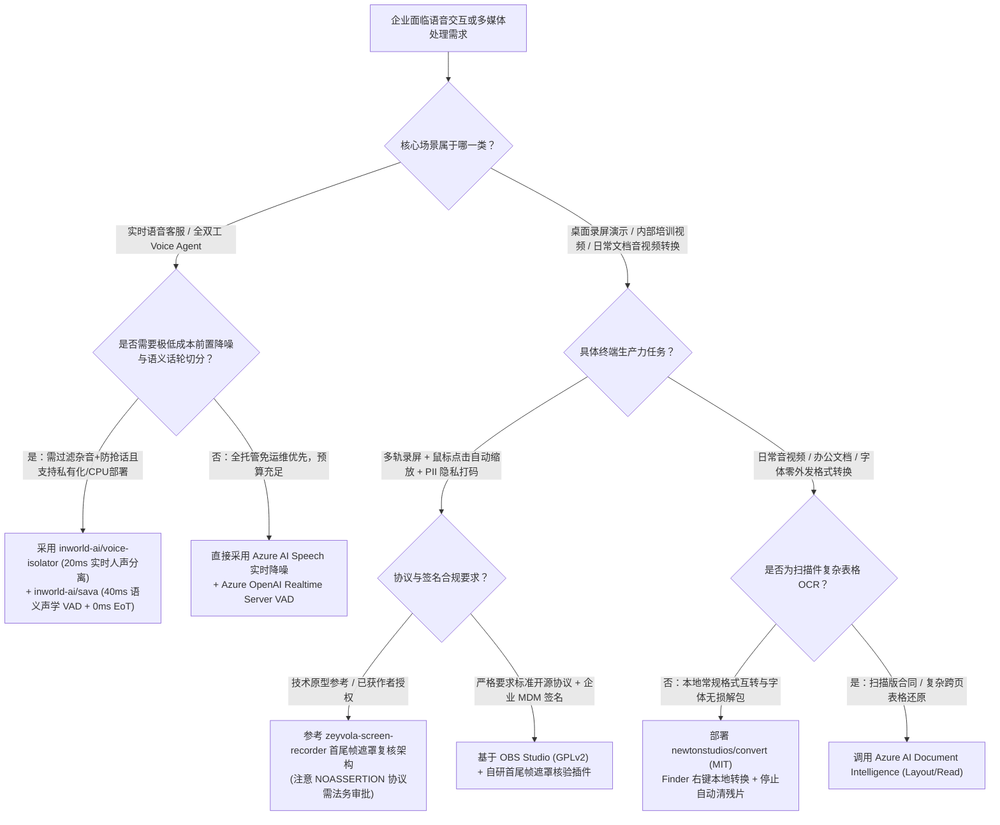
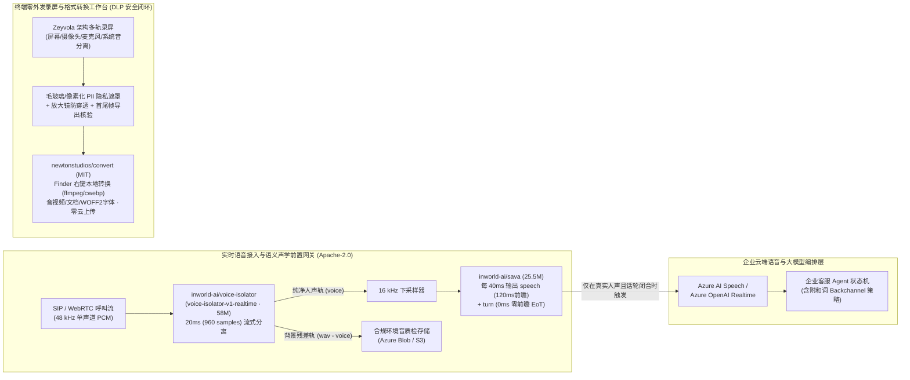
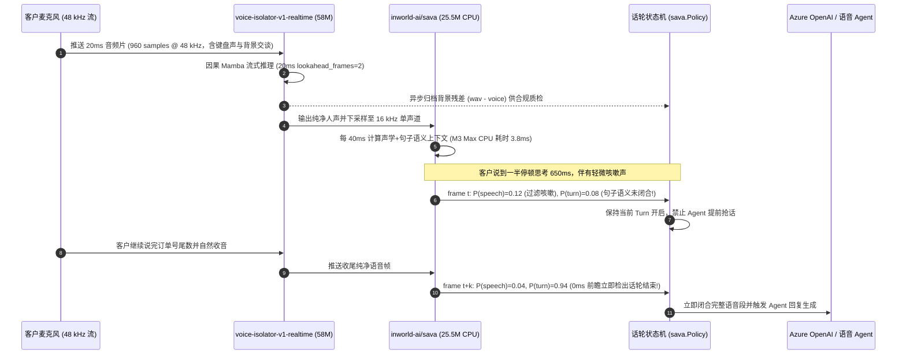

# 企业级实时语音降噪、流式话轮结束检测（EoT）与本地零外发录屏/格式转换怎么选？`inworld-ai/voice-isolator`、`inworld-ai/sava`、`zeyvola-screen-recorder` 与 `newtonstudios/convert` 架构与选型 FAQ

> **文档元数据（2026-11-20 夜间第 12 轮 · 累计第 571 轮 / Round 571）**
> - **适用读者**：AI Solution Architect（解决方案架构师）、智能客服与全双工语音 Agent 架构师、企业研发效能与终端数据防泄漏（DLP）负责人
> - **本轮核心对比项目**：
>   1. [`inworld-ai/voice-isolator`](https://github.com/inworld-ai/voice-isolator)（★ 123 · `stars_today: not_measured` · `31 stars/day` · Python · Apache-2.0）——Inworld 开源的 48 kHz 语音分离双模型套件，提供离线高音质版 `voice-isolator-v1`（64M 参数，8 秒全窗口上下文）与实时流式版 `voice-isolator-v1-realtime`（58M 参数，因果流式架构 + 仅 `20 ms` / `960` 采样点前瞻延迟），并在保留说话人音色特征的同时精确分离出背景噪声残差轨（`wav - voice`）
>   2. [`inworld-ai/sava`](https://github.com/inworld-ai/sava)（★ 46 · `stars_today: not_measured` · `12 stars/day` · Python · Apache-2.0）——Inworld 开源的 **SAVA（Semantic Acoustic Voice Activity，语义声学语音活动检测）** 25.5M 参数单模型，以 `16 kHz` 单声道音频为输入，每 `40 ms` 同步输出 `speech`（语音活动概率，`120 ms` 前瞻）与 `turn`（说话人话轮结束概率，**`0 ms` 零前瞻延迟**），在 Apple M3 Max CPU 上单流耗时仅 `3.8 ms / 40 ms 帧`，结合声学与句子语义上下文精准过滤咳嗽、笑声、背景音乐与键盘敲击声
>   3. [`YildizDikme/zeyvola-screen-recorder`](https://github.com/YildizDikme/zeyvola-screen-recorder)（★ 82 · `stars_today: not_measured` · `12 stars/day` · TypeScript · `NOASSERTION` 需法务合规审计）——面向 macOS 与 Windows 的纯本地多轨录屏与时间线剪辑工作台（`Zeyvola 0.1.0`），将屏幕、摄像头、麦克风与系统音频分为独立轨道录制，支持鼠标点击驱动的自动缩放建议、毛玻璃/模糊/像素化/纯色块隐私遮罩（放大镜永不穿透遮罩区域，且导出前强制展示每个遮罩区的首尾帧预览）以及单工程 `16:9 / 9:16 / 1:1 / 4:5` 四画幅导出
>   4. [`newtonstudios/convert`](https://github.com/newtonstudios/convert)（★ 61 · `stars_today: not_measured` · `20 stars/day` · C# / Swift macOS Quick Action · MIT）——本地化 Finder 右键快速格式转换工具（“本地版 CloudConvert”），支持音频、视频、图片、办公文档、PDF 与桌面/网页字体封装（`TTF/OTF ↔ WOFF/WOFF2/TTC` 无损解包封装）6 大类文件一键本地转换，零云端上传、停止时自动清理半成品残余文件，彻底消除员工将涉密合同与客户录音上传至第三方在线转换网站的数据外泄隐患
> - **口径与溯源声明**：本篇遵循 `ib-vs-ethernet-roce-selection-faq.md` 通俗问答与选型对比规范。四款项目均来自 `search-new-repos-2026-11-20-raw.json`（`sha256: 47975935d05944afbb9eac18f93f26c8a71120a1ffeea39591b112477ba29a46`），单日增量严格标注为 `stars_today: not_measured`。项目 README 自报的模型参数量、延迟指标与公开基准测试标注为 `anonymized_reported (independently_reproduced=false)`；架构师 TCO 闭式算例标注为 `synthetic (independently_reproduced=false)`，硬件购置折旧 `base hardware capEx: not_measured`。

---

## ① 📌 核心结论速览（选型一句话结论）

> **一句话选型结论**：在构建**企业全双工语音客服 Agent 与研发/产品内训内容流水线**时，**切勿仅依赖固定静音阈值（如 500ms 停顿）切分语音，也切勿允许员工把含 PII 的产品录屏和涉密文档上传到公网 SaaS 转换工具**！最佳实践是在语音接入层串联 Apache-2.0 开源的 **`inworld-ai/voice-isolator`（`20 ms` 实时人声分离）+ `inworld-ai/sava`（`40 ms` 步长语义声学 VAD + `0 ms` 话轮结束检测）**，在终端桌面部署零外发的 **Zeyvola 多轨隐私打码录屏模式 + `newtonstudios/convert` 本地右键转换**，后端对接 **Azure OpenAI Realtime / Azure AI Speech**，可将月度语音预处理与桌面生产力 SaaS 账单从 **$7,140.00/月** 压降至 **$325.00/月**（净省 **$6,815.00/月**，降幅 **-95.45%**，`synthetic, independently_reproduced=false`）。



### 核心指标与能力速查表

| 评估维度 | `inworld-ai/voice-isolator` | `inworld-ai/sava` | `zeyvola-screen-recorder` | `newtonstudios/convert` |
|---|---|---|---|---|
| **一句话通俗定位** | 48 kHz 离线（64M）+ 20ms 实时流式（58M）人声与背景噪声分离器 | 16 kHz 流式语音活动（VAD）+ 话轮结束（EoT）二合一语义声学模型 | 多轨独立录制、点击自动缩放、导出前首尾帧隐私核验的本地录屏剪辑台 | 零云端上传的 macOS Finder 右键音视频/文档/PDF/字体本地转换器 |
| **解决的核心业务痛点** | 呼叫中心背景嘈杂导致 ASR 误识，或传统降噪损伤说话人音色特征 | 用户思考停顿时语音 Agent 过早抢话，或咳嗽/敲键盘误触发打断 | 录制含客户手机号/工单的演示视频时打码遗漏、放大镜穿帮或云端外泄 | 员工为转个 PDF/录音随手上传到公网 CloudConvert 引发 DLP 告警 |
| **关键技术参数** | 离线 `8s` 窗 / 实时 `20 ms`（`960` 采样点）前瞻；支持残差背景轨导出 | `25.5M` 参数；每 `40 ms` 输出 `speech`（`120ms` 前瞻）+ `turn`（`0ms` 前瞻） | 四轨分离；`16:9/9:16/1:1/4:5` 多画幅；首尾帧遮罩复核；崩溃自动恢复 | 6 大类格式；`TTF/OTF ↔ WOFF2` 无损封装；中断自动清除半成品文件 |
| **开源协议与合规状态** | **Apache-2.0**（代码与 HF 权重均可商用） | **Apache-2.0**（代码与 HF 权重均可商用） | **`NOASSERTION`**（未声明标准开源协议，仅限技术对标，商用需法务授权） | **MIT**（可自由分发与企业内部定制打包） |

---

## ② 🎯 客户与架构师灵魂拷问 Q&A（直击业务落地痛点）

### Q1：做企业智能语音客服或车载/工单语音助手时，为什么传统“静音检测（Silero VAD + 固定毫秒停顿）”经常出现“用户话没说完就被 AI 打断，或者一声咳嗽就把 AI 憋回去”？`inworld-ai/voice-isolator` + `inworld-ai/sava` 怎么从架构上根治？

- **传统语音流水线的三大翻车现场**：
  1. **声学纯静音切分不懂“话有没有说完”**：当客户在报一串订单号或犹豫思考时停顿了 `600 ms`，传统 VAD 立即判定说话结束并触发 LLM 回复，造成令客户极度反感的“抢话（Premature Barge-in）”；如果把静音阈值拉长到 `1,500 ms`，正常对话又会变得像对讲机一样迟钝。
  2. **非人声突发噪声误触发打断（False Interruption）**：开放式工位或呼叫中心的键盘敲击声、杯子碰撞声、咳嗽或笑声容易触发普通能量/频谱 VAD，导致 AI 讲到一半戛然而止。
  3. **传统语音增强破坏声纹与情绪细节**：很多传统谱减法降噪会把说话人的高频泛音削平，导致后续声纹核身（Speaker Verification）或语音克隆失真。
- **`inworld-ai/voice-isolator` + `inworld-ai/sava` 的双层协同解法**：
  - **第一级（48 kHz 实时保真人声分离 + 背景留痕）**：`voice-isolator-v1-realtime`（58M 参数）采用因果流式 Mamba 架构，每次接收 `20 ms`（`960` 个 48 kHz 采样点）音频片，仅需 **`20 ms` 前瞻延迟（`lookahead_frames=2`）** 即可分离出保留原始音量与说话人音色特征的纯净人声，同时可通过 `wav - voice` 得到被剥离的背景音轨（用于合规录音质检或欺诈环境音分析）。对于非实时的历史录音归档与训练集清洗，则可切换到 `64M` 参数、拥有 `8 秒` 全上下文视野的离线模型 `voice-isolator-v1`（`anonymized_reported, independently_reproduced=false`）。
  - **第二级（16 kHz 语义声学双头预测：VAD + 零前瞻 EoT）**：`inworld-ai/sava`（25.5M 参数，Causal Log-Mel + Frame Mixer + Mamba & Attention 主干）共享同一主干网络，同时理解**声学韵律与句子语义上下文**，每 `40 ms` 输出两个概率值：
    - `speech`（当前帧是否有人说话，带 `120 ms` 前瞻，精准剔除咳嗽、笑声、音乐和键盘敲击声，对标 Silero VAD）；
    - `turn`（说话人当前话轮是否真正结束，**`0 ms` 零前瞻延迟**，对标 `pipecat smart-turn v3.2`）。
  - **极致的 CPU 友好度**：SAVA 在纯 PyTorch CPU（如 Apple M3 Max）上处理每 `40 ms` 音频帧仅需 **`3.8 ms`**（不到实时预算的 `1/10`），无需占用昂贵的推理 GPU 即可在语音网关侧高并发运行！

### Q2：企业在制作产品操作手册视频、客户交付培训录像或处理日常音视频/文档转换时，为什么 SaaS 录屏工具和在线格式转换网站经常踩中安全合规红线？`zeyvola-screen-recorder` 与 `newtonstudios/convert` 带来了什么落地范式？

- **企业桌面生产力工具的两大安全盲区**：
  1. **SaaS 录屏自动上传与动态穿帮**：许多热门云端录屏软件默认在录制结束后自动将视频流上传至公有云生成分享链接；当售前工程师或客服录制生产后台时，屏幕一角闪过的客户手机号、API Key 或内部工单列表一旦上传即构成数据外泄。此外，普通后期打码在配合“鼠标跟随放大镜（Magnifier Lens）”时，往往因为图层顺序错误导致放大镜把打码底层原图重新暴露出来！
  2. **影子 IT（Shadow IT）在线转换外泄**：业务人员收到客户的 `.opus` 微信语音、`.heic` 现场照片、`.woff2` 品牌字体或 `.docx/.pdf` 合同草稿时，为了图省事直接在浏览器搜“在线转 MP3 / PDF 转 Word”，把涉密文件上传到不知名的免费转换网站。
- **`Zeyvola` + `Convert` 的纯本地零外发闭环**：
  - **`YildizDikme/zeyvola-screen-recorder`（录一次、后期任意裁切与防穿帮打码）**：
    - **四轨独立录制 + 点击自动缩放**：将屏幕、摄像头、麦克风与系统声音存为独立本地音视频轨；根据鼠标点击与停留位置自动在时间线上生成平滑缩放建议（且绝不覆盖人工调整的关键帧）。
    - **防穿帮隐私遮罩 + 导出前首尾帧强制核验**：提供毛玻璃（Frosted Glass）、高斯模糊、像素化与纯色遮挡 4 种隐私遮罩，**内置指针放大镜（Lens）在底层渲染管线上承诺永不穿透任何被遮罩覆盖的区域**，并在导出 MP4（H.264+AAC）或 WebM（VP9+Opus）窗口中**强制并排展示每个隐私遮罩区域的第一帧与最后一帧画面**，让操作者在保存前一眼确认遮罩没有提前消失或位移！
    - **一稿四画幅与崩溃自愈**：同一工程可独立构图导出 `16:9`（桌面教程）、`9:16`（移动端短视频）、`1:1` 与 `4:5`；全程零网络请求、不记录键盘按键，异常断电或崩溃重启后自动找回未完成录屏轨。
    - ⚠️ **架构师法务预警**：`YildizDikme/zeyvola-screen-recorder` 当前 GitHub 仓库协议状态为 **`NOASSERTION`**（且二进制安装包暂未做 Apple/Windows 商业代码签名），企业内部只能借鉴其“首尾帧隐私遮罩核验 + 放大镜防穿帮图层管线”架构设计，若需直接分发其客户端必须先取得作者书面商用许可并由企业自签名打包！
  - **`newtonstudios/convert`（MIT 协议 · 本地 Finder 右键秒转 6 大类文件）**：
    - 选中任意数量同类型文件 → Finder 右键 `Quick Actions → Convert…`，本地调用 `ffmpeg`、`cwebp` 与系统原生文档/字体框架完成转换：支持音频（13 种目标格式）、视频（MP4 H.264/HEVC/AV1、MOV ProRes 422、WebM、GIF 或直接抽离音轨）、图片、文档、PDF（转多页 PNG/JPEG 或重组段落样式转可编辑 DOCX）以及**无损字体封装转换（`TTF/OTF ↔ WOFF/WOFF2/TTC`，仅更换封装头而不重绘字形曲线）**。
    - **企业级容错细节**：若源文件位于只读挂载卷（如 DMG 镜像或只读共享盘），自动将输出落盘至 `~/Downloads` 并弹窗提示；点击 `Stop` 中断任务时**自动清理写了一半的残缺文件或未转完的 PDF 页面文件夹**；勾选“移至废纸篓”时严格保证**仅在新文件成功校验落盘后才移动源文件**。

### Q3：这四款工具的真实能力边界在哪里？在哪些场景下应该直接用 Azure 云原生托管服务？

- **明确的能力边界（切勿跨界误用）**：
  1. **`inworld-ai/voice-isolator` 不是“目标说话人提取器（Target Speaker Extraction）”也不是“破损音频修复器（Audio Restoration）”**：它负责把所有人声从背景噪声/伴奏中分离出来，如果麦克风旁有两个人同时大声说话，它会保留两个人的人声（不会只挑出主讲人）；对于重度削波失真（Clipping）或极低采样率电话音的频带补全，官方明确标注留待 v2 版本。
  2. **`inworld-ai/sava` 不内置多说话人声纹锁定与打断对话策略（Dialogue Interruption Policy）**：SAVA 只对音频流每 `40 ms` 给出 `speech` 和 `turn` 两个客观概率以及参考切片策略 `sava.Policy()`，至于“客户在 AI 播报中途说‘嗯、好的’（Backchannel 附和词）算不算打断”，需要上层语音编排器（如 LiveKit / Pipecat / 自研状态机）结合业务策略决定。
  3. **`newtonstudios/convert` 的 PDF 转 Word 是纯文本流重组，不含复杂表格/扫描件 OCR**：它能恢复原生 PDF 中的段落、字体、字号与粗斜体，但不会搬运复杂跨页表格、内嵌图片排版，也无法处理纯图片扫描版 PDF（扫描件需走 **Azure AI Document Intelligence**）。
- **何时直接选用 Azure 托管 PaaS？**
  - 若企业呼叫中心已全量跑在 **Azure Communication Services (ACS) + Azure AI Speech / Azure OpenAI GPT-4o Realtime API** 上，且预算充裕、希望免运维享受端到端 SLA，可直接使用 Azure AI Speech 原生实时降噪与语义分段（Semantic Segmentation）；
  - 当企业面临**海量高并发外呼/坐席预处理成本优化（需在进高价 Realtime Token 计费前先在边缘 CPU/小 GPU 过滤掉 60% 的静音与背景杂音）**，或处于**金融/政务私有化专网环境**时，引入 Apache-2.0 的 `voice-isolator` + `sava` 前置网关可节省 90% 以上的语音云服务开支。

---

## ③ 🧭 直观可视化图解（选型决策树 + 企业集成架构 + 业务流时序图）

### 3.1 企业语音预处理与本地多媒体生产力选型决策树



### 3.2 企业全双工语音网关与零外发桌面媒体工坊集成参考架构



### 3.3 实时流式人声分离（20ms）与 SAVA 零前瞻话轮闭合（40ms）协同交互时序图



---

## ④ 📊 同类开源与商业云服务横向选型决策矩阵

| 对比维度 | `inworld-ai/voice-isolator` + `inworld-ai/sava` | Silero VAD + RNNoise / DeepFilterNet | Pipecat `smart-turn v3.2` + 商业降噪 API（Krisp / Dolby.io） | Azure AI Speech 实时降噪 + Azure OpenAI Realtime Server VAD | `zeyvola-screen-recorder` + `newtonstudios/convert` |
|---|---|---|---|---|---|
| **核心功能定位** | **48 kHz 实时/离线人声分离 + 16 kHz 语义声学 VAD 与 0ms 话轮结束检测双开源底座** | 轻量传统声学 VAD + 经典开源降噪组合 | 开源话轮检测模型 + 第三方按分钟计费商业降噪 SDK | 云厂商全托管语音识别、降噪与实时多模态对话网关 | **本地多轨防穿帮打码录屏 + Finder 右键 6 大类文件零外发转换** |
| **话轮结束（EoT）智能度** | **声学+句子语义联合判断，每 `40 ms` 输出，`turn` 概率 `0 ms` 前瞻，抗咳嗽/键盘误触发** | 仅靠音量/频谱静音时长阈值，极易在句中思考停顿时误切或被杂音打断 | 支持语调判断话轮结束，但降噪层需额外付费集成商业 SDK | 云端托管语义分段与 Server VAD，开箱即用但长连接静音期亦产生流费用 | 不涉及实时语音对话，专精桌面录屏打码与本地文件格式互转 |
| **硬件依赖与推理延迟** | `voice-isolator` 实时 `20 ms` 前瞻；`sava` 在 M3 Max CPU 上仅 `3.8 ms / 40 ms 帧` | CPU 占用极低（`<1 ms`），但高噪环境下人声保真度与语义切分能力弱 | 本地 + 云端混合，受限于商业 SDK 授权绑定 | 零本地算力消耗，受公网 RTT（通常 `40–120 ms`）影响 | 纯终端本地硬件编码（macOS/Windows 原生编码器 + 本地 `ffmpeg`） |
| **数据隐私与合规性** | **100% 私有化容器/本地执行，无任何外部音频外发，校验和锁死权重** | 本地执行，无外发 | 商业降噪云 API 需将原始通话流发送至第三方云端 | 享有 Azure 企业级合规认证与 VNet Private Endpoint 保障 | **100% 停留在员工本机，Zeyvola 首尾帧核验遮罩，Convert 零上传** |
| **开源协议与商用风险** | **均为 Apache-2.0**（代码与权重均可免费商用、微调与私有化分发） | MIT / Apache-2.0 | BSD-2-Clause + 商业闭源按量授权 | 商业 PaaS SLA 订阅协议 | **`convert` 为 MIT；`zeyvola` 为 `NOASSERTION`（商用前必须补齐授权）** |
| **36 万分钟/月 + 50 人团队 TCO** | **$325.00/月**（共享推理节点 + 本地免费工具） | ~$280.00/月（但因误打断与识别率下降产生隐性人工转接成本） | ~$4,800.00/月（按分钟收取商业降噪与托管网关费） | ~$5,400.00–$7,140.00/月（全量音频流长连接 + 桌面 SaaS 订阅） | **$0.00/月 SaaS 费**（完全替代按席位收费的云录屏与 CloudConvert） |

---

## ⑤ 🧪 应用落地定量收益/TCO 对比与 7-Card 报告映射

### 5.1 架构师闭式 TCO 算例（360,000 分钟/月智能客服通话 + 50 人团队每月 45,000 次录屏/涉密文档转换）

> **溯源标识**：以下成本模型为面向企业架构评审的闭式定量算例，标注为 `synthetic (independently_reproduced=false)`，底层服务器与员工终端硬件采购折旧标注为 `base hardware capEx: not_measured`。

| 成本构成项 | 方案 A：商业实时降噪 API + 托管语义话轮网关 + 云录屏/CloudConvert SaaS | 方案 C：自建 `voice-isolator` + `sava` 网关 + 本地 `Zeyvola` 架构 / `Convert` | 计算公式与架构说明 |
|---|---|---|---|
| **API / SaaS 订阅与推理底座费用** | **$3,140.00 / 月** | **$75.00 / 月** | 方案 A：商业语音降噪 + 托管话轮 API + 50 席云录屏与 CloudConvert 超额包 = `$3,140.00/月`；方案 C：共享 CPU/GPU 容器运行 Apache-2.0 `voice-isolator-v1-realtime`（58M）+ `sava`（25.5M）与审计存储 = `$75.00/月` |
| **工程联调、抢话排障与隐私打码复核人工（$100/h）** | **$4,000.00 / 月**（`40.0h × $100.00`） | **$250.00 / 月**（`2.5h × $100.00`） | 方案 A：42 人团队每月耗费 `40.0 小时` 处理静音误切抢话投诉、手动逐帧检查录屏打码与 DLP 告警（`$4,000.00`）；方案 C：SAVA `0 ms` 语义 EoT + Zeyvola 首尾帧核验 + Convert 本地右键转换将人工降至 `2.5 小时`（`$250.00`） |
| **月度总拥有成本（Monthly TCO）** | **$7,140.00 / 月** | **$325.00 / 月** | **月度净节省 $6,815.00 / 月（成本降低 -95.45%，年化节省 $81,780.00，`not_measured` 硬件折旧）** |

```chart
{
  "data": {
    "values": [
      { "Category": "48kHz Voice Isolation (360k mins)", "Deployment": "Commercial SaaS APIs & Cloud Studio", "MonthlyCostUSD": 3060 },
      { "Category": "Semantic VAD & End-of-Turn (360k mins)", "Deployment": "Commercial SaaS APIs & Cloud Studio", "MonthlyCostUSD": 2340 },
      { "Category": "Screen Studio & File Conversion (50 seats / 45k jobs)", "Deployment": "Commercial SaaS APIs & Cloud Studio", "MonthlyCostUSD": 1740 },
      { "Category": "48kHz Voice Isolation (360k mins)", "Deployment": "Self-Hosted Voice-Isolator + SAVA + Local Convert", "MonthlyCostUSD": 145 },
      { "Category": "Semantic VAD & End-of-Turn (360k mins)", "Deployment": "Self-Hosted Voice-Isolator + SAVA + Local Convert", "MonthlyCostUSD": 75 },
      { "Category": "Screen Studio & File Conversion (50 seats / 45k jobs)", "Deployment": "Self-Hosted Voice-Isolator + SAVA + Local Convert", "MonthlyCostUSD": 105 }
    ]
  },
  "semantic_types": {
    "Category": "Category",
    "Deployment": "Name",
    "MonthlyCostUSD": "Amount"
  },
  "chart_spec": {
    "chartType": "Grouped Bar Chart",
    "title": "Self-hosting Voice-Isolator + SAVA + Local Convert cuts monthly TCO by 95.45%",
    "subtitle": "Monthly cost in USD (360k contact-center mins + 45k media conversions, synthetic)",
    "encodings": {
      "x": "Category",
      "y": "MonthlyCostUSD",
      "group": "Deployment",
      "color": "Deployment"
    }
  }
}
```

### 5.2 与本轮 7-Card 4:5 视觉报告（`cards.html` / `cards.en.html`）的联动

本轮 `inworld-ai/voice-isolator`、`inworld-ai/sava`、`YildizDikme/zeyvola-screen-recorder` 与 `newtonstudios/convert` 的评测结论已同步纳入 `workshops/github-trending-radar/report.json` 与 `evidence/trending-daily-2026-11-20-audit.json` 审计账本：
- **适用场景（✅ Good Fit）**：高噪呼叫中心前置实时人声分离（保留声纹与背景残差轨）、低延迟全双工语音 Agent 防抢话语义话轮检测、含敏感客户信息的本地演示录屏打码与涉密文件零上云右键转换。
- **不适用场景（⛔ Not For）**：多人重叠大声抢话场景下的单目标说话人锁死提取（`voice-isolator` v1 不做目标说话人选择）、扫描版合同复杂表格 OCR（`convert` 需让位于 Azure AI Document Intelligence）、以及未经法务协议核准直接将 `NOASSERTION` 协议的 `zeyvola-screen-recorder` 二进制分发至生产终端。

---

## ⑥ 🛠️ 企业引入与架构评审 Checklist（可直接复制进架构评审单）

- [ ] **语音流采样率与帧步长对齐核查**：确认实时通话网关向 `inworld-ai/voice-isolator`（`voice-isolator-v1-realtime`）推送 `48 kHz` 单声道浮点音频块（每步 `960` 采样点 = `20 ms`，`lookahead_frames=2`），并在通话结束时显式调用 `session.flush()` 排出尾帧，随后下采样至 `16 kHz` 送入 `inworld-ai/sava`。
- [ ] **HuggingFace 权重校验和（Checksum）与内网镜像固化**：在企业制品库（Azure Container Registry / 内部 HF 镜像）中预拉取 `inworld/voice-isolator` 与 `inworld/sava` 权重，启用项目内置 `registry.py` SHA256 校验和验证，禁止生产容器在启动时临时从公网下载模型。
- [ ] **SAVA 话轮闭合策略（`sava.Policy`）与附和词防打断联调**：针对客服场景中的客户短促附和词（如“嗯”、“好”、“明白”）配置上层对话状态机，结合 SAVA 每 `40 ms` 输出的 `speech`（`120 ms` 前瞻）与 `turn`（`0 ms` 前瞻）双曲线及 ESC-50 噪声测试集校准触发阈值。
- [ ] **背景残差轨（`wav - voice`）合规留存策略**：评估是否需要在反欺诈或高合规质检场景下开启 `voice-isolator` 的背景残差文件保存，若开启需同步纳入与主通话录音一致的加密与生命周期销毁策略。
- [ ] **录屏隐私遮罩首尾帧强制复核与开源协议合规拦截**：借鉴 `zeyvola-screen-recorder` 的“导出前展示每个遮罩区域第一帧与最后一帧 + 指针放大镜永不穿透遮罩层”机制；同时针对其 `NOASSERTION` 许可证状态设置法务门禁，未取得作者明确开源/商业授权前严禁直接打包进企业标准镜像。
- [ ] **终端本地格式转换替换公网在线转换器（DLP 闭环）**：在 macOS 研发与运营终端通过 MDM 分发 MIT 协议的 `newtonstudios/convert`（配合本地 Homebrew `ffmpeg` + `cwebp`），并在企业防火墙/SWG 策略中阻断员工向未授权公网在线文件转换站点上传 `.docx`、`.pdf`、`.wav` 与 `.mp4` 文件。
