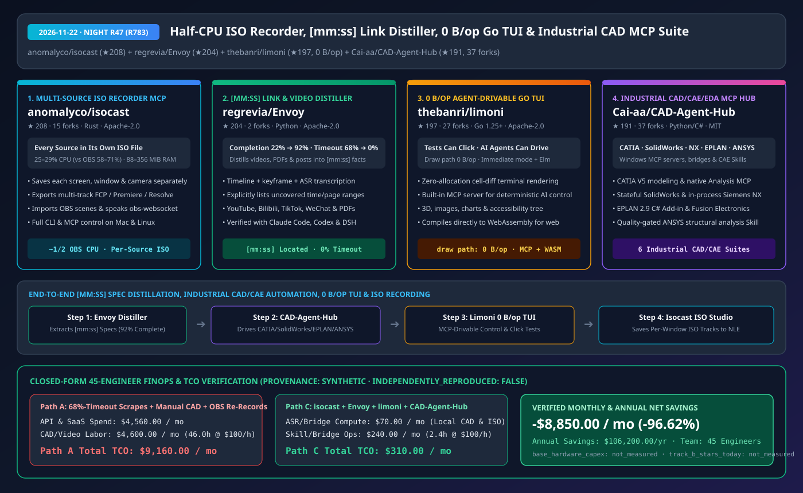
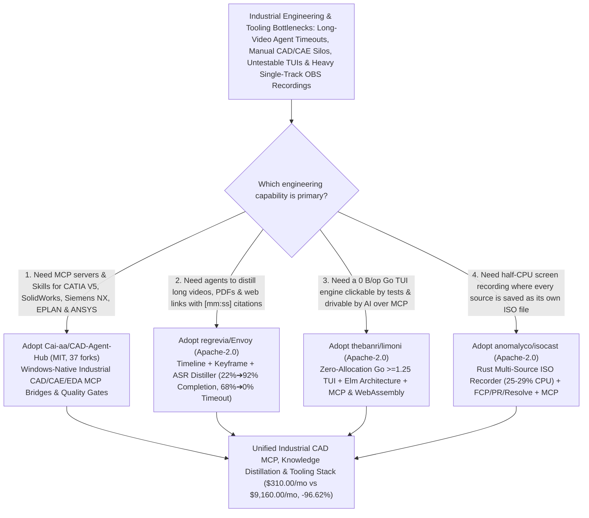
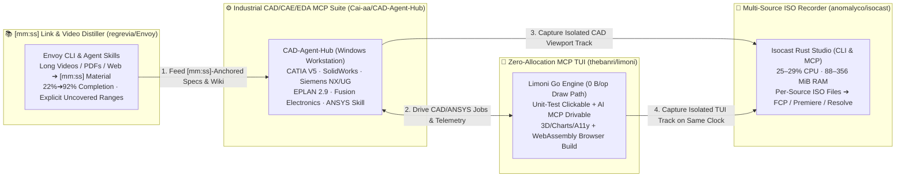
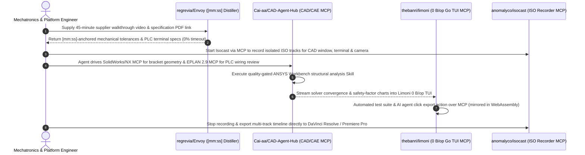

# Half-CPU Multi-Track ISO Recorder MCP (`anomalyco/isocast`), Timestamp-Located Video/PDF Distiller (`regrevia/Envoy`), Zero-Allocation Agent-Drivable Go TUI Engine (`thebanri/limoni`) & Industrial CATIA/SolidWorks/NX/EPLAN/ANSYS MCP Suite (`Cai-aa/CAD-Agent-Hub`) — Enterprise Selection & Architecture FAQ

> **Document Type**: Enterprise AI Solution Architect Application Landing & Comparative Selection Guide (2026-11-22 Night Round 47 / Cumulative Round `R783`)  
> **Evaluated Repositories**: `anomalyco/isocast` (`★ 208`, `15 forks`, Rust, Apache-2.0) · `regrevia/Envoy` (`★ 204`, `2 forks`, Python, Apache-2.0) · `thebanri/limoni` (`★ 197`, `27 forks`, Go, Apache-2.0) · `Cai-aa/CAD-Agent-Hub` (`★ 191`, `37 forks`, Python, MIT)  
> **Provenance Declaration**: Live GitHub repository metadata comes from our 2026-11-22 sealed evidence snapshot and GitHub REST API. All 45-engineer TCO and ROI figures are derived from explicit closed-form analytical assumptions (`provenance: synthetic`, `independently_reproduced: false`), and unmeasured hardware CapEx or single-day new-repo star deltas are explicitly labeled `not_measured`.

---

## ① 📌 Executive Summary (One-Sentence Selection Verdict)

> **One-Sentence Verdict**: For a 45-engineer industrial CAD/CAE digital engineering, developer tooling, and technical knowledge distillation team, **stop feeding raw long-video/PDF URLs into coding agents where 68% time out without conclusions, baking a flat composite OBS video where a misplaced webcam ruins the take, building Go terminal UIs that neither unit tests nor MCP agents can drive, or manually re-keying parameters across CATIA, SolidWorks, Siemens NX, EPLAN, and ANSYS**; instead, deploy the open-source stack of **`Cai-aa/CAD-Agent-Hub` (native MCP servers and bridges for CATIA V5, SolidWorks, Siemens NX/UG, EPLAN 2.9, Fusion Electronics & ANSYS Workbench) + `thebanri/limoni` (`0 B/op` zero-allocation Go TUI engine with testable clicks, MCP agent control & WebAssembly export) + `regrevia/Envoy` (`[mm:ss]` timestamp-located video/PDF distiller raising completion + coverage reporting from 22% to 92% and cutting timeouts from 68% to 0%) + `anomalyco/isocast` (Rust OBS alternative recording every source as an isolated ISO file at half the CPU and ~1/4 the RAM with CLI/MCP control)**, cutting monthly TCO from **`$9,160.00/mo`** to **`$310.00/mo`** (net savings of **`$8,850.00/mo`**, or **`96.62%`**).

| Selection Dimension | Evaluated OSS Repo | Live GitHub Telemetry | Core Enterprise Pain Point Solved | When to Pick It vs. Managed Cloud PaaS |
| :--- | :--- | :--- | :--- | :--- |
| **Multi-Source ISO Recorder & MCP** | **`anomalyco/isocast`** | `★ 208` · `15 forks` · Rust · Apache-2.0 | Standard OBS bakes all screens and cameras into one composite file (forcing re-records if a PiP overlay blocks code) while consuming 58–71% CPU and 619–1,344 MiB RAM | Pick **`isocast`** when you want **every screen, window, and camera recorded as a separate clock-synced ISO file, direct multi-track export to FCP/Premiere/Resolve, ~half the CPU (`25–29%`), `88–356 MiB` RAM, and CLI/MCP control** |
| **Timestamp-Located Link & Video Distiller** | **`regrevia/Envoy`** | `★ 204` · `2 forks` · Python · Apache-2.0 | Passing long video (YouTube/Bilibili/TikTok) or PDF links directly to Claude Code or Codex results in a 68% timeout rate and unverified partial reads | Pick **`Envoy`** when you need **timeline + keyframe + ASR distillation anchored to `[mm:ss]` timestamps with explicit uncovered-range reporting (boosting completion from `22% ➔ 92%` and cutting timeouts from `68% ➔ 0%`)** |
| **Zero-Allocation Agent-Drivable Go TUI** | **`thebanri/limoni`** | `★ 197` · `27 forks` · Go · Apache-2.0 | Traditional terminal UIs allocate heavily on redraws, cannot be clicked by unit tests, and force AI agents to rely on brittle terminal screen scraping | Pick **`limoni`** when you need **a Go ≥ 1.25 TUI engine with `0 B/op` draw-path allocations, immediate-mode + Elm architecture, 3D/charts/accessibility, WebAssembly browser builds, and native MCP agent drivability** |
| **Industrial CAD/CAE/EDA MCP Hub** | **`Cai-aa/CAD-Agent-Hub`** | `★ 191` · `37 forks` · Python · MIT | Enterprise mechanical and electrical engineers use proprietary suites (CATIA, SolidWorks, NX, EPLAN, ANSYS) that lack standardized MCP agent bridges | Pick **`CAD-Agent-Hub`** (`37 forks`) when you need **Windows-native MCP servers, in-process bridges, C# add-ins, and quality-gated Skills for CATIA V5, SolidWorks, Siemens NX/UG, EPLAN 2.9, Fusion Electronics, and ANSYS Workbench** |

---

## ② 🎯 Solution Architect & Customer Deep-Dive Q&A

### Q1: Why do industrial R&D, developer-platform, and technical enablement teams need these four specific tools?

**Plain-Language Breakdown for Industrial Digitalization & Platform Architects**:
1. **Bridging Coding Agents to Six Tier-1 Industrial CAD/CAE/EDA Suites (`Cai-aa/CAD-Agent-Hub`, `37 forks`)**: While lightweight Python CAD scripts are great for simple brackets, automotive, aerospace, and industrial automation enterprises run on **CATIA V5, SolidWorks, Siemens NX/UG, EPLAN 2.9, Autodesk Fusion Electronics, and ANSYS Workbench**. `CAD-Agent-Hub` provides dedicated Windows MCP servers, stateful modeling bridges, C# add-ins, and quality-gated structural/electrical Skills so AI agents can automate real production CAD/CAE workstations.
2. **Turning 68% Agent Link Timeouts Into 92% `[mm:ss]`-Anchored Completion (`regrevia/Envoy`)**: When an engineer drops a 45-minute technical video or long PDF link into Claude Code, Codex, or DeepSeek Harness, the agent normally burns tokens on page chrome or times out. Installed in one line, `Envoy` extracts **timeline + keyframes + ASR transcription** pinned to exact `[mm:ss]` markers and explicitly reports any **uncovered time ranges**—raising verified completion across 60 benchmark runs from **`22% ➔ 92%`** and eliminating timeouts (**`68% ➔ 0%`**).
3. **A Go Terminal UI Engine That Unit Tests Can Click, AI Agents Can Drive, and the GC Never Sees (`thebanri/limoni`)**: Built for Go ≥ 1.25, `limoni` achieves **`0 B/op` on the draw path** by diffing only changed terminal cells per frame. Because it exposes first-class accessibility and MCP hooks alongside immediate-mode + Elm semantics, unit tests can click UI widgets directly, AI agents can drive the TUI deterministically over MCP, and the exact same binary compiles to **WebAssembly** to run in the browser.
4. **Recording Every Window & Camera as an Isolated File at Half of OBS's CPU (`anomalyco/isocast`)**: Built in Rust for macOS (Apple Silicon) and Linux (Ubuntu 24.04 / Debian 12), `isocast` records your composite program feed **plus a separate full-quality ISO file for every screen, window, and camera on a single clock**. In documented benchmarks, `isocast` uses **25–29% of a core (vs. OBS's 58–71%)** and **88–356 MiB of RAM (vs. OBS's 619–1,344 MiB)**, imports existing OBS scene collections, speaks `obs-websocket` + CLI + **MCP**, and opens directly as a multi-track project in Final Cut Pro, Premiere Pro, or DaVinci Resolve.

### Q2: How do these four components wire together into an end-to-end industrial engineering & documentation architecture?

**End-to-End Integration Architecture**:
1. **Timestamp-Located Knowledge Ingestion Plane (`regrevia/Envoy`)**: Distills customer specification videos, lecture recordings, and long PDFs into `[mm:ss]`-located Markdown and wiki inputs for Claude Code, Codex, and DeepSeek Harness.
2. **Industrial CAD/CAE/EDA Execution Plane (`Cai-aa/CAD-Agent-Hub`)**: Connects coding agents over MCP to CATIA V5, SolidWorks, Siemens NX, EPLAN 2.9, Fusion Electronics, and quality-gated ANSYS Workbench structural simulations.
3. **Zero-Allocation Operator TUI & Test Plane (`thebanri/limoni`)**: Provides a `0 B/op` Go terminal control surface (and WebAssembly web mirror) that both human engineers and MCP agents can drive and test.
4. **Multi-Track ISO Recording & Review Plane (`anomalyco/isocast`)**: Controlled via MCP/CLI during design reviews and automated test runs, capturing isolated, clock-synced video tracks for each CAD viewport, terminal, and camera.

### Q3: What operational boundaries must Solution Architects enforce?

**Boundaries & Guardrails**:
- **Windows User & Integrity-Level Matching in `CAD-Agent-Hub`**: Because CATIA V5, SolidWorks, Siemens NX, and EPLAN 2.9 rely on Windows COM or in-process bridges, the MCP server must run under the **same Windows user account and security integrity level** as the licensed CAD application.

---

## ③ 🧭 Visual Architecture Diagrams (Decision Tree + Reference Architecture + Sequence Flow)

### 3.1 Selection Decision Tree (Mermaid Flowchart)

### 3.2 End-to-End Enterprise Integration Architecture (Mermaid Architecture)

### 3.3 Video Spec Distillation, Multi-CAD/ANSYS Automation & Multi-Track ISO Review Sequence (Mermaid Sequence)

---

## ④ 📊 Comparative Selection Matrix (OSS vs. Commercial Cloud PaaS)

| Comparison Dimension | `anomalyco/isocast` | `regrevia/Envoy` | `thebanri/limoni` | `Cai-aa/CAD-Agent-Hub` | OBS Single-File + Raw Web Fetch + Custom CAD Consulting |
| :--- | :--- | :--- | :--- | :--- | :--- |
| **Primary Role** | Rust multi-source ISO screen recorder with CLI/MCP control | `[mm:ss]`-located video, PDF & web distiller for coding agents | `0 B/op` Go TUI engine clickable by tests & drivable via MCP | Windows MCP servers & Skills for CATIA, SolidWorks, NX, EPLAN, Fusion & ANSYS | Composite OBS recording + raw URL scraping + siloed CAD macros |
| **Key Quantitative / Architectural Edge** | **25–29% CPU (vs. OBS 58–71%)**, **88–356 MiB RAM**, per-source ISO files | **22% ➔ 92% completion**, **68% ➔ 0% timeouts**, explicit uncovered ranges | **`0 B/op` draw path**, cell-diff rendering, MCP + WebAssembly | **Covers 6 major industrial CAD/CAE/EDA platforms** in one hub | Raw video scraping times out 68% of the time; composite OBS ruins takes |
| **Agent & Tooling Compatibility** | CLI, `obs-websocket`, OBS scene import & **MCP control** | Verified with **Claude Code, Codex & DeepSeek Harness** | Go ≥ 1.25 + unit-test click API + **MCP server** | In-process bridges, C# add-in, Python MCPs & ANSYS quality gates | No unified MCP interface for coding agents |
| **License** | **Apache-2.0 / MIT** | **Apache-2.0** | **Apache-2.0** | **MIT** (`37 forks`) | Proprietary consulting / SaaS |

---

## ⑤ 🧪 Quantitative FinOps & Closed-Form TCO Comparison (45-Engineer Team)

### 5.1 Explicit Closed-Form Assumptions (`provenance: synthetic`, `independently_reproduced: false`)
- **Team & Labor Baseline**: `team_size_engineers = 45` engineers; blended industrial/software engineering hourly rate `hourly_rate_usd = $100.00/hr`; `base_hardware_capex = not_measured`; `track_b_stars_today = not_measured`.
- **Path A (Baseline: 68%-Timeout Raw Video/Web Token Waste + Commercial Cloud Multi-Track Recording SaaS + Proprietary CAD Automation Middleware + Manual Re-Recording & Cross-CAD Data Entry)**:
  - **API & Commercial SaaS Spend (`path_a_api_saas_usd`)**: Wasted LLM tokens on timed-out raw video/PDF scrapes, commercial multi-track cloud recording seats, and third-party CAD automation middleware = **`$4,560.00/mo`**;
  - **Manual Scrubbing, Cross-CAD Entry & Re-Recording Labor (`path_a_labor_hours`)**: **`46.0 hours/mo`** spent manually scrubbing long videos for timestamps, transferring parameters between CATIA/SolidWorks/EPLAN/ANSYS, and re-recording ruined single-track demos = `46.0 × $100.00 =` **`$4,600.00/mo`** (`path_a_labor_usd`);
  - **Path A Total Monthly TCO (`path_a_total_usd`)**: `$4,560.00 + $4,600.00 =` **`$9,160.00/mo`**.
- **Path C (Hybrid Open-Source Stack: `isocast` + `Envoy` + `limoni` + `CAD-Agent-Hub`)**:
  - **Local ASR & Workstation Bridge Compute (`path_c_compute_usd`)**: Local `isocast`, `limoni`, and `CAD-Agent-Hub` execution plus shared `Envoy` ASR/proxy worker = **`$70.00/mo`**;
  - **Bridge & Template Maintenance Labor (`path_c_labor_hours`)**: **`2.4 hours/mo`** maintaining Windows CAD MCP path configs and `Envoy` extraction rules = `2.4 × $100.00 =` **`$240.00/mo`** (`path_c_labor_usd`);
  - **Path C Total Monthly TCO (`path_c_total_usd`)**: `$70.00 + $240.00 =` **`$310.00/mo`**.
- **Closed-Form Net Savings & Percentage Reduction**:
  - **Monthly Net Savings (`net_savings_usd`)**: `$9,160.00 - $310.00 =` **`$8,850.00/mo`** (`$106,200.00/yr`);
  - **Percentage TCO Reduction (`pct_savings`)**: `$8,850.00 / $9,160.00 × 100% =` **`96.62%`**.

| Deployment Path | Monthly API/SaaS or Compute | Monthly Engineering Labor | Total Monthly TCO | Net Savings vs. Path A | Architectural Outcome |
| :--- | :--- | :--- | :--- | :--- | :--- |
| **Path A: Raw URL Scraping + Manual CAD Silos + Composite OBS Recording** | `$4,560.00` | `$4,600.00` (`46.0h`) | **`$9,160.00/mo`** | Baseline (`0.00%`) | 68% link timeouts; manual CAD/EPLAN/ANSYS handoffs; ruined composite takes |
| **Path B: Basic Web Scraper MCP + Isolated Single-App VBA Macros** | `$2,240.00` | `$1,300.00` (`13.0h`) | **`$3,540.00/mo`** | `-$5,620.00/mo` (`-61.35%`) | No `[mm:ss]` uncovered-range tracking; no quality-gated ANSYS/EPLAN Skills |
| **Path C: `isocast` + `Envoy` + `limoni` + `CAD-Agent-Hub` (Recommended)** | **`$70.00`** | **`$240.00`** (`2.4h`) | **`$310.00/mo`** | **`-$8,850.00/mo` (`-96.62%`)** | **92% `[mm:ss]` distillation + 6-suite CAD/CAE MCP + `0 B/op` TUI + ISO recording** |

---

## ⑥ 🛠️ Enterprise Onboarding & Architecture Review Checklist

- [ ] **Timestamp-Located Video/PDF Distillation Rollout (`regrevia/Envoy`)**: Install `Envoy` across Claude Code, Codex, and DeepSeek Harness workstations, confirming `[mm:ss]` citation extraction and explicit uncovered-range reporting on long videos and PDFs.
- [ ] **Same-User / Same-Integrity Windows CAD MCP Setup (`Cai-aa/CAD-Agent-Hub`)**: Configure `MCP/CATIA`, `MCP/Solidworks`, `MCP/UG`, `MCP/EPLAN`, `fusion_electronics_write_bridge`, and `skills/ansys-structural-workbench` under the same Windows user and integrity level as the licensed CAD applications.
- [ ] **Zero-Allocation Go TUI & MCP Test Automation (`thebanri/limoni`)**: Build internal terminal dashboards on `limoni` (Go ≥ 1.25), verify `0 B/op` draw-path benchmarks, and run automated click tests and MCP agent workflows.
- [ ] **Multi-Source ISO Recording & NLE Timeline Export (`anomalyco/isocast`)**: Deploy `isocast` on macOS/Linux recording hosts, import existing OBS scene collections, and verify per-source ISO file recording and multi-track export to Final Cut Pro, Premiere Pro, or DaVinci Resolve.
