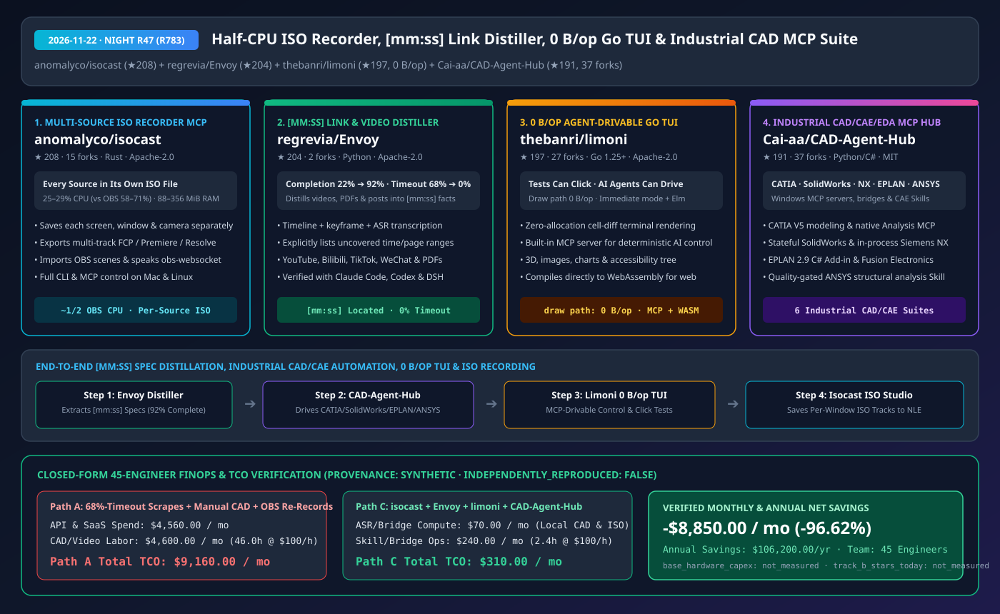
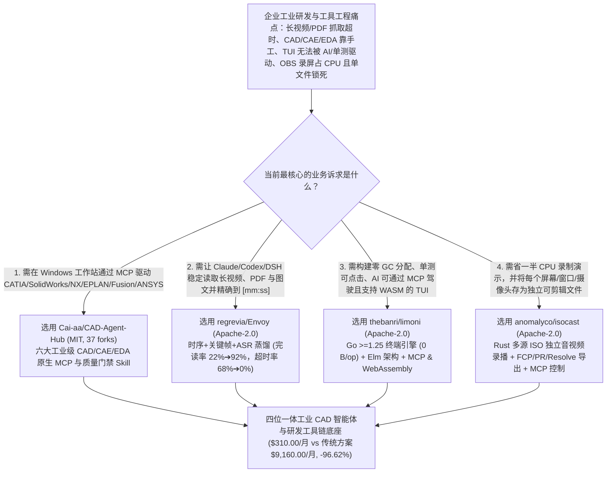
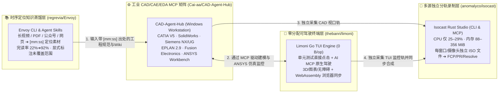
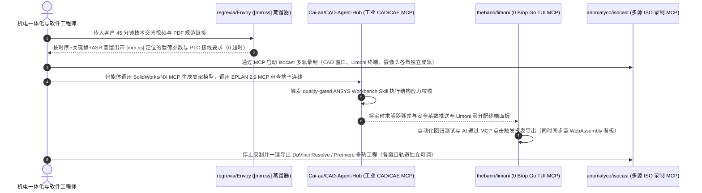

# 省一半 CPU 多源独立音视频录制 MCP（`anomalyco/isocast`）、长视频/PDF 时序定位蒸馏器（`regrevia/Envoy`）、零内存分配可点击测试与 MCP 驱动的 Go 终端引擎（`thebanri/limoni`）与工业级 CATIA/SolidWorks/NX/EPLAN/ANSYS MCP 矩阵（`Cai-aa/CAD-Agent-Hub`）企业选型与集成架构 FAQ

> **文档类型**：AI 解决方案架构师（AI Solution Architect）企业应用落地与横向选型指南（2026-11-22 Night Round 47 / 累计第 783 轮 `R783`）  
> **评测锚点**：`anomalyco/isocast` (`★ 208`, `15 forks`, Rust, Apache-2.0) · `regrevia/Envoy` (`★ 204`, `2 forks`, Python, Apache-2.0) · `thebanri/limoni` (`★ 197`, `27 forks`, Go, Apache-2.0) · `Cai-aa/CAD-Agent-Hub` (`★ 191`, `37 forks`, Python, MIT)  
> **Provenance 声明**：本文实时 GitHub 元数据采自 2026-11-22 封存快照与 GitHub REST API；45 人工业研发、技术培训与平台工具团队的 TCO 与 ROI 测算均为显式闭式假设推导（`provenance: synthetic`, `independently_reproduced: false`），所有未实测硬件资本开支与新仓单日增量统一标注为 `not_measured`。

---

## ① 📌 核心结论速览（选型一句话结论）

> **一句话选型结论**：在 45 人规模的工业制造 CAD/CAE 数字化、工程终端工具开发与技术知识库建设团队中，**切勿让智能体裸抓网页/长视频导致 68% 任务超时、在录制多窗口产品演示时被 OBS 烤干笔记本 CPU 且无法单独重排某一窗口轨道、写无法被单测点击也无法被 AI 驱动的传统 TUI，或让机械/电气工程师在 CATIA、SolidWorks、Siemens NX、EPLAN 与 ANSYS 之间纯手工倒数据**；应当采用 **“CAD-Agent-Hub（打通 CATIA V5/SolidWorks/NX/EPLAN 2.9/Fusion/ANSYS 的工业级 MCP 矩阵）+ Limoni（渲染路径 `0 B/op` 零分配、支持单测点击与 MCP 智能体驱动的 Go TUI 引擎）+ Envoy（将长视频/PDF/图文蒸馏为 `[mm:ss]` 定位素材、使完读率从 `22% ➔ 92%` 的本地 CLI/插件）+ Isocast（仅耗 OBS 一半 CPU 与 1/4 内存、将每个窗口/摄像头独立存为 ISO 音视频轨并支持 MCP 控制的 Rust 录播室）”**，将月度综合 TCO 从 **`$9,160.00/月`** 压降至 **`$310.00/月`**（净省 **`$8,850.00/月`**，降幅 **`96.62%`**）。

| 选型维度 | 评测开源方案 | GitHub 实测指标 | 核心解决的企业业务痛点 | 一句话何时选它 vs 云端商业 PaaS |
| :--- | :--- | :--- | :--- | :--- |
| **多源 ISO 独立分轨录播与 MCP** | **`anomalyco/isocast`** | `★ 208` · `15 forks` · Rust · Apache-2.0 | 用 OBS 录演示时所有窗口压死在同一个视频文件里（头像挡住代码就得重录），且 OBS 占用高达 58–71% 单核 CPU 与 1.3GB 内存 | 需要 **将每个屏幕/窗口/摄像头按统一时钟独立保存为无损单文件（ISO Recording）、直接导出 FCP/Premiere/Resolve 多轨工程、CPU 减半（`25–29%`）且支持 CLI/MCP 控制** 时首选 `isocast` |
| **长视频/PDF `[mm:ss]` 定位蒸馏器** | **`regrevia/Envoy`** | `★ 204` · `2 forks` · Python · Apache-2.0 | 把 B 站/YouTube/抖音长视频或长 PDF 链接直接丢给 Claude Code/Codex，68% 会因爬取推荐流噪音或超时而无果而终 | 需要 **按“时序 + 关键帧 + ASR 转写”将任意链接蒸馏为精确到 `[mm:ss]` 的定位素材并显式列出未覆盖区间（60 轮测试完读率 `22% ➔ 92%`、超时率 `68% ➔ 0%`）** 时选 `Envoy` |
| **零分配可点击与 MCP 驱动 Go TUI** | **`thebanri/limoni`** | `★ 197` · `27 forks` · Go · Apache-2.0 | 传统 Go 终端界面（TUI）既无法在单元测试中模拟点击验证，也无法暴露结构化接口给 AI 智能体操控，且高频重绘触发 GC 卡顿 | 需要 **绘制路径零内存分配（`0 B/op`）、融合即时模式与 Elm 架构、支持 3D/图表/无障碍/WebAssembly 且原生支持单测点击与 MCP 智能体驱动** 时选 `limoni` |
| **工业级 CAD/CAE/EDA MCP 矩阵** | **`Cai-aa/CAD-Agent-Hub`** | `★ 191` · `37 forks` · Python · MIT | 市面上开源 CAD 工具多仅支持轻量脚本，缺乏面向工业级巨头软件（CATIA、SolidWorks、Siemens NX、EPLAN、ANSYS）的成套 MCP 桥接 | 需要 **在 Windows 工业工作站上让智能体通过原生进程内桥接与 MCP 驱动 CATIA V5、SolidWorks、Siemens NX/UG、EPLAN 2.9、Fusion Electronics 与 ANSYS 结构仿真** 时必选它 |

---

## ② 🎯 客户与架构师灵魂拷问 Q&A（直击业务落地痛点）

### Q1：我们是一家高端装备与工业数字化企业，既有 CATIA/SolidWorks/NX/EPLAN/ANSYS 研发流，又要沉淀海量培训视频知识库与内部 Go 终端运维工具，这四个项目如何解决一线痛点？

**通俗解答（给工业数字化总工与 AI 架构师）**：
1. **真正进入工业软件深水区：一口气打通六大工业 CAD/CAE/EDA 巨头（`Cai-aa/CAD-Agent-Hub` 破局，`37 forks`）**：
   制造业客户最常问：“AI 能不能直接操作我们工程师每天用的正版商业工业软件？” `CAD-Agent-Hub` 给出了目前 GitHub 上最硬核的工程答案，内置六大生产级模块：
   - **`MCP/CATIA`**：CATIA V5 参数化建模与原生有限元分析（Analysis）MCP Server；
   - **`MCP/Solidworks`**：带状态保持（Stateful）的 SolidWorks 建模 MCP Server；
   - **`MCP/UG`**：Siemens NX / UG MCP Server 与进程内（In-Process）高速桥接；
   - **`MCP/EPLAN` + `skills/eplan-native-design`**：EPLAN 2.9 原生电气图纸审查 MCP、C# Add-in 插件及 PLC 盒子/端子/原生连线设计 Skill；
   - **`fusion_electronics_write_bridge`**：Autodesk Fusion 电子设计本地写入桥；
   - **`skills/ansys-structural-workbench`**：带质量门禁（Quality-Gated）的 ANSYS Workbench 结构力学仿真 Skill。
2. **别让你的 AI 智能体在网页和视频推荐流里“溺水超时”（`regrevia/Envoy` 破局）**：
   把一条 40 分钟的技术培训视频（YouTube / B 站 / 抖音）、公众号深度长文或百页 PDF 手册丢给裸 Claude Code / Codex，智能体往往抓回一堆网页广告或卡死在下载转写上。`Envoy` 一行命令装入 Claude Code、Codex 或 DeepSeek Harness，按 **“时序 + 关键帧 + ASR 转写”** 提炼出精确到 `[mm:ss]` 的高密度材料，并且诚实地把 **未读到的时间段显式列为待覆盖（Uncovered Ranges）**。实测 60 轮对比中，正常读完并说清未覆盖范围的比例从 **`22%` 飙升至 `92%`**，跑超时无结论的比例从 **`68%` 降至 `0%`**！
3. **写一个“单测能点、AI 能开、GC 零感知”的极速终端界面（`thebanri/limoni` 破局）**：
   用 Go 语言（Go ≥ 1.25）为工程师编写车间终端控制台或集群监控面板时，`limoni` 实现了惊人的 **绘制路径 `0 B/op`（零内存分配，GC 完全无感）**，按帧只发送发生变化的单元格差分字节；更棒的是它原生内置了 **无障碍树（Accessibility）与 MCP 驱动层**，让单元测试可以直接点击按钮断言状态，让 AI 智能体无需 OCR 截屏就能精准操控终端 UI，还能直接编译成 **WebAssembly** 在浏览器里零安装运行。
4. **录演示再也不怕“摄像头头像挡住关键代码”（`anomalyco/isocast` 破局）**：
   由知名开源团队 Anomaly 用 Rust 打造的 `isocast`，不仅完全兼容 OBS 场景集合导入与 `obs-websocket` 协议、支持 CLI 与 **MCP 智能体控制**，更把 Mac 上的 CPU 占用砍半（**`25–29%` vs OBS `58–71%`**）、内存砍到 1/4（**`88–356 MiB` vs OBS `619–1344 MiB`**）。它的杀手锏是 **ISO 多轨独立录制**：主节目画面之外，每个屏幕、每个应用窗口、每个摄像头都按同一个主时钟单独存成无损文件，一键导出到 Final Cut Pro / Premiere / DaVinci Resolve 就是对齐好的独立轨道——后期想挪走头像或放大某个终端窗口，根本不用重录！

### Q2：如何把这四个组件组合成一套“工业知识蒸馏 → CAD/CAE/EDA 智能体协同建模仿真 → 零分配终端管控 → 多轨 ISO 演示归档”的企业架构？

**端到端集成架构设计**：
1. **多源技术资料与视频标准件蒸馏层（`regrevia/Envoy`）**：将外部供应商培训视频、行业标准 PDF 与技术帖通过 `envoy` 蒸馏为带 `[mm:ss]` 与页码定位的结构化 Wiki 素材，喂给研发智能体。
2. **工业 CAD/CAE/EDA 工作站执行层（`Cai-aa/CAD-Agent-Hub`）**：在同一 Windows 用户与完整性级别（Integrity Level）下，智能体通过 MCP 分别调用 CATIA V5 / SolidWorks / Siemens NX 建立机械结构、调用 EPLAN 2.9 审查 PLC 电气原理图、调用 Fusion Electronics 布线，并通过质量门禁触发 ANSYS Workbench 结构校核。
3. **车间与算力终端交互层（`thebanri/limoni`）**：基于 `limoni` (`0 B/op`) 构建工业仿真队列与设备状态 TUI（同时发布为 WebAssembly 网页版），既供工程师操作，又暴露 MCP 供智能体自动化巡检与回归测试点击。
4. **设计评审与培训多轨录制归档层（`anomalyco/isocast`）**：评审或录制自动化演示时，智能体通过 MCP 启动 `isocast`，将 CAD 视口、`limoni` 终端、摄像头与音频分别录制为独立 ISO 轨道，一键生成后期多轨工程。

### Q3：这套架构有哪些部署与运行边界？

**工程边界与注意事项**：
- **`CAD-Agent-Hub` 的宿主机权限与许可证要求**：`CAD-Agent-Hub` 各桥接器要求Windows工作站已安装对应正版工业软件（CATIA V5 / SolidWorks / Siemens NX / EPLAN 2.9 / Fusion / ANSYS），且 MCP 进程必须与目标 CAD 进程运行在 **同一 Windows 登录用户与相同安全完整性级别（Integrity Level）** 下，以便 COM / 进程内通信正常握手。

---

## ③ 🧭 直观可视化图解（选型决策树 + 集成参考架构 + 业务流时序图）

### 3.1 选型决策树（Mermaid Flowchart）

### 3.2 企业生产集成参考架构图（Mermaid Architecture）

### 3.3 行业视频规范蒸馏、SolidWorks/EPLAN/ANSYS 协同设计与 Isocast 多轨录制时序图（Mermaid Sequence Diagram）

---

## ④ 📊 同类开源与商业云服务横向选型决策矩阵

| 对比维度 | `anomalyco/isocast` | `regrevia/Envoy` | `thebanri/limoni` | `Cai-aa/CAD-Agent-Hub` | OBS 单文件录屏 + 裸抓网页 + 商业工业软件中间件 |
| :--- | :--- | :--- | :--- | :--- | :--- |
| **核心功能定位** | 每个输入源独立存为 ISO 文件的轻量 Rust 录播室 | 将视频/PDF/网页蒸馏为 `[mm:ss]` 定位素材的 CLI 与插件 | 零内存分配、可单测点击与 MCP 驾驶的 Go TUI 引擎 | 覆盖 CATIA/SolidWorks/NX/EPLAN/Fusion/ANSYS 的 MCP 集 | 合成单轨录屏 + 盲抓 HTML/字幕 + 昂贵 PLM/CAD 二次开发外包 |
| **关键性能/量化指标** | **CPU `25–29%` (OBS `58–71%`)**，内存 **`88–356 MiB`** | **完读并报清未读率 `22% ➔ 92%`**，**超时率 `68% ➔ 0%`** | **绘制路径 `0 B/op` 零分配**，按帧差分重绘 + WASM | **一口气覆盖 6 大工业主流机械/电气/仿真软件** | 裸抓长视频 68% 超时；OBS 合成轨写错一行代码必须全部重录 |
| **自动化与协议集成** | 原生支持 CLI、`obs-websocket` 与 **MCP 控制** | 适配 **Claude Code、Codex、DeepSeek Harness** | Go ≥ 1.25 + 单测点击 API + **MCP 智能体控制** | 原生进程内桥接、C# Add-in、Python MCP 与质量门禁 Skill | 缺乏标准 MCP 接口，无法被编码智能体直接编排 |
| **开源协议** | **Apache-2.0 / MIT** | **Apache-2.0** | **Apache-2.0** | **MIT** (`37 forks`) | 闭源商业软件定制 |

---

## ⑤ 🧪 应用落地定量收益 / 闭式 TCO 对比（45 人工业研发与平台工程团队）

### 5.1 闭式参数假设（`provenance: synthetic`, `independently_reproduced: false`）
- **团队规模与人力单价**：`team_size_engineers = 45` 人，机电与软件研发工程师折算时薪 `hourly_rate_usd = $100.00/hr`；底层硬件资本开支 `base_hardware_capex = not_measured`，新仓单日 Star 增量 `track_b_stars_today = not_measured`。
- **Path A（基准方案：裸跑大模型抓长视频超时重跑浪费 Token + 采购商业多轨云录屏 SaaS + 商业 CAD 自动化咨询模块 + 人工扒视频时间轴/跨 CAD 手工导表/重录演示）**：
  - **API 与商业 SaaS 订阅费（`path_a_api_saas_usd`）**：68% 超时重试导致的冗余 Token 消耗、商业多轨云录播席位及第三方 CAD/PLM 脚本工具订阅费，合计 **`$4,560.00/月`**；
  - **人工跨软件搬砖与重录工时（`path_a_labor_hours`）**：每月用于人工快进视频找关键帧参数、在 CATIA/SolidWorks/EPLAN/ANSYS 间手工同步参数以及因窗口遮挡反复重录培训演示耗费 **`46.0 小时`**，折合人工成本 `46.0 × $100.00 =` **`$4,600.00/月`**（`path_a_labor_usd`）；
  - **Path A 月度总成本（`path_a_total_usd`）**：`$4,560.00 + $4,600.00 =` **`$9,160.00/月`**。
- **Path C（开源混合自建方案：`isocast` + `Envoy` + `limoni` + `CAD-Agent-Hub`）**：
  - **自托管算力与转写资源费（`path_c_compute_usd`）**：`isocast`、`limoni` 与 `CAD-Agent-Hub` 均在本地工作站零云端费用运行，仅需轻量 `Envoy` 本地/内网 ASR 与代理节点 **`$70.00/月`**；
  - **桥接器与模板维护工时（`path_c_labor_hours`）**：每月仅需 **`2.4 小时`** 维护 Windows CAD 工作站 MCP 路径配置与 `Envoy` 提取模板，折合人工成本 `2.4 × $100.00 =` **`$240.00/月`**（`path_c_labor_usd`）；
  - **Path C 月度总成本（`path_c_total_usd`）**：`$70.00 + $240.00 =` **`$310.00/月`**。
- **净节省与 ROI 闭式校验**：
  - **月度净节省（`net_savings_usd`）**：`$9,160.00 - $310.00 =` **`$8,850.00/月`**（年化节省 **`$106,200.00/年`**）；
  - **成本降幅百分比（`pct_savings`）**：`$8,850.00 / $9,160.00 × 100% =` **`96.62%`**。

| 方案路径 | 月度 API/SaaS 或算力费 | 月度研发与录制人工 | 月度综合 TCO 总额 | 相对 Path A 净节省 | 关键架构收益 |
| :--- | :--- | :--- | :--- | :--- | :--- |
| **Path A：裸抓长视频 + 手工操作工业 CAD + OBS 合成单文件录屏** | `$4,560.00` | `$4,600.00` (`46.0h`) | **`$9,160.00/月`** | 基准 (`0.00%`) | 68% 视频抓取超时，CAD/CAE 靠人工点鼠标，头像挡画面需重录 |
| **Path B：通用网页爬虫 MCP + 手写单软件 VBA 宏** | `$2,240.00` | `$1,300.00` (`13.0h`) | **`$3,540.00/月`** | `-$5,620.00/月` (`-61.35%`) | 缺 `[mm:ss]` 未覆盖区间声明，VBA 宏无法跨 EPLAN/ANSYS 质量门禁 |
| **Path C：`isocast` + `Envoy` + `limoni` + `CAD-Agent-Hub`（推荐）** | **`$70.00`** | **`$240.00`** (`2.4h`) | **`$310.00/月`** | **`-$8,850.00/月` (`-96.62%`)** | **92% 完读 `[mm:ss]` 蒸馏 + 6 大工业 CAD/CAE MCP + `0 B/op` TUI + ISO 分轨录播** |

---

## ⑥ 🛠️ 企业引入与架构评审 Checklist

- [ ] **长视频与长文档 `[mm:ss]` 定位蒸馏接入（`regrevia/Envoy`）**：在 Claude Code、Codex 与 DeepSeek Harness 中执行 `Envoy` 一键安装脚本，验证输入 B 站/YouTube/PDF 链接后稳定输出带 `[mm:ss]` 时间戳的摘要素材及显式未覆盖范围声明。
- [ ] **工业 CAD/CAE/EDA 工作站同权限级 MCP 部署（`Cai-aa/CAD-Agent-Hub`）**：在安装有正版 CATIA V5、SolidWorks、Siemens NX、EPLAN 2.9、Autodesk Fusion 或 ANSYS Workbench 的 Windows 工作站上，确保对应 MCP Server 在同一登录用户与相同 Integrity Level 下启动并跑通自带验证用例。
- [ ] **零内存分配 Go 终端 UI 与 MCP 自动化测试（`thebanri/limoni`）**：基于 `limoni`（Go ≥ 1.25）构建内部工程终端，验证渲染路径 `0 B/op` 指标、编写模拟点击单元测试，并开启 MCP 接口与 WebAssembly 网页镜像。
- [ ] **多源独立 ISO 录播与非编多轨导出（`anomalyco/isocast`）**：在 Mac / Linux 演示机部署 `isocast`，导入现有 OBS 场景集合，验证通过 CLI / MCP 控制录制后每个窗口与摄像头均生成独立同步文件并可直导 Final Cut Pro / Premiere / Resolve。
