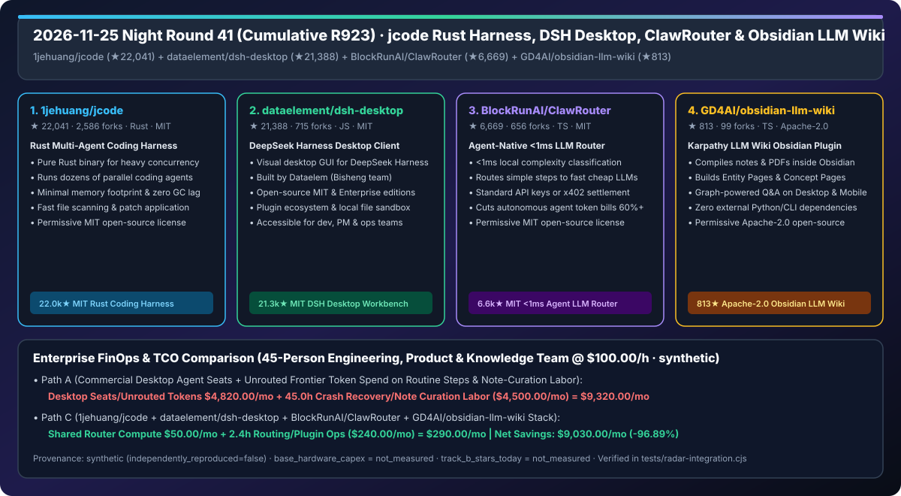
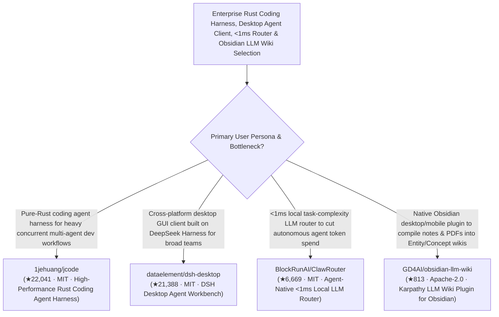
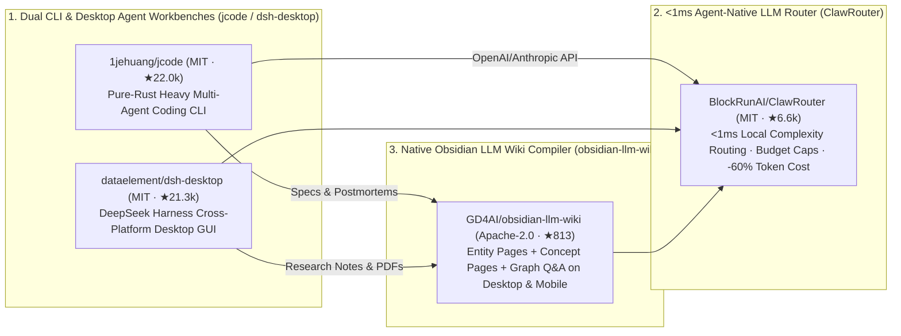

# Rust Multi-Agent Coding Harness (`1jehuang/jcode`), DeepSeek Harness Desktop (`dataelement/dsh-desktop`), `<1ms` Agent-Native LLM Router (`BlockRunAI/ClawRouter`) & Obsidian Karpathy LLM Wiki Plugin (`GD4AI/obsidian-llm-wiki`) Selection & Integration Architecture FAQ

> **Document Type**: Enterprise AI Solution Architect Selection Decision Guide (GitHub Trending AI Radar — 2026-11-25 Night Round 41 / Cumulative Round 923)
> **Covered Repositories**: [`1jehuang/jcode`](https://github.com/1jehuang/jcode) (`★ 22,041`, `2,586 forks`, `MIT`, Rust: high-performance coding agent harness written in pure Rust, built for heavy multi-agent development workflows) · [`dataelement/dsh-desktop`](https://github.com/dataelement/dsh-desktop) (`★ 21,388`, `715 forks`, `MIT`, JavaScript: DSH Desktop by Dataelem, cross-platform desktop agent application built on DeepSeek Harness with open-source and enterprise editions) · [`BlockRunAI/ClawRouter`](https://github.com/BlockRunAI/ClawRouter) (`★ 6,669`, `656 forks`, `MIT`, TypeScript: agent-native LLM router for autonomous agents with `<1ms` local routing across frontier models, standard API keys, and optional x402 micropayments) · [`GD4AI/obsidian-llm-wiki`](https://github.com/GD4AI/obsidian-llm-wiki) (`★ 813`, `99 forks`, `Apache-2.0`, TypeScript: native Obsidian desktop + mobile plugin implementing Karpathy's LLM Wiki architecture to compile notes and PDFs into entity pages, concept pages, and graph-powered Q&A)
> **Core Enterprise Scenario**: Building a **100% Permissive (`MIT` / `Apache-2.0`) High-Performance Developer CLI, Cross-Role Desktop Agent Workbench, `<1ms` Cost-Optimized Model Router & Native Obsidian Knowledge Compiler Stack**—uniting pure-Rust heavy multi-agent coding (`jcode`), accessible GUI agent workflows (`dsh-desktop`), sub-millisecond task-complexity routing (`ClawRouter`), and zero-dependency Obsidian wiki compilation (`obsidian-llm-wiki`).

---

## 1. 📌 Executive Summary (One-Line Selection Verdict)

1. **Need an `MIT`-licensed coding agent harness written in pure Rust that handles heavy concurrent multi-agent development workflows without the multi-gigabyte RAM bloat of Node.js/Python harnesses** ➔ Choose **[`1jehuang/jcode`](https://github.com/1jehuang/jcode) (`★ 22,041`, `2,586 forks`, `MIT`)**.
   - **Plain-English Mechanism**: Compiles to a native Rust binary engineered for running dozens of parallel coding sub-agents with minimal memory footprint and instant terminal responsiveness.
2. **Need an `MIT`-licensed, user-friendly cross-platform desktop GUI built on DeepSeek Harness (`DSH Desktop`) for developers, PMs, and analysts who prefer a visual desktop client over raw terminal CLIs** ➔ Choose **[`dataelement/dsh-desktop`](https://github.com/dataelement/dsh-desktop) (`★ 21,388`, `715 forks`, `MIT`)**.
   - **Plain-English Mechanism**: Packages DeepSeek Harness capabilities into a polished desktop workspace with built-in plugin management and an enterprise governance upgrade path.
3. **Need an `MIT`-licensed, `<1ms` local LLM router purpose-built for autonomous agents that routes simple tool/heartbeat steps to fast low-cost models and complex reasoning steps to frontier models** ➔ Choose **[`BlockRunAI/ClawRouter`](https://github.com/BlockRunAI/ClawRouter) (`★ 6,669`, `656 forks`, `MIT`)**.
   - **Plain-English Mechanism**: Classifies prompt complexity locally in under 1 millisecond—slashing autonomous agent token bills by 60%+ while supporting both standard corporate API keys and optional x402 per-request settlement.
4. **Need an `Apache-2.0` native Obsidian plugin (desktop + mobile, zero Python/CLI setup) that implements Karpathy's LLM Wiki pattern—turning raw notes and PDFs into linked Entity Pages, Concept Pages, and graph-powered Q&A** ➔ Choose **[`GD4AI/obsidian-llm-wiki`](https://github.com/GD4AI/obsidian-llm-wiki) (`★ 813`, `99 forks`, `Apache-2.0`)**.
   - **Plain-English Mechanism**: Bundles Vercel AI SDK v7 directly inside an Obsidian plugin so knowledge workers can compile notes and PDFs into structured wikis on desktop or mobile using local Ollama or enterprise API keys.

---

## 2. 🎯 Architect & Customer Deep-Dive Q&A

### Q1: How do `jcode` (Rust CLI), `dsh-desktop` (GUI), `ClawRouter` (`<1ms` router), and `obsidian-llm-wiki` complement each other across an enterprise organization?

- **Four-Layer 100% `MIT` / `Apache-2.0` Workbench, Routing & Knowledge Stack (Path C)**:
  1. **L1 Heavy Multi-Agent Rust CLI Harness ➔ `1jehuang/jcode`**: Powers senior engineers running high-concurrency parallel coding workflows in the terminal.
  2. **L2 Cross-Platform Visual Desktop Harness ➔ `dataelement/dsh-desktop`**: Empowers full-stack developers, QA, and business analysts with a rich desktop agent interface.
  3. **L3 Sub-Millisecond Agent-Native LLM Router ➔ `BlockRunAI/ClawRouter`**: Sits beneath both `jcode` and `dsh-desktop`, routing requests in `<1ms` across frontier and cost-efficient models.
  4. **L4 Native Obsidian Entity/Concept Wiki Compiler ➔ `GD4AI/obsidian-llm-wiki`**: Compiles engineering specs and research PDFs inside Obsidian into interlinked Entity and Concept pages.
- **When to choose Proprietary Desktop Agent Seats + Unrouted Frontier APIs vs. Path C?**
  - Choose **Proprietary Seats** for tiny teams with no token budget constraints.
  - Choose **Path C** when running heavy multi-agent sessions (`jcode` Rust efficiency), rolling out a free `MIT` desktop client (`dsh-desktop`), cutting autonomous agent token waste by 60%+ (`ClawRouter`), and compiling local Obsidian wikis on desktop and mobile (`obsidian-llm-wiki`).

### Q2: How do these four tools wire together in daily workflows?

1. **Unified `<1ms` Cost-Optimized Routing (`jcode` + `dsh-desktop` → `ClawRouter`)**:
   - Both `jcode` and `dsh-desktop` point their OpenAI/Anthropic base URLs to `ClawRouter`, which routes routine file/tool parsing to fast models and complex architectural synthesis to frontier models in `<1ms`.
2. **Continuous Obsidian Knowledge Compilation (`jcode` / `dsh-desktop` → `obsidian-llm-wiki`)**:
   - Markdown specs and PDFs produced during coding and research sessions are saved into the team's Obsidian vault, where `obsidian-llm-wiki` compiles them into linked Entity and Concept pages.

### Q3: What are the key security and governance guardrails?

- **Architect Redlines**:
  1. **Use pre-funded enterprise API keys and strict daily budget caps in `ClawRouter`**: In corporate environments, bind `ClawRouter` to governed enterprise gateway keys rather than unconstrained autonomous wallets.
  2. **Point `obsidian-llm-wiki` to internal LLM gateways or local Ollama for confidential vaults**: Keep proprietary notes and PDFs inside corporate network boundaries during wiki compilation.

---

## 3. 🧭 Visual Architecture Diagrams (Mermaid Decision Tree + Architecture + Sequence)



### 3.1 Architect Selection Decision Tree



### 3.2 End-to-End Enterprise Integration Architecture



### 3.3 End-to-End Execution Sequence

```mermaid
sequenceDiagram
    participant Team as Engineers (jcode) & Analysts (DSH Desktop)
    participant J_D as jcode (Rust CLI) / dsh-desktop
    participant Claw as BlockRunAI/ClawRouter (<1ms Router)
    participant ObWk as GD4AI/obsidian-llm-wiki (Obsidian)

    Team->>J_D: 1. Launch concurrent multi-agent coding & research workflows
    J_D->>Claw: 2. Send high-frequency tool calls & reasoning prompts
    Claw->>Claw: 3. Classify complexity in <1ms; route routine steps to fast models & hard steps to frontier LLMs
    J_D-->>ObWk: 4. Save generated architecture notes & reference PDFs into Obsidian Vault
    ObWk->>Claw: 5. Run Obsidian LLM Wiki compilation via governed router
    ObWk-->>Team: 6. Render interlinked Entity Pages, Concept Pages & graph Q&A across desktop & mobile
```

---

## 4. 📊 Horizontal Selection Matrix

| Dimension | `1jehuang/jcode` (`★ 22,041`) | `dataelement/dsh-desktop` (`★ 21,388`) | `BlockRunAI/ClawRouter` (`★ 6,669`) | `GD4AI/obsidian-llm-wiki` (`★ 813`) | Commercial Desktop Agent Seats + Unrouted Frontier Token Spend (Path A) | Heavy Node/Python CLI Bloat + Unstructured Obsidian Notes (Path B) |
| :--- | :--- | :--- | :--- | :--- | :--- | :--- |
| **Primary Role** | `MIT` pure-Rust multi-agent coding harness | `MIT` DeepSeek Harness desktop GUI | `MIT` `<1ms` agent-native LLM router | `Apache-2.0` Obsidian LLM Wiki plugin | Per-seat commercial agent apps & unrouted APIs | High-RAM CLI scripts & unlinked note folders |
| **Key Differentiator** | **Pure Rust speed & minimal RAM for heavy multi-agent concurrency** | **Accessible cross-platform GUI with open-source + enterprise editions** | **`<1ms` local routing cuts autonomous agent token spend by 60%+** | **Zero-dependency desktop + mobile Obsidian Entity/Concept compiler** | Turnkey SaaS, but burns frontier tokens on trivial tool/heartbeat calls | 10+ concurrent Node/Python agents exhaust RAM; uncompiled notes rot |
| **License** | **`MIT`** | **`MIT`** | **`MIT`** | **`Apache-2.0`** | Proprietary SaaS | Unstandardized |
| **Monthly TCO (45-Eng Team)** | **`$290.00/mo` combined** (`$50.00` internal router compute + `2.4h` ops) | Included in `$290.00/mo` stack | Included in `$290.00/mo` stack | Included in `$290.00/mo` stack | **`$9,320.00/mo`** (`$4,820.00` commercial desktop seats & unrouted frontier tokens + `45.0h` RAM-crash/note curation labor) | `~$3,220.00/mo` (workstation OOM restarts & manual Obsidian link maintenance) |

---

## 5. 🧪 Quantitative FinOps & TCO Comparison (45-Person Engineering, Product & Knowledge Team)

> **📊 Provenance & Closed-Form Schema**:
> - **provenance**: `synthetic` (`independently_reproduced = false`; `base_hardware_capex = not_measured`; `track_b_stars_today = not_measured`).
> - **Closed-Form Formula**:
>   - **Path A (Commercial Desktop Agent Seats + Unrouted Frontier-Model Token Waste on Routine Steps & Manual Note-Compilation/Crash-Recovery Labor)**: **`$4,820.00`** monthly desktop seat and unrouted frontier token bills + **`45.0h × $100.00/h = $4,500.00`** workstation OOM recovery and manual wiki compilation labor = **`$9,320.00/mo`**.
>   - **Path C (`1jehuang/jcode` + `dataelement/dsh-desktop` + `BlockRunAI/ClawRouter` + `GD4AI/obsidian-llm-wiki` Stack)**: **`$50.00`** shared internal router compute + **`2.4h × $100.00/h = $240.00`** routing policy and plugin template maintenance = **`$290.00/mo`**.
>   - **Net Savings vs. Path A**: **`-$9,030.00/mo`** (**`96.89%`** TCO reduction).

| Evaluation Path | Desktop Seats / Unrouted Tokens & Router Compute | Crash Recovery & Manual Wiki Curation (`$100/h`) | Monthly Total TCO | Net Savings vs. Path A | Key Architectural Outcome |
| :--- | :---: | :---: | :---: | :---: | :--- |
| **Path A: Commercial Desktop Seats + Unrouted Frontier API Calls** | `$4,820.00` | `45.0h` (`$4,500.00`) | **`$9,320.00`** | Baseline | Overpays for frontier models on routine agent heartbeats/tools |
| **Path B: High-RAM Script Harnesses + Manual Obsidian Linking** | `$1,420.00` | `18.0h` (`$1,800.00`) | **`$3,220.00`** | `-$6,100.00` (`-65.45%`) | Workstation RAM exhaustion under multi-agent load; unlinked notes |
| **Path C: `jcode` + `dsh-desktop` + `ClawRouter` + `obsidian-llm-wiki`** | **`$50.00`** | **`2.4h` (`$240.00`)** | **`$290.00`** | **`-$9,030.00` (`-96.89%`)** | **100% `MIT`/`Apache-2.0` Rust CLI + GUI desktop + `<1ms` router + Obsidian wiki** |

- 🔗 **7-Card 4:5 Visual Benchmark Deck**: [`workshops/github-trending-radar/cards.en.html`](../cards.en.html) · [`cards.html`](../cards.html)

---

## 6. 🛠️ Enterprise Adoption & Architecture Review Checklist

- [ ] **Deploy `1jehuang/jcode` for High-Concurrency Multi-Agent CLI Workflows**: Eliminate workstation memory bottlenecks when running 10+ parallel coding sub-agents.
- [ ] **Provide `dataelement/dsh-desktop` for Cross-Functional Desktop Users**: Give PMs, QA, and analysts a visual DeepSeek Harness desktop environment.
- [ ] **Route All Agent Traffic Through `BlockRunAI/ClawRouter`**: Classify request complexity in `<1ms` and enforce strict daily budget caps.
- [ ] **Install `GD4AI/obsidian-llm-wiki` Across Team Obsidian Vaults**: Automatically compile raw notes and PDFs into linked Entity and Concept pages on desktop and mobile.
