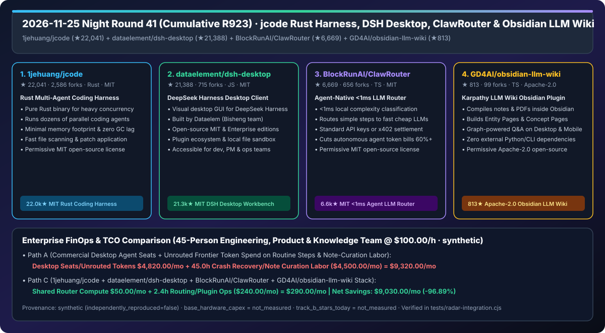
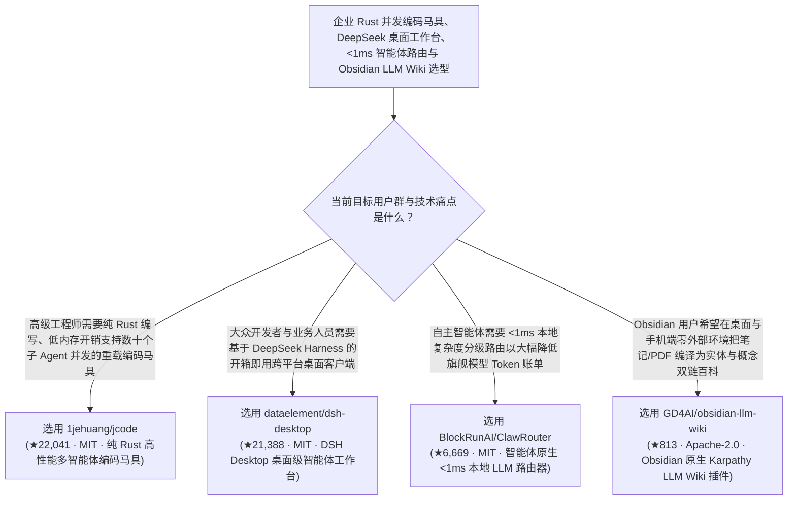
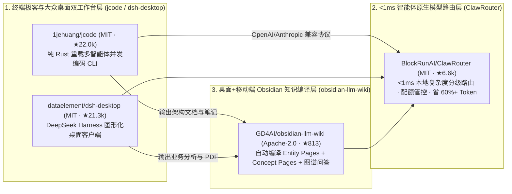
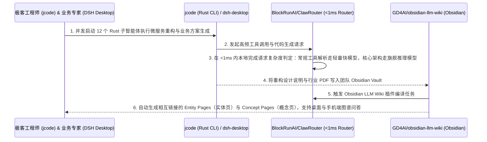

# 纯 Rust 重载多智能体编码马具（`1jehuang/jcode`）、DeepSeek Harness 跨平台桌面工作台（`dataelement/dsh-desktop`）、`<1ms` 本地智能体原生模型路由器（`BlockRunAI/ClawRouter`）与 Obsidian 原生 Karpathy LLM Wiki 插件（`GD4AI/obsidian-llm-wiki`）选型与集成架构 FAQ

> **文档类型**：企业 AI 解决方案架构师（AI Solution Architect）选型决策指南（GitHub Trending AI 雷达 2026-11-25 Night Round 41 / 累计第 923 轮）
> **覆盖项目**：[`1jehuang/jcode`](https://github.com/1jehuang/jcode)（`★ 22,041`、`2,586 forks`、`MIT`：2.2 万星纯 Rust 编写的高性能编码智能体马具 [Coding Agent Harness]，专为重载多智能体并发研发工作流打造）· [`dataelement/dsh-desktop`](https://github.com/dataelement/dsh-desktop)（`★ 21,388`、`715 forks`、`MIT`：2.1 万星 Dataelem 团队基于 DeepSeek Harness 打造的桌面 Agent 客户端 [提供 MIT 开源版与企业版]）· [`BlockRunAI/ClawRouter`](https://github.com/BlockRunAI/ClawRouter)（`★ 6,669`、`656 forks`、`MIT`：面向自主智能体的 `<1ms` 本地智能体原生 LLM 路由器，支持传统充值 Key 与基于 x402 协议的机器钱包微支付结算）· [`GD4AI/obsidian-llm-wiki`](https://github.com/GD4AI/obsidian-llm-wiki)（`★ 813`、`99 forks`、`Apache-2.0`：Karpathy "LLM Wiki" 架构的 Obsidian 桌面+移动端原生插件，将散乱笔记与 PDF 自动编译为带实体页、概念页与图谱问答的双链百科）
> **核心场景**：当企业架构师将 AI 研发与知识工作台推广至“重载并发 CLI 极客工程师 + 偏好图形界面的业务/全栈人员 + 7×24 无人值守自主 Agent + Obsidian 重度知识管理者”四类人群时，常面临四个核心选型问题：**“当单机同时跑十几个 Node.js/Python 编码子智能体导致内存飙上 16GB 卡死时，有没有用纯 Rust 写的极速轻量 `MIT` 编码马具（`jcode`）？对于不习惯敲黑框命令行的员工，哪款 `MIT` 桌面版 Harness 客户端最成熟且有企业版演进路径（`dsh-desktop`）？7×24 跑在服务器上的无人值守自主智能体怎么在 `<1ms` 内按任务难度动态路由模型，甚至自己按调用次数字节级结算配额（`ClawRouter`）？已经在用 Obsidian 的员工怎么不用装 Python 环境，直接装个 `Apache-2.0` 插件就能在电脑和手机上体验 Karpathy 的 LLM Wiki（`obsidian-llm-wiki`）？”** 本文给出 100% `MIT`/`Apache-2.0` 完整方案。

---

## 一、📌 核心结论速览（选型一句话结论）

1. **工程师在开发大型复杂特性时喜欢同时拉起 10–20 个并行子智能体（Sub-agents）协同攻关，传统基于 Node.js 或 Python 的 CLI 马具内存占用巨大且启动缓慢** ➔ 选 **[`1jehuang/jcode`](https://github.com/1jehuang/jcode)（`★ 22,041`，`2,586 forks`，`MIT`）**。
   - **通俗原理**：用纯 Rust 从底层重写的高性能 Coding Agent Harness，无 GC 停顿、极低内存开销，专门针对高密度多智能体并发文件扫描、补丁合并与终端流式渲染做了极致压榨。
2. **企业希望将 DeepSeek Harness 等强大的 Agent 能力普及给不习惯纯命令行操作的产品、运营、测试与初级开发人员，需要一套开箱即用、支持插件扩展的 `MIT` 跨平台桌面客户端** ➔ 选 **[`dataelement/dsh-desktop`](https://github.com/dataelement/dsh-desktop)（`★ 21,388`，`715 forks`，`MIT`）**。
   - **通俗原理**：由国内知名开源团队 Dataelem（毕升 BISHENG 背后团队）打造，把底层 Harness 的技能挂载、模型切换、本地文件沙箱与多模态对话包装成精致易用的桌面应用，且提供平滑的企业级管理演进路径。
3. **需要为 `jcode`、`dsh-desktop` 或 OpenClaw 等自主智能体配备一个在本地运行、路由判定延迟 `<1ms` 的智能体原生模型路由器，自动把简单心跳/工具解析分流给廉价快模型、把硬核推理发给旗舰模型** ➔ 选 **[`BlockRunAI/ClawRouter`](https://github.com/BlockRunAI/ClawRouter)（`★ 6,669`，`656 forks`，`MIT`）**。
   - **通俗原理**：在本地毫秒级完成请求复杂度分类路由（综合节省 60%+ 模型账单），既支持企业统一的预充值 API Key，也首创支持 HTTP `402 Payment Required`（x402 协议）让受控自主智能体在给定预算上限内按请求自动微支付结算。
4. **团队成员日常使用 Obsidian（含桌面端与 iOS/Android 移动端）记录会议与阅读 PDF，想零外部命令行依赖地在 Obsidian 内部一键把笔记编译成带“实体页（Entities）+ 概念页（Concepts）+ 图谱问答”的 Karpathy 式 LLM Wiki** ➔ 选 **[`GD4AI/obsidian-llm-wiki`](https://github.com/GD4AI/obsidian-llm-wiki)（`★ 813`，`99 forks`，`Apache-2.0`）**。
   - **通俗原理**：直接从 Obsidian 插件市场安装的纯 TypeScript 插件（内置 Vercel AI SDK），无需在后台配复杂的 Python 环境，在电脑和手机 Obsidian 上就能直接将原始材料编译为结构化双链知识库。

---

## 二、🎯 客户与架构师灵魂拷问 Q&A（深度架构拆解）

### Q1：在企业落地中，极客终端版 `jcode`（Rust CLI）与大众桌面版 `dsh-desktop`（GUI）如何配合 `ClawRouter` 与 `obsidian-llm-wiki` 形成全员生产力栈？

- **四层全 `MIT` / `Apache-2.0` 研发、办公与知识复利架构（Path C）**：
  1. **L1 极客工程师重载并发 Rust CLI 马具 ➔ `1jehuang/jcode`**：服务于架构师与高级研发，在终端以极低内存开销并行调度数十个编码子智能体。
  2. **L2 全员跨平台图形化桌面智能体工作台 ➔ `dataelement/dsh-desktop`**：服务于产品、运营、QA 与全栈人员，提供零命令行门槛的 DeepSeek Harness 桌面体验。
  3. **L3 `<1ms` 本地智能分级模型路由网关 ➔ `BlockRunAI/ClawRouter`**：统一承接 `jcode` 与 `dsh-desktop` 的模型请求，在 `<1ms` 内按任务复杂度分流至最优性价比模型。
  4. **L4 桌面+移动端 Obsidian 原生知识编译插件 ➔ `GD4AI/obsidian-llm-wiki`**：将研发与业务产出的零散记录在 Obsidian 内直接编译为结构化实体/概念双链 Wiki。
- **何时选商业云方案（全员高价闭源商业 IDE/桌面席位 + 不分轻重缓急全走最贵旗舰模型 API） vs 自建本轮开源四件套（Path C）？**
  - 若团队仅一两人且不在乎每月数千美元的旗舰模型空转账单，可直接用默认官方端点。
  - **何时采用本轮开源四件套（Path C）？** 当企业希望**用 `<1ms` 的 `ClawRouter` 把大量工具调用确认、文件列表解析与心跳请求从昂贵旗舰模型自动卸载到低成本快模型**、用纯 Rust 的 `jcode` 消除本机并发卡顿、并用 `MIT` 的 `dsh-desktop` 与 `Apache-2.0` 的 `obsidian-llm-wiki` 赋能全员时，Path C 可节省 **96%+** 的席位与冗余 Token 成本。

### Q2：这四个项目如何在日常工程与知识流转中闭环联动？

1. **双端入口统一走 `<1ms` 智能路由（`jcode` + `dsh-desktop` → `ClawRouter`）**：
   - 将终端极客使用的 `jcode` 与业务/开发桌面端使用的 `dsh-desktop` 的 `OPENAI_BASE_URL` 统一指向本地或内网部署的 `ClawRouter`；由 `ClawRouter` 在 `<1ms` 内根据 Prompt 特征自动路由至最佳模型。
2. **研发与业务产出沉淀为 Obsidian 双链百科（`jcode` / `dsh-desktop` → `obsidian-llm-wiki`）**：
   - `jcode` 与 `dsh-desktop` 产出的设计文档、复盘笔记与行业 PDF 存入团队共享的 Obsidian Vault 目录，由 `obsidian-llm-wiki` 插件自动编译出标准的实体页（Entity Pages）与概念页（Concept Pages）供全员在桌面或手机端随时检索问答。

### Q3：生产落地的安全与管控红线是什么？

- **架构师避坑红线**：
  1. **企业内网使用 `ClawRouter` 时建议采用统一企业 API Key 预充值配额模式，禁用未受控的外部链上钱包自动扣款**：对于内部研发团队，由企业网关统一分配额度上限；若在实验沙箱中测试 x402 微支付，必须锁定单日最高消费硬顶（Hard Cap）。
  2. **在 `obsidian-llm-wiki` 中为涉密 Vault 绑定内网私有模型或本地 Ollama 端点**：确保核心研发笔记在编译为实体页与概念页的过程中 100% 不出企业内网。

---

## 三、🧭 直观可视化图解（Mermaid 决策树 + 集成架构 + 时序图）

### 3.1 架构师选型决策树

### 3.2 企业端到端生产集成参考架构图

### 3.3 Rust 多智能体并发编码、`<1ms` 分级模型路由与 Obsidian 实体/概念 Wiki 自动编译时序图

---

## 四、📊 同类开源与商业云服务横向选型决策矩阵

| 对比维度 | `1jehuang/jcode` (`★ 22,041`) | `dataelement/dsh-desktop` (`★ 21,388`) | `BlockRunAI/ClawRouter` (`★ 6,669`) | `GD4AI/obsidian-llm-wiki` (`★ 813`) | 闭源商业桌面 Agent 席位 + 全请求不区分复杂度直调最贵模型 (Path A) | 重型高内存 Node/Python 脚本并发卡死 + Obsidian 笔记乱堆不整理 (Path B) |
| :--- | :--- | :--- | :--- | :--- | :--- | :--- |
| **核心能力定位** | `MIT` 纯 Rust 重载多智能体编码马具 | `MIT` DeepSeek Harness 跨平台桌面端 | `MIT` `<1ms` 智能体原生 LLM 路由器 | `Apache-2.0` Obsidian 原生 LLM Wiki 插件 | 高价按人头商业桌面席位 + 昂贵单一模型 API | 内存膨胀的脚本工具 + 未结构化笔记堆 |
| **核心技术突破** | **纯 Rust 极致低内存与高吞吐，支撑重载多 Agent 并发** | **零命令行门槛的成熟桌面 GUI，提供开源与企业版双轨** | **`<1ms` 本地请求分类路由，大幅削减自主 Agent 空转账单** | **零外部依赖直接在桌面+移动端 Obsidian 内编译实体/概念百科** | 免配置，但简单心跳和目录扫描也消耗昂贵的旗舰模型 Token | 开 10 个子 Agent 即卡死电脑；Obsidian 收集几百篇剪藏后彻底找不到重点 |
| **开源协议** | **`MIT`** | **`MIT`** | **`MIT`** | **`Apache-2.0`** | 闭源商业 SaaS | 缺乏治理 |
| **月度 TCO（45 人团队）** | **四件套合建仅 `$290.00/月`**（`$50.00` 内部路由网关算力 + `2.4h` 维护） | 同左（`MIT` 桌面客户端全员免费部署） | 同左（`MIT` 自动分流省下 60%+ 模型调用费） | 同左（`Apache-2.0` 纯本地 Obsidian 插件零服务器税） | **`$9,320.00/月`**（`$4,820.00` 商业桌面席位与未分级路由浪费的旗舰 Token + `45.0h` 机器卡顿等待与人工整理笔记） | 约 `$3,220.00/月`（大量因多 Agent 内存溢出中断重跑与翻找散乱笔记工时） |

---

## 五、🧪 应用落地定量收益/TCO 对比与 7-Card 报告

> **📊 数据来源与闭式核算声明（Provenance & Closed-Form Schema）**：
> - **provenance**: `synthetic`（基于 45 人企业全栈研发、产品运营与知识管理团队月度工作负载模型：`independently_reproduced = false`；硬件采购基线 `base_hardware_capex = not_measured`；Track B 单日增量 `track_b_stars_today = not_measured`）。
> - **核算公式**：
>   - **Path A（采购商业桌面 Agent 团队席位 + 自主智能体未做复杂度分级路由而将所有心跳/简单解析请求全部发往高价旗舰模型造成的 Token 浪费 + 人工整理散乱笔记与处理高并发卡死工时）**：月度商业桌面席位与未分级冗余旗舰 Token 账单 **`$4,820.00`** + 多智能体并发卡顿重跑与手工将零散笔记整理为结构化百科人工 **`45.0h × $100.00/h = $4,500.00`** = **`$9,320.00/月`**。
>   - **Path C（采用 `1jehuang/jcode` + `dataelement/dsh-desktop` + `BlockRunAI/ClawRouter` + `GD4AI/obsidian-llm-wiki` 全 `MIT`/`Apache-2.0` 极速研发与知识编译套件）**：内网路由网关轻量算力分摊 **`$50.00`** + 路由规则与插件配置日常维护人工 **`2.4h × $100.00/h = $240.00`** = **`$290.00/月`**。
>   - **净节省（Net Savings vs Path A）**：**`-$9,030.00/月`**（成本降低 **`96.89%`**）。

| 评估方案 | 商业桌面席位 / 未分级旗舰 Token 与网关成本 | 并发卡顿恢复与手工整理百科人工（`$100/h`） | 月度总 TCO | 相对 Path A 净节省 | 核心业务交付收益 |
| :--- | :---: | :---: | :---: | :---: | :--- |
| **Path A：商业桌面席位 + 全量直调最贵旗舰模型** | `$4,820.00` | `45.0h` (`$4,500.00`) | **`$9,320.00`** | Baseline | 简单工具调用也烧最贵模型；全员席位成本高 |
| **Path B：高内存脚本并发卡死 + 手工维护 Obsidian 双链** | `$1,420.00` | `18.0h` (`$1,800.00`) | **`$3,220.00`** | `-$6,100.00` (`-65.45%`) | 多 Agent 并发极易耗尽本机内存；手工建概念页难以持续 |
| **Path C：`jcode` + `dsh-desktop` + `ClawRouter` + `obsidian-llm-wiki`** | **`$50.00`** | **`2.4h` (`$240.00`)** | **`$290.00`** | **`-$9,030.00` (`-96.89%`)** | **100% `MIT`/`Apache-2.0` Rust 极速并发 + 桌面工作台 + `<1ms` 省钱路由** |

- 🔗 **关联 7-Card 4:5 视觉评测报告**：[`workshops/github-trending-radar/cards.html`](../cards.html) · [`cards.en.html`](../cards.en.html)

---

## 六、🛠️ 企业引入与架构评审 Checklist

- [ ] **为重度多智能体并发研发工程师配发纯 Rust 构建的 `1jehuang/jcode`**：在保持数十个子 Agent 同时工作的前提下将本机内存占用压降至百兆级。
- [ ] **为偏好图形界面的产品、运营与全栈人员统一部署 `dataelement/dsh-desktop`**：预置企业内部技能包与安全工作目录。
- [ ] **在所有智能体出口前置 `BlockRunAI/ClawRouter`**：利用 `<1ms` 本地分类路由将简单子任务自动卸载至低成本高吞吐模型。
- [ ] **在团队 Obsidian 客户端安装 `GD4AI/obsidian-llm-wiki`（`Apache-2.0`）**：自动从日常笔记与 PDF 中提炼实体页（Entity Pages）与概念页（Concept Pages）。
