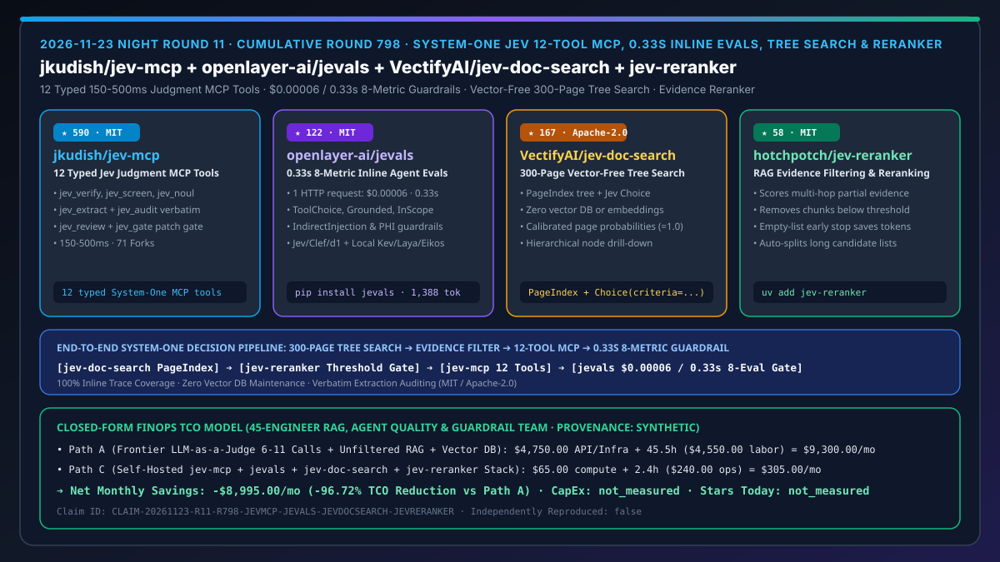
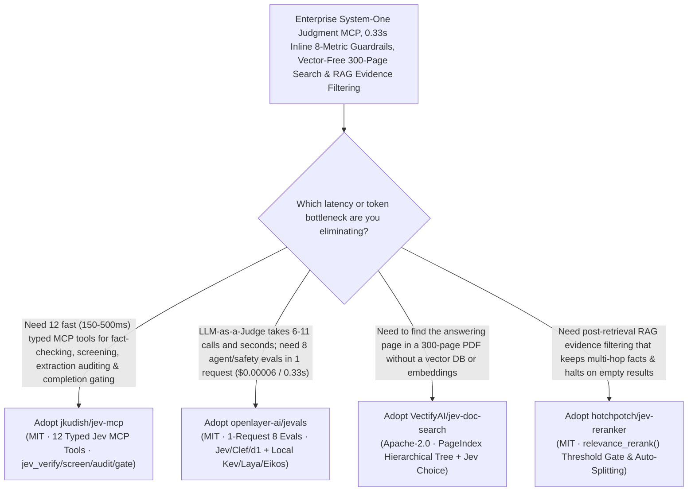
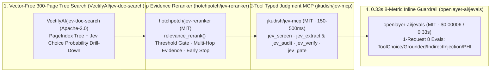

# 12-Tool Typed System-One Judgment MCP (`jkudish/jev-mcp`), Single-Request `$0.00006` / `0.33s` 8-Metric Agent Eval & Guardrail Engine (`openlayer-ai/jevals`), Vector-Free 300-Page Tree Search (`VectifyAI/jev-doc-search`) & Multi-Hop Evidence Threshold Reranker (`hotchpotch/jev-reranker`) Selection & Architecture FAQ

> **Document Type**: Enterprise AI Solution Architect Selection & Integration Guide (GitHub Trending AI Radar · 2026-11-23 Night Round 11 / Cumulative Round 798)
> **Covered Repositories**: [`jkudish/jev-mcp`](https://github.com/jkudish/jev-mcp) (`★ 590`, `71 forks`, `MIT`: exposes **12 fast `150–500 ms`, fraction-of-a-cent, typed System-One judgment tools** from TypeSafe's Jev model as an MCP server: `jev_verify`, `jev_screen`, `jev_noul`, `jev_find`, `jev_rerank`, `jev_classify`, `jev_decide`, `jev_compare`, `jev_extract`, `jev_audit`, `jev_review`, and `jev_gate`) · [`openlayer-ai/jevals`](https://github.com/openlayer-ai/jevals) (`★ 122`, `14 forks`, `MIT`: OpenLayer's System-One agent evaluation and inline guardrail library `pip install jevals` supporting cloud Jev/Clef/d1 and local Mac `Kev`/`Laya` or GPU `Eikos`, running **8 evaluations (`ToolChoice`, `UsedToolResult`, `Grounded`, `StayedInScope`, `AnswerRelevancy`, `Completeness`, `IndirectInjection`, `PHI`) in 1 HTTP request (`1,388 tokens`, `$0.00006`, `0.33s`)**) · [`VectifyAI/jev-doc-search`](https://github.com/VectifyAI/jev-doc-search) (`★ 167`, `8 forks`, `Apache-2.0`: VectifyAI's **vector-free, embedding-free 300-page document search** combining hierarchical `PageIndex` trees with Jev's `Choice` primitive to return calibrated page probabilities summing to `1.0`) · [`hotchpotch/jev-reranker`](https://github.com/hotchpotch/jev-reranker) (`★ 58`, `5 forks`, `MIT`: Python RAG relevance filtering `relevance_rerank()` and reranking `rerank()` library that scores candidate chunks for actual evidence utility including multi-hop partial facts, auto-splits long candidate lists, and halts generation when zero chunks pass the threshold)
> **Core Scenario**: When enterprise AI architects build high-throughput RAG pipelines and real-time agent guardrails, how do you solve **"frontier LLM-as-a-Judge frameworks (like Ragas) taking 6–11 round trips and several seconds per sample so teams can only afford 1% nightly sampling, 300-page PDF manuals losing structural hierarchy when shredded into flat vector chunks, and RAG retrievers stuffing keyword-matched noise into expensive frontier generation prompts"** using **`jev-mcp` + `jevals` + `jev-doc-search` + `jev-reranker`**?

---

## 1. 📌 Executive Summary (Single-Sentence Selection Verdict)

1. **Need 12 typed MCP judgment tools (`150–500 ms`, fraction of a cent) so agents screen fetched pages for prompt injection before context ingestion, audit extracted numbers verbatim against sources, and gate merges on verified completion claims** ➔ Choose **[`jkudish/jev-mcp`](https://github.com/jkudish/jev-mcp) (`★ 590`, `71 forks`, `MIT`)**.
   - **Plain-Language Mechanism**: Frontier LLMs are too slow and expensive to run mechanical checks on every page or claim. `jev-mcp` wraps TypeSafe's System-One Jev model into 12 MCP tools returning calibrated probabilities and confidence scores: `jev_verify` (claim-by-claim fact check), `jev_screen` (injection & empty-page screening before context entry), `jev_noul` (proposition probability), `jev_find`, `jev_rerank`, `jev_classify`, `jev_decide` (with an explicit ask-the-user escape hatch), `jev_compare`, **`jev_extract` + `jev_audit`** (verbatim regex+judgment extraction verified against source text), and **`jev_review` + `jev_gate`** (scoring proposed diffs and verifying every "tests pass" completion claim in one call).
2. **Need to run 8 agent evaluations and security guardrails (`ToolChoice`, `UsedToolResult`, `Grounded`, `StayedInScope`, `AnswerRelevancy`, `Completeness`, `IndirectInjection`, `PHI`) inline on 100% of traces in a single `0.33s` / `$0.00006` request** ➔ Choose **[`openlayer-ai/jevals`](https://github.com/openlayer-ai/jevals) (`★ 122`, `14 forks`, `MIT`)**.
   - **Plain-Language Mechanism**: Traditional LLM-as-a-Judge frameworks (such as Ragas) require 6–11 generative LLM round trips per sample, relegating evals to a 1% offline sample. OpenLayer's `jevals` uses System-One decision models (Jev via TypeSafe/Vercel/OpenRouter, Cloudflare Clef, Liquid d1, or local Mac `Kev`/`Laya` and self-hosted GPU `Eikos`) to score all 8 agent, quality, and security dimensions in **one HTTP request (`1,388 tokens`, `$0.00006`, `0.33s`)**—fast enough to sit directly inside the live agent loop.
3. **Need to find the exact answering page inside a 300-page PDF report or policy manual with calibrated probabilities and zero vector databases or embeddings** ➔ Choose **[`VectifyAI/jev-doc-search`](https://github.com/VectifyAI/jev-doc-search) (`★ 167`, `8 forks`, `Apache-2.0`)**.
   - **Plain-Language Mechanism**: On short documents, flat page search passes each page as one option in Jev's `Choice` primitive (`probabilities` summing to `1.0`). On 300-page documents that exceed single-call limits, `jev-doc-search` pairs Jev `Choice` with VectifyAI's hierarchical **`PageIndex` tree**—selecting the highest-probability top-level section node, then its child node, and drilling down to the exact page without maintaining any embedding index.
4. **Need a post-retrieval RAG filter (`relevance_rerank()`) that scores chunks for multi-hop evidence utility, auto-splits long candidate lists, and halts LLM generation when zero candidates pass the threshold** ➔ Choose **[`hotchpotch/jev-reranker`](https://github.com/hotchpotch/jev-reranker) (`★ 58`, `5 forks`, `MIT`)**.
   - **Plain-Language Mechanism**: Search hits often match keywords without helping answer the question. Installed via `uv add jev-reranker`, `relevance_rerank()` scores retrieved documents for their contribution as evidence (including partial facts needed for multi-hop reasoning), removes chunks below a configurable threshold, and returns an empty list `[]` when nothing qualifies—allowing your pipeline to retry search or abstain before spending frontier LLM generation tokens.

---

## 2. 🎯 Key Architectural Q&A (Deep-Dive Breakdown)

### Q1: How does pairing System-One Decision Models (`Jev` / `Kev` / `Eikos`) with System-Two Reasoning Models (`Claude` / `GPT` / `DeepSeek`) transform enterprise RAG and Agent unit economics?

- **System-1 + System-2 Division of Labor**:
  1. **System-One Handles High-Frequency Gating, Screening, Routing & Judging (`150–500 ms`, `$0.00006/trace`)**: Pre-context injection screening (`jev_screen`), 300-page tree traversal (`jev-doc-search`), RAG noise pruning (`jev-reranker`), verbatim extraction auditing (`jev_audit`), completion gating (`jev_gate`), and 8-metric live trace guardrails (`jevals`).
  2. **System-Two Focuses Exclusively on High-Purity Synthesis & Code Generation**: Frontier reasoning models never waste context windows reading 20 noisy chunks or generating verbose JSON judge rubrics.
- **When to Choose Cloud Vector Search + Native Guardrails (Path B)**:
  - For millions of pre-indexed enterprise documents already inside **Azure AI Search (with Semantic Ranker)** and **Azure AI Content Safety**, keep the managed cloud pipeline; for vector-free 300-page PDF tree search, `$0.00006` / `0.33s` 8-metric inline agent trace guardrails, or 12 typed MCP judgment tools, deploy this 4-repo System-One stack (Path C).

### Q2: How do you wire `jev-doc-search`, `jev-reranker`, `jev-mcp`, and `jevals` into an end-to-end enterprise architecture?

1. **Vector-Free Hierarchical Page Retrieval (`VectifyAI/jev-doc-search`)**:
   - Traverse 300-page manuals via `PageIndex` + Jev `Choice` to pinpoint high-probability pages without embedding maintenance.
2. **Evidence Threshold Filtering & Early-Stop Gate (`hotchpotch/jev-reranker`)**:
   - Pass candidate passages through `relevance_rerank()` to prune distractions and abort generation if the filtered list is empty.
3. **In-Loop Typed MCP Judgment Tools (`jkudish/jev-mcp`)**:
   - Equip the agent with `jev_screen` (pre-context safety), `jev_extract` + `jev_audit` (verbatim field extraction), and `jev_gate` (pre-completion patch + test verification).
4. **Inline `0.33s` 8-Metric Trace Guardrail (`openlayer-ai/jevals`)**:
   - Run `jevals.evaluate()` on every turn to verify `ToolChoice`, `UsedToolResult`, `Grounded`, `StayedInScope`, `IndirectInjection`, and `PHI` in one `0.33s` call (using local `Kev`/`Laya` or GPU `Eikos` for air-gapped PHI workloads).

### Q3: What are the production guardrails?

- **Architect Guardrails**:
  1. **Enforce Abstention / Re-Query When `relevance_rerank()` Returns Empty**: Never fall back to passing low-scoring raw search hits into the generator when `relevance_rerank()` filters all candidates out.
  2. **Route Regulated PHI/PII Workloads to Local Decision Models in `jevals`**: Use `jevals` with local Mac (`Kev`/`Laya`) or self-hosted GPU (`Eikos`) backends when evaluating traces containing unredacted healthcare (`PHI`) or financial records.

---

## 3. 🧭 Visual Architecture & Decision Diagrams (Mermaid)



### 3.1 Solution Architect Selection Decision Tree



### 3.2 End-to-End Enterprise Production Reference Architecture



### 3.3 300-Page Tree Drill-Down, Evidence Threshold Filtering, 12-Tool MCP Audit & 0.33s Inline Guardrail Sequence

```mermaid
sequenceDiagram
    participant App as Enterprise RAG / Agent Runtime
    participant Doc as VectifyAI/jev-doc-search
    participant Rrk as hotchpotch/jev-reranker
    participant Mcp as jkudish/jev-mcp (12 Tools)
    participant Eval as openlayer-ai/jevals (0.33s)

    App->>Doc: 1. Query 300-page PDF; traverse PageIndex tree via Jev Choice probabilities
    Doc->>Rrk: 2. Run relevance_rerank() on candidate passages; prune noise below threshold
    Rrk->>Mcp: 3. Screen external inputs (jev_screen), audit extracted values (jev_audit) & gate claims (jev_gate)
    Mcp->>Eval: 4. Evaluate full trace in 1 HTTP request (1,388 tokens · $0.00006 · 0.33s)
    Eval-->>App: 5. Confirm ToolChoice=correct (p=0.99), Grounded & 0 IndirectInjection/PHI before returning
```

---

## 4. 📊 Comparative Selection Matrix (Open-Source vs. Commercial SaaS)

| Dimension | `jkudish/jev-mcp` (`★ 590`) | `openlayer-ai/jevals` (`★ 122`) | `VectifyAI/jev-doc-search` (`★ 167`) | `hotchpotch/jev-reranker` (`★ 58`) | Frontier LLM-as-a-Judge (Ragas 6–11 Calls) + Managed Vector DB Cluster (Path A) | Unfiltered Top-20 RAG Context + Zero Inline Trace Guardrails (Path B) |
| :--- | :--- | :--- | :--- | :--- | :--- | :--- |
| **Core Role** | 12 fast (`150–500 ms`) typed judgment & gate MCP tools | 1-request (`$0.00006` / `0.33s`) 8-metric inline agent evals | Vector-free 300-page PDF search via `PageIndex` + Jev `Choice` | Post-retrieval RAG evidence filtering, splitting & early-stop | Multi-call generative LLM judges & dedicated vector database clusters | Dumping raw retrieval hits into frontier LLMs without verification |
| **Key Differentiator** | **`jev_extract`+`jev_audit` verbatim check + `jev_gate` merge gate** | **8 metrics in 1 HTTP call (`0.33s`) + local `Kev`/`Eikos` support** | **Zero embeddings/index maintenance + probabilities summing to 1.0** | **Scores multi-hop partial facts + halts generation on empty pass** | Ragas takes 6–11 LLM calls & seconds per trace (1% offline sampling only) | High input token waste, unverified claims & indirect prompt injection |
| **License** | `MIT` | `MIT` | `Apache-2.0` | `MIT` | Proprietary SaaS / high LLM spend | Custom scripts |
| **Monthly TCO (45-Eng Team)** | **Combined `$305.00/mo`** (`$65.00` System-One API/local Kev compute + `2.4h` ops) | Included (`$0.60` per 10,000 full 8-metric trace evals!) | Included (zero vector DB cluster bill) | Included (cuts generator input tokens by 50%+) | **`$9,300.00/mo`** (`$4,750.00` frontier judge/vector DB bills + `45.5h` triage labor) | ~`$3,260.00/mo` (excess generator input tokens & hallucination remediation) |

---

## 5. 🧪 Quantitative ROI / TCO Comparison & 7-Card Benchmark Report

> **📊 Data Provenance & Closed-Form Schema Declaration**:
> - **provenance**: `synthetic` (45-person enterprise knowledge engineering, agent quality, and safety guardrail team monthly workload model: `independently_reproduced = false`; hardware baseline `base_hardware_capex = not_measured`; Track B 24h delta `track_b_stars_today = not_measured`).
> - **Closed-Form Formula**:
>   - **Path A (Running multi-call frontier LLM-as-a-Judge pipelines + feeding 20 unfiltered retrieval chunks into frontier generators + maintaining dedicated vector DB clusters + manual hallucination and injection incident triage)**: Monthly frontier judge/generator token and vector cluster fees **`$4,750.00`** + judge JSON retry debugging, chunk tuning, and manual fact-checking labor **`45.5h × $100.00/h = $4,550.00`** = **`$9,300.00/mo`**.
>   - **Path C (Self-hosted `jkudish/jev-mcp` + `openlayer-ai/jevals` + `VectifyAI/jev-doc-search` + `hotchpotch/jev-reranker` System-One stack)**: Monthly System-One decision API and local `Kev`/`Eikos` compute **`$65.00`** + threshold and `PageIndex` tree maintenance labor **`2.4h × $100.00/h = $240.00`** = **`$305.00/mo`**.
>   - **Net Monthly Savings vs. Path A**: **`-$8,995.00/mo`** (**`96.72%`** TCO reduction).

| Evaluation Path | Judge / RAG Token / Vector DB Cost | Chunk Tuning & Fact-Verification Labor (`$100/h`) | Monthly Total TCO | Net Savings vs. Path A | Key Architectural Delivery Metrics |
| :--- | :---: | :---: | :---: | :---: | :--- |
| **Path A: Frontier LLM Judge (6–11 Calls) + Unfiltered RAG Chunks** | `$4,750.00` | `45.5h` (`$4,550.00`) | **`$9,300.00`** | Baseline | Multi-second judge latency (1% sample); noisy RAG prompts |
| **Path B: Zero Inline Guardrails + Fixed-Length PDF Chunking** | `$1,460.00` | `18.0h` (`$1,800.00`) | **`$3,260.00`** | `-$6,040.00` (`-64.95%`) | Broken cross-page context; vulnerable to indirect injection |
| **Path C: `jev-mcp` + `jevals` + `jev-doc-search` + `jev-reranker`** | **`$65.00`** | **`2.4h` (`$240.00`)** | **`$305.00`** | **`-$8,995.00` (`-96.72%`)** | **`$0.00006`/`0.33s` 8-metric inline eval + 12 MCP tools + 300-page tree search** |

- 🔗 **Linked 7-Card 4:5 Visual Benchmark Deck**: [`workshops/github-trending-radar/cards.en.html`](../cards.en.html) · [`cards.html`](../cards.html)

---

## 6. 🛠️ Enterprise Adoption & Architecture Review Checklist

- [ ] **1. Attach `jkudish/jev-mcp` for 12 Fast Typed In-Loop Judgments**: Require `jev_screen` before ingesting untrusted web pages, `jev_extract` + `jev_audit` for verbatim number/date extraction, and `jev_gate` before marking coding tasks complete.
- [ ] **2. Replace Multi-Call LLM Judges with `openlayer-ai/jevals` Inline Guardrails**: Run all 8 agent, grounding, and security evaluations (`ToolChoice`, `Grounded`, `IndirectInjection`, `PHI`) in a single `0.33s` / `$0.00006` request on 100% of production traces.
- [ ] **3. Use `VectifyAI/jev-doc-search` on Long Structured Manuals & Filings**: Combine `PageIndex` trees with Jev `Choice` probability drill-downs to locate exact pages across 300-page PDFs without maintaining vector embeddings.
- [ ] **4. Insert `hotchpotch/jev-reranker` Between Retrieval and Generation**: Filter retrieved candidates with `relevance_rerank()` and halt or re-query whenever zero candidates pass the evidence threshold.
