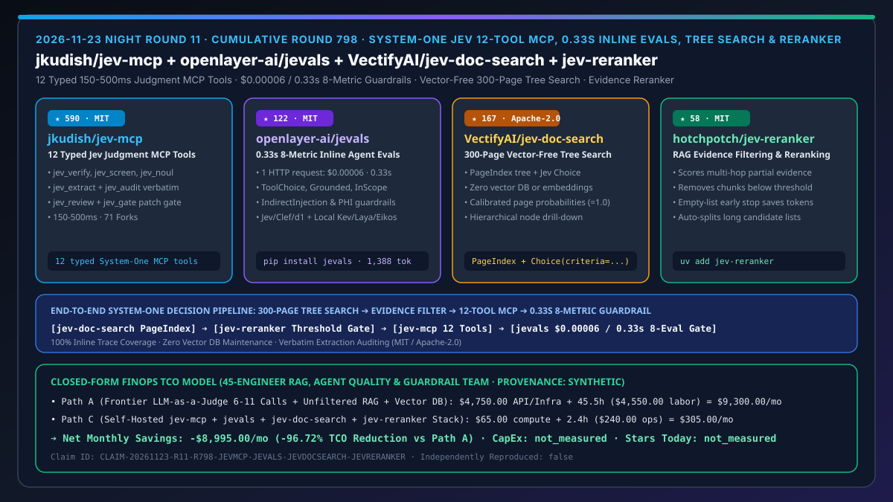
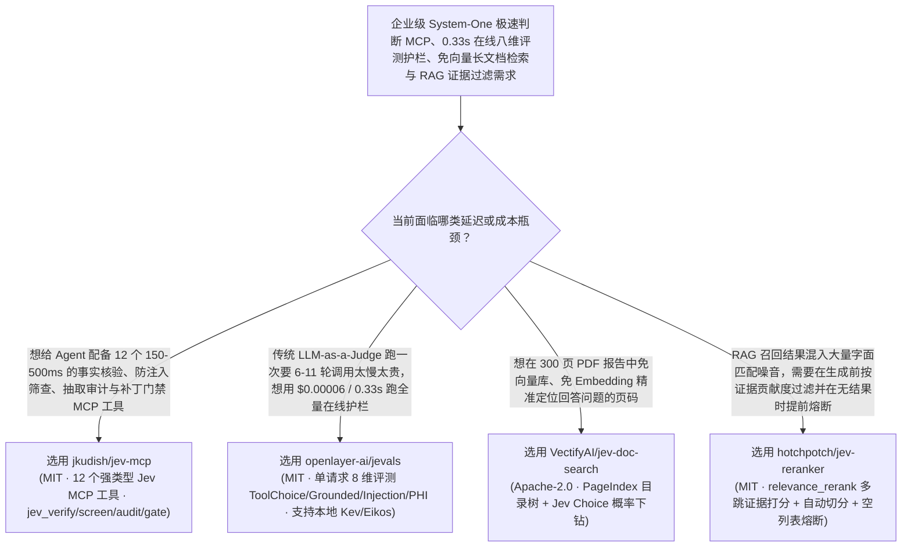
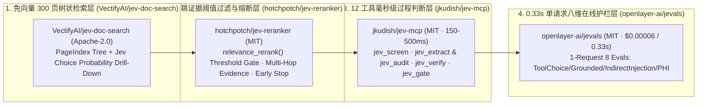
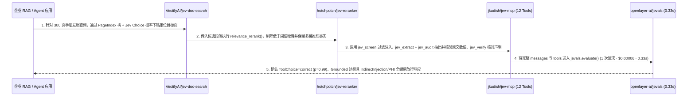

# 12 工具毫秒级校准概率判断 MCP（`jkudish/jev-mcp`）、单次请求 `$0.00006` / `0.33s` 跑完 8 项在线护栏与评测的 System-One 引擎（`openlayer-ai/jevals`）、免向量库 300 页长文档树状概率检索（`VectifyAI/jev-doc-search`）与多跳证据阈值过滤重排器（`hotchpotch/jev-reranker`）选型与集成架构 FAQ

> **文档类型**：企业 AI 解决方案架构师（AI Solution Architect）选型决策指南（GitHub Trending AI 雷达 2026-11-23 Night Round 11 / 累计第 798 轮）
> **覆盖项目**：[`jkudish/jev-mcp`](https://github.com/jkudish/jev-mcp)（`★ 590`、`71 forks`、`MIT`：将 TypeSafe `Jev` 系统一（System One）决策模型封装为 **12 个强类型、带校准概率与置信度的 MCP 工具** `jev_verify` / `jev_screen` / `jev_noul` / `jev_find` / `jev_rerank` / `jev_classify` / `jev_decide` / `jev_compare` / `jev_extract` / `jev_audit` / `jev_review` / `jev_gate`，单次调用仅需 `150–500 ms` 与几分之一美分）· [`openlayer-ai/jevals`](https://github.com/openlayer-ai/jevals)（`★ 122`、`14 forks`、`MIT`：OpenLayer 开源的基于 Jev/Clef/d1/本地 Kev/Laya/Eikos 决策模型的在线智能体评测与护栏库 `pip install jevals`，在**单次 HTTP 请求（`1,388 tokens`、`$0.00006`、`0.33s`）**内同步完成 `ToolChoice`、`UsedToolResult`、`Grounded`、`StayedInScope`、`AnswerRelevancy`、`Completeness`、`IndirectInjection` 与 `PHI` 八维打分）· [`VectifyAI/jev-doc-search`](https://github.com/VectifyAI/jev-doc-search)（`★ 167`、`8 forks`、`Apache-2.0`：VectifyAI 开源的**零向量库、零 Embedding** 300 页长文档检索方案，结合 `PageIndex` 层级目录树与 Jev `Choice` 原语逐层输出页面概率分布且总和严格为 `1.0`）· [`hotchpotch/jev-reranker`](https://github.com/hotchpotch/jev-reranker)（`★ 58`、`5 forks`、`MIT`：面向 RAG 检索后上下文组装前的证据相关性过滤与重排 Python 库 `uv add jev-reranker`，支持多跳部分证据打分、长候选列表自动切分与低于阈值自动清空熔断）
> **核心场景**：当企业架构师在构建高吞吐 RAG 与生产级 Agent 护栏时，面对**“用前沿大模型做每次网页入库筛查、事实核验与 LLM-as-a-Judge（如 Ragas 单样本需 6–11 次往返、耗时数秒）太慢太贵导致只能抽样 1% 夜间离线跑、300 页财务/制度 PDF 切碎塞进向量库后丢失章节层级语境、以及 RAG 检索把字面匹配但无助于回答问题的噪音塞给生成模型浪费输入 Token”**四大痛点，如何构建一套**“12 工具毫秒级门禁（`jev-mcp`）+ `$0.00006` 全量在线 8 维评测（`jevals`）+ 免向量树状页面检索（`jev-doc-search`）+ 证据阈值过滤重排（`jev-reranker`）”**的 System-One 极速判断架构？

---

## 一、📌 核心结论速览（选型一句话结论）

1. **想给编码或业务 Agent 装上 12 个只需 `150–500 ms`、成本不到一美分零头的强类型判断工具——在网页进上下文前先筛掉注入指令（`jev_screen`）、逐句核对报告是否符合引用出处（`jev_verify`）、在无法拍板时自动触发向人类提问逃生舱（`jev_decide`），并在宣称任务完成前一次性校验补丁与测试声明（`jev_gate`）** ➔ 选 **[`jkudish/jev-mcp`](https://github.com/jkudish/jev-mcp)（`★ 590`，`71 forks`，`MIT`）**。
   - **通俗原理**：过去 Agent 之所以跳过这些高频检查，是因为每调一次前沿推理大模型都要花几秒钟和几美分。`jev-mcp` 将 System-One 快速决策模型封装为 12 个标准 MCP 工具：除了 `jev_verify`、`jev_screen`、`jev_noul`（命题校准概率）、`jev_find`、`jev_rerank`、`jev_classify`、`jev_decide`、`jev_compare` 外，还提供极其实用的 **`jev_extract` + `jev_audit`**（先按正则+判断抽出价格/日期/版本号原文，再二次审计确认该值确实来自原文而非模型编造）以及 **`jev_review` + `jev_gate`**（在 Agent 结束任务前对 Diff 的正确性、规范匹配度、测试缺口与爆炸半径打分，并核验每一句“测试已通过”是否真有证据支撑）。
2. **想把传统 Ragas 式需要 6–11 次大模型往返、只能夜间抽样 1% 的慢速离线评测，升级为单次请求仅耗 `$0.00006`、`0.33 秒`、可在 100% 生产请求链路上实时拦截越权、间接注入、PHI 医疗隐私泄露与工具误用的在线评测护栏** ➔ 选 **[`openlayer-ai/jevals`](https://github.com/openlayer-ai/jevals)（`★ 122`，`14 forks`，`MIT`）**。
   - **通俗原理**：Ragas 跑 4 个指标之所以慢且贵，是因为它让生成式大模型逐字吐 JSON 并频繁重试。OpenLayer 开源的 `jevals` 改用决策模型（支持云端 Jev / Cloudflare Clef / Liquid d1，也支持 Mac 本地跑 **Kev / Laya** 或自有 GPU 跑 **Eikos**）：把整条会话 `messages` 与 `tools` Schema 一次性传入 `evaluate()`，**仅用 1 次 HTTP 请求（实测 `1,388 tokens`、`$0.00006`、`0.33s`）** 即可同步拿回 **8 大维度校准概率与得分**：智能体维（`ToolChoice` 工具选得对不对、`UsedToolResult` 有没有用工具结果、`Grounded` 回答有几分之几被工具结果支撑、`StayedInScope` 是否越界）、质量维（`AnswerRelevancy`、`Completeness`）与安全维（`IndirectInjection` 工具返回是否夹带指令注入、`PHI` 医疗隐私检测）。
3. **想在 300 页以上的企业规章手册、招股书或技术标书中精准找到回答问题的那一页，但不想维护笨重的向量数据库与 Embedding 管道** ➔ 选 **[`VectifyAI/jev-doc-search`](https://github.com/VectifyAI/jev-doc-search)（`★ 167`，`8 forks`，`Apache-2.0`）**。
   - **通俗原理**：对于短 PDF（如员工手册），直接把每一页作为 Jev `Choice` 的一个选项（`p1`, `p2`...），一次调用就能拿到所有页面的概率分布（总和严格等于 `1.0`）；当文档长达 300 页超出单次窗口时，`jev-doc-search` 结合 VectifyAI 的 **`PageIndex` 层级目录树**，让 Jev 从顶层章节节点开始，每次在几个子节点中做一次高置信度多项选择，顺着树一路下钻定位到精确页码，全程零向量库、零切块断裂！
4. **想在混合检索（BM25 / 向量搜索）召回几十个候选文档块后、塞给昂贵的旗舰生成模型前，用几百毫秒筛掉“虽然包含关键词但对回答问题毫无帮助”的噪音块（支持多跳推理部分证据保留与全军覆没时提前熔断）** ➔ 选 **[`hotchpotch/jev-reranker`](https://github.com/hotchpotch/jev-reranker)（`★ 58`，`5 forks`，`MIT`）**。
   - **通俗原理**：调用 `relevance_rerank()`，它会按“该文档块作为回答问题证据的真实贡献度（含多跳推理所需的中间事实）”打分排序，自动切分超长候选列表，并直接剔除低于阈值的噪音块；**如果所有候选块均未过阈值，直接返回空列表 `[]`**——应用层据此立即触发改写重搜或直接礼貌拒答，省下整轮昂贵的生成模型输入与输出 Token！

---

## 二、🎯 客户与架构师灵魂拷问 Q&A（深度架构拆解）

### Q1：为什么“System-One 快速决策模型（`Jev` / `Clef` / 本地 `Kev`）+ System-Two 深度推理模型（`Claude` / `GPT` / `DeepSeek`）”的双系统协同是 2026 企业 AI 降本增效的黄金法则？

- **双系统（System 1 + System 2）架构分工**：
  1. **System-One 负责高频、确定性、强类型门禁（`150–500 ms`、`$0.00006/次`）**：网页防注入筛查（`jev_screen`）、300 页目录树下钻（`jev-doc-search`）、检索结果去噪截断（`jev-reranker`）、抽取字段原文核对（`jev_audit`）、补丁完结门禁（`jev_gate`）以及 8 维在线护栏（`jevals`）。
  2. **System-Two 仅在通过门禁的高纯度证据上做复杂合成与代码编写**：不再让旗舰大模型干“大海捞针筛网页”和“逐字吐 JSON 当裁判”的苦力活。
- **何时直接选用传统向量库 + 云端内置护栏（Path B）？**
  - 若企业已有百万级文档切片沉淀在 Azure AI Search（含内置 Semantic Ranker）且仅需基础内容安全过滤，可沿用托管搜索与 Azure AI Content Safety；若需针对百页长文档做免索引树状定位、在 Agent 循环内部以 `0.33s`/`$0.00006` 跑 8 维工具/接地/注入护栏或通过 12 个 MCP 工具做逐条声明核验，则引入本轮四合一 System-One 栈（Path C）。

### Q2：典型企业级“树状页面检索 (`jev-doc-search`) ➔ 多跳证据阈值过滤 (`jev-reranker`) ➔ 12 工具过程核验 (`jev-mcp`) ➔ 0.33s 八维在线护栏 (`jevals`)”架构怎么搭？

1. **长文档免向量树状定位层（`VectifyAI/jev-doc-search`）**：
   - 将百页 PDF 规章或财报构建为 `PageIndex` 树，通过 Jev `Choice` 逐层概率下钻定位目标章节与页码。
2. **RAG 证据相关性过滤与空结果熔断层（`hotchpotch/jev-reranker`）**：
   - 将初步召回的候选段落送入 `relevance_rerank()`，剔除低分噪音；若返回空列表则提前终止生成或触发二次检索。
3. **Agent 循环内 12 原子判断工具层（`jkudish/jev-mcp`）**：
   - Agent 在执行中调用 `jev_screen` 过滤外部网页注入、调用 `jev_extract` + `jev_audit` 抽取并核验关键数值，并在交工前调用 `jev_gate` 审查 Diff 与测试声明。
4. **全量请求在线 8 维评测与安全护栏层（`openlayer-ai/jevals`）**：
   - 在返回给用户或执行高危工具前，用 `jevals.evaluate()` 在 `0.33s` 内一次性完成 `ToolChoice`、`Grounded`、`IndirectInjection`、`PHI` 等 8 项校验（内网高敏环境可切换至本地 Mac `Kev`/`Laya` 或自有 GPU `Eikos` 模型）。

### Q3：这套架构的落地注意事项与红线是什么？

- **架构师落地红线**：
  1. **设定明确的 `jev_decide` 与 `jev-reranker` 拒答/求助阈值**：当最高候选概率低于置信阈值或 `relevance_rerank()` 返回空列表时，必须触发 `ask-the-user` 逃生舱或检索重试，严禁强行把低分文本塞给生成模型硬编答案。
  2. **医疗与金融高敏数据优先挂载本地决策模型**：`openlayer-ai/jevals` 原生支持本地 `Kev`、`Laya` 与自托管 GPU `Eikos`，涉及 `PHI`（受保护健康信息）或核心内网数据时应配置本地决策模型端点。

---

## 三、🧭 直观可视化图解（Mermaid 决策树 + 集成架构 + 时序图）

### 3.1 架构师选型决策树

### 3.2 企业端到端生产集成参考架构图

### 3.3 300 页树状寻页、证据阈值过滤、12 工具抽取审计与 0.33s 八维在线护栏时序图

---

## 四、📊 同类开源与商业云服务横向选型决策矩阵

| 对比维度 | `jkudish/jev-mcp` (`★ 590`) | `openlayer-ai/jevals` (`★ 122`) | `VectifyAI/jev-doc-search` (`★ 167`) | `hotchpotch/jev-reranker` (`★ 58`) | 全程调用前沿大模型当 Judge (Ragas 6–11 次调用) + 重型向量库集群 (Path A) | 完全不设事中核验与重排、把前 20 条粗排结果全塞给生成模型 (Path B) |
| :--- | :--- | :--- | :--- | :--- | :--- | :--- |
| **核心能力定位** | 12 个 `150–500ms` 强类型判断与补丁门禁 MCP 工具 | 单请求 `$0.00006` / `0.33s` 八维在线智能体评测与护栏 | 免向量库 `PageIndex` 树 + Jev `Choice` 300 页文档检索 | RAG 检索后证据贡献度过滤、自动切分与提前熔断库 | 用昂贵慢速的生成式大模型逐字生成 JSON 评语与维护高成本向量索引 | 零重排、零防注入筛查、零事实核验的粗放式 RAG 与 Agent 循环 |
| **核心技术突破** | **`jev_extract`+`jev_audit` 原文核验 + `jev_gate` 完结声明门禁** | **1 次 HTTP 跑完 8 项评测（`$0.00006`/`0.33s`）+ 支持本地 Kev/Eikos** | **零 Embedding 索引维护 + 树状多选概率总和严格为 1.0** | **识别多跳中间证据 + 全不过阈值返回空列表提前省生成费** | Ragas 跑 4 项指标需 6–11 次 LLM 往返耗时数秒，只能 1% 抽样离线跑 | 噪音段落撑爆生成模型输入 Token，且极易被网页间接注入或编造数字 |
| **开源协议** | `MIT` | `MIT` | `Apache-2.0` | `MIT` | 闭源商业 SaaS / 高昂 Token 账单 | 内部简单脚本 |
| **月度 TCO（45 人团队）** | **组合仅 `$305.00/月`**（`$65.00` System-One 极速 API/本地 Kev 算力 + `2.4h` 维护） | 同左（每万次 8 维全量评测仅 `$0.60`！） | 同左（省去独立向量数据库集群月费） | 同左（过滤无效上下文省下 50%+ 生成 Token） | **`$9,300.00/月`**（`$4,750.00` 前沿模型 Judge 账单/向量库集群 + `45.5h` 幻觉与漏检排障工时） | 约 `$3,260.00/月`（大量无效上下文输入 Token 浪费与线上错误数据客诉） |

---

## 五、🧪 应用落地定量收益/TCO 对比与 7-Card 报告

> **📊 数据来源与闭式核算声明（Provenance & Closed-Form Schema）**：
> - **provenance**: `synthetic`（基于 45 人企业知识库问答、智能体质量工程与安全护栏团队月度工作负载模型：`independently_reproduced = false`；硬件采购基线 `base_hardware_capex = not_measured`；Track B 单日增量 `track_b_stars_today = not_measured`）。
> - **核算公式**：
>   - **Path A（使用前沿生成式大模型跑多轮 LLM-as-a-Judge 评测 + 将未过滤的 20 条粗排长文档块全量塞入旗舰模型 + 维护专用向量数据库集群 + 工程师手工复核幻觉数字与漏检的间接提示词注入）**：月度前沿模型 Judge/RAG Token 与向量集群账单 **`$4,750.00`** + 评测JSON解析失败重试、切片调优与人工事实核查工时 **`45.5h × $100.00/h = $4,550.00`** = **`$9,300.00/月`**。
>   - **Path C（自建 `jkudish/jev-mcp` + `openlayer-ai/jevals` + `VectifyAI/jev-doc-search` + `hotchpotch/jev-reranker` System-One 决策栈）**：System-One 极速 API 与本地 `Kev`/`Eikos` 推理分摊开销 **`$65.00`** + 阈值与 `PageIndex` 树维护人工 **`2.4h × $100.00/h = $240.00`** = **`$305.00/月`**。
>   - **净节省（Net Savings vs Path A）**：**`-$8,995.00/月`**（成本降低 **`96.72%`**）。

| 评估方案 | Judge / RAG Token / 向量库成本 | 切片调优与事实复核人工（`$100/h`） | 月度总 TCO | 相对 Path A 净节省 | 关键架构交付指标 |
| :--- | :---: | :---: | :---: | :---: | :--- |
| **Path A：前沿 LLM 当 Judge (6–11 轮/样本) + 粗排直塞生成模型** | `$4,750.00` | `45.5h` (`$4,550.00`) | **`$9,300.00`** | Baseline | 评测耗时数秒只能抽样 1%；噪音块浪费海量输入 Token |
| **Path B：无在线护栏 + 固定字数硬切 300 页 PDF** | `$1,460.00` | `18.0h` (`$1,800.00`) | **`$3,260.00`** | `-$6,040.00` (`-64.95%`) | 跨页表格与章节语境断裂；无法拦截工具返回中的间接注入 |
| **Path C：`jev-mcp` + `jevals` + `jev-doc-search` + `jev-reranker`** | **`$65.00`** | **`2.4h` (`$240.00`)** | **`$305.00`** | **`-$8,995.00` (`-96.72%`)** | **`$0.00006`/`0.33s` 8 维在线护栏 + 12 判断 MCP + 300 页免向量树检索** |

- 🔗 **关联 7-Card 4:5 视觉评测报告**：[`workshops/github-trending-radar/cards.html`](../cards.html) · [`cards.en.html`](../cards.en.html)

---

## 六、🛠️ 企业引入与架构评审 Checklist

- [ ] **1. 挂载 `jkudish/jev-mcp` 为 Agent 赋能 12 个毫秒级自检工具**：在外部网页进入上下文前必调 `jev_screen`，抽取关键合同/财务数值必走 `jev_extract` + `jev_audit` 双步原文核验，任务结案必过 `jev_gate`。
- [ ] **2. 用 `openlayer-ai/jevals` 将离线抽样评测升级为 100% 在线实时护栏**：在 Agent 循环内以单次 HTTP 请求（`0.33s` / `$0.00006`）同步校验 `ToolChoice`、`Grounded`、`IndirectInjection` 与 `PHI`（内网环境可切换至本地 `Kev`/`Laya` 或 `Eikos`）。
- [ ] **3. 对百页级结构化手册与财报采用 `VectifyAI/jev-doc-search`**：利用 `PageIndex` 层级目录树 + Jev `Choice` 概率下钻替代碎片化向量切块。
- [ ] **4. 在 RAG 检索与生成之间串联 `hotchpotch/jev-reranker`**：通过 `relevance_rerank()` 剔除低贡献噪音块，并在返回空列表时立即触发改写重搜或拒答熔断，节省 50%+ 生成模型 Token。
