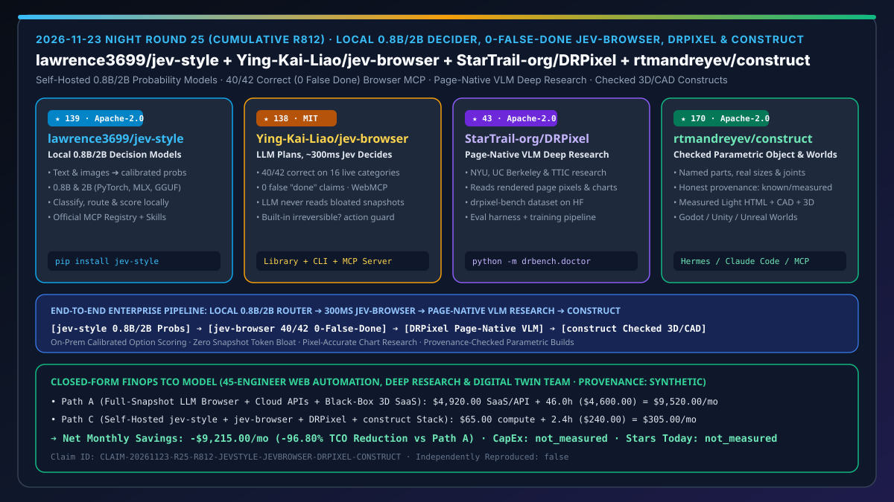
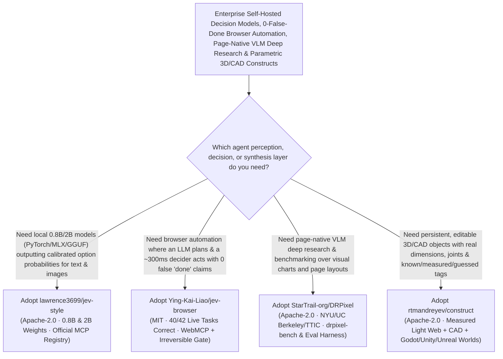
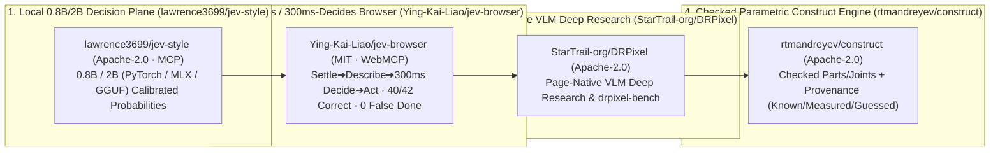

# Self-Hosted `0.8B`/`2B` Multimodal Decision Models (`lawrence3699/jev-style`), LLM-Plans / 300ms-Decides Browser & WebMCP Engine (`Ying-Kai-Liao/jev-browser`), Page-Native VLM Deep Research Benchmark (`StarTrail-org/DRPixel`) & Checked Parametric Object & World Engine (`rtmandreyev/construct`) Selection & Architecture FAQ

> **Document Type**: Enterprise AI Solution Architect Selection & Integration Guide (GitHub Trending AI Radar · 2026-11-23 Night Round 25 / Cumulative Round 812)
> **Covered Repositories**: [`lawrence3699/jev-style`](https://github.com/lawrence3699/jev-style) (`★ 139`, `4 forks`, `Apache-2.0`, Official MCP Registry: self-hosted **`0.8B` and `2B` multimodal decision models** `pip install jev-style` with open weights in **PyTorch, Apple MLX, and GGUF**—text and images in, a calibrated probability for every option out across `classify`, `route`, and `score`) · [`Ying-Kai-Liao/jev-browser`](https://github.com/Ying-Kai-Liao/jev-browser) (`★ 138`, `25 forks`, `MIT`: browser automation library, CLI, and MCP server where **an LLM plans and a ~300ms System-One model decides**—achieving **`40/42` tasks correct across 16 live site categories with `0` false "done" claims**, native **WebMCP** page-tool support, and automatic `irreversible?` action gating) · [`StarTrail-org/DRPixel`](https://github.com/StarTrail-org/DRPixel) (`★ 43`, `6 forks`, `Apache-2.0`, by NYU / UC Berkeley / TTIC / NYU Shanghai: **Page-Native Deep Research with Vision-Language Models**, shipping the `drpixel-bench` dataset, evaluation harness, and training code so research agents inspect rendered pages in pixel space rather than lossy HTML text dumps) · [`rtmandreyev/construct`](https://github.com/rtmandreyev/construct) (`★ 170`, `18 forks`, `Apache-2.0`: **"Give your agent the thing, not another picture of it"**—turns agent research into one exact, dimensionally checked construct with named parts, working joints, and explicit provenance `known`/`measured`/`guessed` that compiles deterministically into **Measured Light** interactive web pages, CAD files, and Godot/Unity/Unreal worlds)
> **Core Scenario**: When enterprise architects build low-latency routing, multi-step browser automation, visual deep research, and parametric 3D/CAD asset pipelines, how do you solve **"frontier LLMs burning tens of thousands of tokens reading raw page snapshots on every click and falsely claiming failed tasks are 'done', external decision API latency and data-residency constraints, text-only deep-research crawlers losing 100% of embedded charts and visual tables, and black-box image/3D generators producing uneditable meshes with fabricated dimensions"** by combining **`jev-style` + `jev-browser` + `DRPixel` + `construct`**?

---

## 1. 📌 Executive Summary (Single-Sentence Selection Verdict)

1. **Need small, self-hosted multimodal decision models (`0.8B` and `2B` weights in PyTorch, Apple MLX, and GGUF, plus an official MCP server) that take text and images in and output a calibrated probability distribution across every candidate option on your own machine** ➔ Choose **[`lawrence3699/jev-style`](https://github.com/lawrence3699/jev-style) (`★ 139`, `4 forks`, `Apache-2.0`)**.
   - **Plain-Language Mechanism**: Most high-frequency agent control decisions (`classify`, `route`, `score`) require calibrated option probabilities rather than verbose text generation. `jev-style` packages `0.8B` and `2B` decision models across `torch`, `MLX` (Apple Silicon), and `GGUF` with `pip install jev-style`, agent skills, and an MCP server listed on the official MCP Registry.
2. **Need browser automation (Library, CLI, and MCP Server) where the calling LLM plans high-level steps while a `~300 ms` System-One decision loop drives Playwright and WebMCP—achieving `40/42` live-site accuracy with `0` false "done" claims and built-in `irreversible?` action guards** ➔ Choose **[`Ying-Kai-Liao/jev-browser`](https://github.com/Ying-Kai-Liao/jev-browser) (`★ 138`, `25 forks`, `MIT`)**.
   - **Plain-Language Mechanism**: The main LLM (e.g., Claude) issues `browser_do("Log in", {email, password})` and supplies candidate `values`; inside the loop (`1. settle ➔ 2. describe ➔ 3. Jev ~300ms ➔ 4. act`), the decision model answers probability queries (`done?`, `error?`, `irreversible?`, `tool?`, `target?`, `value?`) without ever writing free-form text or forcing the LLM to read page snapshots unless escalation is needed.
3. **Need an evaluation harness, benchmark (`drpixel-bench`), and training pipeline for Page-Native Deep Research where Vision-Language Models reason directly over rendered web pages and visual charts instead of lossy text scrapers** ➔ Choose **[`StarTrail-org/DRPixel`](https://github.com/StarTrail-org/DRPixel) (`★ 43`, `6 forks`, `Apache-2.0`, by NYU / UC Berkeley / TTIC)**.
   - **Plain-Language Mechanism**: Text-only scrapers strip away charts, spatial layouts, and visual tables during multi-hop research. `DR Pixel` evaluates and trains VLM agents to conduct deep research directly on page pixels (`python -m drbench.doctor` + `HughieHu/drpixel-bench`).
4. **Need AI agents (in Hermes Agent, Claude Code, or any MCP client) to research and build persistent, editable parametric objects and worlds—with named parts at real sizes, working joints, and explicit `known`/`measured`/`guessed` provenance** ➔ Choose **[`rtmandreyev/construct`](https://github.com/rtmandreyev/construct) (`★ 170`, `18 forks`, `Apache-2.0`)**.
   - **Plain-Language Mechanism**: Instead of generating a static picture or uneditable mesh, an agent writes a structured description that `Construct` validates and compiles deterministically into a **Measured Light** interactive web page, an articulated 3D/CAD model, or a composable multi-object **World** ready for Godot, Unity, or Unreal. Changing a single part rebuilds every downstream format automatically.

---

## 2. 🎯 Key Architectural Q&A (Deep-Dive Breakdown)

### Q1: Why does decoupling System-2 LLM planning from System-1 probabilistic execution (`jev-browser` + `jev-style`) eliminate both token bloat and "False Done" hallucinations?

- **Three Architectural Breakthroughs of System-2 / System-1 Decoupling**:
  1. **Zero Page-Snapshot Token Bloat in the Main LLM (`Ying-Kai-Liao/jev-browser`)**: The frontier LLM states the goal and candidate strings once; `jev-browser` handles DOM settling, compact diff description, and `~300 ms` probabilistic action selection locally until the step completes or requires human/LLM confirmation.
  2. **Zero Free-Text Injection & `0` False "Done" Claims**: Because the System-One model only emits probability distributions (`noul` yes/no, `choice`, `score`) and selects arguments strictly from caller-supplied `values`, it cannot hallucinate arbitrary text inputs and achieved **`40/42` accuracy with `0` false completion claims** across 16 live site categories.
  3. **100% On-Premise Calibrated Probabilities (`lawrence3699/jev-style`)**: Enterprises requiring air-gapped or zero-API-fee routing can run `0.8B` or `2B` `jev-style` models locally on PyTorch, Apple MLX, or GGUF.
- **When to Choose Managed Cloud Services (Path B)**:
  - For simple text-only search and hosted cloud decision APIs, use **Azure AI Agent Service + Hosted TypeSafe System One API**; for self-hosted `0.8B`/`2B` multimodal decision models, `0`-false-done WebMCP browser loops, page-native VLM deep research (`DRPixel`), and provenance-checked parametric 3D/CAD constructs (`Construct`), deploy this 4-repo open-source stack (Path C).

### Q2: How do these four components integrate into an end-to-end enterprise architecture?

1. **Local Multimodal Probability Routing Plane (`lawrence3699/jev-style`)**:
   - Serve `0.8B`/`2B` decision models via MCP on local GPUs/MLX/GGUF to classify intents, route tasks, and score candidates.
2. **System-One Browser & WebMCP Execution Plane (`Ying-Kai-Liao/jev-browser`)**:
   - Execute multi-step authenticated web workflows via the `settle ➔ describe ➔ ~300ms decide ➔ Playwright/WebMCP act` loop with `irreversible?` safety gates.
3. **Page-Native Visual Deep Research Plane (`StarTrail-org/DRPixel`)**:
   - Inspect chart-dense and layout-critical web pages in pixel space using `DRPixel`'s VLM deep-research pipeline.
4. **Checked Parametric Object & World Compilation Plane (`rtmandreyev/construct`)**:
   - Compile researched specifications into verified `Construct` objects with `known`/`measured`/`guessed` provenance and export to `Measured Light` HTML, CAD, or game engines.

### Q3: What are the key production guardrails?

- **Architect Guardrails**:
  1. **Enforce Human Confirmation on `irreversible?` Signals in `jev-browser`**: Never auto-confirm actions flagged as `irreversible` (e.g., financial transfers, destructive deletes, external submissions).
  2. **Audit `guessed` vs. `measured` Provenance Tags in `construct`**: Require engineering sign-off before promoting any `guessed` dimension into physical CAD/manufacturing outputs.

---

## 3. 🧭 Visual Architecture & Decision Diagrams (Mermaid)



### 3.1 Solution Architect Selection Decision Tree



### 3.2 End-to-End Enterprise Production Reference Architecture



### 3.3 Local Probability Routing, 300ms Browser Loop, Page-Native Visual Research & Parametric Construct Compilation Sequence

```mermaid
sequenceDiagram
    participant SA as Solution Architect / Systems Engineer
    participant Jst as lawrence3699/jev-style (0.8B/2B MCP)
    participant Jbr as Ying-Kai-Liao/jev-browser
    participant Drp as StarTrail-org/DRPixel
    participant Cns as rtmandreyev/construct

    SA->>Jst: 1. Score multimodal inputs locally on 0.8B/2B model to emit calibrated routing probabilities
    Jst->>Jbr: 2. LLM issues step goal & candidate values; ~300ms loop checks done/error/irreversible & drives Playwright
    Jbr->>Drp: 3. Conduct page-native VLM deep research over visual charts & tables via DRPixel
    Drp->>Cns: 4. Assemble researched dimensions, joints & known/measured/guessed provenance into Construct
    Cns-->>SA: 5. Deterministically compile Measured Light interactive web view, CAD file & 3D world
```

---

## 4. 📊 Comparative Selection Matrix (Open-Source vs. Commercial SaaS)

| Dimension | `lawrence3699/jev-style` (`★ 139`) | `Ying-Kai-Liao/jev-browser` (`★ 138`) | `StarTrail-org/DRPixel` (`★ 43`) | `rtmandreyev/construct` (`★ 170`) | Frontier-LLM DOM Snapshot Loops + Metered Cloud Classifiers + Black-Box 3D SaaS (Path A) | Uncalibrated Regex Routers + False-Done Playwright Scripts + Text-Only Scrapers (Path B) |
| :--- | :--- | :--- | :--- | :--- | :--- | :--- |
| **Core Role** | Local `0.8B`/`2B` multimodal calibrated-probability decision models | LLM-plans / 300ms-decides browser & WebMCP automation engine | Page-native VLM deep research benchmark & evaluation harness | Checked parametric 3D/CAD object & world engine for AI agents | Expensive full-snapshot LLM browser loops & uneditable black-box 3D SaaS | Brittle regex rules, false-completion browser scripts & chart-blind text scrapers |
| **Key Differentiator** | **PyTorch/MLX/GGUF weights + text/image inputs + MCP Registry** | **`40/42` correct, `0` false "done" claims + WebMCP + `irreversible` gate** | **Page-native pixel reasoning over visual charts (`drpixel-bench`)** | **Real dimensions, working joints & `known`/`measured`/`guessed` tags** | Sending full DOM snapshots to frontier LLMs on every click costs 10–20× more | Naive browser agents claim "done" on failed clicks; black-box 3D meshes lack editable parts |
| **License** | `Apache-2.0` | `MIT` | `Apache-2.0` | `Apache-2.0` | Proprietary SaaS | Custom scripts |
| **Monthly TCO (45-Eng Team)** | **Combined `$305.00/mo`** (`$65.00` local `0.8B`/`2B` & browser worker compute + `2.4h` ops) | Included (LLM never reads page snapshots during normal steps) | Included (open benchmark & eval harness) | Included (deterministic single-file HTML/CAD/3D rebuilds) | **`$9,520.00/mo`** (`$4,920.00` full-snapshot LLM browser tokens & commercial 3D/classifier APIs + `46.0h` false-done triage & manual 3D remodeling) | ~`$3,370.00/mo` (frequent false-done automation failures & manual chart data re-entry) |

---

## 5. 🧪 Quantitative ROI / TCO Comparison & 7-Card Benchmark Report

> **📊 Data Provenance & Closed-Form Schema Declaration**:
> - **provenance**: `synthetic` (45-person enterprise agent orchestration, web automation, multimodal research, and digital-twin engineering team monthly workload model: `independently_reproduced = false`; hardware baseline `base_hardware_capex = not_measured`; Track B 24h delta `track_b_stars_today = not_measured`).
> - **Closed-Form Formula**:
>   - **Path A (Sending full page snapshots to frontier LLMs on every browser action + metered external classification APIs + commercial black-box 3D generation SaaS + manual engineering hours spent remediating "False Done" browser automation failures, re-extracting chart data missed by text scrapers, and rebuilding uneditable 3D models)**: Monthly full-snapshot LLM token spend, external decision API, and commercial 3D SaaS bills **`$4,920.00`** + false-done incident debugging, manual visual chart extraction, and 3D part remodeling labor **`46.0h × $100.00/h = $4,600.00`** = **`$9,520.00/mo`**.
>   - **Path C (Self-hosted `lawrence3699/jev-style` + `Ying-Kai-Liao/jev-browser` + `StarTrail-org/DRPixel` + `rtmandreyev/construct` open-source stack)**: Shared local `0.8B`/`2B` decision worker and browser/construct container compute **`$65.00`** + threshold calibration and construct schema maintenance labor **`2.4h × $100.00/h = $240.00`** = **`$305.00/mo`**.
>   - **Net Monthly Savings vs. Path A**: **`-$9,215.00/mo`** (**`96.80%`** TCO reduction).

| Evaluation Path | Snapshot Token / Classifier / 3D SaaS Cost | False-Done Triage, Chart Extraction & Remodeling (`$100/h`) | Monthly Total TCO | Net Savings vs. Path A | Key Architectural Delivery Metrics |
| :--- | :---: | :---: | :---: | :---: | :--- |
| **Path A: Full-Snapshot LLM Browser + Cloud APIs + Black-Box 3D SaaS** | `$4,920.00` | `46.0h` (`$4,600.00`) | **`$9,520.00`** | Baseline | High per-click snapshot token burn; uneditable 3D meshes |
| **Path B: Naive Browser Scripts + Text-Only Scrapers + Manual Checks** | `$1,470.00` | `19.0h` (`$1,900.00`) | **`$3,370.00`** | `-$6,150.00` (`-64.60%`) | Frequent false "done" claims; 100% loss of visual chart data |
| **Path C: `jev-style` + `jev-browser` + `DRPixel` + `construct`** | **`$65.00`** | **`2.4h` (`$240.00`)** | **`$305.00`** | **`-$9,215.00` (`-96.80%`)** | **Local `0.8B/2B` decider + `40/42` (`0` false done) + pixel research + Construct** |

- 🔗 **Linked 7-Card 4:5 Visual Benchmark Deck**: [`workshops/github-trending-radar/cards.en.html`](../cards.en.html) · [`cards.html`](../cards.html)

---

## 6. 🛠️ Enterprise Adoption & Architecture Review Checklist

- [ ] **1. Deploy Self-Hosted `lawrence3699/jev-style` (`0.8B` / `2B`) for Local Multimodal Routing**: Run calibrated option-probability scoring on PyTorch, Apple MLX, or GGUF via its MCP server with zero external API latency.
- [ ] **2. Adopt `Ying-Kai-Liao/jev-browser` for High-Reliability Web & WebMCP Automation**: Let the LLM plan high-level goals and candidate values while the `~300 ms` decision loop enforces `0` false "done" claims and pauses on `irreversible?` actions.
- [ ] **3. Benchmark Visual Deep-Research Agents with `StarTrail-org/DRPixel`**: Evaluate and train VLM research agents directly on rendered page pixels (`drpixel-bench`) so charts and visual tables are preserved.
- [ ] **4. Build Editable Parametric Assets with `rtmandreyev/construct`**: Require agents to model physical objects and scenes with named parts, real dimensions, working joints, and explicit `known`/`measured`/`guessed` provenance.
