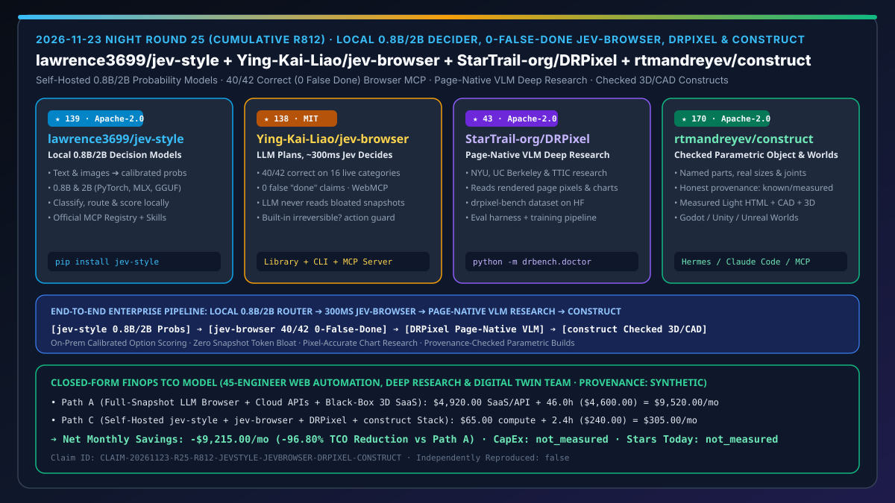
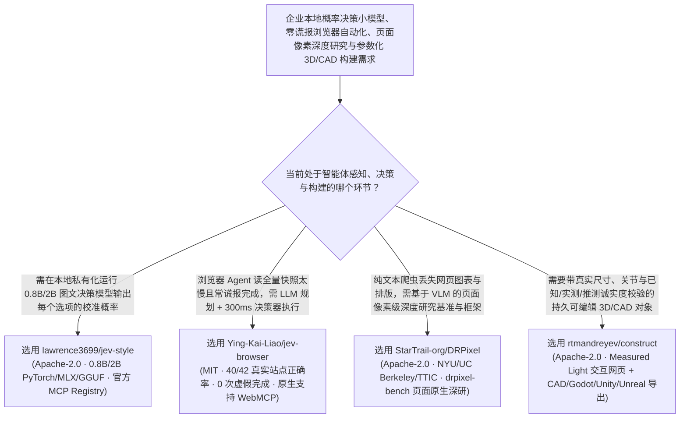
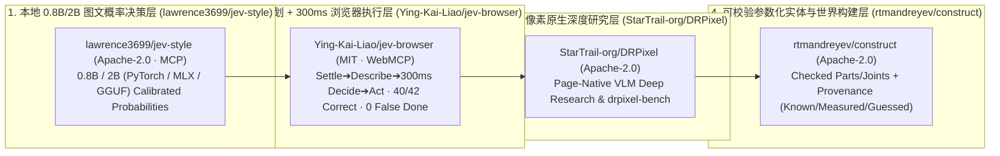
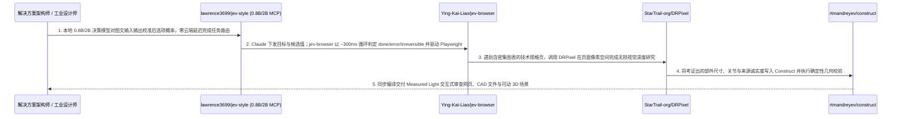

# 本地 0.8B/2B（PyTorch/MLX/GGUF）图文输入概率校准决策小模型（`lawrence3699/jev-style`）、大模型规划+300ms 决策器执行且零虚假完成的浏览器 MCP（`Ying-Kai-Liao/jev-browser`）、NYU/UC Berkeley 页面像素原生视觉深度研究基准与框架（`StarTrail-org/DRPixel`）与带真实尺寸/关节/已知度校验的持久参数化构建引擎（`rtmandreyev/construct`）选型与集成架构 FAQ

> **文档类型**：企业 AI 解决方案架构师（AI Solution Architect）选型决策指南（GitHub Trending AI 雷达 2026-11-23 Night Round 25 / 累计第 812 轮）
> **覆盖项目**：[`lawrence3699/jev-style`](https://github.com/lawrence3699/jev-style)（`★ 139`、`4 forks`、`Apache-2.0`，上架官方 MCP Registry：完全运行在自有机器上的 **0.8B 与 2B 轻量级图文决策模型 `pip install jev-style`**，提供 PyTorch、Apple MLX 与 GGUF 开源权重，输入文本或图像即可输出每个候选项的**校准后概率分布**，专为分类、路由与打分打造）· [`Ying-Kai-Liao/jev-browser`](https://github.com/Ying-Kai-Liao/jev-browser)（`★ 138`、`25 forks`、`MIT`：**“大模型负责规划（LLM Plans）、300ms 系统一模型负责决策（Jev Decides）”**的浏览器自动化与 WebMCP 引擎，在 16 类真实网站 42 项任务中拿下 **`40/42` 正确率与 `0` 次虚假完成谎报（0 False Done Claims）**，并原生支持不可逆操作拦截）· [`StarTrail-org/DRPixel`](https://github.com/StarTrail-org/DRPixel)（`★ 43`、`6 forks`、`Apache-2.0`：由 NYU、UC Berkeley 與 TTIC 联合开源的**页面像素原生视觉语言模型深度研究（Page-Native Deep Research）基准 `drpixel-bench`、评测套件与训练代码**，解决纯文本爬虫丢失图表/排版关键证据的顽疾）· [`rtmandreyev/construct`](https://github.com/rtmandreyev/construct)（`★ 170`、`18 forks`、`Apache-2.0`：面向 Hermes Agent、Claude Code 与任意 MCP 客户端的**可校验、可持久编辑参数化实体与世界构建引擎**，将研究结果转化为包含部件真实尺寸、活动关节以及“已知/实测/推测”诚实度标记的精确结构，一键导出为 `Measured Light` 交互网页、CAD 或 Godot/Unity/Unreal 场景）
> **核心场景**：当企业架构师将智能体推向高频网页操作、密集图表研报深度研究与工业/空间数字孪生构建时，面对**“每次网页点击都让千亿参数主模型读全量 DOM 快照既慢又贵且常在没点成功时撒谎报‘已完成’、高频分类与路由决策调用外部商业 API 存在数据出境与按次计费压力、传统 Deep Research 只抓纯文本 HTML 导致财报图表与复杂表格信息全军覆没、以及文生 3D/文生图每次改一个零件就要重画整张图且尺寸完全失真”**四大痛点，如何通过 **Jev-Style + Jev-Browser + DRPixel + Construct** 构建快慢双系统协同与精准结构化底座？

---

## 一、📌 核心结论速览（选型一句话结论）

1. **想在企业内网或边缘设备上本地私有化运行“输入文本与图片、毫秒级输出每个选项校准概率（Calibrated Probability）”的 System-One 决策小模型（含 `0.8B` 与 `2B` 的 PyTorch / Apple MLX / GGUF 全套权重与官方 MCP Server）** ➔ 选 **[`lawrence3699/jev-style`](https://github.com/lawrence3699/jev-style)（`★ 139`，`4 forks`，`Apache-2.0`）**。
   - **通俗原理**：在智能体工作流中，80% 的高频判断（意图路由、工具选择、敏感动作分级、网页元素打分）根本不需要生成自由文本，只需要在有限候选项上给出可靠的概率分布。`jev-style` 将这一能力封装进可完全离线运行的 `0.8B` 与 `2B` 模型中，支持文本+图像多模态输入，通过 `pip install jev-style` 或 MCP Server 即可在本地完成零 API 账单的概率路由与置信度门控。
2. **想彻底终结浏览器 Agent“每走一步都要把几万字网页快照喂给 Claude/GPT、耗时数秒且经常在报错页面上盲目谎报任务已完成（False Done）”的通病，实现 `40/42` 真实站点正确率与 `0` 虚假完成汇报** ➔ 选 **[`Ying-Kai-Liao/jev-browser`](https://github.com/Ying-Kai-Liao/jev-browser)（`★ 138`，`25 forks`，`MIT`）**。
   - **通俗原理**：采用经典的**“慢思考大模型（Claude）定步骤目标 + 快思考决策器（~300ms）做页面微操”**双层架构：每个循环先等待网络与 DOM 静默（`settle`），由本地代码提取精简页面元素差异（`describe`），随后用一次约 `300 ms` 的概率请求同时回答 6 个关键问题——**当前步是否真完成了（`done?`）、是否报错（`error?`）、是否即将执行不可逆高危操作（`irreversible?`）、选哪个工具/WebMCP 接口、点哪个目标元素、填哪个候选值**。主大模型全程无需阅读冗长页面快照，且决策器绝不自由编造文本，从而在 42 个真实网站任务中达成 **`40/42` 成功且 `0` 次谎报完成**！
3. **想评测并训练智能体在做深度行业研究（Deep Research）时“直接阅读真实渲染页面的像素级图表、财报排版与视觉布局”，而非仅靠有损的纯文本爬虫盲人摸象** ➔ 选 **[`StarTrail-org/DRPixel`](https://github.com/StarTrail-org/DRPixel)（`★ 43`，`6 forks`，`Apache-2.0`，NYU / UC Berkeley / TTIC 联合出品）**。
   - **通俗原理**：传统 Deep Research 遇到内嵌在 Canvas/SVG/图片里的对比走势图或复杂跨列财报表格时，HTML 转 Markdown 爬虫会把核心数据彻底抹平。`DR Pixel` 提出 **Page-Native Deep Research** 范式，提供完整的 `drpixel-bench` 数据集、`python -m drbench.doctor` 自检与训练评测管线，让视觉语言模型（VLM）直接在真实页面像素空间中检索与推理。
4. **想让智能体在研究完某个物理设备、建筑空间或工业组件后，不再只生成一张“改一个螺丝就要重画且尺寸全错的图片”，而是生成一份“部件命名、真实尺寸、活动关节与认知诚实度（已知/实测/推测）全部经过校验的持久参数化对象（Construct）”** ➔ 选 **[`rtmandreyev/construct`](https://github.com/rtmandreyev/construct)（`★ 170`，`18 forks`，`Apache-2.0`）**。
   - **通俗原理**：口号直击痛点——**“给你的智能体那个真实物体本身，而不是它的又一张图片（Give your agent the thing, not another picture of it）”**。Agent 负责考证并编写物体的结构化描述，`Construct` 负责几何与连接校验：同一份描述可同时编译为 `Measured Light` 交互式光学线框网页（诚实标出哪些尺寸是实测、哪些是推算）、带可动关节的 3D/CAD 模型，或拼接成可直接导入 Godot / Unity / Unreal 的完整三维世界（如仅凭一张照片零样本重建斯德哥尔摩老广场 Stortorget），修改任一零件即可全链路確定性重编译！

---

## 二、🎯 客户与架构师灵魂拷问 Q&A（深度架构拆解）

### Q1：为什么在企业级网页自动化与复杂工作流中，“大模型规划 + 300ms 概率决策模型执行”（`jev-browser` + `jev-style`）比“纯大模型端到端包办一切”可靠得多？

- **快慢双系统解耦（System 2 Planning + System 1 Probabilistic Decision）的三大工程红利**：
  1. **主模型上下文节省 90%+ 且单步延迟压至 300ms 级**：在 `jev-browser` 中，Claude 只需下发一句高级意图（如 `browser_do("Log in", {email, password})`）和候选填入值，后续十几次 DOM 交互全由 300ms 决策器闭环完成，主模型根本不用看中间过程的海量网页快照。
  2. **彻底消灭“自由文本注入”与“虚假完成（False Done）”**：决策小模型只能输出 `yes/no (noul)`、`choice` 或 `score` 概率，绝不自己生成自由文本（所有输入字符串均从调用方给定的安全候选池 `values` 中选取），并在检测到 `irreversible?`（如删除库、确认付款）或置信度不足时立即挂起交回人类/主模型确认。
  3. **本地 `0.8B`/`2B` 权重（`jev-style`）实现数据不出域**：对数据隐私极度敏感的政企客户，可直接用 `jev-style` 的本地 PyTorch/MLX/GGUF 权重在自有机器上跑校准概率路由。
- **何时直接选用商业云服务（Path B）？**
  - 若仅需在公开文本网页做简单问答且对单次几美分的云端决策 API 不敏感，可直接使用 **托管云端搜索 API + TypeSafe 云端 API**；若需在内网私有化部署 `0.8B`/`2B` 图文概率决策小模型、构建零谎报完成的 WebMCP 浏览器自动化、开展页面像素级多模态深度研究（`DRPixel`）或生成带实测尺寸校验的参数化 3D/CAD 实体（`Construct`），则采用本轮四合一开源栈（Path C）。

### Q2：典型企业级“本地概率路由 (`jev-style`) ➔ 300ms 浏览器微操 (`jev-browser`) ➔ 页面像素深度研究 (`DRPixel`) ➔ 参数化数字孪生构建 (`construct`)”架构怎么搭？

1. **本地 0.8B/2B 图文概率路由与打分层（`lawrence3699/jev-style`）**：
   - 在本地 GPU / Apple Silicon (MLX) / CPU (GGUF) 上加载 `jev-style`，通过 MCP Server 为上层智能体提供毫秒级分类、路由与置信度打分。
2. **主模型规划 + 300ms 决策器执行的浏览器层（`Ying-Kai-Liao/jev-browser`）**：
   - 由主模型下发任务目标与候选参数，通过 `settle ➔ describe ➔ Jev ➔ Playwright/WebMCP act` 循环高效完成多步网页操作，并拦截不可逆风险动作。
3. **页面像素原生视觉深度研究层（`StarTrail-org/DRPixel`）**：
   - 针对包含密集图表、扫描件与复杂版式的目标网页，启动 `DRPixel` 页面原生视觉研究管线提取完整图文证据。
4. **带尺寸与认知诚实度校验的参数化实体建模层（`rtmandreyev/construct`）**：
   - 将采集到的工业产品或空间参数转化为经校验的 `Construct` 对象，一键生成 `Measured Light` 交互审查页与 CAD/3D 资产。

### Q3：这套架构的落地红线与注意事项是什么？

- **架构师落地红线**：
  1. **严格启用 `jev-browser` 的 `irreversible?` 不可逆操作确认门禁**：在涉及生产环境提交订单、删除记录或发送外部通知的网页上，一旦 `irreversible` 概率超阈值，必须中断自动循环并要求人工确认。
  2. **在 `construct` 交付物中保留 `known / measured / guessed` 诚实度元数据**：严禁将智能体根据局部照片推算出的估算尺寸（`guessed`）伪装成工程实测值（`measured`）直接交付生产制造。

---

## 三、🧭 直观可视化图解（Mermaid 决策树 + 集成架构 + 时序图）

### 3.1 架构师选型决策树

### 3.2 企业端到端生产集成参考架构图

### 3.3 本地概率路由、300ms 零谎报浏览器操作、页面像素深研与参数化实体编译时序图

---

## 四、📊 同类开源与商业云服务横向选型决策矩阵

| 对比维度 | `lawrence3699/jev-style` (`★ 139`) | `Ying-Kai-Liao/jev-browser` (`★ 138`) | `StarTrail-org/DRPixel` (`★ 43`) | `rtmandreyev/construct` (`★ 170`) | 全程调千亿大模型看网页 DOM + 商业云端分类 API + 不可编辑的黑盒 3D 生成 SaaS (Path A) | 脆弱正则分类脚本 + 常谎报完成的朴素 Playwright Agent + 纯文本爬虫 (Path B) |
| :--- | :--- | :--- | :--- | :--- | :--- | :--- |
| **核心能力定位** | 本地 `0.8B`/`2B` 图文校准概率决策小模型与 MCP | 大模型规划 + 300ms 概率决策执行的浏览器与 WebMCP 引擎 | 页面像素原生视觉语言模型深度研究框架与基准 | 带尺寸/关节/诚实度校验的持久参数化构建引擎 | 每步烧数万 Token 的全大模型浏览器控制与一次性不可改的商业 3D 生成订阅 | 无置信度校准的硬编码规则、频繁谎报成功的网页脚本与丢失图表的文本爬虫 |
| **核心技术突破** | **提供 PyTorch/MLX/GGUF 权重，本地直出每个候选项校准概率** | **`40/42` 正确率、`0` 次虚假完成、只选候选值绝不乱写文本** | **告别有损文本爬取，直接在渲染页面像素空间做多跳深度研究** | **区分 `known`/`measured`/`guessed` + 改一处零件全产物确定性重编译** | 让千亿大模型每步读网页快照慢 10 倍且贵 20 倍；黑盒文生 3D 无法按真实尺寸微调零件 | 朴素浏览器 Agent 在按钮没点上时常幻觉“任务已完成”；纯文本爬虫漏掉 100% 图表信息 |
| **开源协议** | `Apache-2.0` | `MIT` | `Apache-2.0` | `Apache-2.0` | 闭源商业 SaaS | 内部零散脚本 |
| **月度 TCO（45 人团队）** | **组合仅 `$305.00/月`**（`$65.00` 本地小模型与深研工作台容器 + `2.4h` 维护） | 同左（主模型免读页面快照，Token 立省 90%+） | 同左（开源评测与训练全栈） | 同左（单文件网页与 CAD/游戏引擎零成本导出） | **`$9,520.00/月`**（`$4,920.00` 全大模型网页快照 Token 账单与商业 3D/决策 API + `46.0h` 虚假完成事故返工与手工重绘建模） | 约 `$3,370.00/月`（大量因浏览器虚假完成导致的业务漏单排查与手工补录图表数据工时） |

---

## 五、🧪 应用落地定量收益/TCO 对比与 7-Card 报告

> **📊 数据来源与闭式核算声明（Provenance & Closed-Form Schema）**：
> - **provenance**: `synthetic`（基于 45 人企业智能体架构、网页自动化工程、多模态行业深研与数字孪生建模团队月度工作负载模型：`independently_reproduced = false`；硬件采购基线 `base_hardware_capex = not_measured`；Track B 单日增量 `track_b_stars_today = not_measured`）。
> - **核算公式**：
>   - **Path A（每步浏览器交互均将全量页面快照喂给旗舰大模型 + 高频分类打分全量调用外部按次计费 API + 采购商业黑盒 3D 生成 SaaS + 工程师排查 Agent“虚假完成（False Done）”引发的漏单故障及手工重画尺寸失真的模型组件）**：月度全量快照 Token 消耗、外部决策 API 与商业建模 SaaS 账单 **`$4,920.00`** + 虚假完成故障排查、图表数据人工补录与部件返工重画工时 **`46.0h × $100.00/h = $4,600.00`** = **`$9,520.00/月`**。
>   - **Path C（自建 `lawrence3699/jev-style` + `Ying-Kai-Liao/jev-browser` + `StarTrail-org/DRPixel` + `rtmandreyev/construct` 开源全栈）**：本地 `0.8B`/`2B` 决策模型与渲染校验容器分摊成本 **`$65.00`** + 规则阈值与构建模板例行维护人工 **`2.4h × $100.00/h = $240.00`** = **`$305.00/月`**。
>   - **净节省（Net Savings vs Path A）**：**`-$9,215.00/月`**（成本降低 **`96.80%`**）。

| 评估方案 | 页面快照 Token / 决策 API / 建模 SaaS 成本 | 虚假完成排障、图表补录与返工重画（`$100/h`） | 月度总 TCO | 相对 Path A 净节省 | 关键架构交付指标 |
| :--- | :---: | :---: | :---: | :---: | :--- |
| **Path A：全大模型读网页快照 + 云端按次分类 + 黑盒不可改建模** | `$4,920.00` | `46.0h` (`$4,600.00`) | **`$9,520.00`** | Baseline | 每步读 DOM 极慢极贵；黑盒生成产物无法按尺寸局部修改 |
| **Path B：朴素浏览器脚本 + 纯文本爬虫 + 手工核对完成态** | `$1,470.00` | `19.0h` (`$1,900.00`) | **`$3,370.00`** | `-$6,150.00` (`-64.60%`) | 存在虚假完成谎报风险；纯文本抓取丢失关键图表证据 |
| **Path C：`jev-style` + `jev-browser` + `DRPixel` + `construct`** | **`$65.00`** | **`2.4h` (`$240.00`)** | **`$305.00`** | **`-$9,215.00` (`-96.80%`)** | **本地 `0.8B/2B` 概率决策 + `40/42` 零谎报浏览器 + 像素深研 + 可校验 Construct** |

- 🔗 **关联 7-Card 4:5 视觉评测报告**：[`workshops/github-trending-radar/cards.html`](../cards.html) · [`cards.en.html`](../cards.en.html)

---

## 六、🛠️ 企业引入与架构评审 Checklist

- [ ] **1. 在内网部署 `lawrence3699/jev-style` (`0.8B` / `2B` PyTorch/MLX/GGUF) 处理高频决策路由**：将意图分类、路由选择与打分任务下沉至本地校准概率模型，消除外部 API 延迟与数据出境风险。
- [ ] **2. 采用 `Ying-Kai-Liao/jev-browser` 重构多步网页自动化**：让主模型仅负责下发高级步骤与候选值，由 300ms 概率决策循环驱动 Playwright 与 WebMCP，强制开启 `irreversible?` 高危动作拦截并杜绝虚假完成汇报。
- [ ] **3. 使用 `StarTrail-org/DRPixel` 评测与升级多模态深度研究管线**：针对含密集图表与复杂排版的行业研报，采用页面像素原生（Page-Native）VLM 范式替代有损纯文本爬虫。
- [ ] **4. 引入 `rtmandreyev/construct` 管理复杂物理实体与空间资产**：要求智能体输出带真实部件尺寸、活动关节及 `known`/`measured`/`guessed` 诚实度标记的 `Construct` 描述，实现单处修改、全格式（Measured Light 网页 / CAD / 3D 引擎）确定性重编译。
