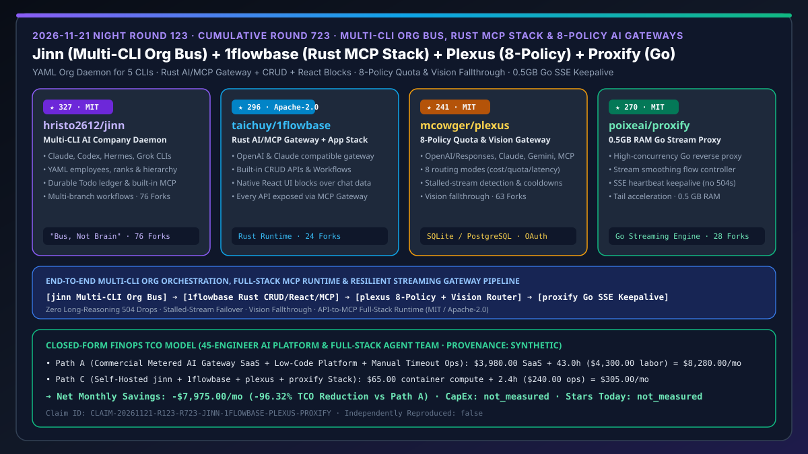
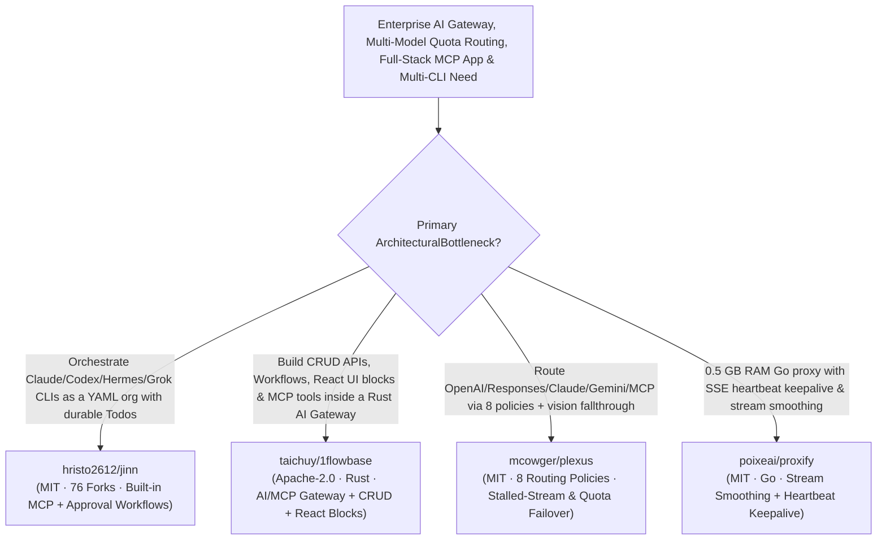
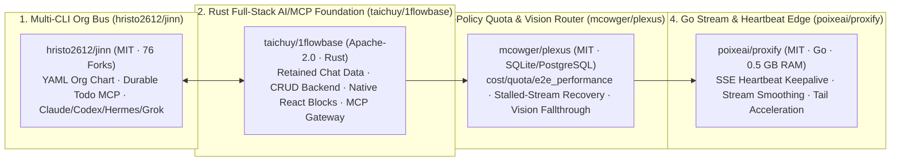

# Multi-CLI Org Daemon (`hristo2612/jinn`), Rust Full-Stack AI/MCP App Foundation (`taichuy/1flowbase`), 8-Policy Quota & Vision-Fallthrough Gateway (`mcowger/plexus`) & Go Stream-Smoothing Proxy (`poixeai/proxify`) Selection & Architecture FAQ

> **Document Type**: Enterprise AI Solution Architect Selection & Integration Guide (GitHub Trending AI Radar — 2026-11-21 Night Round 123 / Cumulative Round 723)
> **Covered Repositories**: [`hristo2612/jinn`](https://github.com/hristo2612/jinn) (`★ 327`, `76 forks`, `MIT` — TypeScript daemon orchestrating Claude Code, Codex, Hermes, Grok & Antigravity CLI as a YAML-defined company with durable Todo ledger & built-in MCP) · [`taichuy/1flowbase`](https://github.com/taichuy/1flowbase) (`★ 296`, `24 forks`, `Apache-2.0` — Rust self-hosted AI Gateway, MCP Gateway, CRUD backend & native React block runtime) · [`mcowger/plexus`](https://github.com/mcowger/plexus) (`★ 241`, `63 forks`, `MIT` — unified gateway for OpenAI Chat/Responses, Anthropic Messages, Gemini & streamable-HTTP MCP with 8 routing policies, OAuth quota checkers, stalled-stream recovery & vision fallthrough) · [`poixeai/proxify`](https://github.com/poixeai/proxify) (`★ 270`, `28 forks`, `MIT` — 0.5 GB RAM Go reverse proxy optimized for LLM stream smoothing, SSE heartbeat keepalive & tail acceleration)
> **Core Scenario**: How enterprise AI platform architects combine **0.5 GB RAM Go SSE heartbeat keepalive and stream smoothing (`proxify`)**, **8-policy cost/latency/quota routing with stalled-stream detection and vision fallthrough (`plexus`)**, **Rust API-first/MCP-first full-stack app generation over gateway data (`1flowbase`)**, and **YAML org-chart orchestration across heterogeneous coding CLIs (`jinn`)**.

---

## 1. 📌 Executive Summary (One-Line Selection Verdict)

1. **Need to orchestrate Claude Code, Codex, Hermes, Grok, and Antigravity CLIs as a structured organization with YAML reporting lines, a durable Todo ledger, built-in company MCP tools, and multi-branch approval workflows** ➔ Choose **[`hristo2612/jinn`](https://github.com/hristo2612/jinn) (`★ 327`, `76 forks`, `MIT`)**.
   - **Plain-English Mechanism**: Built on a **"Bus, not brain"** philosophy, `jinn` conducts the agent CLIs already installed on your `PATH` using YAML-defined employees, ranks, departments, and reporting lines. It provides a cross-session Todo ledger, a built-in MCP server for typed company operations, and cron/webhook workflows with sequential, conditional, parallel, and switch paths. (*Architect Note: Upstream is marked unmaintained by the original author; fork from the `76-fork` community tree for internal maintenance*).
2. **Need a Rust-powered self-hosted AI Gateway that retains conversation data and extends directly into CRUD backend APIs, Workflows, native React blocks, and an automatic MCP Gateway** ➔ Choose **[`taichuy/1flowbase`](https://github.com/taichuy/1flowbase) (`★ 296`, `24 forks`, `Apache-2.0`)**.
   - **Plain-English Mechanism**: Written in **Rust**, `1flowbase` unifies OpenAI- and Claude-compatible model access with an API-first application runtime. Because every CRUD table, workflow, and UI block is controlled via APIs—and every API is automatically exposed as an MCP endpoint—agents can build, query, and operate full business applications on top of the gateway.
3. **Need a single-binary or Docker unified LLM & streamable-HTTP MCP gateway (`SQLite` or `PostgreSQL`) with 8 routing strategies, custom OAuth quota checkers, stalled-stream recovery, and vision fallthrough** ➔ Choose **[`mcowger/plexus`](https://github.com/mcowger/plexus) (`★ 241`, `63 forks`, `MIT`)**.
   - **Plain-English Mechanism**: Accepts OpenAI Chat Completions & Responses, Anthropic Messages, Gemini native requests, embeddings, audio, images, and streamable-HTTP MCP traffic. Routes model aliases using **`random`, `in_order`, `cost`, `performance`, `latency`, `usage`, `quota`, or `e2e_performance`** policies while enforcing exponential cooldowns, stalled-stream detection, and automatic **vision fallthrough** when routing image inputs to text-only models.
4. **Need a lightweight `0.5 GB RAM` Go reverse proxy engineered specifically for LLM SSE heartbeat keepalive, stream-cadence smoothing, and tail acceleration** ➔ Choose **[`poixeai/proxify`](https://github.com/poixeai/proxify) (`★ 270`, `28 forks`, `MIT`)**.
   - **Plain-English Mechanism**: Written in Go for high concurrency on minimal memory (`0.5 GB RAM`), `proxify` unifies multi-upstream paths (`/openai`, `/gemini`) and solves long-reasoning disconnects via **SSE heartbeat keepalive**, a built-in **stream smoothing** flow controller, and **tail acceleration**.

---

## 2. 🎯 Architect & Customer Deep-Dive Q&A

### Q1: Why do standard reverse proxies and basic model routers struggle with long-reasoning timeouts, stalled streams, non-vision fallbacks, and full-stack MCP app delivery?

- **Four Production Pain Points Solved**:
  1. **Long-Reasoning 504 Timeouts & Choppy Token Bursts (`poixeai/proxify`)**: Reasoning models that pause for 30–120 seconds before emitting tokens often trigger CDN/load-balancer idle timeouts. `proxify` injects **SSE heartbeat keepalives**, smooths token delivery cadence, and accelerates tail chunks in a `0.5 GB RAM` Go binary.
  2. **Stalled Streams, Quota Exhaustion & Text-Only Model Failures on Image Prompts (`mcowger/plexus`)**: `plexus` detects stalled streams mid-generation, tracks per-key and OAuth subscription quotas via custom quota checkers, routes across 8 policies (`cost`, `quota`, `e2e_performance`), and executes **vision fallthrough** for non-vision targets.
  3. **Rebuilding Boilerplate CRUD & MCP Backends Behind Every AI Gateway (`taichuy/1flowbase`)**: Instead of treating the gateway as a stateless pipe, `1flowbase` stores conversation and business data in a Rust runtime with built-in CRUD APIs, React blocks, and an automatic MCP Gateway.
  4. **Uncoordinated Multi-CLI Agents (`hristo2612/jinn`)**: Organizes Claude Code, Codex, Hermes, and Grok CLIs into YAML departments with durable Todo receipts.
- **When to Choose Managed Cloud Services (Path B)**:
  - If your enterprise standardizes exclusively on Azure-hosted models and managed API policies, use **Azure API Management (APIM) AI Gateway + Azure AI Foundry**.

### Q2: How do we assemble a four-tier enterprise AI gateway and agent application stack?

1. **Edge Streaming & Heartbeat Keepalive Layer (`poixeai/proxify`)**:
   - Deploy `proxify` on lightweight Go edge nodes (`0.5 GB RAM`) to handle single-path upstream routing, SSE heartbeat keepalive, stream smoothing, and tail acceleration.
2. **Policy-Aware Multi-Protocol & MCP Routing Layer (`mcowger/plexus`)**:
   - Run `plexus` backed by PostgreSQL to normalize OpenAI Chat/Responses, Anthropic Messages, Gemini, and streamable-HTTP MCP endpoints across 8 routing strategies with stalled-stream failover and vision fallthrough.
3. **Full-Stack AI/MCP Application Runtime Layer (`taichuy/1flowbase`)**:
   - Build internal business workflows, CRUD APIs, and React UI blocks directly on top of `1flowbase`'s Rust gateway runtime and expose every operation via its MCP Gateway.
4. **Multi-CLI Org Orchestration Layer (`hristo2612/jinn`)**:
   - Coordinate Claude Code, Codex, Hermes, and Grok CLIs through `jinn`'s YAML org hierarchy, durable Todo ledger, and approval workflows.

### Q3: What are the governance and maintenance considerations for this stack?

- **Key Strengths**:
  - **100% Permissive Open Source (`MIT` and `Apache-2.0`)** spanning Go, Rust, and TypeScript.
- **Maintenance & Lifecycle Boundaries**:
  - `hristo2612/jinn` is marked unmaintained by its original author; enterprises adopting its YAML org-chart and multi-CLI bus pattern should fork from its `76-fork` community base and pair it with actively maintained `mcowger/plexus`, `taichuy/1flowbase`, and `poixeai/proxify`.

---

## 3. 🧭 Visual Architecture & Decision Diagrams



### 3.1 Solution Architect Selection Decision Tree



### 3.2 End-to-End Enterprise Reference Architecture



### 3.3 Org Delegation, MCP CRUD Execution, 8-Policy Routing & Go SSE Keepalive Sequence

```mermaid
sequenceDiagram
    participant Org as Jinn Org Workflow / React App
    participant Flow as taichuy/1flowbase (Rust Runtime)
    participant Plexus as mcowger/plexus (8-Policy Gateway)
    participant Proxify as poixeai/proxify (Go Stream Guard)
    participant LLM as Upstream Multi-Provider Models

    Org->>Flow: 1. Trigger multi-phase workflow with multimodal attachment & MCP CRUD call
    Flow->>Plexus: 2. Dispatch normalized request + streamable-HTTP MCP tool routing
    Plexus->>Plexus: 3. Evaluate quota & e2e_performance; trigger Vision Fallthrough if target is text-only
    Plexus->>Proxify: 4. Forward upstream via high-concurrency Go reverse proxy
    Proxify->>LLM: 5. Inject SSE heartbeat keepalive during long reasoning & apply tail acceleration
    LLM-->>Org: 6. Stream smoothed tokens back to 1flowbase React UI & Jinn durable Todo ledger
```

---

## 4. 📊 Peer Open-Source vs Commercial Cloud Selection Matrix

| Dimension | `hristo2612/jinn` (`★ 327`) | `taichuy/1flowbase` (`★ 296`) | `mcowger/plexus` (`★ 241`) | `poixeai/proxify` (`★ 270`) | Commercial AI Gateway SaaS + Low-Code Platform (Path A) | Cloud-Native APIM Gateway (Path B) |
| :--- | :--- | :--- | :--- | :--- | :--- | :--- |
| **Core Role** | Multi-CLI YAML org & durable Todo daemon | Rust AI/MCP gateway + CRUD + React app stack | 8-policy multi-provider & HTTP MCP gateway | 0.5 GB RAM Go stream-optimized reverse proxy | Volume-metered AI gateway SaaS + low-code seats | Azure APIM / AWS API Gateway |
| **Architectural Edge** | **YAML org hierarchy across Claude, Codex, Hermes & Grok** | **Unified Rust AI Gateway + CRUD APIs + React blocks + MCP** | **8 routing policies + OAuth quotas + stalled-stream & vision fallback** | **SSE heartbeat keepalive + stream smoothing + tail acceleration** | High per-request markup; cannot orchestrate local CLIs | Lacks OAuth quota checkers, vision fallthrough & React/CRUD stack |
| **License** | `MIT` | `Apache-2.0` | `MIT` | `MIT` | Proprietary SaaS | Proprietary Cloud PaaS |
| **Monthly TCO (45-Eng Team)** | **`$305.00/mo` combined** (`$65.00` compute + `2.4h` ops) | Included in `$305.00/mo` stack | Included in `$305.00/mo` stack | Included in `$305.00/mo` stack | **`$8,280.00/mo`** (`$3,980.00` SaaS + `43.0h` labor) | `~$2,550.00/mo` (Enterprise APIM tier + traffic) |

---

## 5. 🧪 Quantitative ROI / FinOps TCO Model & 7-Card Report

> **📊 Provenance & Closed-Form Audit Declaration**:
> - **Provenance**: `synthetic` (45-engineer enterprise AI platform, gateway routing & full-stack agent delivery workload model; `independently_reproduced = false`; `base_hardware_capex = not_measured`; `track_b_stars_today = not_measured`).
> - **Closed-Form Equations**:
>   - **Path A (Commercial Metered AI Gateway SaaS + Commercial Multi-Agent Low-Code Platform + Manual Engineering for SSE Timeout Drops, Stalled Streams & Multi-Provider Protocol Adapters)**: Monthly gateway & platform fees **`$3,980.00`** + manual routing/adapter/timeout engineering **`43.0h × $100.00/h = $4,300.00`** = **`$8,280.00/mo`**.
>   - **Path C (Self-Hosted `hristo2612/jinn` + `taichuy/1flowbase` + `mcowger/plexus` + `poixeai/proxify`)**: Lightweight Go/Rust/TS container compute **`$65.00`** + routing policy & workflow maintenance **`2.4h × $100.00/h = $240.00`** = **`$305.00/mo`**.
>   - **Net Savings vs Path A**: **`-$7,975.00/mo`** (**`96.32%`** cost reduction).

| Architecture Option | API / SaaS / Compute | Platform & Gateway Labor (`$100/h`) | Total Monthly TCO | Net Savings vs Path A | Key Architectural Outcome |
| :--- | :---: | :---: | :---: | :---: | :--- |
| **Path A: Commercial AI Gateway SaaS + Low-Code Cloud** | `$3,980.00` | `43.0h` (`$4,300.00`) | **`$8,280.00`** | Baseline | Token markups; SSE timeout drops on long reasoning |
| **Path B: Cloud Enterprise APIM + Custom Glue Routers** | `$1,350.00` | `12.0h` (`$1,200.00`) | **`$2,550.00`** | `-$5,730.00` (`-69.20%`) | No vision fallthrough, stalled-stream recovery, or Rust CRUD/MCP |
| **Path C: `jinn` + `1flowbase` + `plexus` + `proxify`** | **`$65.00`** | **`2.4h` (`$240.00`)** | **`$305.00`** | **`-$7,975.00` (`-96.32%`)** | **8-policy routing + vision fallback + Go keepalive + Rust MCP stack** |

- 🔗 **7-Card 4:5 Visual Report**: [`workshops/github-trending-radar/cards.en.html`](../cards.en.html) · [`cards.html`](../cards.html)

---

## 6. 🛠️ Enterprise Adoption & Architecture Review Checklist

- [ ] **1. Eliminate Long-Reasoning 504 Timeouts with `poixeai/proxify`**: Deploy the `0.5 GB RAM` Go proxy at the edge with SSE heartbeat keepalive, stream smoothing, and tail acceleration enabled.
- [ ] **2. Enforce 8-Policy Quota & Vision-Fallthrough Routing with `mcowger/plexus`**: Back `plexus` with PostgreSQL, configure `cost` / `quota` / `e2e_performance` routing policies, and enable stalled-stream recovery plus vision fallthrough.
- [ ] **3. Build Internal CRUD + React + MCP Apps on `taichuy/1flowbase`**: Use the Rust runtime to retain gateway chat data and expose CRUD APIs and workflows directly to agents via its built-in MCP Gateway.
- [ ] **4. Fork & Pin `hristo2612/jinn` for Multi-CLI Org Workflows**: Maintain an internal fork of `jinn` (`76 forks`) to orchestrate Claude Code, Codex, Hermes, and Grok CLIs via YAML org charts and durable Todo ledgers.
