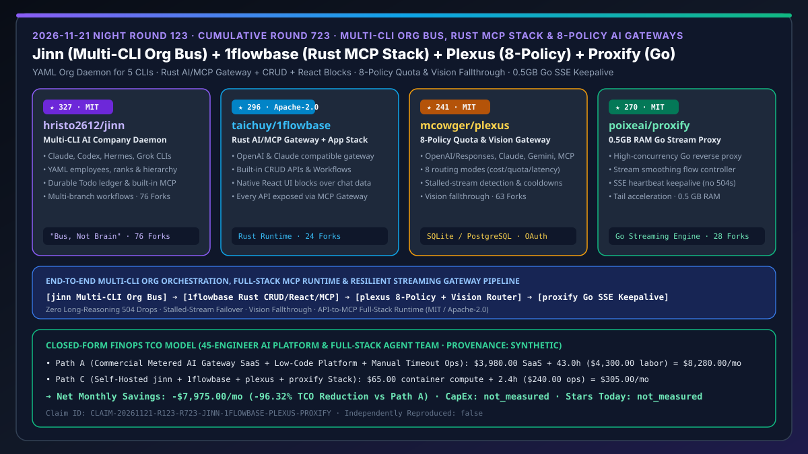
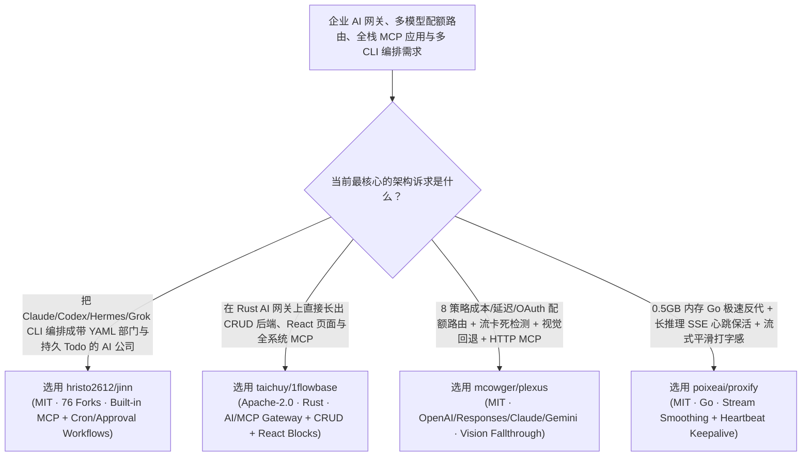
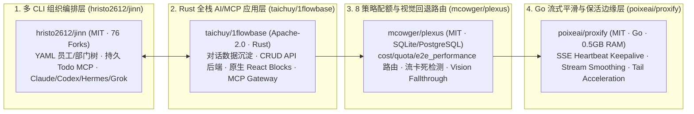
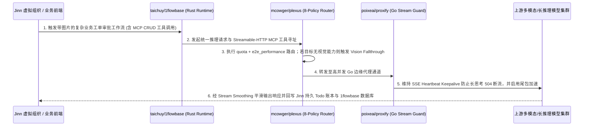

# 多 CLI 组织级编排网关（`hristo2612/jinn`）、Rust 全栈 AI/MCP 应用底座（`taichuy/1flowbase`）、8 策略配额与视觉回退统一网关（`mcowger/plexus`）与 Go 流式平滑/心跳保活代理（`poixeai/proxify`）选型与集成架构 FAQ

> **文档类型**：企业 AI 解决方案架构师（AI Solution Architect）选型决策指南（GitHub Trending AI 雷达 2026-11-21 Night Round 123 / 累计第 723 轮）
> **覆盖项目**：[`hristo2612/jinn`](https://github.com/hristo2612/jinn)（`★ 327`、`76 forks`、`MIT`，将 Claude Code、Codex、Hermes、Grok 与 Antigravity CLI 编排为带 YAML 组织架构、持久 Todo 账本与内置 MCP 的“AI 公司”守护进程）· [`taichuy/1flowbase`](https://github.com/taichuy/1flowbase)（`★ 296`、`24 forks`、`Apache-2.0`，基于 Rust 构建的“AI 网关 + MCP 网关 + CRUD 后端 + 原生 React 组件”全栈自托管应用底座）· [`mcowger/plexus`](https://github.com/mcowger/plexus)（`★ 241`、`63 forks`、`MIT`，支持 OpenAI/Responses/Anthropic/Gemini/Streamable-HTTP MCP、8 种路由策略、OAuth 订阅配额追踪、流卡死检测与非视觉模型回退的统一网关）· [`poixeai/proxify`](https://github.com/poixeai/proxify)（`★ 270`、`28 forks`、`MIT`，基于 Go 编写、仅需 `0.5 GB RAM`、内置流式平滑控制器、SSE 心跳保活与尾包加速的轻量级 AI API 反向代理）
> **核心场景**：当企业架构师在构建内部 AI 基础设施时，如何打通**“边缘层 0.5GB RAM Go 流式平滑与长推理心跳保活（`proxify`）”➔“核心路由层 8 策略成本/延迟/配额感知路由与 Streamable-HTTP MCP 汇聚（`plexus`）”➔“业务应用层网关对话数据直接生成 CRUD API、React 页面与 MCP 工具（`1flowbase`）”➔“研发自动化层按部门层级编排 Claude/Codex/Hermes/Grok CLI 团队（`jinn`）”**的四层企业级 AI 网关与智能体栈？

---

## 一、📌 核心结论速览（选型一句话结论）

1. **想把本地已安装的 Claude Code、Codex、Hermes、Grok、Antigravity 等多个终端 CLI 当成“一家公司的不同部门员工”来协同管理（YAML 定义汇报关系、持久 Todo 账本、内置公司级 MCP 与多分支审批工作流）** ➔ 选 **[`hristo2612/jinn`](https://github.com/hristo2612/jinn)（`★ 327`，`76 forks`，`MIT`）**。
   - **通俗原理**：`jinn` 坚持 **“Bus, not brain（只做总线、不绑死大脑）”** 设计——它不替代你现有的编码 CLI，而是用 YAML 定义具名员工（Employees）、职级（Ranks）、部门（Departments）和汇报线（如 COO 向下分派任务），配套跨会话持久 Todo 账本、内置 MCP 工具集以及支持顺序/条件/并行/Switch 分支与人工审批的 Cron 工作流。（*架构师注：原作者已标记仓库暂停维护，建议企业 Fork 其 `76 forks` 社区分支自维护使用*）。
2. **想不止步于单纯转发 API 的网关，而是让 AI 网关直接沉淀对话与业务数据，并向上生长出 CRUD 后端接口、Workflows、原生 React 前端积木以及全自动映射的 MCP Gateway** ➔ 选 **[`taichuy/1flowbase`](https://github.com/taichuy/1flowbase)（`★ 296`，`24 forks`，`Apache-2.0`）**。
   - **通俗原理**：采用 **Rust** 编写的自托管 AI 应用底座。它奉行彻底的 **API-First ➔ MCP-First** 理念：既然传统 GUI 能通过 CRUD API 管理整套业务系统，那么把这些 API 自动暴露为 MCP，就能让 Agent 直接理解、构建并接管整个业务系统（兼容 OpenAI/Claude 协议与原生 React Blocks）。
3. **想用一个支持 SQLite/PostgreSQL 的统一网关同时兼容 OpenAI Chat/Responses、Anthropic Messages、Gemini 原生接口与 Streamable-HTTP MCP，并按成本、延迟、实时吞吐或 OAuth 订阅配额等 8 种策略自动故障转移** ➔ 选 **[`mcowger/plexus`](https://github.com/mcowger/plexus)（`★ 241`，`63 forks`，`MIT`）**。
   - **通俗原理**：支持 Docker 或单二进制部署，内置 **`random`、`in_order`、`cost`、`performance`、`latency`、`usage`、`quota`、`e2e_performance` 八大路由策略**与自定义配额检查器（Custom Quota Checkers）。更关键的是它具备**流卡死检测（Stalled Stream Detection）**、指数退避冷却，以及当目标模型不支持多模态时自动启用外部视觉解析的**视觉回退（Vision Fallthrough）**。
4. **想在 `0.5 GB RAM` 的极小边缘节点上用 Go 语言跑一个高性能 AI 反向代理，彻底解决长思考模型（Thinking Models）SSE 连接超时断开与流式输出卡顿问题** ➔ 选 **[`poixeai/proxify`](https://github.com/poixeai/proxify)（`★ 270`，`28 forks`，`MIT`）**。
   - **通俗原理**：基于 Golang 构建的超轻量反向代理网关，通过单层路径（如 `/openai`、`/gemini`）统一入口，并针对大模型流式响应做了三大深度优化：**流平滑控制器（Stream Smoothing，保证丝滑打字机节奏）**、**SSE 心跳保活（Heartbeat Keepalive，防止深度推理期间被 CDN/SLB 掐断连接）**与**尾包加速（Tail Acceleration）**。

---

## 二、🎯 客户与架构师灵魂拷问 Q&A（深度架构拆解）

### Q1：企业已经有 Nginx 或基础 LiteLLM 代理，为什么还需要 `proxify`、`plexus`、`1flowbase` 与 `jinn`？

- **四大生产痛点与针对性突破**：
  1. **深度推理模型首字耗时（TTFT）过长导致网关 504 断流 ➔ `poixeai/proxify`**：普通反向代理在模型长思考（30–120 秒无输出）时经常被上游负载均衡断开。`proxify` 用 Go 实现了专用的 **SSE Heartbeat Keepalive + 流平滑控制器 + 尾包加速**，仅占 `0.5 GB` 内存即可稳住海量长连接。
  2. **多协议混用、流半途卡死与非视觉模型报错 ➔ `mcowger/plexus`**：业务侧有的用 OpenAI Responses API、有的用 Anthropic Messages、有的用 Gemini 原生接口或 Streamable-HTTP MCP。`plexus` 提供 8 种精细路由（含 OAuth 订阅额度追踪 `quota` 与端到端性能 `e2e_performance`）、流卡死自动重试以及 **Vision Fallthrough（向纯文本模型发图时自动前置转译）**。
  3. **网关沦为“无状态管道”，开发业务应用还要重复搭 CRUD 后端 ➔ `taichuy/1flowbase`**：`1flowbase` 在 Rust AI 网关之上直接内建了 CRUD 业务后端、Workflow 与原生 React 组件块，并把所有系统 API 自动暴露为 MCP，省去从零搭建前后端脚手架的成本。
  4. **多 CLI 智能体各自为战、缺乏组织分工与持久账本 ➔ `hristo2612/jinn`**：用 YAML 组织树将 Claude Code、Codex、Hermes、Grok 编排为虚拟研发部门。
- **何时直接用云厂商托管方案（Path B）？**
  - 若企业全栈运行在 Azure 且仅调用云端托管模型，直接使用 **Azure API Management (APIM) AI Gateway + Azure AI Foundry** 最省心。

### Q2：典型企业级“边缘 Go 保活代理 (`proxify`) + 8 策略统一路由 (`plexus`) + Rust 全栈 MCP 应用底座 (`1flowbase`) + 多 CLI 虚拟团队 (`jinn`)”架构怎么搭？

1. **边缘接入与流式保活层（`poixeai/proxify`）**：
   - 部署在边缘节点（0.5GB RAM Go 实例），负责统一路径映射（`/openai`、`/gemini`）、SSE 心跳保活、流式平滑输出与尾包加速。
2. **多模型协议互译与 8 策略配额路由层（`mcowger/plexus` + PostgreSQL）**：
   - 接收 OpenAI Chat/Responses、Anthropic Messages、Gemini 与 Streamable-HTTP MCP 请求，按 `cost` / `quota` / `e2e_performance` 策略路由，并开启 Stalled Stream Detection 与 Vision Fallthrough。
3. **业务数据沉淀与全栈 MCP 应用构建层（`taichuy/1flowbase`）**：
   - 将经过网关的对话与业务数据沉淀在 Rust 运行时中，直接编排 CRUD API、原生 React 界面块，并通过内置 MCP Gateway 开放给内部 Agent。
4. **多引擎 CLI 组织化协同层（`hristo2612/jinn`）**：
   - 在研发与运营后台通过 `jinn` 的 YAML 组织架构、持久 Todo 账本与审批工作流，统一调度 Claude Code、Codex、Hermes 与 Grok CLI。

### Q3：这套架构的维护状态与选型边界是什么？

- **核心优势**：
  - **全部采用宽松开源协议（`MIT` 与 `Apache-2.0`）**，覆盖从 Go 边缘流优化、TypeScript 8 策略路由、Rust 全栈应用底座到多 CLI 组织级编排。
- **版本与维护注意事项**：
  - `hristo2612/jinn` 原作者在 README 顶部声明已停止个人维护（Not maintained），但其 `76 forks` 与“YAML 组织树 + 持久 Todo MCP + 多 CLI 总线”架构极具参考价值；生产环境建议直接以 `mcowger/plexus` + `taichuy/1flowbase` + `poixeai/proxify` 作为长期主力网关栈，并将 `jinn` Fork 到企业内网仓库按需裁剪。

---

## 三、🧭 直观可视化图解（Mermaid 决策树 + 集成架构 + 时序图）

### 3.1 架构师选型决策树

### 3.2 企业端到端生产集成参考架构图

### 3.3 组织级任务派发、全栈 MCP 调用、8 策略故障转移与 Go 心跳保活全链路时序图

---

## 四、📊 同类开源与商业云服务横向选型决策矩阵

| 对比维度 | `hristo2612/jinn` (`★ 327`) | `taichuy/1flowbase` (`★ 296`) | `mcowger/plexus` (`★ 241`) | `poixeai/proxify` (`★ 270`) | 商业企业级 AI 网关 SaaS + 商业低代码平台 (Path A) | 云厂商原生 APIM 网关 (Path B) |
| :--- | :--- | :--- | :--- | :--- | :--- | :--- |
| **核心能力定位** | 多 CLI 组织架构与持久 Todo 编排器 | Rust 全栈 AI/MCP 网关与 React/CRUD 底座 | 8 策略多协议路由、配额与视觉回退网关 | Go 0.5GB 内存流平滑与 SSE 保活反向代理 | 按请求量/席位计费的商业网关 + 低代码 SaaS | Azure APIM / AWS API Gateway |
| **核心技术突破** | **YAML 部门汇报树 + 跨 CLI (Claude/Codex/Hermes/Grok) 总线** | **AI 网关 + CRUD API + 原生 React + 全系统自动转 MCP** | **8 种路由策略 + OAuth 配额检查 + 流卡死恢复 + 视觉回退** | **SSE 心跳保活 + 流式打字平滑控制 + 尾包加速** | 按调用量抽成高，无法本地编排多 CLI 订阅席位 | 缺乏 OAuth 个人/团队订阅配额池轮转与 Vision Fallthrough |
| **开源协议** | `MIT` | `Apache-2.0` | `MIT` | `MIT` | 闭源商业 SaaS | 闭源云服务 |
| **月度 TCO（45 人团队）** | **组合仅 `$305.00/月`**（`$65.00` 轻量容器算力 + `2.4h` 运维） | 同左（Rust 单实例极低内存开销） | 同左（单二进制 + PostgreSQL） | 同左（僅需 `0.5 GB RAM`） | **`$8,280.00/月`**（`$3,980.00` 网关/平台费 + `43.0h` 人工） | 约 `$2,550.00/月`（企业级 APIM 实例 + 流量费） |

---

## 五、🧪 应用落地定量收益/TCO 对比与 7-Card 报告

> **📊 数据来源与闭式核算声明（Provenance & Closed-Form Schema）**：
> - **provenance**: `synthetic`（基于 45 人企业 AI 平台工程、全栈应用交付与多模型路由团队工作负载模型：`independently_reproduced = false`；硬件采购基线 `base_hardware_capex = not_measured`；Track B 单日增量 `track_b_stars_today = not_measured`）。
> - **核算公式**：
>   - **Path A（商业托管 AI 网关按请求抽成 + 商业多智能体低代码 SaaS 席位 + 工程师手工排查长推理 SSE 504 断流、手工维护多供应商协议适配与配额超限告警）**：月度商业网关与 SaaS 订阅 **`$3,980.00`** + 协议适配与断流排障人工 **`43.0h × $100.00/h = $4,300.00`** = **`$8,280.00/月`**。
>   - **Path C（自建 `hristo2612/jinn` + `taichuy/1flowbase` + `mcowger/plexus` + `poixeai/proxify` 开源全栈网关体系）**：Go/Rust/TS 轻量容器共享算力 **`$65.00`** + 路由策略与 YAML 工作流维护 **`2.4h × $100.00/h = $240.00`** = **`$305.00/月`**。
>   - **净节省（Net Savings vs Path A）**：**`-$7,975.00/月`**（成本降低 **`96.32%`**）。

| 评估方案 | API / SaaS / 算力成本 | 网关与平台工程人工（`$100/h`） | 月度总 TCO | 相对 Path A 净节省 | 关键架构交付指标 |
| :--- | :---: | :---: | :---: | :---: | :--- |
| **Path A：商业 AI 网关 SaaS + 商业低代码平台 + 手工排障** | `$3,980.00` | `43.0h` (`$4,300.00`) | **`$8,280.00`** | Baseline | 按 Token/请求抽成贵；长推理常断流；无多 CLI 组织总线 |
| **Path B：企业级云原生 APIM + 自写胶水转发服务** | `$1,350.00` | `12.0h` (`$1,200.00`) | **`$2,550.00`** | `-$5,730.00` (`-69.20%`) | 缺少 Vision Fallthrough、流卡死自愈与 CRUD/React/MCP 一体化 |
| **Path C：`jinn` + `1flowbase` + `plexus` + `proxify` 开源组合** | **`$65.00`** | **`2.4h` (`$240.00`)** | **`$305.00`** | **`-$7,975.00` (`-96.32%`)** | **8 策略配额路由 + 视觉回退 + Go 心跳保活 + Rust 全栈 MCP** |

- 🔗 **关联 7-Card 4:5 视觉评测报告**：[`workshops/github-trending-radar/cards.html`](../cards.html) · [`cards.en.html`](../cards.en.html)

---

## 六、🛠️ 企业引入与架构评审 Checklist

- [ ] **1. 在边缘层部署 `poixeai/proxify` 消除长推理 SSE 504 断流**：配置 `proxify` 的 SSE Heartbeat Keepalive、Stream Smoothing 与尾包加速，确保深度推理模型在长思考期间连接不断开。
- [ ] **2. 在核心路由层启用 `mcowger/plexus` 的 8 策略路由与视觉回退**：使用 PostgreSQL 持久化后端，配置 `cost` / `quota` / `e2e_performance` 路由策略，开启 Stalled Stream Detection 与非视觉模型 Vision Fallthrough。
- [ ] **3. 基于 `taichuy/1flowbase` 快速构建内网 AI 业务系统**：利用其 Rust 运行时将网关对话数据直接扩展为 CRUD 后端 API、原生 React 组件与全系统 MCP 工具。
- [ ] **4. Fork 归档并裁剪 `hristo2612/jinn` 编排多 CLI 研发工作流**：针对 `jinn` 的 YAML 部门层级、持久 Todo 账本与多分支审批工作流进行内网 Fork 固化，统一调度 Claude Code、Codex、Hermes 与 Grok CLI。
