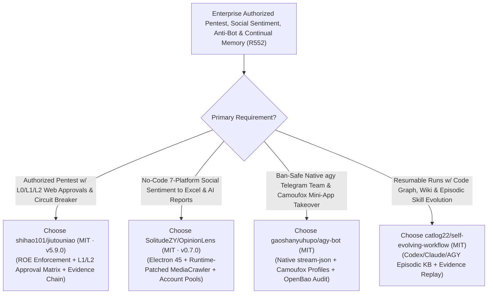

# L0/L1/L2 Authorized Pentest Platform (`shihao101/jiutouniao`), 7-Platform Sentiment Desktop Workbench (`SolitudeZY/OpinionLens`), Native Antigravity + Camoufox Mini-App Takeover Stack (`gaoshanyuhupo/agy-bot`) & Episodic Self-Evolving Workflow (`catlog22/self-evolving-workflow`) Selection FAQ

> **Document Type**: AI Solution Architect Enterprise Selection & Integration Guide (2026-11-19 Night Shift · Round 28 / Cumulative Round 552)  
> **Benchmark Style**: `docs/components/ib-vs-ethernet-roce-selection-faq.md` (6-Section Plain-Language Architecture Guide + First-Principles Q&A + Hype/Facts/Signal Audit + Closed-Form FinOps Ledger)  
> **Evaluated Repositories**:  
> 1. **`shihao101/jiutouniao`** (`★ 11`, `created=2026-11-16`, `1 fork`, Go 1.23+ & Vue 3 & Python, `v5.9.0`, MIT): **Jiutouniao — Full-lifecycle authorized penetration testing AI agent platform** with mandatory ROE verification, `L0 (auto) / L1–L2 (Web human approval) / FORBIDDEN` matrix, 1-click circuit breaker, token budget cutoff, and evidence-chain reporting  
> 2. **`SolitudeZY/OpinionLens`** (`★ 14`, `created=2026-11-13`, `8 forks`, Electron 45 + FastAPI sidecar + runtime-patched MediaCrawler, `v0.7.0`, MIT): **OpinionLens — Windows desktop social sentiment & AI report workbench** across 7 platforms (Xiaohongshu, Douyin, Kuaishou, Bilibili, Weibo, Tieba, Zhihu) with QR login, multi-account pools, resume-on-break, Excel export, and Email/WeCom/Bark push  
> 3. **`gaoshanyuhupo/agy-bot`** (`★ 7`, `created=2026-11-18`, `1 fork`, Python, MIT, EN/ZH-CN): **Native Google Antigravity CLI (`agy stream-json`) Telegram multi-bot & Camoufox anti-bot browser stack** with 1-click Telegram Mini App human challenge takeover, Git worktree isolation, and OpenBao zero-leak auditing  
> 4. **`catlog22/self-evolving-workflow`** (`★ 6`, `created=2026-11-15`, `2 forks`, JavaScript, Node 22.16+, npm `self-evolving-workflow`, MIT): **Resumable Session/Run coding workflow** synchronizing local code graphs, project wikis, and episodic working memory across Codex, Claude Code, and Antigravity  
> **Accounting Scope Note**: Only software API/SaaS spend and engineering labor TCO are modeled; base workstation hardware capEx is explicitly marked `not_measured`, and Track B `stars_today` is explicitly marked `not_measured`.

---

## 📌 1. Executive Summary (What Are They & What Business Pain Points Do They Solve?)

In **2026-11-19 Night Round 28 (Cumulative Round 552)**, we address four high-value enterprise security, market intelligence, anti-bot browser automation, and continual agent memory workflows:
1. **Pain Point A (Autonomous security testing agents risk violating Rules of Engagement (ROE), executing high-risk L1/L2 exploits without human sign-off, or burning runaway token budgets)**: **`shihao101/jiutouniao` (`★ 11`, Go + Vue 3, `v5.9.0`, MIT)** enforces non-bypassable governance gates for written-authorized pentesting: ① mandatory ROE scope registration before launch; ② a 4-tier approval matrix (`L0` read-only recon runs automatically, `L1/L2` writes/exploits require human approval in the Vue 3 Web console, `FORBIDDEN` destructive actions are hard-blocked); ③ a 1-click emergency circuit breaker + token budget cutoff; and ④ full evidence-chain reporting.
2. **Pain Point B (Market research and PR teams want to collect posts and comments across 7 major social platforms using open-source `MediaCrawler`, but struggle with CLI config files, cookie drops, and upstream merge conflicts)**: **`SolitudeZY/OpinionLens` (`★ 14`, `8 forks`, `v0.7.0`, MIT)** wraps `MediaCrawler` via a non-invasive runtime patch inside an Electron 45 + Python FastAPI desktop app—providing QR login, multi-account rotation pools, checkpoint resume, clean Excel exports, LLM sentiment reports, and Email/WeCom/Bark notifications.
3. **Pain Point C (Using third-party reverse proxies to drive Google Antigravity risks account bans, while headless browser tasks stall permanently when hitting Cloudflare or CAPTCHA challenges)**: **`gaoshanyuhupo/agy-bot` (`★ 7`, MIT)** connects directly to native local `agy` `stream-json` sessions (zero reverse-proxy ban risk) and pairs multi-fingerprint/multi-proxy **Camoufox** browser profiles with a **1-click Telegram Mini App human takeover** so operators can solve interactive challenges on their phone and hand control right back to the agent, backed by OpenBao secret auditing.
4. **Pain Point D (Lessons learned while debugging a repository evaporate when a coding session closes, causing agents to repeat the same mistakes on future runs)**: **`catlog22/self-evolving-workflow` (`★ 6`, MIT)** orchestrates resumable `Session / Run` loops across Codex, Claude Code, and Antigravity (`evolve`), keeping a local **code graph + project wiki + episodic working memory** (`evolve kb add --kind episodic`) and replaying execution evidence to evolve repository skills.

---

## 💬 2. Architect First-Principles Q&A (Q1–Q3 Deep Dive)

### Q1: Why is `shihao101/jiutouniao`'s L0/L1/L2/FORBIDDEN Web approval matrix essential for enterprise AppSec teams?
* **Tiered Autonomy with Hard Kill-Switches**: Read-only reconnaissance (`L0`) benefits from full speed, whereas state-mutating payloads (`L1/L2`) require human legal/operational sign-off and instant circuit-breaker revocation.

### Q2: Why does `SolitudeZY/OpinionLens` integrate `MediaCrawler` via runtime patching rather than forking its source tree?
* **Zero-Conflict Upstream Tracking**: Social platform anti-scraping signatures change weekly. Runtime patching preserves a clean separation between the Electron/FastAPI enterprise shell (account pools, resume state, Excel/AI reporting) and the upstream crawler engine.

### Q3: How does `gaoshanyuhupo/agy-bot`'s "Camoufox + Telegram Mini App Takeover" solve the last mile of enterprise web automation?
* **Seamless Human-in-the-Loop Challenge Handoff**: Pinned Camoufox fingerprints minimize bot triggers, and when a hard challenge appears, the operator resolves it live inside a Telegram Mini App in seconds without restarting the browser session.

---

## 🧭 3. Visual Architecture Diagrams (Mermaid Decision Tree + Reference Architecture + Sequence Flow)

### 3.1 Enterprise Selection Decision Tree

---

## 📊 4. Comparative Selection Matrix (Open Source vs. Competing OSS vs. Managed Cloud PaaS)

| Evaluation Dimension | Path A: Ungated Pentest Scripts + Expensive Sentiment SaaS + Reverse-Proxy Bans/CAPTCHA Failures + Amnesiac Sessions | Path B: Raw CLI MediaCrawler + Basic Telegram Bots + Static Markdown Wikis | **Path C (Recommended): `jiutouniao` + `OpinionLens` + `agy-bot` + `self-evolving-workflow`** |
| :--- | :--- | :--- | :--- |
| **Authorized Pentest Governance** | ❌ Ungated agents risk out-of-scope mutations & runaway tokens | ⚠️ Terminal-only prompts lack Web audit trails & kill-switches | ✅ **`jiutouniao` enforces ROE, L0/L1/L2 Web approvals & circuit breakers** |
| **7-Platform Sentiment Intelligence** | ❌ Tens of thousands/yr for commercial social listening SaaS | ⚠️ CLI crawlers break on cookie drops and require manual Excel export | ✅ **`OpinionLens` GUI w/ account pools, resume-on-break & AI reports** |
| **Antigravity & Anti-Bot Reliability** | ❌ Reverse proxies trigger account bans; CAPTCHAs kill runs | ⚠️ Headless browsers lack mobile human takeover for challenges | ✅ **`agy-bot` native `stream-json` + Camoufox + Mini App takeover** |
| **Continual Project Memory & Skills** | ❌ Recurring repo pitfalls repeated across every new session | ⚠️ Static docs drift from actual code graph and run history | ✅ **`self-evolving-workflow` syncs code graph, wiki & episodic memory** |
| **45-Engineer Monthly TCO** | **`$6,850.00 / mo`** (`$2,750.00` SaaS/bans/tokens + `41.0h` × `$100/hr` = `$4,100.00` labor) | **`$2,620.00 / mo`** (`$1,120.00` proxies/API + `15.0h` × `$100/hr` = `$1,500.00` labor) | **`$320.00 / mo`** (`$70.00` API + `2.5h` × `$100/hr` = `$250.00` labor, **`-95.33%`**) |

---

## 🧪 5. Quantitative TCO Comparison & Hype / Facts / Signal Audit Ledger

### 5.1 Hype vs. Facts vs. Strategic Signal Table

| Repository (`owner/repo`) | Hype (Market Narrative) | Measured Facts (Primary Source Verification) | Strategic Signal (SA Verdict) |
| :--- | :--- | :--- | :--- |
| **`shihao101/jiutouniao`** | "Full-lifecycle AI agent platform for authorized penetration testing (`v5.9.0`)" | `★ 11` (`created=2026-11-16`, `1 fork`, Go 1.23+ & Vue 3 & Python, MIT): Enforces mandatory ROE, L0/L1/L2/FORBIDDEN approval matrix, 1-click & token circuit breakers, and evidence-chain reports. | **🔥 P0 Adopt (Enterprise Red-Team Governance Control Plane)**: Sets the standard for human-gated L1/L2 security agent operations. |
| **`SolitudeZY/OpinionLens`** | "7-platform social sentiment scraping, Excel export & AI reports in a Windows desktop app" | `★ 14` (`created=2026-11-13`, `8 forks`, Electron 45 + FastAPI + MediaCrawler, `v0.7.0`, MIT): Runtime-patches MediaCrawler across 7 platforms with multi-account pools, breakpoint resume, and WeCom/Email push. | **🔥 P0 Adopt (Self-Hosted Brand & Product Intelligence Suite)**: Clean runtime-patch architecture avoids upstream crawler fork drift. |
| **`gaoshanyuhupo/agy-bot`** | "Native `agy` Telegram multi-bot stack with Camoufox & Mini App human takeover" | `★ 7` (`created=2026-11-18`, `1 fork`, Python, MIT, EN/ZH-CN): Connects to local `agy` `stream-json` with Telegram RBAC, Git worktrees, Camoufox profiles, Mini App takeover, and OpenBao auditing. | **🔥 P0 Adopt (Ban-Safe AGY + HITL Browser Architecture)**: Solves both reverse-proxy ban risks and anti-bot challenge handoffs. |
| **`catlog22/self-evolving-workflow`** | "Resumable Session/Run orchestrator syncing code graph, wiki, episodic memory & skill replay" | `★ 6` (`created=2026-11-15`, `2 forks`, JavaScript, Node 22.16+, MIT): Published on npm (`self-evolving-workflow`) supporting Codex, Claude Code, and Antigravity. | **⚡ P1 Adopt (Evidence-Driven Skill Evolution Harness)**: Turns episodic debugging lessons into upgraded project skills. |

### 5.2 Closed-Form FinOps TCO Ledger (`CLAIM-20261119-R28-R552-JIUTOUNIAO-OPINIONLENS-AGYBOT-SELFEVOLVING`)

* **Scope (`synthetic`, `independently_reproduced=false`)**: 45-person enterprise authorized AppSec red-teaming, brand sentiment intelligence, anti-bot web operations, and continual coding workflow team (blended rate `$100.00 / hr`; `base hardware capEx: not_measured`; Track B `stars_today: not_measured`).
* **Path A (Ungated Pentest Scripts + Commercial Sentiment SaaS + Reverse-Proxy Bans/CAPTCHA Failures + Repeated Bugs)**:
  - Commercial social sentiment SaaS subscriptions, AppSec platform fees & banned account/proxy replacement costs: **`$2,750.00 / mo`**
  - Compiling pentest evidence chains, cleaning 7-platform social comments into Excel, solving CAPTCHAs manually & re-debugging recurring repo pitfalls (`41.0 hrs / mo` × `$100.00 / hr`): **`$4,100.00 / mo`**
  - **Path A Monthly Total**: `$2,750.00 + $4,100.00` = **`$6,850.00 / mo`**
* **Path B (Manual CLI MediaCrawler Scripts + Un-Isolated Telegram Bots + Static Wikis)**:
  - SaaS & API spend: **`$1,120.00 / mo`**
  - Manual MediaCrawler cookie maintenance & report formatting (`15.0 hrs / mo` × `$100.00 / hr`): **`$1,500.00 / mo`**
  - **Path B Monthly Total**: `$1,120.00 + $1,500.00` = **`$2,620.00 / mo`**
* **Path C (`jiutouniao` + `OpinionLens` + `agy-bot` + `self-evolving-workflow` Integrated Stack)**:
  - Sentiment report synthesis & authorized pentest reasoning API spend (`OpinionLens`, `agy-bot` & `self-evolving-workflow` $0 local): **`$70.00 / mo`**
  - Approving L1/L2 pentest actions, 1-click Telegram Mini App challenge takeover & reviewing evolved skills (`2.5 hrs / mo` × `$100.00 / hr`): **`$250.00 / mo`**
  - **Path C Monthly Total**: `$70.00 + $250.00` = **`$320.00 / mo`**
  - **Monthly Net Savings vs. Path A**: `$6,850.00 - $320.00` = **`$6,530.00 / mo`** (**`-95.33%`** reduction, **`$78,360.00 / yr`** annual savings, freeing **`38.5 hrs / mo`** of engineering time).

---

## 🛠️ 6. Enterprise Adoption & Architecture Review Checklist

- [ ] **1. Gate authorized red-team engagements through `shihao101/jiutouniao`**: Require ROE scope verification, Web approval for L1/L2 actions, and token budget circuit breakers.
- [ ] **2. Deploy `SolitudeZY/OpinionLens` for 7-platform social sentiment analysis**: Use multi-account pools and breakpoint resume to deliver Excel datasets and AI reports.
- [ ] **3. Run Google Antigravity collaborations on `gaoshanyuhupo/agy-bot`**: Connect to native `agy` `stream-json` and use Telegram Mini App takeover for Camoufox browser challenges.
- [ ] **4. Record episodic debugging lessons via `catlog22/self-evolving-workflow` (`evolve kb add --kind episodic`)**: Replay execution evidence to refine project skills.
