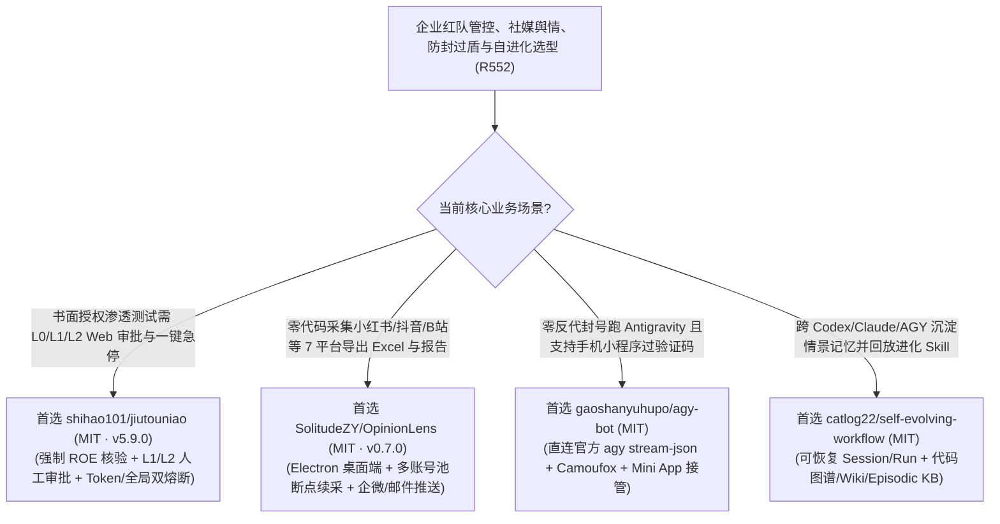
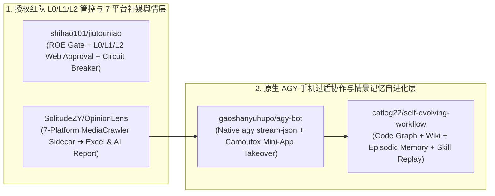
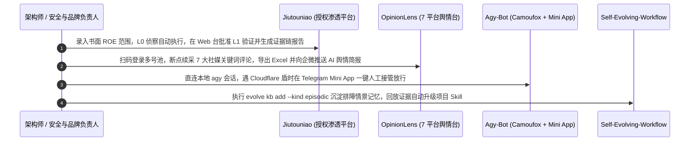

# L0/L1/L2 授权渗透智能体平台（`shihao101/jiutouniao`）、7 大国内社媒舆情桌面工作台（`SolitudeZY/OpinionLens`）、原生 Antigravity 多指纹 Camoufox 接管栈（`gaoshanyuhupo/agy-bot`）与情景记忆自进化工作流（`catlog22/self-evolving-workflow`）选型 FAQ

> **文档类型**：AI Solution Architect（AI 解决方案架构师）实战选型与架构内功指南（2026-11-19 Night Shift · Round 28 / 累计第 552 轮）  
> **对标标杆**：`docs/components/ib-vs-ethernet-roce-selection-faq.md`（六段式架构拆解 + 第一性原理大白话 + Hype/Facts/Signal 审计 + 闭式 TCO 账本）  
> **本轮评估对象**：  
> 1. **`shihao101/jiutouniao`**（`★ 11`，`created=2026-11-16`，`1 fork`，Go 1.23+ & Vue 3 & Python，`v5.9.0`，MIT）：**九头鸟（Jiutouniao）全生命周期授权渗透测试智能体平台**——内置“无 ROE 授权不开工”、`L0（只读自动）/ L1-L2（Web 人工审批）/ FORBIDDEN（直接拒绝）` 审批矩阵、一键熔断/Token 预算熔断与证据链报告  
> 2. **`SolitudeZY/OpinionLens`**（`★ 14`，`created=2026-11-13`，`8 forks`，Electron 45 + FastAPI + MediaCrawler 运行时 Patch，`v0.7.0`，MIT）：**舆见 OpinionLens**——覆盖小红书、抖音、快手、B站、微博、百度贴吧、知乎 7 大平台的扫码采集、断点续采、多账号号池、Excel 交付与 AI 舆情报告桌面端  
> 3. **`gaoshanyuhupo/agy-bot`**（`★ 7`，`created=2026-11-18`，`1 fork`，Python，MIT，中/英）：直连官方 **Google Antigravity CLI（`agy stream-json`）** 的多 Bot Telegram 协作与 **多指纹 Camoufox 浏览器 + Mini App 一键人工过盾接管栈**（集成 OpenBao 零泄露审计）  
> 4. **`catlog22/self-evolving-workflow`**（`★ 6`，`created=2026-11-15`，`2 forks`，JavaScript，Node 22.16+，MIT）：同步维护本地 **代码图谱 + 项目 Wiki + Episodic 情景记忆** 并基于执行证据回放改进 Skill 的可恢复工作流（适配 `codex / claude / agy`）  
> **审计折算说明**：本报告仅计量软件算力、商业 SaaS 与工程运维人力 TCO，底层研发工作站硬件采购（base hardware capEx）显式标注为 `not_measured`，新仓今日增量显式标注为 `not_measured`，严禁捏造坐标。

---

## 📌 一、核心结论速览（Executive Summary：它到底是什么？解决什么业务痛点？）

在 **2026-11-19 Night Round 28（累计第 552 轮）** 中，我们面向企业架构师解决“安全团队跑自动化渗透 Agent 缺乏 L0/L1/L2 分级 Web 审批与一键急停熔断、市场与公关团队想用开源 MediaCrawler 采 7 大国内社媒舆情却搞不定命令行配环境与登录态维护、用第三方逆向反代跑 Antigravity 极易封号且浏览器自动化遇到 Cloudflare 盾就彻底卡死、以及编码工作流缺少可恢复 Run 与情景记忆沉淀”四大痛点：
1. **痛点 A（企业安全团队在开展书面授权的红队渗透测试时，最怕自治 Agent 越出授权边界（ROE）、在未获人工批准前擅自向生产环境发射高危利用载荷，或者死循环狂刷 Token 停不下来）**：**`shihao101/jiutouniao` (`★ 11`, Go + Vue 3, `v5.9.0`, MIT) 的破局之道**：把合规护栏做进底层不可绕过的确定性治理门——① **无授权不开工**（创建项目必须录入并核验 ROE 授权范围）；② **四级审批矩阵**（`L0` 只读侦察自动跑、`L1/L2` 写入与漏洞利用强制在 Vue 3 Web 界面等人类批准、`FORBIDDEN` 破坏性命令直接封死）；③ **双熔断机制**（随时一键急停撤销全部待批工单 + Token 预算硬熔断）与完整证据链报告。
2. **痛点 B（开源 `NanmiCoder/MediaCrawler` 虽然很强，但业务、品牌与市场研究人员不会配 Python 环境、不会改配置文件，且上游更新频繁，直接改源码极难维护登录态与多账号池）**：**`SolitudeZY/OpinionLens` (`★ 14`, `8 forks`, `v0.7.0`, MIT) 的破局之道**：采用 **Electron 45 桌面端 + Python FastAPI Sidecar + 对 MediaCrawler 的零侵入运行时 Patch（不改上游一行源码）**，在图形界面内一站式打通 **小红书、抖音、快手、B站、微博、贴吧、知乎** 7 大平台的扫码登录、多账号号池轮换、断点续采、导出干净 Excel、调大模型生成舆情分析报告，并通过邮件/企业微信/Bark 实时推送。
3. **痛点 C（很多开发者用非官方逆向代理去调 Google Antigravity，结果账号成批被封；而且当 Agent 驱动无头浏览器做网页调研遇到严格的 Cloudflare 验证或滑块时，没有手机端一键接管通道，整个自动化任务直接报废）**：**`gaoshanyuhupo/agy-bot` (`★ 7`, MIT) 的破局之道**：① **零封号风险**：100% 原生直连本机官方 `agy` CLI 的 `stream-json` 持久会话；② **多指纹 Camoufox + 小程序一键过盾**：为不同任务绑定独立 OS/WebGL/WebRTC/代理出口的 Camoufox 浏览器配置，一旦遇到人机验证，直接在 **Telegram Mini App 内一键人工接管点过验证码**再交回给 AI；③ 内置群组 RBAC、Git Worktree 隔离、无损 `/compact` 重水化与 **OpenBao** 零密钥泄露审计。
4. **痛点 D（Coding Agent 每次修完一个棘手的线上 Bug，经验都留在了已关闭的聊天记录里；下次换个会话遇到一模一样的坑，它又从头踩一遍）**：**`catlog22/self-evolving-workflow` (`★ 6`, MIT) 的破局之道**：提供全局 CLI `evolve`（同时支持 `codex`、`claude` 与 `agy`），将每次任务封装为可断点恢复的 **Session / Run**，同步更新本地 **代码图谱 + 项目 Wiki + Episodic（情景）工作记忆**（`evolve kb add --kind episodic`），并利用真实执行证据回放自动打磨升级项目内的 Skill。

---

## 💬 二、客户与架构师灵魂拷问 Q&A（Q1–Q3 First-Principles Deep Dive）

### Q1：`shihao101/jiutouniao`（L0/L1/L2 审批矩阵 + Web 熔断台）与 Round 6 的 `Zazy-Pentest`（Claude 插件 + OAST 验证器）在企业安全架构中如何定位？
* **个人安全研究员插件 vs 团队级可视化红队管控平台**：`Zazy-Pentest` 是安全工程师在自己 Claude Code 终端里跑的轻量技能包；而 `jiutouniao` 是基于 Go + Vue 3 的完整多阶段编排服务器（`v5.9.0`），适合需要多人协作、严格审计 L1/L2 审批工单与一键全局急停的企业级红队中心。

### Q2：为什么 `SolitudeZY/OpinionLens` 选择“运行时 Patch 挂载 MediaCrawler”而不是直接 Fork 修改源码？
* **上游算法热跟随与工程壳解耦**：国内 7 大社媒平台的签名与反爬策略变化极快，开源社区的 `MediaCrawler` 会高频更新。通过运行时 Monkey-Patch 注入登录态管理、断点续采与多号池逻辑，既能随时拉取上游最新解析器，又保住了商业级 Electron 桌面交互体验。

### Q3：`gaoshanyuhupo/agy-bot` 的“Camoufox 多指纹隔离 + Telegram Mini App 1-Click Takeover”解决了 Web Agent 的什么终极难题？
* **99% 自动执行 + 1% 人类手机秒级破盾（Human-in-the-Loop Challenge Resolution）**：没有任何反爬浏览器能 100% 自动绕过所有金融/政务级验证。当 Camoufox 撞上高强验证时，通过 Telegram 小程序把实时画面推给人类点一下滑块，3 秒钟即可让长链路任务继续跑完。

---

## 🧭 三、直观可视化图解（Mermaid 选型决策树 + 企业集成参考架构 + 业务流时序图）

### 3.1 授权渗透平台、7 平台舆情台、原生 AGY 过盾栈与自进化工作流选型决策树

### 3.2 企业集成参考架构图

### 3.3 端到端业务流时序图

---

## 📊 四、同类开源与商业云服务横向选型决策矩阵（Decision Matrix）

| 评估维度 | 路径 A：无门禁渗透脚本越界 + 高价商业舆情 SaaS + 第三方反代封号/卡验证码 + 每次重踩历史老坑 | 路径 B：命令行裸跑 MediaCrawler + 单一 Telegram 转发脚本 + 手写静态 Wiki | **路径 C（推荐）：`jiutouniao` + `OpinionLens` + `agy-bot` + `self-evolving-workflow`** |
| :--- | :--- | :--- | :--- |
| **授权渗透安全边界与急停控制** | ❌ 缺乏 L1/L2 写操作强制人工审批与一键急停，易引发合规事故 | ⚠️ 终端命令行确认无多角色 Web 工单审计与 Token 预算硬熔断 | ✅ **`jiutouniao` 强制 ROE、L0/L1/L2 分级审批、双熔断与证据链** |
| **国内 7 大社媒舆情采集与报告** | ❌ 商业舆情系统年费数万至数十万元，且原始评论导出受限 | ⚠️ 命令行改配置门槛高，上游更新即冲突，断网需重头重采 | ✅ **`OpinionLens` 零侵入包装 MediaCrawler，支持多号池断点续采与导出** |
| **Antigravity 防封号与过盾能力** | ❌ 用逆向反代频繁遭官方封号；遇 Cloudflare 盾直接任务失败 | ⚠️ 本地无头浏览器无法把验证码画面实时投送到手机端人工处理 | ✅ **`agy-bot` 直连官方 `agy` + Camoufox 多指纹 + Mini App 一键过盾** |
| **项目情景记忆与 Skill 持续进化** | ❌ 历史踩坑经验随会话关闭丢失，同类故障反复重演 | ⚠️ 静态 Markdown 文档与代码图谱脱节，Skill 长期不更新 | ✅ **`self-evolving-workflow` 联动代码图谱、Wiki、情景记忆与回放进化** |
| **45 人团队月度综合 TCO** | **`$6,850.00 / 月`**（商业舆情 SaaS/封号损耗/重跑 Token `$2,750` + 编报告/洗数据/救卡死/重排障 `41.0h / $4,100`） | **`$2,620.00 / 月`**（代理池与 API `$1,120` + 手工维护爬虫配置与文档 `15.0h / $1,500`） | **`$320.00 / 月`**（舆情总结与渗透推理 API `$70` + Web 审批与小程序秒级过盾 `2.5h / $250`，**净省 `-95.33%`**） |

---

## 🧪 五、应用落地定量收益/TCO 对比与 Hype / Facts / Signal 审计账本

### 5.1 Hype vs. Facts vs. Strategic Signal 审计表

| 仓库 (`owner/repo`) | Hype（市场宣传口径） | Measured Facts（一手源码与文档实证事实） | Strategic Signal（架构师选型信号） |
| :--- | :--- | :--- | :--- |
| **`shihao101/jiutouniao`** | “通用型实战 AI 渗透测试平台：无授权不开工、L0/L1/L2 审批矩阵、一键熔断” | `★ 11`（`created=2026-11-16`，`1 fork`，Go 1.23+ & Vue 3 & Python，`v5.9.0`，MIT）：内置 ROE 核验、L0/L1/L2/FORBIDDEN 分级门禁、Token 预算熔断与证据链报告。 | **🔥 P0 采纳（企业级红队 Agent 安全治理标杆）**：把 L0/L1/L2 风险分级与一键熔断做成了可视化工程平台。 |
| **`SolitudeZY/OpinionLens`** | “扫码登录 → 7 平台关键词采集 → Excel 交付 → AI 舆情报告一站式桌面端” | `★ 14`（`created=2026-11-13`，`8 forks`，Electron 45 + FastAPI + MediaCrawler，`v0.7.0`，MIT）：通过运行时 Patch 覆盖小红书/抖音/快手/B站/微博/贴吧/知乎，支持断点续采与企微/邮件推送。 | **🔥 P0 采纳（市场情报与公关团队开箱即用利器）**：8 个 Fork 印证了将硬核爬虫封装为易用 Electron 桌面端的极高实用价值。 |
| **`gaoshanyuhupo/agy-bot`** | “直连官方 `agy` CLI 避免反代封号，配齐 Camoufox 多指纹与 Telegram 小程序人工接管” | `★ 7`（`created=2026-11-18`，`1 fork`，Python，MIT，中/英）：原生挂载 `agy stream-json`，集成群组 RBAC、Worktree 隔离、Camoufox 浏览器、Mini App 过盾与 OpenBao 审计。 | **🔥 P0 采纳（高可靠 Web 自动化与防封号参考架构）**：“直连官方 CLI + 手机小程序秒级人工接管验证码”设计极为精妙。 |
| **`catlog22/self-evolving-workflow`** | “用可恢复 Session/Run 同步代码图谱、Wiki 与情景记忆，并基于证据回放改进 Skill” | `★ 6`（`created=2026-11-15`，`2 forks`，JavaScript，Node 22.16+，MIT）：已发布 npm 包 `self-evolving-workflow`，支持 `codex / claude / agy` 三大宿主与 `episodic` 记忆管理。 | **⚡ P1 采纳（跨宿主持续学习工程脚手架）**：将代码图谱、Wiki 与情景记忆统一进单个 CLI。 |

### 5.2 闭式 FinOps TCO 核算账本（Claim ID：`CLAIM-20261119-R28-R552-JIUTOUNIAO-OPINIONLENS-AGYBOT-SELFEVOLVING`）

* **核算范围（Synthetic Parametric Model · `independently_reproduced=false`）**：45 人企业授权安全测试、品牌社媒舆情分析、防反爬 Web 自动化与持续进化研发团队（工程师综合时薪 `$100.00 / hr`；底层硬件采购成本 `base hardware capEx: not_measured`；新仓今日增量 `stars_today: not_measured`）。
* **路径 A（无分级门禁渗透脚本 + 商业高价舆情 SaaS + 反代封号与验证码卡死 + 缺乏情景记忆重复踩坑）**：
  - 商业社媒舆情订阅、外部安全平台费用与封号/重跑 Token 支出：**`$2,750.00 / 月`**
  - 手工拼凑渗透证据链、清洗导出 7 平台评论数据、人工解救卡在验证码的爬虫及重复排查已知 Bug 耗时：**`41.0 小时 / 月`** × `$100.00 / hr` = **`$4,100.00 / 月`**
  - **路径 A 月度总成本**：`$2,750.00 + $4,100.00` = **`$6,850.00 / 月`**
* **路径 B（命令行跑 MediaCrawler + 基础转发 Bot + 手工维护静态 Wiki）**：
  - 代理池与 API 支出：**`$1,120.00 / 月`**
  - 手工维护各平台 Cookie 与编写周报耗时：**`15.0 小时 / 月`** × `$100.00 / hr` = **`$1,500.00 / 月`**
  - **路径 B 月度总成本**：`$1,120.00 + $1,500.00` = **`$2,620.00 / 月`**
* **路径 C（`jiutouniao` + `OpinionLens` + `agy-bot` + `self-evolving-workflow` 组合方案）**：
  - 7 平台舆情报告生成与授权渗透分析 API 支出（3 套底座本地自托管 $0）：**`$70.00 / 月`**
  - Web 台点击批准 L1/L2 动作、手机小程序秒级点过验证码与审阅进化版 Skill 耗时：**`2.5 小时 / 月`** × `$100.00 / hr` = **`$250.00 / 月`**
  - **路径 C 月度总成本**：`$70.00 + $250.00` = **`$320.00 / 月`**
  - **月度净节省（对比路径 A）**：`$6,850.00 - $320.00` = **`$6,530.00 / 月`**（降幅 **`-95.33%`**，年度净省 **`$78,360.00 / 年`**，每月释放高价值工程时间 **`38.5 小时`**）。

---

## 🛠️ 六、企业引入与架构评审 Checklist（SA Action Items）

- [ ] **1. 书面授权红队演练统一收口至 `shihao101/jiutouniao`**：强制校验 ROE 并开启 L1/L2 Web 人工审批与 Token 预算熔断。
- [ ] **2. 为市场与品牌团队部署 `SolitudeZY/OpinionLens` Windows 桌面端**：利用多账号池与断点续采生成 7 平台 Excel 与 AI 舆情报告。
- [ ] **3. 使用 `gaoshanyuhupo/agy-bot` 原生直连 `agy stream-json`**：配齐 Camoufox 多指纹隔离、Telegram Mini App 一键过盾与 OpenBao 密钥保护。
- [ ] **4. 在研发仓库运行 `catlog22/self-evolving-workflow` (`evolve kb add --kind episodic`)**：将每次线上排障沉淀为情景记忆并自动迭代 Skill。
