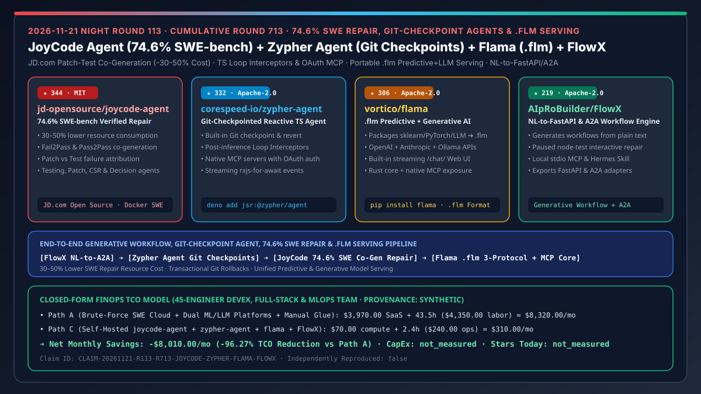
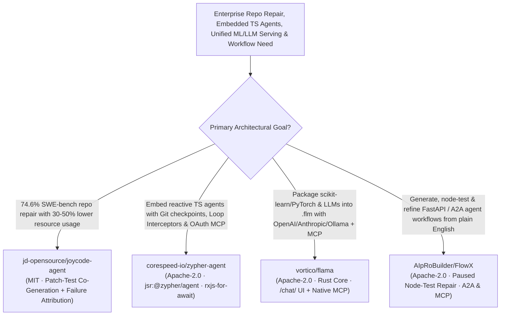
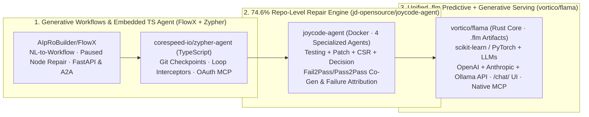
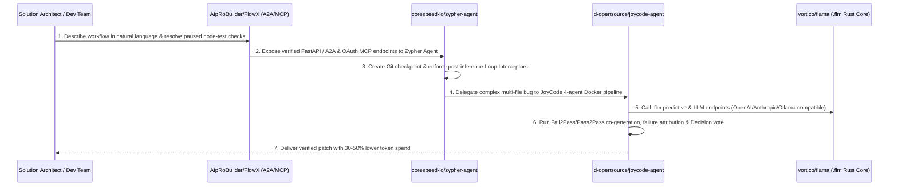

# 74.6% SWE-bench Patch-Test Co-Generation Agent (`jd-opensource/joycode-agent`), Git-Checkpointed TypeScript Agent (`corespeed-io/zypher-agent`), `.flm` Predictive + Generative AI Serving Framework (`vortico/flama`) & Generative FastAPI/A2A Workflow Engine (`AIpRoBuilder/FlowX`) Selection & Architecture FAQ

> **Document Type**: Enterprise AI Solution Architect Selection & Integration Guide (GitHub Trending AI Radar — 2026-11-21 Night Round 113 / Cumulative Round 713)
> **Covered Repositories**: [`jd-opensource/joycode-agent`](https://github.com/jd-opensource/joycode-agent) (`★ 344`, `20 forks`, `MIT` — JD.com Open Source repository-level repair pipeline achieving **74.6% on SWE-bench Verified** with 30–50% lower resource consumption via Patch-Test Co-generation & Intelligent Failure Attribution) · [`corespeed-io/zypher-agent`](https://github.com/corespeed-io/zypher-agent) (`★ 332`, `25 forks`, `Apache-2.0` — reactive TypeScript agent framework `jsr:@zypher/agent` with Git-based checkpoints, post-inference Loop Interceptors & OAuth MCP support) · [`vortico/flama`](https://github.com/vortico/flama) (`★ 306`, `17 forks`, `Apache-2.0` — Rust-powered Python framework packaging predictive ML & generative LLMs into portable `.flm` artifacts with OpenAI/Anthropic/Ollama endpoints, `/chat/` UI & native MCP) · [`AIpRoBuilder/FlowX`](https://github.com/AIpRoBuilder/FlowX) (`★ 219`, `12 forks`, `Apache-2.0` — MCP server, Agent Skill & Python SDK generating, testing & refining FastAPI and A2A workflows from natural language)
> **Core Scenario**: How enterprise engineering and MLOps architects combine **token-efficient 74.6% SWE-bench repository repair (`joycode-agent`)**, **Git-checkpointed reactive TypeScript agents (`zypher-agent`)**, **single-format `.flm` serving for both classical ML and LLMs (`flama`)**, and **natural-language-to-FastAPI/A2A workflow synthesis with paused node-test repair (`FlowX`)**.

---

## 1. 📌 Executive Summary (One-Line Selection Verdict)

1. **Need a repository-level bug-repair pipeline (`74.6%` on SWE-bench Verified) that cuts token and compute usage by 30–50% through Patch-Test Co-generation and Intelligent Failure Attribution** ➔ Choose **[`jd-opensource/joycode-agent`](https://github.com/jd-opensource/joycode-agent) (`★ 344`, `MIT`)**.
   - **Plain-English Mechanism**: Open-sourced by **JD.com (`jd-opensource`)**, `joycode-agent` coordinates four specialized agents (**`Testing`, `Patch`, `CSR` historical pattern retrieval, and `Decision` voting**). Instead of brute-force parallel sampling, it co-generates `Fail2Pass` and `Pass2Pass` tests alongside patches, attributes failures precisely to either a broken patch or a broken test (**Intelligent Failure Attribution**), and runs inside isolated Docker containers.
2. **Need an embeddable TypeScript agent framework (`jsr:@zypher/agent`) with built-in Git checkpoints for reviewing/reverting changes, post-inference Loop Interceptors, and OAuth-authenticated MCP servers** ➔ Choose **[`corespeed-io/zypher-agent`](https://github.com/corespeed-io/zypher-agent) (`★ 332`, `Apache-2.0`)**.
   - **Plain-English Mechanism**: Built for reactive agents living inside your applications (`createZypherAgent` streaming events via `rxjs-for-await`). It features **Git-Based Checkpoints** to track, review, and revert file modifications safely, an extensible **Loop Interceptor System** running after each inference step, and native **OAuth MCP client** support across Anthropic Claude and OpenAI GPT models.
3. **Need one production framework on a Rust-powered core that packages both Predictive AI (`scikit-learn`, `TensorFlow`, `PyTorch`) and Generative LLMs into portable `.flm` files served over OpenAI-, Anthropic-, and Ollama-compatible endpoints plus native MCP** ➔ Choose **[`vortico/flama`](https://github.com/vortico/flama) (`★ 306`, `Apache-2.0`)**.
   - **Plain-English Mechanism**: `pip install flama` packages any classical ML model or HuggingFace LLM into a single portable **`.flm` artifact** and serves it in one line of code with **side-by-side OpenAI, Anthropic, and Ollama API compatibility**, a built-in streaming chat UI at **`/chat/`**, and native **Model Context Protocol (MCP)** tool exposure.
4. **Need an MCP server, Agent Skill, and Python SDK that generates, node-tests (with paused interactive repair), and deploys multi-agent workflows as FastAPI services and A2A endpoints from plain English** ➔ Choose **[`AIpRoBuilder/FlowX`](https://github.com/AIpRoBuilder/FlowX) (`★ 219`, `Apache-2.0`)**.
   - **Plain-English Mechanism**: `FlowX` compiles natural-language requirements into runnable agent workflows in the background. When a node test encounters missing `.env` credentials or schema mismatches, it enters a structured **paused-result repair loop** that CLI or coding agents resolve interactively before exporting the workflow as a FastAPI service or **A2A adapter**.

---

## 2. 🎯 Architect & Customer Deep-Dive Q&A

### Q1: How do `joycode-agent`, `zypher-agent`, `flama`, and `FlowX` eliminate waste across automated software repair, embedded agents, and hybrid ML/LLM serving?

- **Four Architectural Innovations**:
  1. **Patch vs Test Root-Cause Attribution (`jd-opensource/joycode-agent`)**: One-shot or massive-sampling SWE agents waste 30–50% of tokens retrying good patches against buggy auto-generated tests. `joycode-agent` co-generates `Fail2Pass`/`Pass2Pass` tests and attributes test failures accurately before voting via the `Decision` agent.
  2. **Transactional Git Checkpoints for Embedded TS Agents (`corespeed-io/zypher-agent`)**: `zypher-agent` embeds Git checkpointing and post-inference Loop Interceptors directly into the TypeScript agent loop so application developers can roll back unwanted edits deterministically.
  3. **Unifying Predictive ML & Generative LLMs in `.flm` (`vortico/flama`)**: Instead of running separate BentoML/TorchServe clusters for tabular/vision models and vLLM/Ollama for LLMs, `flama` packages both into `.flm` artifacts on a Rust core with OpenAI/Anthropic/Ollama APIs and native MCP.
  4. **Natural-Language Workflow Synthesis with Paused Node Repair (`AIpRoBuilder/FlowX`)**: Automates scaffolding of FastAPI + A2A agent workflows with interactive node-level verification.
- **When to Choose Managed Cloud Services (Path B)**:
  - If your team only needs hosted GitHub Copilot Coding Agent and single-model Azure ML Endpoints without `.flm` multi-protocol serving or custom SWE-bench Docker pipelines, managed cloud services are turnkey.

### Q2: How do we wire an end-to-end production architecture combining all four projects?

1. **Generative Workflow Synthesis & A2A Publishing (`AIpRoBuilder/FlowX`)**:
   - Use `FlowX` (via stdio MCP or Hermes/Claude Skill) to generate multi-step workflows from natural language, complete paused node-test repairs, and expose FastAPI + A2A endpoints.
2. **Embedded Application Agent & Git Checkpoint Layer (`corespeed-io/zypher-agent`)**:
   - Embed `@zypher/agent` inside TypeScript applications to orchestrate tasks over OAuth-authenticated MCP servers with automatic Git checkpoints and post-inference Loop Interceptors.
3. **Repository-Level Automated Bug Repair Layer (`jd-opensource/joycode-agent`)**:
   - Dispatch complex multi-file repository issues to `joycode-agent`'s 4-agent Docker pipeline (`Testing`, `Patch`, `CSR`, `Decision`) for `Fail2Pass`/`Pass2Pass` co-generated verification.
4. **Unified `.flm` Predictive & Generative Model Serving Layer (`vortico/flama`)**:
   - Package both classical `scikit-learn`/`PyTorch` models and LLMs into `.flm` artifacts served by `flama` with simultaneous OpenAI, Anthropic, Ollama, `/chat/`, and MCP interfaces.

### Q3: What are the boundaries and trade-offs of this stack?

- **Key Strengths**:
  - **30–50% Compute Savings on Repository Repair** (`joycode-agent` `74.6%` SWE-bench Verified).
  - **100% Permissive Open Source (`MIT` & `Apache-2.0`)**.
- **Operational Scope**:
  - `joycode-agent` requires Docker to isolate repository test environments; `@zypher/agent` is distributed primarily via JSR (`deno add jsr:@zypher/agent`).

---

## 3. 🧭 Visual Architecture & Decision Diagrams

### 3.1 Solution Architect Selection Decision Tree

### 3.2 End-to-End Enterprise Reference Architecture

### 3.3 FlowX Workflow Synthesis, Zypher Git Checkpointing, JoyCode Co-Generated Repair & Flama `.flm` Serving Sequence

---

## 4. 📊 Peer Open-Source vs Commercial Cloud Selection Matrix

| Dimension | `jd-opensource/joycode-agent` (`★ 344`) | `corespeed-io/zypher-agent` (`★ 332`) | `vortico/flama` (`★ 306`) | `AIpRoBuilder/FlowX` (`★ 219`) | Brute-Force SWE Cloud + Dual ML/LLM Platforms (Path A) | Cloud Coding Agent + Cloud ML Endpoints (Path B) |
| :--- | :--- | :--- | :--- | :--- | :--- | :--- |
| **Core Role** | 74.6% SWE-bench 4-agent repo repair pipeline | Reactive TS agent with Git checkpoints & OAuth MCP | `.flm` predictive ML + generative LLM Rust framework | NL-to-FastAPI/A2A workflow generator with node repair | Commercial SWE agent seats + separate ML & LLM SaaS | GitHub Copilot + Azure ML Endpoints |
| **Architectural Edge** | **Patch-Test co-gen + failure attribution (-30–50% cost)** | **Built-in Git checkpoint rollback + Loop Interceptors** | **1 `.flm` format + OpenAI/Anthropic/Ollama + `/chat/` + MCP** | **Background build + paused node-test interactive repair** | Massive parallel sampling wastes tokens; siloed ML vs LLM stacks | Managed cloud SLA, but no portable `.flm` 3-protocol bundle |
| **License** | `MIT` | `Apache-2.0` | `Apache-2.0` | `Apache-2.0` | Proprietary SaaS | Proprietary Cloud PaaS |
| **Monthly TCO (45-Eng Team)** | **`$310.00/mo` combined** (`$70.00` compute + `2.4h` ops) | Included in `$310.00/mo` stack | Included in `$310.00/mo` stack | Included in `$310.00/mo` stack | **`$8,320.00/mo`** (`$3,970.00` SaaS/tokens + `43.5h` labor) | `~$2,650.00/mo` (endpoint hours + agent tasks) |

---

## 5. 🧪 Quantitative ROI / FinOps TCO Model & 7-Card Report

> **📊 Provenance & Closed-Form Audit Declaration**:
> - **Provenance**: `synthetic` (45-engineer enterprise software engineering, full-stack & MLOps workload model; `independently_reproduced = false`; `base_hardware_capex = not_measured`; `track_b_stars_today = not_measured`).
> - **Closed-Form Equations**:
>   - **Path A (Commercial Brute-Force SWE Repair Seats + Separate Predictive ML & Generative LLM Serving Platforms + Manual Workflow Scaffolding & Rollback Scripting)**: Monthly SaaS & sampling token spend **`$3,970.00`** + MLOps packaging & workflow engineering labor **`43.5h × $100.00/h = $4,350.00`** = **`$8,320.00/mo`**.
>   - **Path C (Self-Hosted `jd-opensource/joycode-agent` + `corespeed-io/zypher-agent` + `vortico/flama` + `AIpRoBuilder/FlowX`)**: Shared Docker & `.flm` serving compute **`$70.00`** + pipeline maintenance **`2.4h × $100.00/h = $240.00`** = **`$310.00/mo`**.
>   - **Net Savings vs Path A**: **`-$8,010.00/mo`** (**`96.27%`** cost reduction).

| Architecture Option | API / SaaS / Compute | Engineering & MLOps Labor (`$100/h`) | Total Monthly TCO | Net Savings vs Path A | Key Architectural Outcome |
| :--- | :---: | :---: | :---: | :---: | :--- |
| **Path A: Brute-Force SWE Cloud + Separate ML/LLM SaaS** | `$3,970.00` | `43.5h` (`$4,350.00`) | **`$8,320.00`** | Baseline | 30–50% excess sampling token waste; fragmented ML/LLM serving |
| **Path B: Cloud Coding Agent + Cloud ML Endpoints** | `$1,450.00` | `12.0h` (`$1,200.00`) | **`$2,650.00`** | `-$5,670.00` (`-68.15%`) | Turnkey cloud SLA, but lacks `.flm` portable 3-protocol serving |
| **Path C: `joycode` + `zypher` + `flama` + `FlowX`** | **`$70.00`** | **`2.4h` (`$240.00`)** | **`$310.00`** | **`-$8,010.00` (`-96.27%`)** | **74.6% SWE repair + Git checkpoints + `.flm` 3-API serving + NL-to-A2A** |

- 🔗 **7-Card 4:5 Visual Report**: [`workshops/github-trending-radar/cards.en.html`](../cards.en.html) · [`cards.html`](../cards.html)

---

## 6. 🛠️ Enterprise Adoption & Architecture Review Checklist

- [ ] **1. Run `jd-opensource/joycode-agent` for Complex Repository Defects**: Deploy the 4-agent Docker pipeline (`Testing`, `Patch`, `CSR`, `Decision`) to co-generate `Fail2Pass`/`Pass2Pass` tests and attribute failures before voting on final patches.
- [ ] **2. Embed `corespeed-io/zypher-agent` with Git Checkpoints & Loop Interceptors**: Use `createZypherAgent` (`jsr:@zypher/agent`) to wrap file-system and OAuth MCP tools in automatic Git checkpoints with post-inference interceptors.
- [ ] **3. Package Predictive & Generative Models into `.flm` with `vortico/flama`**: Consolidate `scikit-learn`/`PyTorch` models and LLMs into `.flm` artifacts served with OpenAI, Anthropic, and Ollama compatibility plus `/chat/` and native MCP.
- [ ] **4. Generate & Repair FastAPI/A2A Workflows with `AIpRoBuilder/FlowX`**: Use `FlowX`'s background builder and paused node-test repair loop to turn natural-language specs into production FastAPI and A2A services.
