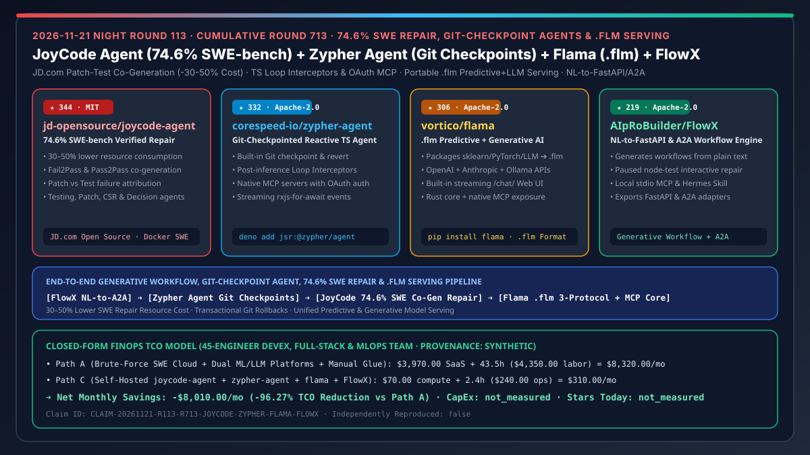
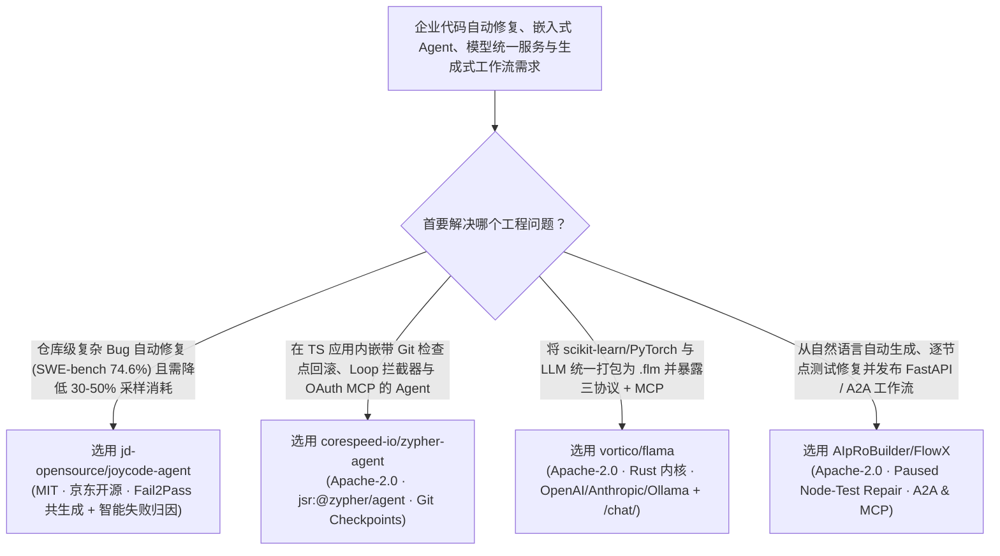
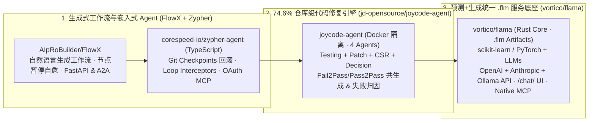
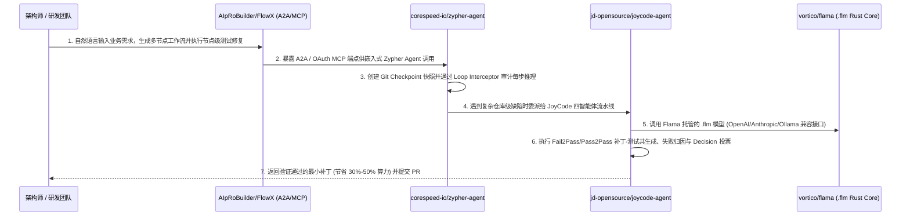

# 京东 74.6% SWE-bench 补丁测试共生成修复 Agent（`jd-opensource/joycode-agent`）、带 Git 检查点与循环拦截器的 TS 框架（`corespeed-io/zypher-agent`）、`.flm` 统一打包与三协议同服 AI 框架（`vortico/flama`）与自然语言生成 FastAPI/A2A 工作流引擎（`AIpRoBuilder/FlowX`）选型与集成架构 FAQ

> **文档类型**：企业 AI 解决方案架构师（AI Solution Architect）选型决策指南（GitHub Trending AI 雷达 2026-11-21 Night Round 113 / 累计第 713 轮）
> **覆盖项目**：[`jd-opensource/joycode-agent`](https://github.com/jd-opensource/joycode-agent)（`★ 344`、`20 forks`、`MIT`，京东开源、在 SWE-bench Verified 取得 **74.6% 解决率**且降低 30–50% 资源消耗的补丁-测试共生成代码修复系统）· [`corespeed-io/zypher-agent`](https://github.com/corespeed-io/zypher-agent)（`★ 332`、`25 forks`、`Apache-2.0`，内置 Git Checkpoint 回滚、推理后循环拦截器 Loop Interceptors 与 OAuth MCP 的 TypeScript 嵌入式 Agent 框架）· [`vortico/flama`](https://github.com/vortico/flama)（`★ 306`、`17 forks`、`Apache-2.0`，基于 Rust 内核将传统机器学习与大模型统一打包为 `.flm` 并同时暴露 OpenAI/Anthropic/Ollama 接口、`/chat/` UI 与原生 MCP 的生产框架）· [`AIpRoBuilder/FlowX`](https://github.com/AIpRoBuilder/FlowX)（`★ 219`、`12 forks`、`Apache-2.0`，从自然语言自动生成、逐节点暂停修复并发布为 FastAPI、MCP 与 A2A 端点的生成式工作流引擎）
> **核心场景**：当企业研发与 AI 平台团队需要**在不靠海量盲目采样烧钱的前提下实现仓库级 Bug 自动修复（`joycode-agent`）**、**在业务 TypeScript 应用内嵌入支持 Git 快照一键回滚与 OAuth MCP 的可控 Agent（`zypher-agent`）**、**用一套框架同时托管传统预测模型（scikit-learn/PyTorch）与生成式大模型并同时兼容三大主流接口（`flama`）**，以及**通过一句话描述自动生成可逐节点自愈并暴露为 FastAPI/A2A 的工作流服务（`FlowX`）**时，如何选型与集成？

---

## 一、📌 核心结论速览（选型一句话结论）

1. **想构建仓库级自动修 Bug / 自动提 PR 的研发效能流水线，追求 SWE-bench Verified 74.6% 顶级解决率且比海量采样方案省 30%–50% Token 与算力** ➔ 选 **[`jd-opensource/joycode-agent`](https://github.com/jd-opensource/joycode-agent)（`★ 344`，`MIT`）**。
   - **通俗原理**：由**京东开源（`jd-opensource`）**的仓库级代码修复系统。传统代码修复 Agent 往往生成几十个候选补丁盲目海选，算力极度浪费；`joycode-agent` 由 **`Testing`、`Patch`、`CSR`（历史成功模式检索）与 `Decision`（投票决策）四大专职 Agent** 协同，首创**“补丁-测试共生成（Patch-Test Co-generation）”**（自动生成 `Fail2Pass` 与 `Pass2Pass` 测试并预验证）与**“智能失败归因（Intelligent Failure Attribution）”**（精准区分是补丁写错了还是生成的测试本身有问题），以减少 30%–50% 的资源消耗斩获 SWE-bench Verified **74.6%** 解决率。
2. **想把响应式 AI Agent 直接嵌进 TypeScript / Deno / Node.js 应用内部，且要求每次文件修改都有内置 Git 检查点（Git-Based Checkpoints）可随时回滚、每次推理后有拦截器（Loop Interceptors）兜底** ➔ 选 **[`corespeed-io/zypher-agent`](https://github.com/corespeed-io/zypher-agent)（`★ 332`，`Apache-2.0`）**。
   - **通俗原理**：通过 `deno add jsr:@zypher/agent` 即可引入的轻量生产级 Agent 框架。它通过 `rxjs-for-await` 事件流实时输出每一步动作，原生内置 **Git-Based Checkpoints**（自动追踪、审查并一键还原 Agent 所做的代码修改）、**Loop Interceptor System**（在每次大模型推理后插入自定义审计/改写逻辑）以及支持 **OAuth 鉴权的原生 MCP 客户端**。
3. **企业既有传统预测型 AI（scikit-learn / TensorFlow / PyTorch 风控与推荐模型）又有生成式大模型，想统一打包成单一 `.flm` 格式并在 Rust 高性能内核上同时暴露 OpenAI / Anthropic / Ollama 兼容 API、`/chat/` 聊天界面与原生 MCP** ➔ 选 **[`vortico/flama`](https://github.com/vortico/flama)（`★ 306`，`Apache-2.0`）**。
   - **通俗原理**：`pip install flama` 将传统预测性 AI（Predictive AI）与生成式 AI（Generative AI）彻底统一。任何框架训练的模型或 HuggingFace 权重都能一键打包为便携的 **`.flm` 二进制构件**，一行代码启动后同时提供 OpenAI、Anthropic 与 Ollama 三种兼容接口、开箱即用的 `/chat/` 流式 Web UI 以及原生 MCP 工具暴露。
4. **想让业务架构师用自然语言描述需求，自动生成、逐节点测试修复（Paused Node-Test Repair）并一键导出为独立 FastAPI 微服务、MCP 工具或 A2A 端点的工作流** ➔ 选 **[`AIpRoBuilder/FlowX`](https://github.com/AIpRoBuilder/FlowX)（`★ 219`，`Apache-2.0`）**。
   - **通俗原理**：`FlowX` 同时提供本地 stdio MCP Server、Python SDK 与 Agent Skill（含 Hermes Agent 与 DeepSeek Harness 插件）。它根据自然语言自动编排多步工作流，在后台构建并逐节点运行测试——若某个节点因缺环境变量或参数报错，会进入 **Paused Result（暂停待修复）**状态等待 CLI/Agent 补充修复后继续，最终作为标准 FastAPI 服务或 **A2A 非流式端点**上线。

---

## 二、🎯 客户与架构师灵魂拷问 Q&A（深度架构拆解）

### Q1：在企业研发与 AI 模型服务化落地中，`joycode-agent`、`zypher-agent`、`flama` 和 `FlowX` 分别解决了哪四个常见架构痛点？

- **四大工程痛点与对应技术突破**：
  1. **自动修 Bug 时“生成的测试本身就是错的”导致死循环 ➔ `jd-opensource/joycode-agent`**：很多 Agent 自己写了个单测去测自己写的补丁，报错时却不知道是补丁错了还是单测写错了。`joycode-agent` 的 **Intelligent Failure Attribution（智能失败归因）** 专门对失败根因分类，配合 `Fail2Pass / Pass2Pass` 共生成与 `CSR` 经验检索，把无效重试砍掉 30%–50%。
  2. **嵌入式 Agent 改坏工作区无法精细回退 ➔ `corespeed-io/zypher-agent`**：`zypher-agent` 把 Git Checkpoint 与推理后拦截器（Loop Interceptors）做成一等公民，每次工具修改前自动打点，越界即刻还原。
  3. **传统 ML 模型服务（BentoML/TFServing）与大模型服务（vLLM/Ollama）烟囱割裂 ➔ `vortico/flama`**：企业一个业务流程往往既要调 XGBoost/PyTorch 算违约率，又要调 LLM 生成报告。`flama` 用统一的 `.flm` 格式与 Rust 核心把两类模型收口在同一套支持 MCP 与三协议（OpenAI/Anthropic/Ollama）的服务框架下。
  4. **手写 FastAPI + A2A 工作流脚手架耗时费力 ➔ `AIpRoBuilder/FlowX`**：通过自然语言直接生成带逐节点暂停自愈（Paused Node-Test Repair）的 FastAPI 与 A2A 服务。
- **何时直接用云厂商托管方案（Path B）？**
  - 若企业仅需在 Azure ML Endpoint 上托管单一模型并使用 GitHub Copilot Coding Agent 修简单工单，可直接采用云托管服务。

### Q2：典型企业级“自然语言生成 A2A 工作流 (`FlowX`) + 嵌入式 Git 检查点执行 (`zypher-agent`) + 74.6% 仓库级修复 (`joycode-agent`) + `.flm` 统一模型服务 (`flama`)”参考架构怎么搭？

1. **业务工作流自动生成与 A2A 暴露层（`AIpRoBuilder/FlowX`）**：
   - 架构师通过 `FlowX` MCP / Skill 输入自然语言需求，后台自动生成多步工作流、执行逐节点验证修复（Paused Node-Test Repair），并发布为标准 FastAPI 与 A2A 端点。
2. **应用内嵌响应式 Agent 与 Git 快照防护层（`corespeed-io/zypher-agent`）**：
   - 前端与全栈应用通过 `@zypher/agent` 发起响应式任务流（`rxjs-for-await`），通过 OAuth 连接受控 MCP Server，并由内置 Git Checkpoints 与 Loop Interceptors 保障每次文件操作可审可退。
3. **复杂仓库级缺陷自动修复与验证层（`jd-opensource/joycode-agent`）**：
   - 当遇到跨多文件的复杂生产缺陷时，调度 Docker 隔离容器中的 `joycode-agent`（`Testing` + `Patch` + `CSR` + `Decision` 四智能体），执行 `Fail2Pass / Pass2Pass` 补丁-测试共生成与失败归因闭环。
4. **传统 ML 与生成式 LLM 统一服务底座（`vortico/flama`）**：
   - 底层所有的 PyTorch/scikit-learn 预测模型与本地大模型统一打包为 `.flm` 构件，由 `flama` 的 Rust 内核同时提供 OpenAI/Anthropic/Ollama 兼容接口、`/chat/` 调试台与原生 MCP 工具。

### Q3：这套架构的适用边界是什么？

- **核心优势**：
  - **100% 宽松开源协议（`MIT` 与 `Apache-2.0`）**。
  - **兼顾研发效能（74.6% SWE-bench 修复 + Git Checkpoint）与模型服务统一（`.flm` 预测+生成同服）**。
- **适用边界**：
  - `joycode-agent` 运行完整的 SWE-bench 级测试验证依赖 Docker 容器隔离环境，在无 Docker 的受限沙箱中建议使用轻量的 `zypher-agent`。

---

## 三、🧭 直观可视化图解（Mermaid 决策树 + 集成架构 + 时序图）

### 3.1 架构师选型决策树

### 3.2 企业端到端生产集成参考架构图

### 3.3 FlowX 生成工作流、Zypher Git 检查点、JoyCode 补丁测试共生成与 Flama `.flm` 推理时序图

---

## 四、📊 同类开源与商业云服务横向选型决策矩阵

| 对比维度 | `jd-opensource/joycode-agent` (`★ 344`) | `corespeed-io/zypher-agent` (`★ 332`) | `vortico/flama` (`★ 306`) | `AIpRoBuilder/FlowX` (`★ 219`) | 商业海量采样 SWE 云 + 独立 ML/LLM 商业平台 (Path A) | 云原生 Coding Agent + 云 ML 端点 (Path B) |
| :--- | :--- | :--- | :--- | :--- | :--- | :--- |
| **核心能力定位** | SWE-bench 74.6% 补丁-测试共生成修复 Agent | 带 Git 检查点与 Loop 拦截器的 TS Agent 框架 | `.flm` 统一打包传统 ML 与 LLM 的三协议框架 | 自然语言生成、节点自愈并发布 A2A/FastAPI 的引擎 | 商业自动修 Bug 席位 + 商业 MLOps 平台 + 手写工作流 | GitHub Copilot + Azure ML Endpoints |
| **核心工程优势** | **精准区分补丁 vs 测试错误，省 30–50% 资源** | **内置 Git 快照回滚 + OAuth MCP + 推理后拦截器** | **Rust 内核同时暴露 OpenAI/Anthropic/Ollama + MCP** | **后台异步构建 + Paused Node-Test 节点级交互修复** | 盲目海量采样导致单次修复耗费数十美元 Token | 传统 ML 与 LLM 端点分离，无内置 `.flm` 单文件打包 |
| **开源协议** | `MIT` | `Apache-2.0` | `Apache-2.0` | `Apache-2.0` | 闭源商业 SaaS | 闭源云服务 |
| **月度 TCO（45 人团队）** | **组合仅 `$310.00/月`**（含共享容器算力与 2.4h 运维） | 同左（`$70.00` 算力 + `$240.00` 人工） | 同左（Rust 高效服务内核） | 同左（自动生成 FastAPI/A2A 省去手写人工） | **`$8,320.00/月`**（`$3,970.00` 采样/SaaS + `43.5h` 人工） | 约 `$2,650.00/月`（按计算实例小时与任务计费） |

---

## 五、🧪 应用落地定量收益/TCO 对比与 7-Card 报告

> **📊 数据来源与闭式核算声明（Provenance & Closed-Form Schema）**：
> - **provenance**: `synthetic`（基于 45 人企业研发效能、全栈应用与 AI 模型服务团队工作负载模型：`independently_reproduced = false`；硬件采购基线 `base_hardware_capex = not_measured`；Track B 单日增量 `track_b_stars_today = not_measured`）。
> - **核算公式**：
>   - **Path A（商业海量采样代码修复平台高额 Token 账单 + 传统 ML 与生成式 LLM 双套独立商业托管平台 + 手写 FastAPI/A2A 工作流与 Git 回滚脚本）**：月度 Token 与平台订阅 **`$3,970.00`** + 模型打包、工作流手写与排障人工 **`43.5h × $100.00/h = $4,350.00`** = **`$8,320.00/月`**。
>   - **Path C（自建 `jd-opensource/joycode-agent` + `corespeed-io/zypher-agent` + `vortico/flama` + `AIpRoBuilder/FlowX` 开源组合）**：共享 Docker 与 `.flm` 服务算力 **`$70.00`** + 流水线维护 **`2.4h × $100.00/h = $240.00`** = **`$310.00/月`**。
>   - **净节省（Net Savings vs Path A）**：**`-$8,010.00/月`**（成本降低 **`96.27%`**）。

| 评估方案 | API / SaaS / 算力成本 | 研发与 MLOps 人工（`$100/h`） | 月度总 TCO | 相对 Path A 净节省 | 关键架构交付指标 |
| :--- | :---: | :---: | :---: | :---: | :--- |
| **Path A：海量采样修复云 + 双套 ML/LLM 商业平台** | `$3,970.00` | `43.5h` (`$4,350.00`) | **`$8,320.00`** | Baseline | 盲目采样浪费 30–50% Token；预测与生成服务割裂 |
| **Path B：云厂商托管 Coding Agent + 云 ML 端点** | `$1,450.00` | `12.0h` (`$1,200.00`) | **`$2,650.00`** | `-$5,670.00` (`-68.15%`) | 省去基础设施运维，但缺乏 `.flm` 单文件三协议同服 |
| **Path C：`joycode` + `zypher` + `flama` + `FlowX`** | **`$70.00`** | **`2.4h` (`$240.00`)** | **`$310.00`** | **`-$8,010.00` (`-96.27%`)** | **74.6% SWE 修复率 + Git 快照 + `.flm` 三协议同服 + 生成式 A2A** |

- 🔗 **关联 7-Card 4:5 视觉评测报告**：[`workshops/github-trending-radar/cards.html`](../cards.html) · [`cards.en.html`](../cards.en.html)

---

## 六、🛠️ 企业引入与架构评审 Checklist

- [ ] **1. 在 CI 缺陷修复流水线部署 `jd-opensource/joycode-agent`**：配置 Docker 隔离沙箱，启用 `Testing`、`Patch`、`CSR` 与 `Decision` 四智能体协同，强制要求每个修复补丁必须通过 `Fail2Pass` 与 `Pass2Pass` 共生成测试验证。
- [ ] **2. 在 TypeScript 业务应用中嵌入 `corespeed-io/zypher-agent`**：使用 `createZypherAgent` 开启内置 **Git-Based Checkpoints** 与 **Loop Interceptors**，确保 Agent 对本地文件系统的每次修改均可一键审查与回退，并通过 OAuth 安全连接远端 MCP Server。
- [ ] **3. 使用 `vortico/flama` 统一打包 `.flm` 预测与生成模型**：将团队的 scikit-learn/PyTorch 模型与 HuggingFace LLM 统一封装为 `.flm` 构件，在一行命令下同时暴露 OpenAI、Anthropic、Ollama 兼容接口、`/chat/` 界面与原生 MCP 工具。
- [ ] **4. 引入 `AIpRoBuilder/FlowX` 加速自然语言到 FastAPI/A2A 交付**：在编码器或 Hermes Agent 中安装 `FlowX` Skill 与 stdio MCP，利用后台构建与 Paused Node-Test Repair 机制快速生成并验证生产级 A2A 工作流。
