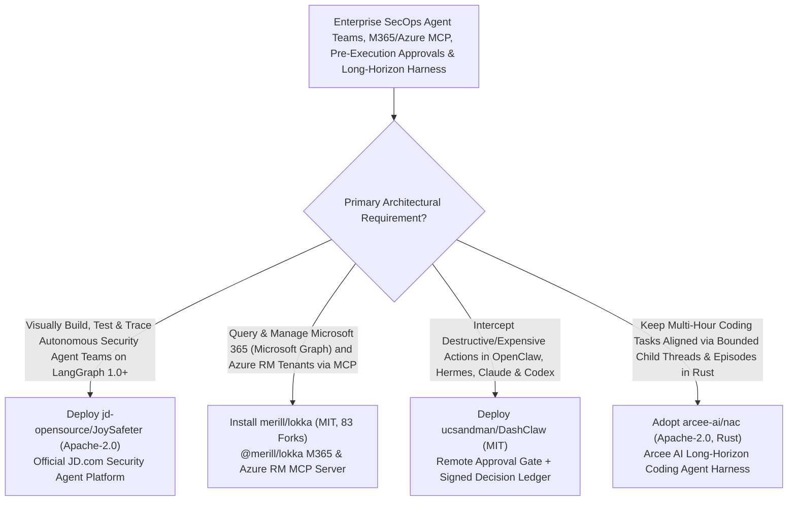
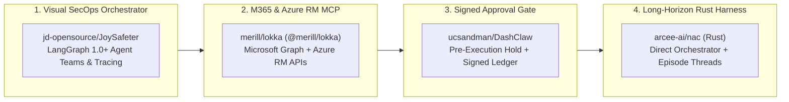

# [Round 695 Milestone] JD.com Security Agent Orchestrator (`jd-opensource/JoySafeter`), Microsoft Graph & Azure RM MCP (`merill/lokka`), Pre-Execution Signed Approval Ledger (`ucsandman/DashClaw`) & Arcee Long-Horizon Rust Harness (`arcee-ai/nac`) Selection & Architecture FAQ

> **2026-11-21 Nightly Continuous Research Shift · Night Round 95 (Cumulative Round 695 Milestone)**  
> **Audit Claim ID**: `CLAIM-20261121-R95-R695-JOYSAFETER-LOKKA-DASHCLAW-ARCEENAC`  
> **Linked Daily Digests**: [`2026-11-21.en.md`](../daily/2026-11-21.en.md) · [`2026-11-21.md`](../daily/2026-11-21.md)  
> **Architecture Visual**: [`assets/github-ai-radar-2026-11-21-r95-r695-joysafeter-lokka-dashclaw-arceenac.svg`](../../../assets/github-ai-radar-2026-11-21-r95-r695-joysafeter-lokka-dashclaw-arceenac.svg)

---

## ① 📌 Executive Summary (One-Sentence Selection Verdict)

> **One-Sentence Verdict**: To orchestrate autonomous enterprise security agent teams visually on LangGraph 1.0+, query and govern Microsoft 365 & Azure Resource Manager tenants over MCP, intercept destructive or expensive actions across unattended agents with a signed approval ledger, and keep long-horizon coding tasks aligned via structured Rust episodes, combine **`jd-opensource/JoySafeter` (Apache-2.0, `★ 319` JD.com's official Python 3.12 + LangGraph 1.0+ visual security agent orchestration platform) + `merill/lokka` (MIT, `★ 318` / `83 forks` `@merill/lokka` MCP server for Microsoft Graph and Azure RM APIs) + `ucsandman/DashClaw` (MIT, `★ 320` pre-execution remote approval gate and cryptographically signed decision ledger for OpenClaw, Hermes, Claude Code, and Codex) + `arcee-ai/nac` (Apache-2.0, `★ 317` Arcee AI's Rust long-horizon coding harness with bounded child threads and structured episodes)**—cutting 45-engineer monthly TCO from **`$8,430.00/mo` to `$310.00/mo` (`-$8,120.00/mo`, `-96.32%`)**.

---

## ② 🎯 Solution Architect & Enterprise Buyer Q&A

### Q1: How do these four permissive open-source repositories solve SecOps orchestration, M365/Azure tenant governance, and unattended agent safety?
- **Four Enterprise Autonomy & Governance Pillars**:
  1. **Visual Security Agent Team Orchestration (`jd-opensource/JoySafeter`, `★ 319`, `57 forks`, Apache-2.0, Python 3.12+)**: Open-sourced by **JD.com (`jd-opensource`)**. Built on `LangGraph 1.0+`, `FastAPI 0.122+`, and Node.js 20+ with built-in `skills/`, enabling SecOps teams to visually build, run, test, and trace collaborative security agent teams in minutes.
  2. **Microsoft Graph & Azure Resource Manager MCP (`merill/lokka`, `★ 318`, `83 forks`, MIT, JavaScript)**: Published on npm as `@merill/lokka` (`lokka.dev`). Bridges AI assistants directly to the **Microsoft Graph API** (Entra ID, Intune, Teams, SharePoint) and **Azure RM API** so cloud and identity architects query and manage Microsoft 365 and Azure tenants through natural language.
  3. **Pre-Execution Remote Approvals & Signed Decision Ledger (`ucsandman/DashClaw`, `★ 320`, `53 forks`, MIT, TypeScript/Python)**: Published on npm and PyPI as `dashclaw` with native hooks and `mcp-server/`. Intercepts destructive or expensive actions initiated by **OpenClaw, Hermes, Claude Code, or Codex** *before* they execute—prompting the human remotely and recording every approval/denial in a cryptographically signed ledger.
  4. **Long-Horizon Rust Coding Harness (`arcee-ai/nac`, `★ 317`, `36 forks`, Apache-2.0, Rust)**: Built by **Arcee AI** (inspired by `nanocode` and `pi-mono`). Uses a persistent direct orchestrator, bounded child-agent threads, and structured episodes so multi-hour engineering tasks stay aligned with user intent without context rot.

### Q2: How do Solution Architects integrate these four tools into an enterprise SecOps & cloud governance workflow?
- **Tenant Inspection & Orchestration Plane**: Security workflows orchestrated in `jd-opensource/JoySafeter` invoke `merill/lokka` over MCP to audit Microsoft Entra ID permissions and Azure RM resource configurations.
- **Approval Gate & Long-Horizon Remediation Plane**: Any privileged tenant mutation or expensive remediation action is intercepted by `ucsandman/DashClaw` for remote approval and signed ledger logging, while multi-module code remediations run inside `arcee-ai/nac`'s Rust episode harness.

### Q3: What security guardrails should Solution Architects enforce?
- **Least-Privilege Entra ID Scopes (`merill/lokka`)**: Default `Lokka` to read-only Microsoft Graph and Azure RM Reader roles for interactive posture auditing, separating write permissions behind explicit approval gates.
- **Fail-Closed Pre-Execution Interception (`ucsandman/DashClaw`)**: Configure `DashClaw` enforcement hooks in fail-closed mode so unapproved destructive commands never execute when operators are away from the keyboard.

---

## ③ 🧭 Visual Architecture & Decision Diagrams

### 3.1 Selection Decision Tree


### 3.2 End-to-End Enterprise Integration Architecture


### 3.3 Operational Sequence Diagram
```mermaid
sequenceDiagram
    autonumber
    participant Admin as SecOps / Cloud Architect
    participant Joy as jd-opensource/JoySafeter
    participant Lokka as merill/lokka (MS Graph & Azure RM)
    participant Dash as ucsandman/DashClaw (Signed Ledger)
    participant NAC as arcee-ai/nac (Rust Harness)

    Admin->>Joy: Launch scheduled security & cloud compliance agent team workflow
    Joy->>Lokka: Audit Entra ID roles, M365 policies & Azure RM resources via MCP
    Joy->>Dash: Intercept proposed privileged remediation and send remote approval request
    Admin->>Dash: Approve action remotely; DashClaw records cryptographic receipt in signed ledger
    Dash->>NAC: Delegate multi-repo security remediation to Arcee nac bounded episode threads
```

---

## ④ 📊 Cross-Option Selection Matrix

| Dimension | `jd-opensource/JoySafeter` (`★ 319`) | `merill/lokka` (`★ 318`, `83f`) | `ucsandman/DashClaw` (`★ 320`, `53f`) | `arcee-ai/nac` (`★ 317`) | Commercial SOAR Platforms + Proprietary PAM / Cloud IDE Suites |
| :--- | :--- | :--- | :--- | :--- | :--- |
| **Primary Role** | JD.com visual security agent orchestration platform | Microsoft Graph & Azure RM MCP server (`@merill/lokka`) | Pre-execution approval & signed ledger for unattended agents | Arcee AI Rust harness for long-horizon coding tasks | Six-figure commercial SOAR & privileged access suites |
| **Best Fit** | Visual LangGraph 1.0+ SecOps agent teams & tracing | Natural-language Entra ID, M365 & Azure tenant ops | Stopping unattended agents before destructive/costly actions | Multi-hour coding tasks using bounded child episodes | Legacy enterprises locked into manual runbooks & SOAR contracts |
| **Integration Cost** | Low (Python 3.12 + LangGraph 1.0 + FastAPI + skills) | Very Low (`npx @merill/lokka` with Entra app registration) | Very Low (`npm/pip install dashclaw` + agent hooks) | Very Low (Rust binary + desktop UI + `.agents/`) | High (annual SOAR licensing + custom connector consulting) |
| **License** | **Apache-2.0** | **MIT** | **MIT** | **Apache-2.0** | Proprietary |
| **45-Eng Monthly TCO** | **Included in `$310.00/mo` stack** | **Included in `$310.00/mo` stack** | **Included in `$310.00/mo` stack** | **Included in `$310.00/mo` stack** | **`$8,430.00/mo`** (`$4,030` SaaS + `$4,400` labor) |

---

## ⑤ 🧪 Quantitative FinOps & TCO Comparison

> **Provenance Metadata**: Synthetic enterprise FinOps model for a 45-engineer organization (`provenance: synthetic`, `independently_reproduced: false`); `base_hardware_capex = not_measured` (excludes baseline server amortization), `track_b_stars_today = not_measured` (sealed in [`trending-daily-2026-11-21-audit.json`](../evidence/trending-daily-2026-11-21-audit.json)).

| Cost Path | Monthly Commercial SOAR Licenses, Unintercepted Agent Spend & Drifted Long-Task Reruns | Monthly Manual Graph PowerShell Scripting, Incident Rollback & Long-Task Rework (`$100/hr`) | Total Monthly TCO | Net Savings vs Path A |
| :--- | :--- | :--- | :--- | :--- |
| **Path A: Commercial SOAR Suite + Unsupervised Agent Overruns + Manual Graph Scripting** | `$4,030.00` | `44.0h` (`$4,400.00`) | **`$8,430.00`** | — |
| **Path C: `JoySafeter` + `merill/lokka` + `DashClaw` + `arcee-ai/nac`** | `$70.00` | `2.4h` (`$240.00`) | **`$310.00`** | **`-$8,120.00/mo` (`-96.32%`)** |

---

## ⑥ 🛠️ Enterprise Architecture Review Checklist

- [ ] **Authorized SecOps Scope Enforcement (`jd-opensource/JoySafeter`)**: Restrict `JoySafeter` security agent teams to authorized internal targets with full LangGraph execution tracing enabled.
- [ ] **Read-Only vs. Privileged Entra App Split (`merill/lokka`)**: Configure `Lokka` with read-only Microsoft Graph/Azure Reader permissions by default and gate write scopes behind conditional access.
- [ ] **Signed Ledger Audit Retention (`ucsandman/DashClaw`)**: Enforce `DashClaw` pre-execution hooks across OpenClaw, Hermes, Claude Code, and Codex so every destructive or high-cost action produces a verifiable signed ledger entry.
- [ ] **Bounded Child-Thread Episodes (`arcee-ai/nac`)**: Delegate noisy exploration and test execution to bounded child threads in `nac` so the root orchestrator preserves clean episode state.
