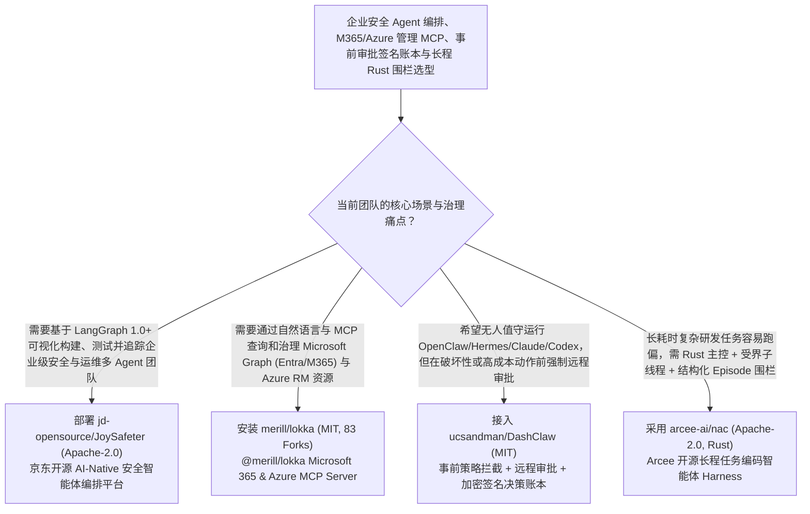
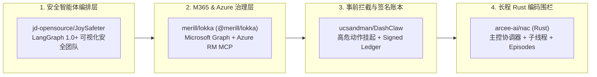
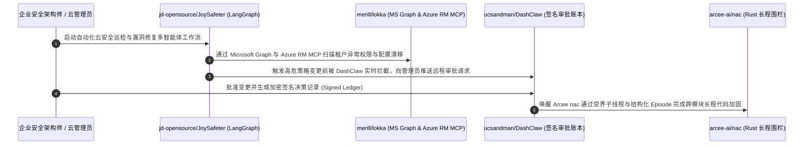

# 【第 695 轮里程碑】京东开源安全智能体编排平台（`jd-opensource/JoySafeter`）、Microsoft Graph 与 Azure RM 管理 MCP（`merill/lokka`）、高危动作拦截与签名账本（`ucsandman/DashClaw`）与 Arcee 长程任务 Rust 编码围栏（`arcee-ai/nac`）架构选型与落地 FAQ

> **2026-11-21 夜间持续研究班次 · Night Round 95（累计 Round 695 里程碑）**  
> **审计凭据**：`CLAIM-20261121-R95-R695-JOYSAFETER-LOKKA-DASHCLAW-ARCEENAC`  
> **关联日刊**：[`2026-11-21.md`](../daily/2026-11-21.md) · [`2026-11-21.en.md`](../daily/2026-11-21.en.md)  
> **可视化架构图**：[`assets/github-ai-radar-2026-11-21-r95-r695-joysafeter-lokka-dashclaw-arceenac.svg`](../../../assets/github-ai-radar-2026-11-21-r95-r695-joysafeter-lokka-dashclaw-arceenac.svg)

---

## ① 📌 核心结论速览（选型一句话结论）

> **一句话选型结论**：在构建覆盖“**企业级可视化安全与运维多智能体编排（LangGraph 1.0+）➔ Microsoft 365 与 Azure RM 租户自然语言治理 MCP ➔ 无人值守 Agent 破坏性/高成本动作事前拦截与签名账本 ➔ 基于结构化 Episode 与子线程的 Rust 长程编码围栏**”的企业安全自治底座时，推荐采用 100% 宽松协议（Apache-2.0 / MIT）的四件套：**“`jd-opensource/JoySafeter`（Apache-2.0，`★ 319` 京东官方开源的基于 Python 3.12 + LangGraph 1.0 + FastAPI 的企业级安全智能体团队可视化编排与追踪平台）+ `merill/lokka`（MIT，`★ 318`、`83 forks` 面向 Microsoft Graph 与 Azure RM API 的租户查询与管理 MCP Server `@merill/lokka`）+ `ucsandman/DashClaw`（MIT，`★ 320` 针对 OpenClaw / Hermes / Claude Code / Codex 破坏性或昂贵动作的事前远程审批、策略检查与签名证据账本）+ `arcee-ai/nac`（Apache-2.0，`★ 317` Arcee AI 开源的基于主控协调器、受界子线程与结构化 Episode 的长程任务 Rust 编码围栏）”**。在 45 人企业安全运营（SecOps）、云管与研发团队基准下，可将月度总拥有成本（TCO）从 **`$8,430.00/月`** 降至 **`$310.00/月`**（净省 **`$8,120.00/月`**，降幅 **`-96.32%`**）。

---

## ② 🎯 客户与架构师灵魂拷问 Q&A

### Q1：这四个开源项目如何协同解决企业安全自动化、M365/Azure 云租户治理与无人值守 Agent 失控风险？
- **四大核心工程支柱**：
  1. **京东官方出品的企业级安全智能体团队可视化工厂 —— `jd-opensource/JoySafeter`（`★ 319`，`57 forks`，Apache-2.0，Python 3.12+）**：由 **京东开源（`jd-opensource`）** 维护。基于 `LangGraph 1.0+`、`FastAPI 0.122+` 与现代前端工作台，专为企业安全与运维自动化打造——支持通过可视化画布构建、运行、测试并全链路追踪（Tracing）多智能体协作团队（Agent Teams），内置丰富的 `skills/`，将安全巡检与响应从数月定制缩短至分钟级编排。
  2. **一句自然语言统管 Microsoft 365 与 Azure RM 租户 —— `merill/lokka`（`★ 318`，`83 forks`，MIT，JavaScript）**：由微软身份安全领域专家维护（`@merill/lokka`，`lokka.dev`）。通过单个标准 MCP Server 同时桥接 **Microsoft Graph API**（Entra ID 用户/组、Intune 设备、Teams、条件访问策略）与 **Azure Resource Manager（Azure RM）API**，让云架构师与 IT 管理员用 AI 助手实时审计跨租户权限与云资源状态。
  3. **让 Agent 无人值守运行，但绝不给它“先斩后奏”的无条件特权 —— `ucsandman/DashClaw`（`★ 320`，`53 forks`，MIT，TypeScript/Python）**：同时提供 npm 与 PyPI SDK（`dashclaw`）及原生 `mcp-server/`。当 `OpenClaw`、`Hermes`、`Claude Code` 或 `Codex` 试图执行**破坏性操作（如删库、改生产配置）或高昂费用调用**时，`DashClaw` 在动作执行前实时挂起拦截，向不在电脑前的工程师推送远程审批请求，并将每一次放行或拒绝决定写入**加密签名账本（Signed Ledger）**。
  4. **解决长程编码任务“跑着跑着忘了最初目标”的 Rust 围栏 —— `arcee-ai/nac`（`★ 317`，`36 forks`，Apache-2.0，Rust）**：由 **Arcee AI** 开源（启发自 `nanocode` 与 `pi-mono`）。采用纯 Rust 构建（含 CLI 与 `desktop/`），通过**常驻主控 Agent（Persistent Direct Orchestrator）+ 受界子线程（Bounded Child Threads）+ 结构化阶段记忆（Structured Episodes）**，确保跨数小时的大规模重构始终对齐人类初始意图而不发生上下文漂移。

### Q2：企业架构师如何将这四个项目串成一条端到端的“云租户巡检 ➔ 安全编排 ➔ 事前审批 ➔ 长程修复”闭环？
- **云租户洞察与安全编排层**：在 `jd-opensource/JoySafeter` 的 LangGraph 1.0+ 可视化平台中编排安全巡检 Agent 团队，挂载 `merill/lokka` MCP 自动查询 Microsoft Graph（Entra ID）与 Azure RM 配置偏离。
- **事前强制审批与长程代码修复层**：一旦智能体需要修改高危云策略或执行生产修复，`ucsandman/DashClaw` 强制拦截并生成带数字签名的远程审批单；涉及大型代码库安全加固的任务则交由 `arcee-ai/nac` 通过受界子线程与结构化 Episode 稳健完成。

### Q3：架构师在生产环境部署 `Lokka` 与 `DashClaw` 时有哪些安全铁律？
- **默认只读 Entra ID 权限（`merill/lokka`）**：在日常巡检会话中仅授予 `Lokka` 应用注册 `Directory.Read.All` / `Reader` 只读权限；涉及创建用户或修改条件访问策略的操作必须走独立受控审批。
- **Fail-Closed 审批超时策略（`ucsandman/DashClaw`）**：将 `DashClaw` 的执行拦截钩子设为 **Fail-Closed（默认拒绝）**，若远程审批超时未响应则自动中止高危命令并记录签名审计日志。

---

## ③ 🧭 直观可视化图解（Mermaid 选型决策树 + 企业集成架构 + 业务流时序图）

### 3.1 选型决策树

### 3.2 企业集成参考架构图

### 3.3 业务流时序图

---

## ④ 📊 同类开源与商业云服务横向选型决策矩阵

| 维度 | `jd-opensource/JoySafeter` (`★ 319`) | `merill/lokka` (`★ 318`, `83f`) | `ucsandman/DashClaw` (`★ 320`, `53f`) | `arcee-ai/nac` (`★ 317`) | 商业 SOAR 安全编排平台 + 商业特权审批 SaaS |
| :--- | :--- | :--- | :--- | :--- | :--- |
| **核心定位** | 京东开源可视化安全智能体编排与追踪平台 | Microsoft Graph 与 Azure RM 官方生态 MCP | 跨四大 Agent 的事前远程审批与签名账本 | Arcee AI 开源的长程任务 Rust 编码围栏 | 按剧本/席位高价收费的传统商业 SOAR 与 PAM |
| **适用场景** | 企业安全自动化、红蓝对抗演练与多 Agent 协同 | 用 AI 快速审计 Entra ID、M365 与 Azure 资源 | 拦截 OpenClaw/Hermes/Claude/Codex 高危或烧钱动作 | 数小时级跨模块重构与防目标遗忘长程研发 | 预算极高、接受封闭生态的传统大型金融机构 |
| **集成成本** | 低（标准 Python 3.12 + LangGraph 1.0 + FastAPI） | 极低（`npx @merill/lokka` 绑定 Entra 应用凭证） | 极低（npm/PyPI `dashclaw` + 原生 Hooks/MCP） | 极低（Rust 单二进制 + `desktop/` 客户端） | 极高（每年数十万美元 SOAR 许可与定制费） |
| **开源许可** | **Apache-2.0** | **MIT** | **MIT** | **Apache-2.0** | 商业专有 |
| **45 人团队月均 TCO** | **包含于 `$310.00/月` 联合栈** | **包含于 `$310.00/月` 联合栈** | **包含于 `$310.00/月` 联合栈** | **包含于 `$310.00/月` 联合栈** | **`$8,430.00/月`**（`$4,030` SaaS + `$4,400` 人工） |

---

## ⑤ 🧪 应用落地定量收益 / TCO 对比与 7-Card 报告锚点

> **数据来源说明（Provenance Metadata）**：以下 TCO 模型为面向 45 人企业安全运营（SecOps）、云管与研发团队的合成架构测算（`provenance: synthetic`, `independently_reproduced: false`）；硬件资本开支 `base_hardware_capex = not_measured`（不含基础容器宿主机硬件折旧），单日热榜增量 `track_b_stars_today = not_measured`（审计账本锚定于 [`trending-daily-2026-11-21-audit.json`](../evidence/trending-daily-2026-11-21-audit.json)）。

| 成本路径 | 月度商业 SOAR 安全编排许可、未拦截误操作损失与长任务跑偏重跑 Token 费 | 人工手写 PowerShell 查 M365/Azure 权限、事后救火回滚与长任务返工 (`$100/h`) | 月度总成本 (Total Monthly TCO) | 相对 Path A 净节省 |
| :--- | :--- | :--- | :--- | :--- |
| **Path A：商业 SOAR 订阅 + 无事前拦截高危误操作/跑偏重跑 + 人工编写 Graph 脚本** | `$4,030.00` | `44.0h` (`$4,400.00`) | **`$8,430.00`** | — |
| **Path C：`JoySafeter` + `merill/lokka` + `DashClaw` + `arcee-ai/nac`** | `$70.00` | `2.4h` (`$240.00`) | **`$310.00`** | **`-$8,120.00/月` (`-96.32%`)** |

---

## ⑥ 🛠️ 企业引入与架构评审 Checklist

- [ ] **安全演练授权范围声明（`jd-opensource/JoySafeter`）**：严格遵守仓库合规声明，仅在企业自有授权资产与测试沙箱内运行自动化安全测试 Agent 团队。
- [ ] **Entra ID 最小权限与凭据轮换（`merill/lokka`）**：为 `Lokka` MCP 配置托管标识或短期证书凭证，并按只读分析与写操作拆分为两个独立的 MCP 实例。
- [ ] **高危与高成本双阈值签名拦截（`ucsandman/DashClaw`）**：在 OpenClaw、Hermes、Claude Code 与 Codex 上统一启用 `DashClaw` Hook，确保所有生产写动作与超额 API 调用均落入签名账本。
- [ ] **长程任务 Episode 检查点复盘（`arcee-ai/nac`）**：利用 `nac` 的结构化 Episode 与受界子线程隔离上下文，避免子任务报错污染主控 Agent 的全局目标。
