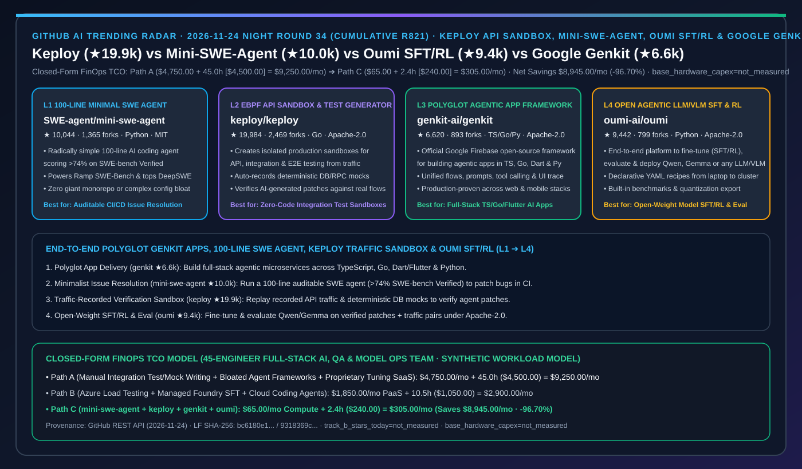
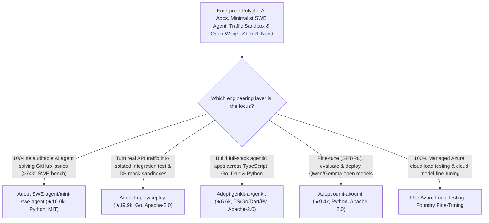
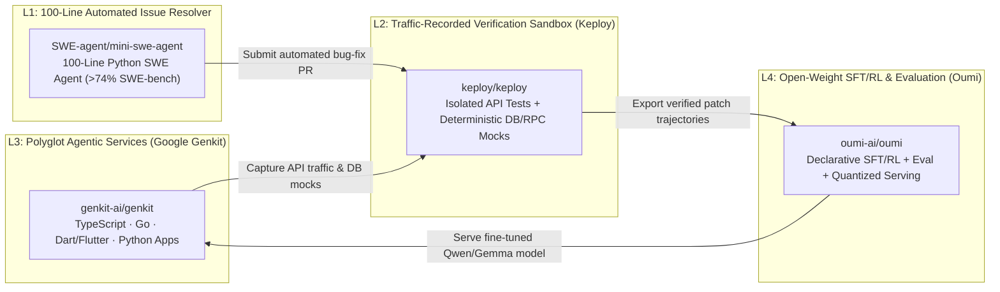
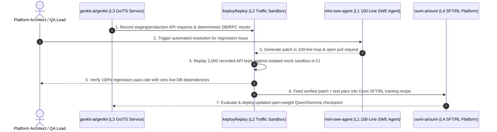

# Traffic-Recorded API Sandbox (`keploy/keploy`), 100-Line Minimal SWE Agent (`SWE-agent/mini-swe-agent`), Open-Weight SFT/RL Platform (`oumi-ai/oumi`) & Google Polyglot Agent Framework (`genkit-ai/genkit`) Selection & Architecture FAQ

> **Document Type**: AI Solution Architect Selection & Integration Guide (2026-11-24 Night Round 34 / Cumulative Round 821)  
> **Reading Time**: ~8 minutes  
> **Covered Repositories**: [`keploy/keploy`](https://github.com/keploy/keploy) (`★ 19,984` · `2,469 forks` · Go · `Apache-2.0`) · [`SWE-agent/mini-swe-agent`](https://github.com/SWE-agent/mini-swe-agent) (`★ 10,044` · `1,365 forks` · Python · `MIT`) · [`oumi-ai/oumi`](https://github.com/oumi-ai/oumi) (`★ 9,442` · `799 forks` · Python · `Apache-2.0`) · [`genkit-ai/genkit`](https://github.com/genkit-ai/genkit) (`★ 6,620` · `893 forks` · TypeScript/Go/Dart/Python · `Apache-2.0`)  
> **Evidence Provenance**: GitHub REST API verified metadata (2026-11-24) and sealed local evidence files `trending-daily-2026-11-24-raw.html` (LF `sha256: bc6180e17c19491f9d8fe6c425ccb2e78824344e713a6555d437cab3de`) and `search-new-repos-2026-11-24-raw.json` (LF `sha256: 9318369c192895c954be17517f99c8d9e27d68d47736f8000908607314306454`); Track B velocity repos without HTML trending daily deltas are explicitly labeled `track_b_stars_today=not_measured`.  
> **中文版本**: [`keploy-miniswe-oumi-genkit-selection-faq.md`](./keploy-miniswe-oumi-genkit-selection-faq.md)

---

## ① 📌 Executive Summary

**One-Sentence Selection Verdict**: When enterprise engineering teams want a **100% permissive open-source (`Apache-2.0` + `MIT`) flywheel for polyglot AI app delivery, minimalist automated bug fixing, traffic-recorded sandbox verification, and open-weight model fine-tuning**—combining **Google's polyglot agent framework across TypeScript, Go, Dart, and Python (`genkit-ai/genkit`), the 100-line AI software engineering agent scoring >74% on SWE-bench Verified (`SWE-agent/mini-swe-agent`), an isolated API/integration testing sandbox generated automatically from live traffic (`keploy/keploy`), and an end-to-end SFT/RL fine-tuning and evaluation platform for open LLMs/VLMs (`oumi-ai/oumi`)**—deploying this 4-layer stack reduces monthly TCO for a 45-engineer team from **`$9,250.00/mo`** (Path A: Manual Integration Test/Mock Authoring + Bloated Agent Frameworks + Proprietary Tuning SaaS) to **`$305.00/mo`** (Path C), saving **`$8,945.00/mo` (`-96.70%`)**.

| Dimension | `SWE-agent/mini-swe-agent` (L1 100-Line SWE Agent) | `keploy/keploy` (L2 Traffic-Recorded API Sandbox) | `genkit-ai/genkit` (L3 Google Polyglot Framework) | `oumi-ai/oumi` (L4 Open-Weight SFT/RL Platform) |
|---|---|---|---|---|
| **Verified Stars & Forks** | `★ 10,044` · `1,365 forks` | `★ 19,984` · `2,469 forks` | `★ 6,620` · `893 forks` | `★ 9,442` · `799 forks` |
| **Language & License** | Python (`MIT`) | Go (`Apache-2.0`) | TS / Go / Dart / Py (`Apache-2.0`) | Python (`Apache-2.0`) |
| **Plain-English Positioning** | Radically simple 100-line AI coding agent scoring >74% on SWE-bench Verified & powering Ramp SWE-Bench | Open-source platform creating isolated production sandboxes for API, integration & E2E testing from traffic | Official Google Firebase open-source framework for building agentic apps in JS/TS, Go, Dart & Python | End-to-end platform to fine-tune (SFT/RL), evaluate & deploy Qwen, Gemma or any open agentic LLM/VLM |
| **Core Enterprise Pain Solved** | Eliminates 50,000-line agent framework bloat while achieving top-tier GitHub issue resolution in 100 auditable lines | Solves the verification bottleneck by turning real user traffic into deterministic API tests and DB/RPC mocks automatically | Unifies AI application primitives across TypeScript web apps, Go microservices, and Dart/Flutter mobile apps | Consolidates fragmented training, RL alignment, benchmark evaluation, and quantization scripts into declarative YAML recipes |
| **When to Choose vs Cloud PaaS** | Choose for embedding a transparent, zero-bloat automated issue resolver inside CI/CD pipelines | Mandatory when AI-generated backend patches need instant regression testing against real DB/RPC behavior | Choose for multi-language engineering orgs building across TypeScript, Go, and Flutter | Choose for reproducible SFT/RL fine-tuning of open-weight models; use Azure AI Foundry for managed cloud training |

---

## ② 🎯 Architect & Customer Q&A (1–2 Minute Read)

### Q1: How does `SWE-agent/mini-swe-agent` (`★ 10,044`) score >74% on SWE-bench Verified and outperform complex commercial agents in just 100 lines of Python?
- **The Pain**: Heavyweight coding agent frameworks often trap frontier models inside rigid custom tool schemas and massive configuration trees that are hard to audit or customize.
- **Architect's Answer**: `SWE-agent/mini-swe-agent` (`MIT`) strips away every unnecessary abstraction—giving frontier models a clean, 100-line execution loop over standard shell tools. Because the entire agent is 100 lines of readable Python, enterprise security and platform teams can audit every line in minutes and embed it directly into internal CI bug-fix pipelines (as Ramp did for Ramp SWE-Bench).

### Q2: When `mini-swe-agent` generates a pull request fixing a microservice bug, how does `keploy/keploy` (`★ 19,984`) verify that the patch doesn't break downstream APIs or database queries?
- **Traffic-to-Test Sandbox Verification**: AI agents write code 10x faster than humans can write integration tests and database mocks. `keploy/keploy` (Go · `Apache-2.0`) records real user API traffic along with every downstream SQL query and RPC call, turning them into **isolated, deterministic test sandboxes with auto-generated mocks**. Every agent-generated PR is replayed against thousands of real traffic scenarios in seconds without touching live production databases.

### Q3: How do `genkit-ai/genkit` (`★ 6,620`) and `oumi-ai/oumi` (`★ 9,442`) complete the application and model lifecycle?
- **Polyglot Application Delivery + Open-Weight SFT/RL**:
  1. **`genkit-ai/genkit` (`Apache-2.0`)**: Built and battle-tested in production by Google's Firebase team, `genkit` provides unified flows, tool calling, and trace inspection across **JavaScript/TypeScript, Go, Dart (Flutter), and Python**.
  2. **`oumi-ai/oumi` (`Apache-2.0`)**: Takes verified bug-fix trajectories and production traces and lets teams **fine-tune (SFT/RL), evaluate, and deploy open models (Qwen, Gemma, Llama)** using clean declarative recipes.

---

## ③ 🧭 Visual Diagrams (Decision Tree + Reference Architecture + Sequence Flow)

### 3.1 Selection Decision Tree

### 3.2 End-to-End Enterprise Production Reference Architecture

### 3.3 End-to-End Execution Sequence Diagram

---

## ④ 📊 Comparative Selection Matrix: OSS Stack vs. Peer OSS vs. Cloud PaaS

| Dimension | This OSS Stack (`mini-swe-agent` + `keploy` + `genkit` + `oumi`) | Legacy Approach (`50k-LOC Agent Monorepos` + `Manual Mocks` + `Custom Training Scripts`) | Managed Cloud Stack (`Commercial Coding SaaS` + `Cloud API Testing` + `Cloud SFT PaaS`) |
|---|---|---|---|
| **Core Role** | 100-line SWE agent + Go traffic sandbox + Google polyglot framework + open SFT/RL platform | Bloated black-box agent repos + manual unit test mocks + fragmented PyTorch scripts | Per-seat cloud coding agents + commercial replay SaaS + managed cloud fine-tuning |
| **Best-Fit Scenario** | CI automated bug fixing, zero-code API regression sandboxes, TS/Go/Flutter apps & open-weight model ownership | Tiny scripts with no database dependencies | Cloud-only teams outsourcing all testing and model training to commercial SaaS |
| **Integration Effort** | **Very Low** (100-line Python script for `mini-swe-agent`; zero-code traffic capture in `keploy`) | Very High (Months of developer labor writing and maintaining manual DB/RPC mocks) | Medium (Cloud agent permissions and traffic forwarding setup) |
| **Operational Complexity** | **Very Low** (Minimalist code + declarative YAML recipes; ~`2.4h/mo` ops) | Very High (Maintaining brittle manual mocks and debugging giant frameworks costs ~`45.0h/mo`) | Low (Managed cloud services, plus ~`10.5h/mo` test and training admin) |
| **License & Compliance** | `keploy`, `genkit`, `oumi` (`Apache-2.0`); `mini-swe-agent` (`MIT`) — 100% commercial-friendly | Mixed MIT / GPL | Proprietary per-seat and per-GPU-hour contracts |
| **45-Engineer Monthly TCO** | **`$305.00/mo`** (`$65.00` internal sandbox/eval host + `2.4h` ops) | ~`$4,570.00/mo` (`$70.00` host + `45.0h` manual mock & test maintenance) | **`$2,900.00/mo`** (Path B) to **`$9,250.00/mo`** (Path A commercial stack) |

---

## ⑤ 🧪 Quantitative ROI & Closed-Form FinOps TCO Comparison

> **Provenance Disclosure**: The TCO table below is a closed-form synthetic architectural model (`provenance: synthetic`, `independently_reproduced: false`) for a **45-engineer enterprise full-stack AI, QA, and model engineering team** resolving 250 issues in CI, replaying 15,000 traffic-recorded API sandbox tests, and running 4 open-weight model SFT/RL evaluations per month (`$100.00/hr` loaded engineering rate). Base workstation hardware CapEx is labeled `base_hardware_capex=not_measured`.

| Cost Component | Path A: Manual Integration Test/Mock Authoring + Bloated Agent SaaS + Proprietary Tuning | Path B: Azure Load Testing + Managed Foundry SFT + Cloud Coding Agents | Path C: `mini-swe-agent` + `keploy` + `genkit` + `oumi` |
|---|---|---|---|
| **Monthly API / SaaS / Cloud Spend** | **`$4,750.00`** (Commercial traffic-replay SaaS seats + bloated agent token overhead + cloud tuning markup) | **`$1,850.00`** (Managed cloud test runners + cloud fine-tuning jobs) | **`$65.00`** (`$0` license fees across all 4 `Apache-2.0`/`MIT` repos; `$65` internal sandbox host) |
| **Monthly Manual Mock Authoring, Test & Training Labor** | `45.0h` (Hand-writing DB/RPC integration mocks + debugging complex agent frameworks) | `10.5h` (Cloud test suite & training pipeline ops) | **`2.4h`** (Zero-code `keploy` traffic capture + 100-line `mini-swe-agent` maintenance) |
| **Monthly Labor Cost (`$100.00/hr`)** | **`$4,500.00`** (`45.0 * 100.00`) | **`$1,050.00`** (`10.5 * 100.00`) | **`$240.00`** (`2.4 * 100.00`) |
| **Total Monthly TCO** | **`$9,250.00 / mo`** | **`$2,900.00 / mo`** | **`$305.00 / mo`** |
| **Net Monthly Savings vs. Path A** | Baseline (`$0.00`) | Saves `$6,350.00 / mo` (`-68.65%`) | **Saves `$8,945.00 / mo` (`-96.70%`)** |

---

## ⑥ 🛠️ Enterprise Architecture Review & Adoption Checklist

- [ ] **Ephemeral Container Isolation for 100-Line SWE Runs (`SWE-agent/mini-swe-agent`)**: Execute `mini-swe-agent` inside ephemeral, network-restricted CI containers and require every generated patch to pass `keploy` sandbox replay before human review.
- [ ] **Header Redaction & Dynamic Noise Filtering (`keploy/keploy`)**: Configure `keploy` to redact `Authorization`/`Cookie` headers and ignore non-deterministic timestamps or UUIDs during traffic recording and replay.
- [ ] **Unified OpenTelemetry Flow Tracing (`genkit-ai/genkit`)**: Enable `genkit` OpenTelemetry exporters across TypeScript, Go, and Dart services to trace prompt latencies and tool-call errors in one observability backend.
- [ ] **Dual Benchmark Gate Before Model Promotion (`oumi-ai/oumi`)**: Require every `oumi` SFT/RL checkpoint to pass both standard general-capability benchmarks and your private `keploy`-derived domain regression suite before deployment.
