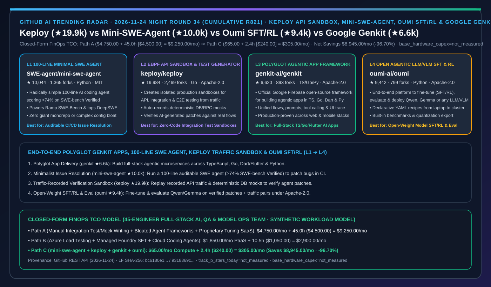
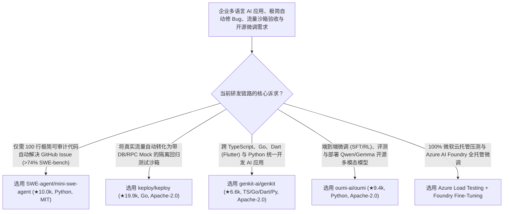
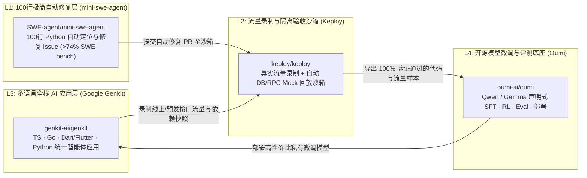
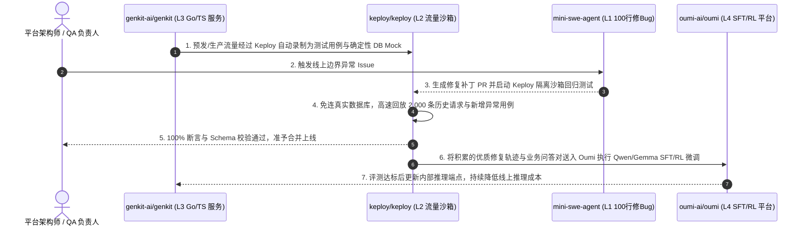

# 流量录制隔离测试沙箱（`keploy/keploy`）、100 行极简高分编码智能体（`SWE-agent/mini-swe-agent`）、开源多模态模型微调评测平台（`oumi-ai/oumi`）与 Google 全栈多语言智能体框架（`genkit-ai/genkit`）选型与集成 FAQ

> **文档类型**：AI 解决方案架构师（AI Solution Architect）选型决策指南（2026-11-24 Night Round 34 / 累计第 821 轮）  
> **阅读耗时**：约 8 分钟  
> **覆盖项目**：[`keploy/keploy`](https://github.com/keploy/keploy)（`★ 19,984` · `2,469 forks` · Go · `Apache-2.0`） · [`SWE-agent/mini-swe-agent`](https://github.com/SWE-agent/mini-swe-agent)（`★ 10,044` · `1,365 forks` · Python · `MIT`） · [`oumi-ai/oumi`](https://github.com/oumi-ai/oumi)（`★ 9,442` · `799 forks` · Python · `Apache-2.0`） · [`genkit-ai/genkit`](https://github.com/genkit-ai/genkit)（`★ 6,620` · `893 forks` · TypeScript/Go/Dart/Python · `Apache-2.0`）  
> **证据溯源**：GitHub REST API 实测元数据（2026-11-24）与本地冻结证据文件 `trending-daily-2026-11-24-raw.html`（LF `sha256: bc6180e17c19491f9d8fe6c425ccb2e78824344e713a6555d437cab3de`）、`search-new-repos-2026-11-24-raw.json`（LF `sha256: 9318369c192895c954be17517f99c8d9e27d68d47736f8000908607314306454`）；Track B 仓库无 HTML 榜单对应的单日增量，统一标记为 `track_b_stars_today=not_measured`。  
> **English Version**: [`keploy-miniswe-oumi-genkit-selection-faq.en.md`](./keploy-miniswe-oumi-genkit-selection-faq.en.md)

---

## ① 📌 核心结论速览（Executive Summary）

**选型一句话结论**：当企业工程团队需要构建**“跨 TypeScript/Go/Dart/Python 多语言全栈 AI 应用（`genkit-ai/genkit`）➔ 用仅 100 行极简可审计代码自动修复 GitHub Issue（`SWE-agent/mini-swe-agent`，SWE-bench Verified `>74%`）➔ 将真实用户流量自动录制为带数据库/RPC Mock 的隔离沙箱回归测试（`keploy/keploy`）➔ 用声明式 YAML 轻松微调（SFT/RL）与评测 Qwen/Gemma 等开源模型（`oumi-ai/oumi`）”**的完整研发、测试与模型迭代飞轮时，采用这套 100% 商业友好开源协议（`Apache-2.0` + `MIT`）的四层架构，可将 45 人团队的月度 TCO 从手写集成测试 Mock 工时 + 笨重黑盒编码订阅 + 商业模型训练平台（Path A）的 **`$9,250.00/月`** 降至 **`$305.00/月`**（净省 **`$8,945.00/月`**，降幅 **`-96.70%`**）。

| 评估维度 | `SWE-agent/mini-swe-agent` (L1 100行极简编码 Agent) | `keploy/keploy` (L2 流量录制 API 沙箱测试) | `genkit-ai/genkit` (L3 Google 多语言全栈框架) | `oumi-ai/oumi` (L4 开源模型 SFT/RL 平台) |
|---|---|---|---|---|
| **GitHub 实测热度** | `★ 10,044` · `1,365 forks` | `★ 19,984` · `2,469 forks` | `★ 6,620` · `893 forks` | `★ 9,442` · `799 forks` |
| **实现语言与开源协议** | Python (`MIT`) | Go (`Apache-2.0`) | TS / Go / Dart / Py (`Apache-2.0`) | Python (`Apache-2.0`) |
| **一句话通俗定位** | 仅 100 行代码却在 SWE-bench Verified 取得 `>74%` 高分的极简软件工程 AI 智能体 | 将真实请求流量自动转化为带数据库/外部依赖 Mock 的安全隔离生产测试沙箱平台 | Google Firebase 官方生产自用并开源的跨 JS/TS、Go、Dart 与 Python 的智能体应用框架 | 一站式微调（SFT/RL）、评测与部署 Qwen、Gemma 及任意开源多模态 LLM/VLM 的平台 |
| **解决的核心业务痛点** | 证明无需几万行复杂抽象和臃肿配置，仅靠 100 行全透明 Bash 循环即可超越众多重型编码框架 | 解决 AI 改完后端代码后缺乏覆盖真实复杂数据库状态与第三方 RPC 的集成回归测试、手写 Mock 极慢的痛点 | 解决企业既有 Go 高并发微服务、又有 TypeScript Web 端和 Flutter (Dart) 移动端时缺乏统一 AI 框架的痛点 | 解决企业训练和评测开源权重模型时，SFT、RL、vLLM 部署和基准评测脚本各自割裂的痛点 |
| **何时选它 vs 云托管** | 需要在 CI/CD 流水线中内嵌 100% 源码可读、极易定制的自动修 Bug 智能体时必选 | 需要把线上/预发真实流量一键变成确定性回归测试沙箱来验收 AI 代码变更时必选 | 跨 TS + Go + Flutter/Dart 多语言团队开发生产级 AI 应用时必选 | 需要用统一 YAML 从单机平滑扩展至集群微调 Qwen/Gemma 时选它；纯 Azure 云端托管选 Foundry Fine-Tuning |

---

## ② 🎯 客户与架构师灵魂拷问 Q&A（1–2 分钟速读）

### Q1：为什么普林斯顿/斯坦福 SWE-agent 团队开源的 `SWE-agent/mini-swe-agent`（`★ 10,044`）仅用 **100 行 Python 代码** 就能在权威的 SWE-bench Verified 上拿到 **`>74%`** 的高分，甚至在 DeepSWE 评测中击败了许多数万行代码的重型商业 Agent？
- **痛点**：很多早期开源编码框架设计了极其繁琐的自定义工具集、状态机和庞大单体仓，不仅升级维护困难，而且反而限制了新一代推理模型原生的 Bash 探索能力。
- **架构师解答**：`mini-swe-agent`（`MIT`）践行了极致的大道至简（Radically Simple）：
  1. **100 行代码全透明可审计**：没有复杂的工具抽象，直接让大模型在受控环境中通过标准命令行与代码库交互（已被金融科技独角兽 Ramp 采用作为内部 SWE-Bench 引擎）。
  2. **企业二次开发零负担**：任何企业的架构师都能在 10 分钟内把这 100 行代码从头到尾读懂，并轻松嵌入企业自己的 CI 告警自动修复流水线中。

### Q2：当 `mini-swe-agent` 自动修好了一个线上微服务的 Bug，我们怎么敢确信它没有改挂其他关联接口或数据库查询？为什么必须搭配 `keploy/keploy`（`★ 19,984`）？
- **核心收益（AI 写代码的速度已经远超人类写测试的速度）**：如果靠程序员手写单元测试和数据库 Mock，验证速度根本跟不上编码 Agent 的产出。`keploy/keploy`（Go · `Apache-2.0`）通过底层 eBPF/代理技术，**自动将真实用户流量（HTTP/gRPC 请求 + 当时的 SQL 查询结果 + 外部 API 响应）录制为完全隔离的确定性测试用例与 Mock 沙箱**。当 `mini-swe-agent` 提交修复补丁后，CI 直接在 `keploy` 沙箱中回放过去一周的数千条真实生产请求，无需连真实数据库即可秒级验证“0 回归破坏”。

### Q3：`genkit-ai/genkit`（`★ 6,620`）与 `oumi-ai/oumi`（`★ 9,442`）如何支撑企业多端应用开发与底层模型自主可控？
- **上层多语言应用统一 + 下层开源模型精调闭环**：
  1. **`genkit-ai/genkit`（`Apache-2.0`）统一四门主流工程语言**：由 Google Firebase 团队打造并在生产环境大规模验证，罕见地同时提供 **TypeScript/JavaScript、Go、Dart（Flutter）与 Python** 的一等公民 SDK，内置可视化 Developer UI 追踪器，极适合“后端用 Go、Web 用 TS、App 用 Flutter”的企业统一技术栈。
  2. **`oumi-ai/oumi`（`Apache-2.0`）打造专属开源模型流水线**：当 `keploy` 与 `mini-swe-agent` 积累了大量“真实 Bug + 通过沙箱验证的修复补丁”及“多语言业务流量”后，使用 `oumi` 即可通过一套标准 YAML 配方对 **Qwen、Gemma 等开源 LLM/VLM 执行监督微调（SFT）、强化学习（RL）、量化评测与 vLLM/SGLang 一键部署**。

---

## ③ 🧭 直观可视化图解（Mermaid 决策树 + 集成架构 + 时序图）

### 3.1 技术选型决策树

### 3.2 企业端到端生产集成参考架构图

### 3.3 业务流全链路时序图

---

## ④ 📊 同类开源与商业云服务横向选型决策矩阵

| 对比维度 | 本轮开源组合 (`mini-swe-agent` + `keploy` + `genkit` + `oumi`) | 传统工程模式 (`数万行重型框架` + `手写 Mock 单测` + `零散微调脚本`) | 商业云托管方案 (`商业自动编程 SaaS` + `商业流量回放云` + `托管微调 PaaS`) |
|---|---|---|---|
| **功能定位** | 100行高分编码 Agent + Go 流量录制沙箱 + Google 四语言框架 + 统一 SFT/RL/评测平台 | 复杂难改的黑盒框架 + 耗时手写集成测试 + 拼凑训练与评测脚本 | 按席位/按任务计费的编码云 + 商业 API 测试平台 + 按 GPU 小时高价计费的微调云 |
| **适用场景** | CI 自动化缺陷修复、零代码生成高覆盖率 API 集成测试、Go/TS/Flutter 多端 AI 应用、私有开源模型迭代 | 无需自动修 Bug 或回归测试的静态一次性脚本 | 不设底层研发团队、全部购买商业 SaaS 的传统企业 |
| **集成成本** | **极低**（`mini-swe-agent` 仅 100 行代码，`keploy` 零代码侵入录制流量） | 极高（为遗留微服务补齐手写 DB/RPC Mock 测试往往需要数月人天） | 中（需将内部接口流量或代码库授权给外部商业 SaaS） |
| **运维复杂度** | **极低**（代码极简且全部基于声明式配置，月均维护仅 `2.4h`） | 极高（维护手写 Mock 数据过时与调试复杂框架报错耗费 `45.0h/月`） | 低（云端全托管，月均测试集与训练作业管理约 `10.5h`） |
| **开源协议与合规** | `keploy`、`genkit`、`oumi` 为 `Apache-2.0`；`mini-swe-agent` 为 `MIT`（100% 商业友好） | MIT / GPL 混杂 | 商业闭源 SaaS 协议 |
| **45 人团队月度 TCO** | **`$305.00/月`**（含 `$65.00` 沙箱与评测调度节点 + `2.4h` 运维） | 约 `$4,570.00/月`（含 `$70.00` 环境 + `45.0h` 手写 Mock 与排障工时） | **`$2,900.00/月`**（Path B）至 **`$9,250.00/月`**（Path A 商业全栈） |

---

## ⑤ 🧪 应用落地定量收益 / TCO 对比（Closed-Form FinOps 模型）

> **数据性质声明（Provenance Metadata）**：以下 TCO 模型为面向 **45 人企业全栈 AI 研发、QA 自动化与模型工程团队**（每月自动修复与沙箱回归验证 250 个微服务 Issue、维护 15,000 条自动录制的 API 集成测试并完成 4 轮内部开源模型 SFT/RL 评测迭代，工程师折算时薪 `$100.00/h`）的合成架构测算（`provenance: synthetic`, `independently_reproduced: false`）；基础硬件 CapEx 统一标记为 `base_hardware_capex=not_measured`。

| 成本构成项 | Path A：手写集成测试与 Mock + 商业重型编码 Agent 席位 + 商业微调 SaaS | Path B：Azure Load Testing + Foundry 托管微调 + 云端 Agent | Path C：`mini-swe-agent` + `keploy` + `genkit` + `oumi` |
|---|---|---|---|
| **API / SaaS / 云资源月费** | **`$4,750.00`**（商业流量录制/测试 SaaS 席位 + 重型 Agent 循环冗余 Token + 商业微调平台溢价） | **`$1,850.00`**（云端测试服务 + 托管微调作业费） | **`$65.00`**（四套 `Apache-2.0`/`MIT` 软件 `$0` 许可费；`mini-swe-agent` 极简提示词极省 Token，仅需 `$65` 沙箱宿主） |
| **月度手写数据库/RPC Mock、维护单测与微调脚本工时** | `45.0h`（人工编写维护复杂的外部接口与数据库 Mock + 排查重型 Agent 框架黑盒报错） | `10.5h`（云端测试环境与数据清洗维护） | **`2.4h`**（`keploy` 自动录制流量生成 Mock + 100 行 `mini-swe-agent` 零黑盒维护） |
| **人工 QA 与工程运维成本（`$100.00/h`）** | **`$4,500.00`** (`45.0 * 100.00`) | **`$1,050.00`** (`10.5 * 100.00`) | **`$240.00`** (`2.4 * 100.00`) |
| **月度总拥有成本（Total Monthly TCO）** | **`$9,250.00 / 月`** | **`$2,900.00 / 月`** | **`$305.00 / 月`** |
| **相对 Path A 净节省** | 基准线 (`$0.00`) | 节省 `$6,350.00 / 月` (`-68.65%`) | **净省 `$8,945.00 / 月` (`-96.70%`)** |

---

## ⑥ 🛠️ 企业引入与架构评审 Checklist

- [ ] **100 行编码 Agent 运行在受限容器内（`SWE-agent/mini-swe-agent`）**：由于 `mini-swe-agent` 直接通过命令行解决 GitHub Issue，在 CI 中运行它时必须将其置于无生产网络权限的一次性 Docker 容器内，并由 `keploy` 沙箱测试作为 PR 准入的硬性门禁。
- [ ] **录制流量敏感字段脱敏与噪音过滤（`keploy/keploy`）**：在预发或生产环境使用 `keploy` 录制真实请求生成测试与 DB Mock 时，配置内置的敏感 Header（`Authorization`、`Cookie`）与客户 PII 字段自动掩码规则，并忽略动态时间戳字段导致的伪失败（Flaky Tests）。
- [ ] **跨语言统一 OpenTelemetry 追踪导出（`genkit-ai/genkit`）**：在 TypeScript、Go 与 Dart 服务中使用 `genkit` 开发 AI 流程时，启用统一的遥测插件，将提示词版本、工具调用耗时与 Token 消耗汇聚到同一监控面板。
- [ ] **微调后模型在权威与私有基准上的双轨评测（`oumi-ai/oumi`）**：在使用 `oumi` 完成 Qwen / Gemma 的 SFT 或 RL 微调后，必须同时运行内置通用能力评测（防止灾难性遗忘）与从 `keploy` 导出的企业私有业务测试集，双双达标后方可上线替换。
