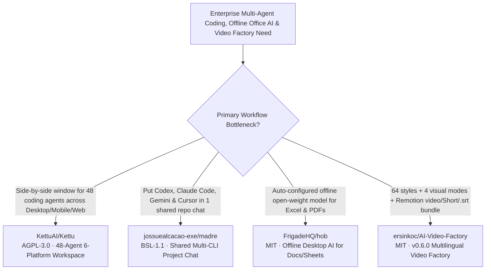
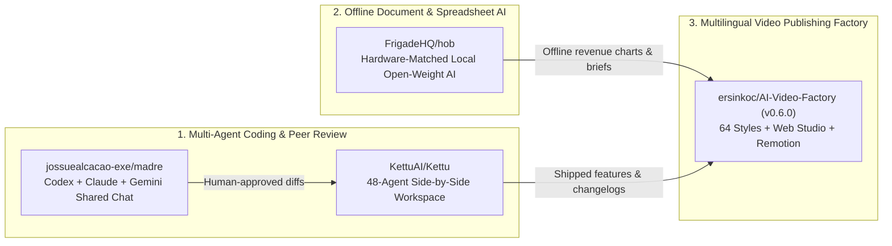
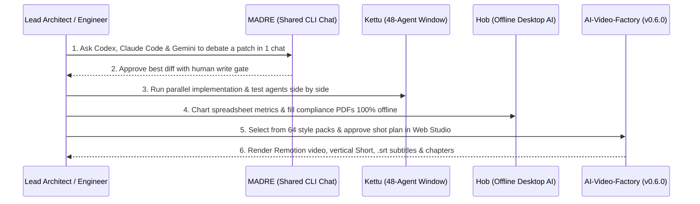

# 48-Agent Side-by-Side Workspace, 64-Style Remotion Video Factory, Offline Open-Weight Desktop AI & Shared Multi-CLI Chat Selection Guide: Kettu vs AI-Video-Factory vs Hob vs MADRE

> **2026-11-23 Night Round 36 (Cumulative Round 823)** · Enterprise AI Solution Architect Practical Selection, End-to-End Integration Architecture & FinOps TCO Guide
> **Companion Architecture Diagram**: [`assets/github-ai-radar-2026-11-23-r36-r823-kettu-aivideofactory-hob-madre.svg`](../../../assets/github-ai-radar-2026-11-23-r36-r823-kettu-aivideofactory-hob-madre.svg)

---

## 1. 📌 Executive Summary

Across multi-agent software engineering, industrialized multilingual video production, offline document/spreadsheet analysis on local hardware, and cross-CLI peer review inside a single project chat, **`KettuAI/Kettu`**, **`ersinkoc/AI-Video-Factory`**, **`FrigadeHQ/hob`**, and **`jossuealcacao-exe/madre`** deliver a high-ROI open-source stack:

1. **48-Agent Side-by-Side Cross-Platform Coding Workspace (`KettuAI/Kettu`)**: (`★ 127`, `13 forks`, TypeScript, `AGPL-3.0`). Runs across macOS, Windows, Linux, iOS, Android, and Web to place 48 coding agents (Claude Code, Codex, OpenCode, Pi, and 40+ others) side by side in one unified window.
2. **64-Style Multilingual Remotion Video Studio & Publishing Factory (`ersinkoc/AI-Video-Factory`)**: (`★ 656`, `89 forks`, TypeScript, `MIT`, `v0.6.0`). Turns a topic into a narrated, animated video across 4 visual modes (rigged vector animation, moving stills, hybrid stills/AI clips, or full clips) and 64 style packs, with a human-in-the-loop Web Studio and complete publishing package (full video, vertical Short, `.srt` subtitles, chapters, tags, and thumbnail).
3. **Private Offline Open-Weight Desktop AI for Spreadsheets & PDFs (`FrigadeHQ/hob`)**: (`★ 559`, `48 forks`, TypeScript, `MIT`). Built by FrigadeHQ for macOS, Windows, and Linux, Hob automatically selects and configures the best frontier open-weight model that fits your computer to fill out PDFs, chart regional spreadsheet revenue, and summarize documents 100% offline.
4. **Shared Local Project Chat for Multiple Coding CLIs (`jossuealcacao-exe/madre`)**: (`★ 127`, `38 forks`, JavaScript, `BSL-1.1`, `@jossuealcala/madre`). Puts your existing Codex, Claude Code, Gemini CLI, Cursor, OpenCode, and Grok installations into a single local chat room inside your repository where each agent reads what the others proposed and you approve which file changes land.
5. **FinOps Quantitative Takeaway**: Migrating from per-seat cloud desktop AI subscriptions, commercial video studio SaaS, and manual multi-CLI copy-pasting (Path A: `$9,460.00/mo`) to this local-first stack (Path C: `$305.00/mo`) saves **`$9,155.00/mo`** (**`-96.78%`**).

---

## 2. 🎯 Architect & Customer Key Q&A

### Q1: How do `Kettu`, `MADRE`, and `Hob` differ in an enterprise AI workstation strategy?
- **`Kettu` (Side-by-Side Parallel Fleet Execution)**: Best for engineers running multiple independent tasks in parallel across 48 supported coding agents on desktop or mobile (`iOS`/`Android`/`Web`).
- **`MADRE` (Single-Room Multi-CLI Peer Review & Debate)**: Best when you want Codex, Claude Code, Gemini CLI, and Cursor in **one shared project conversation** reading each other's answers and debating a tricky bug before you approve the winning diff.
- **`Hob` (Zero-Setup Offline Document & Spreadsheet AI)**: Best for finance, legal, and operations staff who need a private, offline alternative to Claude Desktop/ChatGPT that automatically picks the right local open-weight model for their machine.

### Q2: How do these four tools integrate into an enterprise engineering & media workflow?
1. **Multi-Agent Architecture Debate (`MADRE`)**: Run Codex, Claude Code, and Gemini CLI in one shared project chat to critique architecture designs and approve file changes;
2. **Parallel Sub-Task Execution (`Kettu`)**: Monitor 48 coding agents side by side across desktop and mobile as they implement approved modules;
3. **Offline Business & Financial QA (`Hob`)**: Analyze sensitive sales spreadsheets and fill out compliance PDFs offline using hardware-matched open-weight models;
4. **Multilingual Video & Short Packaging (`AI-Video-Factory`)**: Feed release notes and product topics into `AI-Video-Factory` (`v0.6.0`), approve vector art and shot plans in the Web Studio, and render full videos + vertical Shorts + `.srt` captions via Remotion.

### Q3: What are the licensing and governance guardrails?
- **`AI-Video-Factory`** & **`Hob`**: Permissive **`MIT`** license—ready for unrestricted enterprise customization and commercial output.
- **`Kettu`**: **`AGPL-3.0`** license—clean for internal developer workstations; hosting a modified multi-tenant Web SaaS requires source disclosure.
- **`MADRE`**: **`BSL-1.1`** license—free for local/internal team usage via `@jossuealcala/madre`, prohibiting resale as a managed competing service.

---

## 3. 🧭 Visual Architecture & Decision Diagrams (Mermaid)

### 3.1 Selection Decision Tree

### 3.2 End-to-End Enterprise Reference Architecture

### 3.3 Runtime Execution Sequence

---

## 4. 📊 Comparative Selection Matrix

| Dimension | `KettuAI/Kettu` | `ersinkoc/AI-Video-Factory` | `FrigadeHQ/hob` | `jossuealcacao-exe/madre` | Cloud AI Seats & Video SaaS (Path A) |
| :--- | :--- | :--- | :--- | :--- | :--- |
| **Primary Role** | 48-agent side-by-side coding workspace across 6 platforms | 64-style, 4-mode Remotion video & Short publishing factory | Offline open-weight desktop AI for PDFs & spreadsheets | Shared local project chat for Codex, Claude Code, Gemini & Cursor | Separate cloud IDE seats + video SaaS + ChatGPT Enterprise |
| **Key Differentiator** | Native macOS, Windows, Linux, iOS, Android & Web support | Full publishing bundle: video, vertical Short, `.srt`, chapters, tags | Auto-selects best frontier open-weight model for local hardware | Agents read each other's replies in 1 chat with human write approval | Siloed agent contexts & mandatory cloud document upload |
| **Data Sovereignty** | Local CLI harness execution | Local Web Studio + Remotion rendering | 100% offline local model execution | Runs locally over existing CLI installs | Prompts and spreadsheets sent to third-party clouds |
| **License** | `AGPL-3.0` | `MIT` | `MIT` | `BSL-1.1` | Proprietary per-seat SaaS |
| **Monthly TCO (45-Eng Team)** | **Combined `$305.00/mo`** (`$65.00` shared host + `$240.00` ops labor) | Included in combined stack | Included in combined stack | Included in combined stack | **`$9,460.00/mo`** (`$4,960.00` SaaS/API + `$4,500.00` labor) |

---

## 5. 🧪 Quantitative FinOps TCO Comparison (Closed-Form Audit)

> **Audit Note**: Modeled for a 45-person engineering and operations organization orchestrating multi-agent coding sessions, running offline spreadsheet/PDF analysis on staff laptops, and producing 40 multilingual narrated videos + vertical Shorts per month. Repository metadata is verified via the GitHub REST API; live runtime p99 latency is marked `not_measured`.

| Cost Component | Path A: Commercial Cloud Desktop AI Seats + Video SaaS + Manual Multi-CLI Relay | Path C: Self-Hosted `Kettu` + `AI-Video-Factory` + `Hob` + `MADRE` | Net Savings / Delta |
| :--- | :--- | :--- | :--- |
| **API / SaaS Subscriptions & Compute** | `$4,960.00 / mo` | `$65.00 / mo` | `-$4,895.00 / mo` |
| **Cross-CLI Copy-Paste, Subtitle/Short Packaging & Redaction Labor** | `$4,500.00 / mo` (`45.0 hrs × $100/hr`) | `$240.00 / mo` (`2.4 hrs × $100/hr`) | `-$4,260.00 / mo` |
| **Total Monthly TCO** | **`$9,460.00 / mo`** | **`$305.00 / mo`** | **`$9,155.00 / mo` (`-96.78%`)** |

---

## 6. 🛠️ Enterprise Architecture Review Checklist

- [ ] **Side-by-Side vs. Shared-Room Governance (`Kettu` + `MADRE`)**: Standardize on `Kettu` for parallel multi-branch implementation across 48 harnesses, and use `MADRE` with human write confirmation when cross-examining complex diffs across Codex, Claude Code, and Gemini CLI.
- [ ] **Web Studio Approval Gate (`AI-Video-Factory`)**: Configure brand palettes and reusable character presets in `AI-Video-Factory` (`v0.6.0`), requiring human sign-off in the Web Studio before final Remotion rendering.
- [ ] **Air-Gapped Spreadsheet & PDF Rollout (`Hob`)**: Deploy `Hob` on finance and legal endpoints so hardware-matched open-weight models process sensitive spreadsheets and PDF forms completely offline.
- [ ] **License Compliance Boundary (`AGPL-3.0` / `BSL-1.1` / `MIT`)**: Keep `Kettu` (`AGPL-3.0`) and `MADRE` (`BSL-1.1`) scoped to internal developer productivity while building customer-facing extensions on `MIT`-licensed `AI-Video-Factory` and `Hob`.
