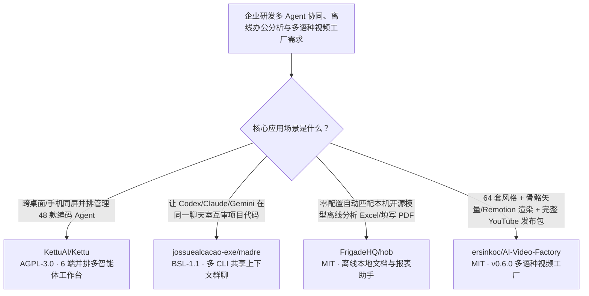
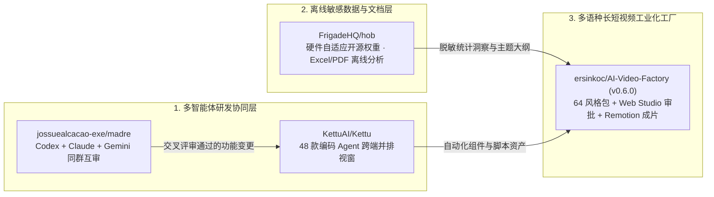
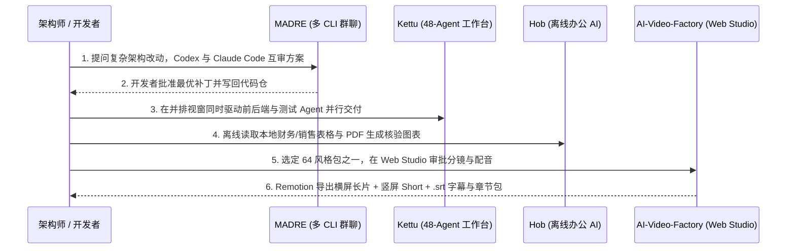

# 48 智能体同屏工作台、64 风格多语种视频工厂、离线开源权重办公桌面与多 CLI 群聊协同选型指南：Kettu vs AI-Video-Factory vs Hob vs MADRE

> **2026-11-23 Night Round 36（Cumulative Round 823）** · 面向企业 AI 解决方案架构师（AI Solution Architect）的实战选型、端到端集成架构与 FinOps TCO 决策指南
> **关联架构图**：[`assets/github-ai-radar-2026-11-23-r36-r823-kettu-aivideofactory-hob-madre.svg`](../../../assets/github-ai-radar-2026-11-23-r36-r823-kettu-aivideofactory-hob-madre.svg)

---

## 1. 📌 核心结论速览（Executive Summary）

在研发团队同屏并行调度几十种编码智能体、多语种动画/口播长短视频工业化生产、非技术业务人员零配置离线处理表格/PDF，以及让多个已安装 CLI 智能体在同一代码仓内群聊互审四大场景中，**`KettuAI/Kettu`**、**`ersinkoc/AI-Video-Factory`**、**`FrigadeHQ/hob`** 与 **`jossuealcacao-exe/madre`** 提供了精准互补的落地方案：

1. **支持 48 款编码智能体并排协同的全平台工作台（48-Agent Side-by-Side Coding Workspace）**：优先选择 **`KettuAI/Kettu`**（`★ 127`，`13 forks`，TypeScript，`AGPL-3.0`）。支持 macOS、Windows、Linux、iOS、Android 与 Web 六端，将 Claude Code、Codex、OpenCode、Pi 等 48 款编码智能体收拢至单一高颜值窗口并排运行与对比。
2. **64 套视觉风格、4 种渲染模式与完整发布包的多语种视频工厂（64-Style Remotion Video Factory）**：优先选择 **`ersinkoc/AI-Video-Factory`**（`★ 656`，`89 forks`，TypeScript，`MIT`，`v0.6.0`）。由 Claude 智能体完成故事脚本、分镜规划、骨骼矢量动画与质检，Remotion 渲染成片，内置 Web Studio 供人工审批，并一次性输出长视频、竖屏 Short、`.srt` 字幕、章节、标签与缩略图。
3. **根据本机硬件自动匹配最优开源权重的离线文档/表格桌面端（Offline Open-Weight Desktop AI）**：优先选择 **`FrigadeHQ/hob`**（`★ 559`，`48 forks`，TypeScript，`MIT`）。由 Frigade 团队开源，自动检测 Mac/Windows/Linux 硬件并配置最适合的前沿开源模型，离线完成 PDF 表单填写、销售电子表格区域营收分析画图与长文档总结。
4. **让 Codex / Claude Code / Gemini / Cursor 在同一项目群聊互审的本地中枢（Shared Multi-CLI Project Chat）**：优先选择 **`jossuealcacao-exe/madre`**（`★ 127`，`38 forks`，JavaScript，`BSL-1.1`）。把本机已安装的 Codex、Claude Code、Gemini CLI、Cursor、OpenCode 与 Grok 拉进同一个项目聊天室，每个智能体都能看到彼此的发言，最终由开发者决定采纳谁的代码修改。
5. **FinOps 定量结论**：将多席位商业编码平台、商业动画视频 SaaS 与全员商业桌面大模型订阅（Path A：`$9,460.00/月`）替换为上述四款本地/自托管工具（Path C：`$305.00/月`），每月净省 **`$9,155.00`**（降幅 **`-96.78%`**）。

---

## 2. 🎯 客户与架构师灵魂拷问 Q&A（Pain Points & Architecture Decisions）

### Q1：同为多智能体桌面工具，`Kettu`、`MADRE` 与 `Hob` 分别适合哪类企业用户？
- **`Kettu`（面向重度多轨并行研发工程师）**：需要在桌面或移动端**并排分屏（Side-by-Side）**同时盯控多达 48 种编码 Agent 各自独立推进不同子模块。
- **`MADRE`（面向关键架构难题的多模型群聊会诊）**：不需要开十几个独立窗口，而是把 Codex、Claude Code、Gemini CLI、Cursor 拉进**同一个项目聊天流**里互相挑错辩论，最后由人类拍板写盘。
- **`Hob`（面向财务、法务与业务运营人员的离线助手）**：不写代码，只需要一个像 ChatGPT/Claude Desktop 一样好用的本地客户端，自动下好最匹配电脑显存的开源权重模型，断网处理敏感 Excel 报表与 PDF 合同。

### Q2：如何将这四套组件集成为企业内部“多模型研发会诊 + 离线业务分析 + 视频内容工厂”？
1. **代码共创与同屏调度层（`Kettu` + `MADRE`）**：日常多任务开发用 `Kettu` 并排执行；遇到高复杂度重构或线上 Bug 时，在 `MADRE` 中发起 Claude Code + Codex + Gemini 联合会诊并人工审批变更；
2. **离线敏感数据处理层（`Hob`）**：业务与分析师使用 `Hob` 在本地读取销售表格与 PDF 报告，生成区域对比图表与业务洞察摘要；
3. **多语种视频工业化生产层（`AI-Video-Factory`）**：将产品更新或业务洞察输入 `AI-Video-Factory`，从 64 套风格包与 4 种视觉模式（骨骼矢量动画/动态静帧/混合剪辑/全生成片段）中选定方案，在 Web Studio 审批后通过 Remotion 渲染完整发布包。

### Q3：许可证与合规边界需要注意什么？
- **`AI-Video-Factory`** 与 **`Hob`**：均为 **`MIT`** 协议，可自由定制并用于企业商业生产。
- **`Kettu`**：采用 **`AGPL-3.0`** 协议，内部安装使用无传染风险，若修改后作为公共 Web SaaS 托管需开源修改代码。
- **`MADRE`**：采用 **`BSL-1.1`**（Business Source License 1.1），支持通过 `npm i -g @jossuealcala/madre` 在本机免费使用，但不可将其直接包装为竞品商业托管服务售卖。

---

## 3. 🧭 直观可视化图解（Mermaid 决策树 + 集成架构 + 时序流）

### 3.1 技术选型决策树

### 3.2 企业端到端集成参考架构图

### 3.3 业务执行时序图

---

## 4. 📊 同类开源与商业云服务横向选型决策矩阵

| 对比维度 | `KettuAI/Kettu` | `ersinkoc/AI-Video-Factory` | `FrigadeHQ/hob` | `jossuealcacao-exe/madre` | 商业云端席位与视频 SaaS (Path A) |
| :--- | :--- | :--- | :--- | :--- | :--- |
| **核心功能定位** | 48 款编码 Agent 跨 6 端并排工作台 | 64 风格、4 视觉模式多语种 Remotion 视频工厂 | 自动匹配本机开源模型的离线 PDF/表格助手 | Codex/Claude/Gemini/Cursor 本地同群互审聊天室 | 多套云端 IDE 席位 + 商业视频 SaaS + 全员 ChatGPT Enterprise |
| **关键差异化优势** | 同时覆盖桌面三端 + iOS/Android/Web | 输出长视频 + 竖屏 Short + `.srt` + 章节/缩略图全套包 | 免手工配环境，按硬件自动挑选开源模型离线跑 | 复用本机已登录 CLI，互相读取上下文并由人工批改 | 各工具上下文割裂，敏感 Excel/PDF 必须上传云端 |
| **运行环境** | macOS / Windows / Linux / iOS / Android / Web | 本地 Web Studio + CLI + Remotion | macOS / Windows / Linux 本地离线 | macOS / Linux / Windows (WSL2) | 纯云端 SaaS |
| **开源协议** | `AGPL-3.0` | `MIT` | `MIT` | `BSL-1.1` | 闭源商业订阅 |
| **月度 TCO（45 人团队）** | **组合总计 `$305.00/月`**（`$65.00` 共享算力 + `$240.00` 运维人工） | 同左 | 同左 | 同左 | **`$9,460.00/月`**（`$4,960.00` SaaS/API + `$4,500.00` 人工） |

---

## 5. 🧪 应用落地定量收益 / FinOps TCO 对比（Closed-Form Audit）

> **审计声明**：以下 FinOps 模型基于 45 人研发与内容团队管理多智能体并行编码、为非技术岗位配备离线 PDF/表格 AI 助手，以及每月生产 40 支多语种带字幕/章节/竖屏切片视频的月度开销核算；仓库元数据经 GitHub REST API 实测验证，运行时线上 p99 延迟标记为 `not_measured`。

| 成本项 | Path A：全员商业桌面 AI 席位 + 商业多轨视频 SaaS + 人工跨工具搬运 | Path C：`Kettu` + `AI-Video-Factory` + `Hob` + `MADRE` 本地协同栈 | 净节省 / 变化幅度 |
| :--- | :--- | :--- | :--- |
| **API / SaaS 订阅与算力成本** | `$4,960.00 / mo` | `$65.00 / mo` | `-$4,895.00 / mo` |
| **多 CLI 人工传话、字幕切片打包与报表脱敏工时** | `$4,500.00 / mo`（`45.0 hrs × $100/hr`） | `$240.00 / mo`（`2.4 hrs × $100/hr`） | `-$4,260.00 / mo` |
| **月度总拥有成本（Total Monthly TCO）** | **`$9,460.00 / mo`** | **`$305.00 / mo`** | **`$9,155.00 / mo`（`-96.78%`）** |

---

## 6. 🛠️ 企业引入与架构评审 Checklist

- [ ] **多编码智能体并排与互审规范（`Kettu` + `MADRE`）**：使用 `Kettu` 统一纳管并行开发会话，对核心模块重构开启 `MADRE` 多 CLI 群聊互审，强制开启文件写入人工确认门禁。
- [ ] **多语种视频 Web Studio 审核门禁（`AI-Video-Factory`）**：在 `AI-Video-Factory` 中锁定企业品牌调色板与角色设定，要求在 Web Studio 完成脚本、分镜与口型同步审核后再触发最终 Remotion 渲染。
- [ ] **高敏部门离线桌面端分发（`Hob`）**：为财务、法务与人事终端安装 `Hob`，验证断网状态下本地开源权重模型对 Excel 区域报表与 PDF 表单的处理准确率。
- [ ] **开源许可证分层合规（`AGPL-3.0` / `BSL-1.1` / `MIT`）**：将 `Kettu`（AGPL-3.0）与 `MADRE`（BSL-1.1）限定为内部研发工具使用，对外商业交付与二次开发优先基于 `MIT` 协议的 `AI-Video-Factory` 与 `Hob`。
