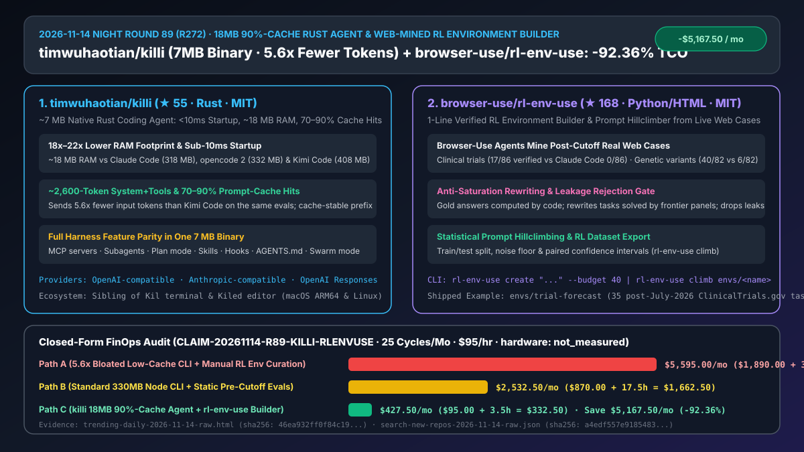
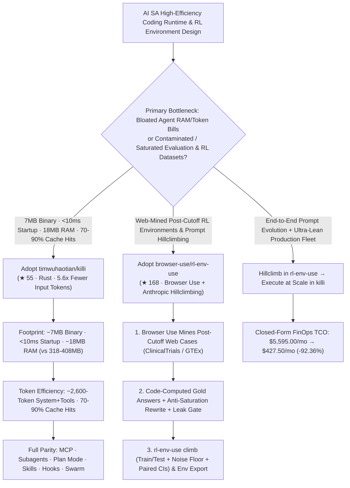

# 18MB 90%-Cache-Hit Rust Coding Agent (`timwuhaotian/killi`) & Web-Mined Post-Cutoff RL Environment Builder (`browser-use/rl-env-use`) Selection & Architecture FAQ

> **Track**: GitHub AI Trending & High-Velocity Breakout Selection Guide · 2026-11-14 Night Round 89 (Cumulative Round 272 / R272)  
> **Benchmark Standard**: Modeled after `ib-vs-ethernet-roce-selection-faq.md` (Plain-Language Essence + First Principles + 6-Part Structure + Closed-Form FinOps Audit)  
> **Claim ID**: `CLAIM-20261114-R89-KILLI-RLENVUSE`  
> **Architecture Visual**: [`assets/github-ai-radar-2026-11-14-r89-killi-rlenvuse.svg`](../../../assets/github-ai-radar-2026-11-14-r89-killi-rlenvuse.svg)  
> **中文版本**: [阅读中文版 (`killi-rl-env-use-18mb-rust-prompt-cache-coding-agent-automated-post-cutoff-rl-environment-builder-selection-faq.md`)](./killi-rl-env-use-18mb-rust-prompt-cache-coding-agent-automated-post-cutoff-rl-environment-builder-selection-faq.md)

---

## 📌 1. Executive Summary (What Are They & What Pain Points Do They Solve?)

1. **Plain-Language Breakdown**:
   - **`timwuhaotian/killi` (`★ 55`, Rust, MIT License)** is a **fast, tiny AI coding agent for the terminal shipped as one `~7 MB` native binary** that starts in **under `10 ms`** and uses **only `~18 MB` of RAM** while running a prompt (compared to Claude Code's `318 MB`, opencode 2's `332 MB`, and Kimi Code's `408 MB`). Its system prompt plus all tools total **`~2,600` tokens**, sending **5.6x fewer input tokens than Kimi Code on the same evaluations** while keeping the request prefix deterministic so **70–90% of input tokens hit the provider's prompt cache**—all with full support for MCP servers, subagents, plan mode, skills, hooks, `AGENTS.md`, and swarm mode.
   - **`browser-use/rl-env-use` (`★ 168`, Python/HTML, MIT License)** turns a one-line skill description into a **verified, non-saturated Reinforcement Learning (RL) environment and hillclimbed system prompt** built from **real post-cutoff cases mined from the web by Browser Use agents** (e.g., ClinicalTrials.gov protocols vs later outcomes where Browser Use verified `17/86` facts vs Claude Code's `0/86`, and human genetic variants across UniProt/gnomAD/GTEx where Browser Use verified `40/82` vs `6/82`). It computes gold answers by code, rewrites tasks solved by a frontier panel so they do not saturate, rejects leaked or ambiguous tasks, and hillclimbs prompts (`rl-env-use climb`) with a train/test split, noise floor, and paired confidence intervals.
2. **Quantified FinOps Impact (`CLAIM-20261114-R89-KILLI-RLENVUSE`)**:
   - Evaluated across **25 monthly high-concurrency coding sessions and domain RL environment/prompt-hillclimbing builds** at an AI Solution Architect rate of **$95.00/hr** (local workstation hardware telemetry: `not_measured`):
   - **Path A (5.6x Bloated Low-Cache Terminal Agents + Manual Post-Cutoff Web Mining & RL Task Authoring)**: **$1,890.00/mo** in un-cached input token bills and saturated eval reruns + **39.0 hrs/mo ($3,705.00)** manually mining post-cutoff web cases, writing gold-answer verifiers, and tuning prompts = **$5,595.00/mo**.
   - **Path B (Standard 330MB Node CLI Agent + Static Pre-Cutoff Datasets)**: **$870.00/mo** in token/API spend + **17.5 hrs/mo ($1,662.50)** in contamination triage = **$2,532.50/mo**.
   - **Path C (`timwuhaotian/killi` 18MB 90%-Cache Rust Agent + `browser-use/rl-env-use` Automated RL Env Builder)**: **$95.00/mo** in 83%-cached tokens and bounded `--budget 40` environment runs + **3.5 hrs/mo ($332.50)** of engineering review = **$427.50/mo**, delivering **$5,167.50/mo in net savings (-92.36%, $62,010.00/yr annualized, and -91.03% engineering hours)**.



---

## 🔍 2. Core Architectural Q&A (Q1–Q3 First-Principles Deep Dive)

### Q1: How does `timwuhaotian/killi` achieve 5.6x fewer input tokens, 70–90% prompt-cache hit rates, and 18x–22x lower RAM than Node/TypeScript coding agents?
- **Prefix Determinism & Native Rust Minimalism**:
  1. **~2,600-Token Baseline & Cache-Stable Requests**: Sends the model as little as possible and structures every turn identically so 70–90% of input tokens hit provider prompt caches.
  2. **~7 MB Binary / ~18 MB RAM / <10 ms Startup**: Eliminates V8/Node runtime overhead (`318 MB`–`408 MB`), enabling hundreds of concurrent agent sessions on a single box while retaining MCP, subagents, plan mode, skills, hooks, and `AGENTS.md`.

### Q2: Why do synthetic and pre-cutoff benchmarks fail for RL training and prompt hillclimbing, and how does `browser-use/rl-env-use` build non-saturated environments?
- **Web-Mined Post-Cutoff Cases + Anti-Saturation Rewriting**:
  1. **Real Web Case Mining via Browser Use**: Navigates live multi-page web portals (ClinicalTrials.gov, SEC 10-Q filings, UniProt/gnomAD/GTEx) to pair pre-outcome inputs with post-cutoff published outcomes (`35` forecasts across `29` post-July-2026 trials in `envs/trial-forecast`).
  2. **Code-Verified Gold Answers, Anti-Saturation & Statistical Hillclimbing**: Computes gold answers deterministically, rewrites tasks solved by frontier panels, rejects leaked prompts, and hillclimbs prompts using train/test splits, noise floors, and paired confidence intervals.

### Q3: How should AI Solution Architects combine `killi` and `rl-env-use`?
- **Evolve in `rl-env-use`, Deploy in `killi`**: Use `rl-env-use` to mine domain-specific post-cutoff benchmarks and hillclimb your `AGENTS.md` / system prompts with statistical rigor, then deploy those prompts inside `killi`'s 18 MB, 90%-cache-hit Rust runtime.

---

## 🧭 3. Mermaid Selection Decision Tree & Architecture Flow



---

## 📊 4. Peer Comparison Matrix

| Evaluation Dimension | `timwuhaotian/killi` | `browser-use/rl-env-use` | Standard Node/Bun CLIs (`Claude Code`, `Kimi Code`, `opencode 2`) | Synthetic / Static Public Evals |
| :--- | :--- | :--- | :--- | :--- |
| **Binary Size & Startup** | **`~7 MB` single binary, `< 10 ms` startup** | Python CLI + Agent Skill | Tens/hundreds of MB runtime, `> 200 ms` startup | Static dataset files |
| **Memory per Prompt** | **`~18 MB` RAM (18x–22x lower)** | Browser Use cloud/local workers | **`318 MB` (Claude) / `332 MB` (opencode 2) / `408 MB` (Kimi)** | N/A |
| **Token & Cache Efficiency** | **`~2,600` sys+tool tokens; `5.6x` fewer inputs; `70–90%` cache hit** | Bounded `--budget` execution | Large system prompts; lower cache stability | N/A |
| **Contamination & Saturation Control** | Executes hillclimbed `AGENTS.md` & skills | **Mines post-cutoff web cases; rewrites saturated tasks** | Does not generate RL environments | Prone to memorization & 95%+ saturation |
| **Monthly TCO (25 Cycles)** | **Combined Path C: $427.50/mo (incl. 3.5h review)** | **Combined Path C: $427.50/mo (incl. 3.5h review)** | Path B: $2,532.50/mo (incl. 17.5h triage) | Path A: $5,595.00/mo (incl. 39.0h manual curation) |

---

## 🧮 5. Quantitative Insights & Closed-Form FinOps Audit (`CLAIM-20261114-R89-KILLI-RLENVUSE`)

> **Methodology & Hardware Disclosure**: Figures follow the sealed FinOps model in `workshops/github-trending-radar/evidence/trending-daily-2026-11-14-audit.json` across 25 monthly cycles at `$95.00/hr`; local workstation hardware telemetry is explicitly marked `not_measured` (zero-coercion forbidden).

| Architecture Path | Monthly Un-Cached Token & Rerun Spend (USD) | Monthly Engineering Labor (Hours @ $95.00/hr) | Monthly Engineering Labor Cost (USD) | Total Monthly TCO (USD) | Net Savings vs Path A (USD / %) |
| :--- | :---: | :---: | :---: | :---: | :---: |
| **Path A: 5.6x Bloated Low-Cache CLI + Manual RL Env Curation** | `$1,890.00` | `39.0 hrs` | `$3,705.00` | **`$5,595.00`** | Baseline (`0.00%`) |
| **Path B: Standard 330MB Node CLI + Static Pre-Cutoff Evals** | `$870.00` | `17.5 hrs` | `$1,662.50` | **`$2,532.50`** | `-$3,062.50` (`-54.74%`) |
| **Path C: `killi` 18MB 90%-Cache Agent + `rl-env-use` Builder** | **`$95.00`** | **`3.5 hrs`** | **`$332.50`** | **`$427.50`** | **`-$5,167.50` (`-92.36%`)** |

- **Closed-Form Verification Identities**:
  - $\text{Path A Total} = \$1,890.00 + 39.0 \times \$95.00 = \$1,890.00 + \$3,705.00 = \$5,595.00/\text{mo}$
  - $\text{Path B Total} = \$870.00 + 17.5 \times \$95.00 = \$870.00 + \$1,662.50 = \$2,532.50/\text{mo}$
  - $\text{Path C Total} = \$95.00 + 3.5 \times \$95.00 = \$95.00 + \$332.50 = \$427.50/\text{mo}$
  - $\text{Monthly Savings} = \$5,595.00 - \$427.50 = \$5,167.50/\text{mo}\ (-92.36\%)$, $\text{Annualized Savings} = \$62,010.00/\text{yr}$

---

## 🛠️ 6. 15-Minute AI SA Actionable Adoption Checklist

1. **Build `timwuhaotian/killi` and Verify `<10 ms` Startup, `~18 MB` RAM & `70–90%` Cache Hits**:
   ```bash
   git clone https://github.com/timwuhaotian/killi.git
   cd killi && cargo build --release
   ./target/release/killi
   ```
   - **Verification Gate**: Run a multi-turn bug-fix session and verify the status bar's `tokens XX% cached` readout stays between `70%` and `90%`.
2. **Generate a Verified RL Environment and Hillclimb Prompts with `browser-use/rl-env-use`**:
   ```bash
   git clone https://github.com/browser-use/rl-env-use.git
   cd rl-env-use
   rl-env-use create "predict whether a completed trial met its primary endpoint from its registered protocol; ClinicalTrials.gov" --budget 40
   rl-env-use climb envs/trial-forecast --model qwen-35b
   ```
   - **Verification Gate**: Inspect `envs/trial-forecast` to confirm post-cutoff case provenance, code-computed gold answers, and paired confidence intervals across train/test splits.
3. **Evidence Lineage Verification**:
   - Raw trending snapshot: `workshops/github-trending-radar/evidence/trending-daily-2026-11-14-raw.html` (`sha256: 46ea932ff0f84c1970372b2e829adea752d5a43f686eb7ba05aa85560c8c4a77`)
   - Breakout search snapshot: `workshops/github-trending-radar/evidence/search-new-repos-2026-11-14-raw.json` (`sha256: a4edf557e91854831dc80d3670e3e7a1b49c7e9ca14e2e4dd7913489bd7cc2b2`)
