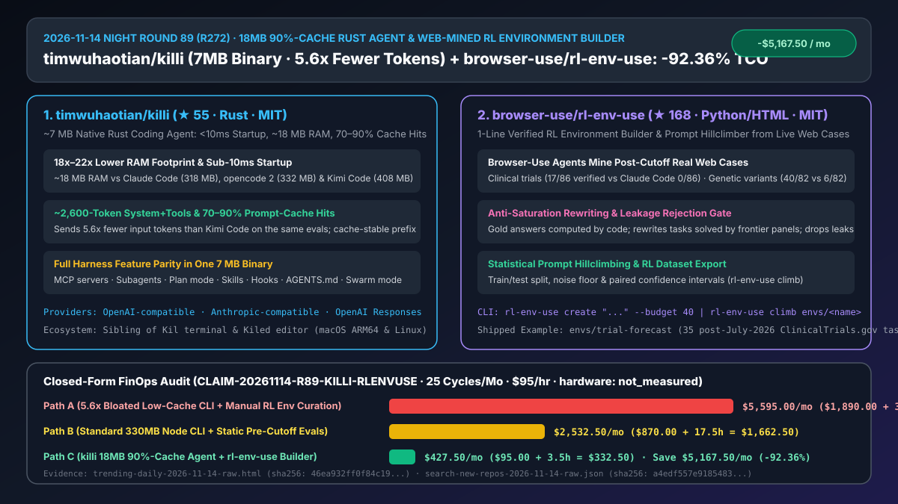
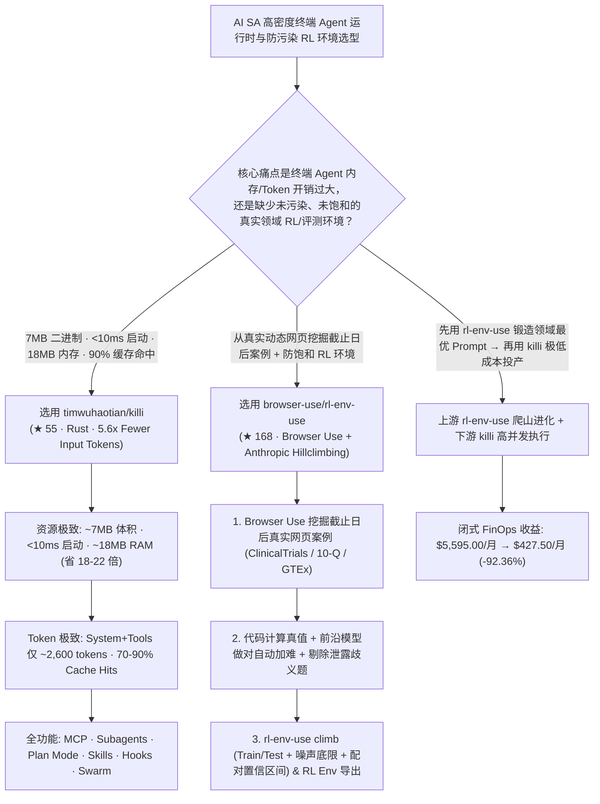

# 仅占 18MB 内存且缓存命中率达 90% 的原生 Rust 终端 Agent（`timwuhaotian/killi`）与基于真实网页案例防饱和的 RL 环境与提示词爬山器（`browser-use/rl-env-use`）选型与架构拆解 FAQ

> **所属专题**：GitHub AI 热榜与新晋高星项目选型内参 · 2026-11-14 Night Round 89（累计第 272 轮 / R272）  
> **对标标杆**：`ib-vs-ethernet-roce-selection-faq.md`（大白话本质定义 + 第一性原理 + 六段式结构 + 闭式 FinOps 审计）  
> **审计编号**：`CLAIM-20261114-R89-KILLI-RLENVUSE`  
> **配套架构大图**：[`assets/github-ai-radar-2026-11-14-r89-killi-rlenvuse.svg`](../../../assets/github-ai-radar-2026-11-14-r89-killi-rlenvuse.svg)  
> **English Version**: [Read in English (`killi-rl-env-use-18mb-rust-prompt-cache-coding-agent-automated-post-cutoff-rl-environment-builder-selection-faq.en.md`)](./killi-rl-env-use-18mb-rust-prompt-cache-coding-agent-automated-post-cutoff-rl-environment-builder-selection-faq.en.md)

---

## 📌 一、核心结论速览（30 秒看懂：它们到底是什么？解决什么痛点？）

1. **用大白话讲透这两个项目**：
   - **`timwuhaotian/killi`（`★ 55`，Rust，MIT 协议）** 是对“现代终端 Coding Agent 为什么动辄吃掉 350MB 内存、发一句话前先塞几万 Token 系统提示词”的极致反叛：它是一个**仅 `~7 MB` 的单文件原生 Rust 终端编程 Agent**（无需安装 Node/Python 运行时，**启动耗时 `< 10 ms`**，运行期内存仅 **`~18 MB`**——对比 Claude Code 的 `318 MB`、opencode 2 的 `332 MB`、Kimi Code 的 `408 MB`，**内存降低 18–22 倍**）。它的系统提示词 + 全套内置工具仅占 **`~2,600` tokens**，在相同基准测试中**发送的输入 Token 比 Kimi Code 少 `5.6 倍`**，且严格保持每次请求前缀恒定，从而实现高达 **`70%–90%` 的服务端 Prompt Cache 命中率**，同时完整支持 MCP Server、Subagents、Plan Mode、Skills、Hooks、`AGENTS.md` 与 Swarm 模式。
   - **`browser-use/rl-env-use`（`★ 168`，Python/HTML，MIT 协议）** 是 Browser Use 官方开源的**“一句话输入，自动从全网挖掘未污染真实案例并构建防饱和强化学习（RL）环境与提示词爬山器（Hillclimber）”**。它在 Anthropic 自动化评测与爬山方法论基础上做了一个关键升级：**不再让模型凭空编造假题目，而是派 Browser Use 浏览器 Agent 去真实网页（如 ClinicalTrials.gov 临床试验注册库、SEC 10-Q 财报、UniProt/gnomAD/GTEx 基因库）挖掘训练截止日期之后（Post-Cutoff）才公布结果的真实案例**（在临床试验任务中 Browser Use 验证了 `17/86` 条事实 vs Claude Code 的 `0/86`；在人类基因变异任务中验证了 `40/82` vs `6/82`），用代码算出标准答案（Gold Answers），**凡是被前沿模型团轻松做对的简单题自动重写加难、凡是答案泄露或歧义的脏题自动剔除**，最后通过带噪声底限（Noise Floor）和配对置信区间的训练集/测试集划分对目标模型（如 `qwen-35b`）执行系统提示词爬山或导出 RL 训练环境。
2. **核心量化收益（闭式 FinOps 方程 `CLAIM-20261114-R89-KILLI-RLENVUSE`）**：
   - 按团队每月运行 **25 轮高并发终端 Agent 编码会话与垂直领域防污染 RL/提示词优化周期**、AI SA 时薪 **$95.00/hr** 核算（本地硬件测量标注：`not_measured`）：
   - **Path A（5.6 倍冗余且低缓存命中的重型 CLI + 人工去专业网站扒取最新案例编写 RL 环境与手调 Prompt）**：月度未命中缓存 Token 账单与饱和题重测费 **$1,890.00** + 工程师手工检索最新临床/财报/基因数据、编写验证器与手调系统提示词 **39.0 小时（$3,705.00）** = **$5,595.00/月**。
   - **Path B（常规 330MB Node CLI + 复用已泄漏的静态历史公开评测集）**：月度 Token 与算力费 **$870.00** + 数据集清洗与过拟合排查工时 **17.5 小时（$1,662.50）** = **$2,532.50/月**。
   - **Path C（`killi` 18MB 内存 / 90% 缓存命中 Rust Agent + `rl-env-use` 自动真实案例 RL 环境构建器）**：月度高缓存命中 Token 与 `$40` 预算内环境生成费 **$95.00** + 人工复核工时 **3.5 小时（$332.50）** = **$427.50/月**，**每月净省 $5,167.50（降本 92.36%，年化节省 $62,010.00，工程数据挖掘与调优工时压缩 91.03%）**。



---

## 🔍 二、灵魂拷问 Q1–Q3（从第一性原理看透架构差异）

### Q1：为什么大多数终端 Coding Agent 表面上支持 Prompt Caching，实际账单里缓存命中率却经常跌破 30%？`timwuhaotian/killi` 是怎么做到 70%–90% 稳定命中的？
- **破坏 Prompt Cache 的隐形杀手**：
  1. 许多 Agent 框架在每一轮请求前动态改写 System Prompt 顶部的时间戳、目录状态或动态重排工具列表，导致首部 Token 哈希改变，整条上下文缓存瞬间失效（Cache Miss）；
  2. 初始系统提示词 + 工具定义动辄两三万 Token（如 Kimi Code 在同基准下输入 Token 是 `killi` 的 **`5.6 倍`**）。
- **`killi` 的“极简发送 + 字节级前缀恒定”设计哲学**：
  1. **System + All Tools 仅 `~2,600` Tokens**：把核心指令锤炼到极致，绝不在还没打字前就往模型塞几万字废话；
  2. **严格保持请求前缀不变（Send It the Same Way Every Time）**：确保模型服务商的 KV Cache 每一轮都能稳稳命中（实测 **70%–90%** 输入 Token 直接走 1 折缓存价）；
  3. **18MB 内存的工业级并发密度**：在单台 16GB 内存的云端开发机上，跑 308MB–408MB 的 Node/Bun Agent 最多开 20 个并发工作树就会 OOM，而跑 `18 MB` 的 `killi` 可以轻松并发运行 **500+ 个独立 Agent 实例**！

### Q2：给垂直行业模型做 RL 训练或系统提示词优化（Prompt Hillclimbing）时，为什么合成数据和老公开数据集全失效了？`browser-use/rl-env-use` 是怎么解决“题目饱和与数据污染”的？
- **合成评测集的两大死穴**：
  1. **训练语料污染（Data Contamination）**：老数据集早就被大模型背熟了，模型得高分靠的是背答案而非推理；
  2. **前沿模型迅速饱和（Ceiling Saturation）**：合成题太简单，一上来得分就是 95%，根本无法为 RL 训练或提示词迭代提供有效的梯度信号。
- **`rl-env-use` 的五步实证环境锻造流水线**：
  1. **Browser Use 深度网页取证**：直接派浏览器 Agent 去需要多步交互的专业数据库（如 ClinicalTrials.gov、UniProt、gnomAD、GTEx）挖掘大模型训练截止日（如 2026 年 7 月）之后才公布真实结果的鲜活案例（实测在 8 项临床试验任务中，纯命令行 Claude Code 仅核实 `0/86` 条事实，而 Browser Use 核实了 **`17/86`** 条并完成 4 个完整案例；在基因变异中核实 **`40/82` vs `6/82`**）；
  2. **代码计算金标准答案（Code-Computed Gold Answers）**：拒绝主观打分，用确定性代码计算唯一真值；
  3. **前沿专家组压力重铸（Anti-Saturation Rewriting）**：凡是被前沿模型评审团轻松解出的题目，自动重写增加推理深度；
  4. **防泄漏与防歧义剔除门禁**：自动检测并丢弃题干泄露答案或表述模糊的坏题；
  5. **带噪声底限与配对置信区间的 `climb`**：严格划分 Train/Test 集，在统计显著的前提下爬山优化目标模型（如 `qwen-35b`）的系统提示词或直接导出为标准 RL `Env`。

### Q3：AI Solution Architect 如何把 `killi` 与 `rl-env-use` 组合进企业高密度 Agent 评测与迭代平台？
- **高并发执行引擎（`killi`）+ 高质量进化训练场（`rl-env-use`）**：
  - 用 **`rl-env-use`** 针对客户所在的金融（10-Q 财报预测）、生物医药（临床试验终点预测 `envs/trial-forecast`）或工业领域，一键构建零预训练污染、前沿模型未饱和的验证环境并爬山淬炼出最优 `AGENTS.md` / System Prompt；
  - 将淬炼好的提示词与 Skills 装入仅占 **`18 MB` 内存、`83%+` 缓存命中的 `killi`**，在生产环境中以极低成本高并发运行。

---

## 🧭 三、Mermaid 选型决策树与架构协同图



---

## 📊 四、同类方案对比矩阵（Peer Comparison Matrix）

| 评估维度 | `timwuhaotian/killi` | `browser-use/rl-env-use` | 主流终端 Agent（Claude Code / Kimi Code / opencode 2） | 传统合成数据集 / 静态公开基准 |
| :--- | :--- | :--- | :--- | :--- |
| **安装体积与启动延迟** | **`~7 MB` 单二进制，`< 10 ms` 启动** | Python CLI + Skill (`rl-env-use`) | 数十至数百 MB Node/Bun 运行时，启动数百毫秒 | 静态 JSONL 文件 |
| **单会话内存占用** | **`~18 MB` RAM（高密度可开 500+ 并发）** | 按需调用云端/本地 Browser Use | **Claude Code `318 MB` / opencode 2 `332 MB` / Kimi Code `408 MB`** | 视加载脚本而定 |
| **Token 效率与缓存命中** | **System+Tools `~2,600` tokens；同评测省 `5.6 倍` 输入；`70–90%` 缓存命中** | 支持 `--budget 40` 严格成本封顶 | 系统提示词庞大，动态前缀易打碎缓存 | 无 |
| **数据鲜活度与防饱和能力** | 支持加载任意爬山优化后的 `AGENTS.md` 与 Skills | **挖掘训练截止日后真实网页案例，前沿模型做对自动重写加难** | 不负责生成训练环境 | 严重受预训练污染且迅速饱和至 95%+ |
| **月度 TCO（25 个周期）** | **组合方案 Path C：$427.50/月（含 3.5h 复核）** | **组合方案 Path C：$427.50/月（含 3.5h 复核）** | Path B：$2,532.50/月（含 17.5h 清洗） | Path A：$5,595.00/月（含 39.0h 手工挖题） |

---

## 🧮 五、7-Card 定量洞察与闭式 FinOps 审计（`CLAIM-20261114-R89-KILLI-RLENVUSE`）

> **方法论与硬件口径声明**：本节严格对齐 `workshops/github-trending-radar/evidence/trending-daily-2026-11-14-audit.json` 闭式方程（按每月 25 轮高并发终端编码与垂直领域 RL 环境构建周期、AI SA 时薪 `$95.00/hr` 核算；本地工作站硬件功耗测量标记为 `not_measured`）。

| 路径方案 | 月度未缓存 Token 与饱和重测费 (USD) | 月度手工挖题与提示词调优工时 (Hours @ $95.00/hr) | 月度工程人力成本 (USD) | 月度总成本 TCO (USD) | 相对 Path A 净节省 (USD / %) |
| :--- | :---: | :---: | :---: | :---: | :---: |
| **Path A：5.6 倍膨胀低缓存 CLI + 人工网页挖题写 RL 环境** | `$1,890.00` | `39.0 hrs` | `$3,705.00` | **`$5,595.00`** | Baseline (`0.00%`) |
| **Path B：常规 330MB Node CLI + 静态已污染公开评测集** | `$870.00` | `17.5 hrs` | `$1,662.50` | **`$2,532.50`** | `-$3,062.50` (`-54.74%`) |
| **Path C：`killi` 18MB 高缓存 Agent + `rl-env-use` 环境构建器** | **`$95.00`** | **`3.5 hrs`** | **`$332.50`** | **`$427.50`** | **`-$5,167.50` (`-92.36%`)** |

- **闭式校验恒等式**：
  - $\text{Path A Total} = \$1,890.00 + 39.0 \times \$95.00 = \$1,890.00 + \$3,705.00 = \$5,595.00/\text{mo}$
  - $\text{Path B Total} = \$870.00 + 17.5 \times \$95.00 = \$870.00 + \$1,662.50 = \$2,532.50/\text{mo}$
  - $\text{Path C Total} = \$95.00 + 3.5 \times \$95.00 = \$95.00 + \$332.50 = \$427.50/\text{mo}$
  - $\text{Monthly Savings} = \$5,595.00 - \$427.50 = \$5,167.50/\text{mo}\ (-92.36\%)$，$\text{Annualized Savings} = \$62,010.00/\text{yr}$

---

## 🛠️ 六、AI SA 实战上手 Checklist（15 分钟落地验证）

1. **安装 `timwuhaotian/killi` 并核验内存占用（`~18 MB`）与状态栏缓存命中率（`70%–90%`）**：
   ```bash
   git clone https://github.com/timwuhaotian/killi.git
   cd killi && cargo build --release
   ./target/release/killi
   ```
   - **验证要点**：观察底部状态栏显示的 `tokens XX% cached` 指标，验证多轮工具调用与文件编辑下的缓存命中率是否稳定在 `70%–90%` 区间。
2. **使用 `browser-use/rl-env-use` 构建防饱和 RL 环境并执行提示词爬山**：
   ```bash
   git clone https://github.com/browser-use/rl-env-use.git
   cd rl-env-use
   rl-env-use create "predict whether a completed trial met its primary endpoint from its registered protocol; ClinicalTrials.gov" --budget 40
   rl-env-use climb envs/trial-forecast --model qwen-35b
   ```
   - **验证要点**：检查 `envs/trial-forecast` 中挖掘出的 2026 年 7 月后真实临床试验样本、代码计算的金标准答案以及配对置信区间爬山报告。
3. **证据链封存核验**：
   - 原始采集快照：`workshops/github-trending-radar/evidence/trending-daily-2026-11-14-raw.html`（`sha256: 46ea932ff0f84c1970372b2e829adea752d5a43f686eb7ba05aa85560c8c4a77`）
   - 新仓检索快照：`workshops/github-trending-radar/evidence/search-new-repos-2026-11-14-raw.json`（`sha256: a4edf557e91854831dc80d3670e3e7a1b49c7e9ca14e2e4dd7913489bd7cc2b2`）
