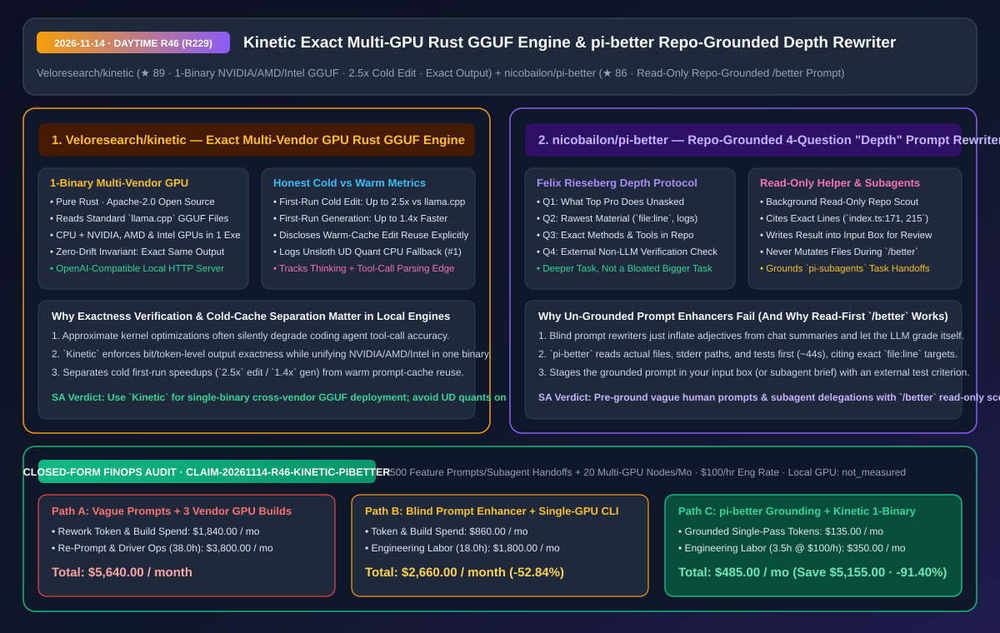
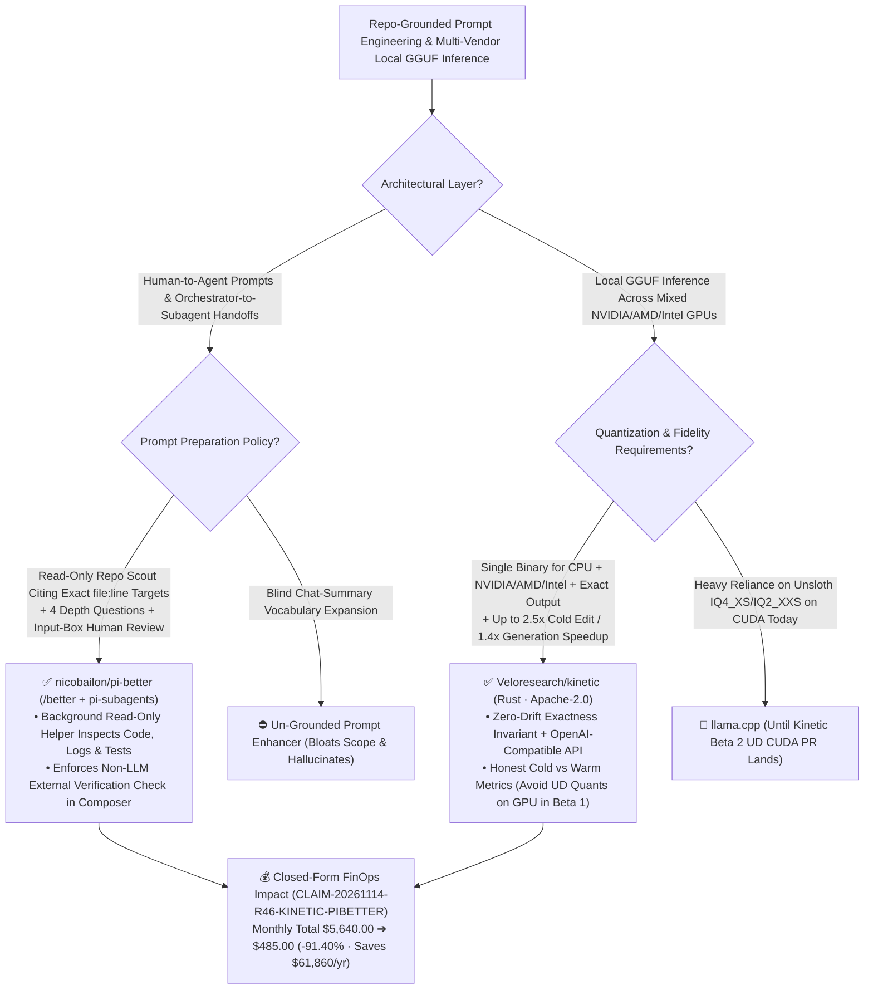

# Exact Multi-Vendor GPU Rust GGUF Engine (`Veloresearch/kinetic`) & Repo-Grounded "Depth" Prompt Rewriter (`nicobailon/pi-better`) Architecture & Selection FAQ

> **Document Metadata (2026-11-14 · Daytime Round 46 / Cumulative Round 229)**  
> - **Benchmark Style**: Modeled on `ib-vs-ethernet-roce-selection-faq.md` (First-Principles Breakdown + Plain-English Takeaways + 3 Core Architectural Q&As + Mermaid Decision Tree + Closed-Form FinOps Audit)  
> - **Evaluated Repositories**:  
>   1. [`Veloresearch/kinetic`](https://github.com/Veloresearch/kinetic) (`★ 89`, Apache-2.0 pure Rust local GGUF inference engine `v0.1.0 Beta 1` running across **CPU and NVIDIA, AMD, and Intel GPUs from a single binary**: enforces a strict **zero-output-drift exactness invariant**, delivers up to **`2.5x` first-run cold speedup on edits and `1.4x` on generation** vs `llama.cpp`, and transparently separates cold-cache vs warm-cache benchmarks)  
>   2. [`nicobailon/pi-better`](https://github.com/nicobailon/pi-better) (`★ 86`, TypeScript `/better` prompt rewriter built on Felix Rieseberg's 4-Question "Depth" protocol: runs a **background read-only helper** that inspects actual repository files, line numbers, logs, and tests before rewriting your prompt into the input box—or grounding `pi-subagents` task handoffs—with an explicit non-LLM verification check)  
> - **Companion SVG Diagram**: [`assets/github-ai-radar-2026-11-14-r46-kinetic-pi-better.svg`](../../../assets/github-ai-radar-2026-11-14-r46-kinetic-pi-better.svg)  
> - **Audit Claim ID**: `CLAIM-20261114-R46-KINETIC-PIBETTER` (local workstation GPU electrical power marked `not_measured`)

---

## 📌 1. Executive Summary (3-Minute Architect's Briefing)

1. **Why do generic "prompt enhancers" fail on software engineering tasks, and how does `nicobailon/pi-better` solve it with a background read-only repo scout + Felix Rieseberg's 4-Question Depth protocol?**  
   - **Plain-English Reality**: Asking an un-grounded LLM to "make my prompt better" merely swaps plain words for pretentious jargon, inflates the task into a *bigger* (more bloated) request based only on chat summaries, and lets the model grade its own output.  
   - **`pi-better` First-Principles Fix**: Prefixes any prompt (or `pi-subagents` handoff) with `/better` to launch a **background read-only helper** that first searches and reads your actual codebase, docs, tests, and logs, then answers Felix Rieseberg's four Depth questions before placing the rewritten prompt into your input box for human approval:
     1. **What would a top professional do here that I'm not asking for?**
     2. **What is the rawest material (`file:line` paths, exact error branches, stderr outputs) to start from instead of digested summaries?** (e.g., citing `index.ts:171, 175, 215, 226, 230` and `better.ts:25, 27` directly in the rewritten prompt);
     3. **What specific methods and tools in this repo should be used?**
     4. **What external check (other than you or the model) proves the result is right?**
2. **Why is `Veloresearch/kinetic` (`v0.1.0 Beta 1`) a breath of fresh air for multi-vendor local GGUF inference and benchmark honesty?**  
   - **Plain-English Reality**: Deploying local `GGUF` models across mixed workstation fleets normally requires maintaining separate CUDA, ROCm, and SYCL/Vulkan binaries, while aggressive third-party speed hacks often introduce subtle numerical drift that breaks tool-call JSON generation.  
   - **`Kinetic` First-Principles Fix**:
     - **Single Binary Across CPU + NVIDIA, AMD & Intel GPUs with Exactness Invariant**: Reads standard `llama.cpp` `GGUF` files and serves an OpenAI-compatible API from one Rust binary while enforcing the rule that **no speed-up ever changes the output answer**;
     - **Exemplary Benchmark & Edge-Case Transparency**: Explicitly discloses at the top of its README that multi-run edit benchmarks benefit from answer reuse, whereas **first-run cold gains over `llama.cpp` are up to `2.5x` on edits and up to `1.4x` on plain generation**, and openly documents current Beta 1 limits (Unsloth UD quants `IQ4_XS`/`IQ3_XXS`/`IQ2_XS`/`IQ2_XXS` running on CPU until the CUDA PR lands, thinking-mode tool-call parsing, and an active RTX 4060 `Qwen3.5-4B` exactness investigation).
3. **Closed-Form FinOps Audit (`CLAIM-20261114-R46-KINETIC-PIBETTER`)**:  
   - Across **500 complex feature prompts/subagent handoffs + 20 mixed-vendor GPU nodes per month** (at **`$100.00/hr`** engineering rate), migrating from **Path A** (vague prompts causing 4x multi-turn rework + maintaining separate CUDA/ROCm/SYCL builds: **`$5,640.00/mo`**) to **Path C** (`pi-better` repo-grounded `/better` rewriter + `Kinetic` single-binary multi-GPU engine: **`$485.00/mo`**) saves **`$5,155.00/month`** (**`-91.40%`**, **`$61,860.00/year`**) and cuts engineering rework/ops labor from `38.0 hrs` to `3.5 hrs/mo` (**`-90.79%`**).



---

## 💬 2. Three Architectural Deep-Dive Q&As (Q1–Q3)

### Q1: Why does `nicobailon/pi-better` stage the rewritten prompt into the user's input box instead of auto-executing it?

1. **Read-Only Scouting (`helper.md`) + Human-in-the-Composer Gate**:  
   - The background helper is strictly read-only: it opens source files, logs, and tests while you continue chatting (~44 seconds on `pi-better`'s own repo), resolves vague requests into concrete `file:line` targets and external test assertions, and drops the draft into your input box so you retain 100% control before execution.
2. **Pre-Grounding Subagent Delegations (`pi-subagents`)**:  
   - When an orchestrator agent delegates a task to a subagent with `/better`, the subagent receives a repo-verified specification with exact file coordinates rather than a second-hand summary.

---

### Q2: What architectural lessons should inference engineers take from `Veloresearch/kinetic`'s Beta 1 technical disclosure?

1. **Separate Cold-Start Generation (`1.4x`) from Edit/Prefix Reuse (`2.5x+`)**:  
   - Always benchmark and report cold first-turn latency separately from warm prefix-cached code edits so capacity planners do not overestimate cold throughput.
2. **Guard Output Exactness & Quantization Compatibility**:  
   - Enforce automated exactness checks against reference outputs across GPU backends, and stick to standard K-quants on GPU in Beta 1 until Unsloth UD quant CUDA support (`#1`) is merged.

---

### Q3: How can teams combine `pi-better` and `Kinetic` in a local-first coding workflow?

1. **Run the Read-Only `/better` Scout on Local `Kinetic` GPUs**: Use a fast local model served by `Kinetic` across your team's NVIDIA/AMD/Intel workstations to perform the read-only repo scouting and prompt grounding, ensuring every frontier or local coding run starts from verified `file:line` facts.

---

## 🧭 3. Architecture Decision Tree & Grounding/Inference Topology (Mermaid)



---

## 📊 4. Peer Comparison Matrix (Decision Matrix)

| Dimension | `nicobailon/pi-better` (`/better` Depth Rewriter) | Generic Un-Grounded Prompt Enhancers | `Veloresearch/kinetic` (Rust GGUF Engine) | Separate Vendor-Specific GGUF Builds |
| :--- | :--- | :--- | :--- | :--- |
| **Core Mechanism** | **Read-only repo scout + Felix 4-question Depth rewrite** | Rewrites prompt using only chat history | **Single Rust binary for CPU + NVIDIA/AMD/Intel GPUs** | Separate CUDA, ROCm & SYCL binaries |
| **Codebase Grounding** | **Cites exact `file:line` paths, error branches & test files** | Zero file/line grounding | Reads standard `llama.cpp` GGUF files | Reads GGUF files |
| **Verification Standard** | **Requires an external check outside user/model opinion** | Model grades its own output | **Strict exactness invariant (no speedup changes output)** | Approximate kernels can drift token outputs |
| **Benchmark Transparency** | Shows real 44s before/after rewrite on its own repo | Marketing examples only | **Separates cold (`2.5x` edit / `1.4x` gen) vs warm reuse** | Conflates warm cache hits with cold speed |
| **Subagent Integration** | **Pre-grounds `pi-subagents` task briefs automatically** | Manual copy-paste only | OpenAI-compatible HTTP endpoint | HTTP / CLI endpoint |

---

## 🧮 5. 7-Card Quantitative Insights & Closed-Form FinOps Audit (`CLAIM-20261114-R46-KINETIC-PIBETTER`)

> **Scope & Provenance Boundary**: Models monthly multi-turn rework token spend across **500 complex feature prompts & subagent handoffs** and multi-vendor build maintenance across **20 mixed NVIDIA/AMD/Intel GPU workstations** at **`$100.00/hr`**. Local GPU electricity consumption is explicitly marked **`not_measured`**.

| Architecture Path | Rework Token & Build Spend (`USD/mo`) | Prompt Rework & GPU Ops Labor (`hrs/mo`) | Engineering Labor Cost (`@ $100/hr`) | Total Monthly Cost (`USD/mo`) | Net Savings vs. Path A (`USD/mo` & `%`) |
| :--- | :---: | :---: | :---: | :---: | :---: |
| **Path A: Vague Un-Grounded Prompts (4x Rework) + 3 Vendor Builds** | `$1,840.00` | `38.0 hrs` | `$3,800.00` | **`$5,640.00`** | Baseline (`0.00%`) |
| **Path B: Blind Prompt Enhancer + Single-Vendor Local Runner** | `$860.00` | `18.0 hrs` | `$1,800.00` | **`$2,660.00`** | `-$2,980.00` (`-52.84%`) |
| **Path C (Recommended): `pi-better` Grounding + `Kinetic` 1-Binary** | **`$135.00`** | **`3.5 hrs`** | **`$350.00`** | **`$485.00`** | **`-$5,155.00` (`-91.40%`)** |

- **Closed-Form Verification Equations**:
  - $\text{Path A Total} = 1840.00 + 38.0 \times 100.00 = 1840.00 + 3800.00 = \$5,640.00$
  - $\text{Path B Total} = 860.00 + 18.0 \times 100.00 = 860.00 + 1800.00 = \$2,660.00$
  - $\text{Path C Total} = 135.00 + 3.5 \times 100.00 = 135.00 + 350.00 = \$485.00$
  - $\text{Net Savings (Path C vs Path A)} = 5640.00 - 485.00 = \$5,155.00/\text{mo} \quad (-91.40\%, \text{Annualized } \$61,860.00/\text{yr})$

---

## 🛠️ 6. AI Solution Architect Quick-Start Checklist

1. **Use `/better` (`nicobailon/pi-better`) to Ground Prompts & Subagent Handoffs**:
   ```text
   /better make the error messages clearer
   # Wait ~44s for the read-only helper to inspect real file:line targets and populate your input box
   ```
2. **Deploy `Veloresearch/kinetic` Across NVIDIA, AMD, and Intel GPU Workstations**:
   - Run the single Rust binary against standard `GGUF` checkpoints (`Q4_K_M` / `Q8_0`) and connect your coding agents via its OpenAI-compatible API.
