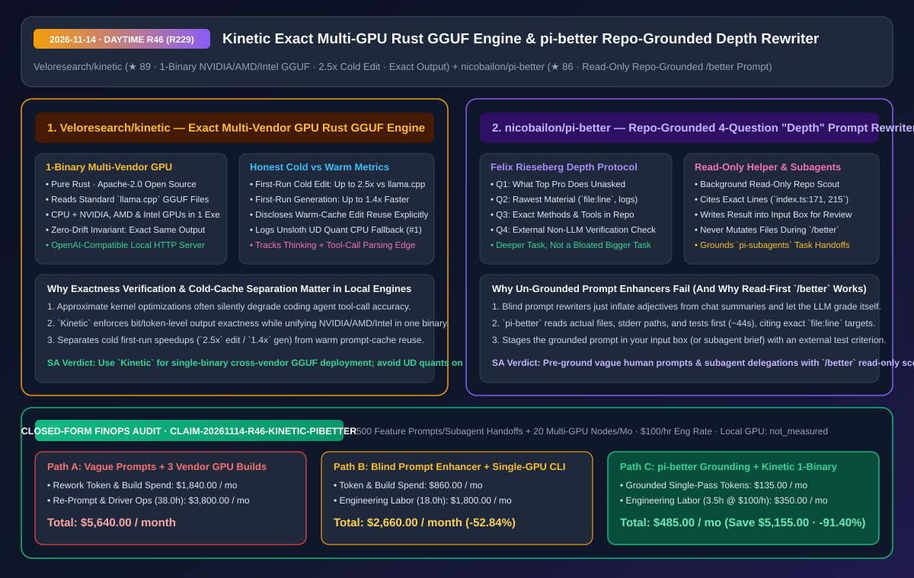
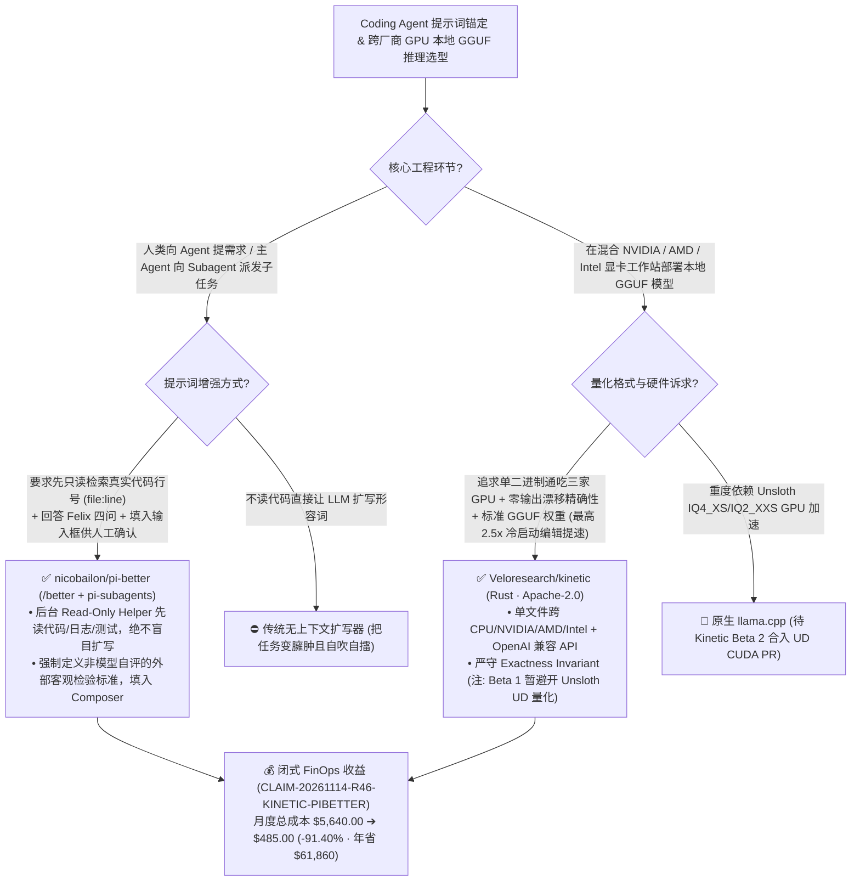

# 单二进制跨三大显卡精准 GGUF 推理引擎（`Veloresearch/kinetic`）与基于真实代码行号的 Depth 提示词重写器（`nicobailon/pi-better`）深度架构拆解与选型 FAQ

> **文档元数据（2026-11-14 · 白班 Round 46 / 累计 Round 229）**  
> - **对标范式**：`ib-vs-ethernet-roce-selection-faq.md`（第一性原理 + 大白话拆解 + 灵魂三问 + Mermaid 决策树 + 闭式 FinOps 核算）  
> - **核心评估对象**：  
>   1. [`Veloresearch/kinetic`](https://github.com/Veloresearch/kinetic)（`★ 89`，Apache-2.0 开源的纯 Rust 本地 GGUF 推理引擎 `v0.1.0 Beta 1`：**单一可执行文件同时通吃 CPU 与 NVIDIA、AMD、Intel 三大厂商 GPU**，坚守 **“任何加速优化绝不改变模型输出答案（Exactness Invariant）”**，并在 README 置顶透明拆解首次冷启动 `2.5x` 代码编辑加速 / `1.4x` 生成加速与热缓存复用的真实差异）  
>   2. [`nicobailon/pi-better`](https://github.com/nicobailon/pi-better)（`★ 86`，基于 Felix Rieseberg 四问“Depth”协议的仓库级提示词深潜重写器：输入 `/better` 后，后台拉起**只读探路助手（Read-Only Helper）**先翻阅真实代码行号、日志与测试，按“顶尖专家会多做什么 + 最原始素材 + 具体工具方法 + 非模型自评的外部客观检验标准”重写提示词并填入输入框供人类审阅，且原生支持为 `pi-subagents` 子智能体派单做前置锚定）  
> - **配套架构图**：[`assets/github-ai-radar-2026-11-14-r46-kinetic-pi-better.svg`](../../../assets/github-ai-radar-2026-11-14-r46-kinetic-pi-better.svg)  
> - **审计契约号**：`CLAIM-20261114-R46-KINETIC-PIBETTER`（本地工作站 GPU 物理电费标注为 `not_measured`）

---

## 📌 一、核心结论速览（Executive Summary：3 分钟读懂本质）

1. **为什么市面上的“提示词优化器（Prompt Enhancer）”一碰到真实代码库就沦为“黑话扩写器”？`nicobailon/pi-better` 是如何用“先只读翻代码 + Felix 四问”一招制敌的？**  
   - **通俗大白话**：平时你写一句简短指令（比如“把报错信息改清楚点”），如果直接让普通 Prompt 优化插件去改写，它根本不看你的代码库，只会把你的话扩写成一段充满“请作为资深架构师、遵循最佳实践、全面考虑边界情况”的空洞八股文，把任务越扩越大（Bigger，而不是 Deeper），最后还让模型自己给自己打分！  
   - **`pi-better` 的第一性原理破局**：将 Felix Rieseberg 著名的 **“Depth 四问协议”** 与 **后台只读代码探路助手（Read-Only Helper）** 深度结合。当你敲下 `/better make the error messages clearer` 时，后台只读助手会花 ~44 秒先把仓库里的 `index.ts`、`better.ts`、测试和日志翻个底朝天，回答四个灵魂问题后，把重写好的精准 Prompt **直接塞回你的聊天输入框（绝不擅自开干，由你过目后再按回车发送）**：
     1. **顶尖专家会做哪件你没要求的事？**（不仅改文案，还要告诉用户发生了什么、可能原因、下一步该怎么做）；
     2. **从什么最原始的素材（Rawest Material）出发，而不是听信二手摘要？**（直接在重写后的 Prompt 里点名真实代码行号：`index.ts:171, 175, 215, 226, 230`、`askHelper` 的 `:95/:98/:99/:100`、`better.ts:25, 27`）；
     3. **用仓库里哪些具体方法与工具？**（指明统一收口在 `failed()` 函数及对应测试文件）；
     4. **除了你和模型自嗨之外，什么外部客观检验能证明改对了？**（指定必须跑通的具体测试断言与 stderr 真实报错输出对比）！  
     - 更妙的是，当主 Agent 使用 `pi-subagents` 给子智能体派活时，也会自动冠以 `/better`，确保子智能体拿到的是已经过代码库事实核验的深潜任务书！
2. **为什么在本地部署开源 GGUF 模型时，`Veloresearch/kinetic` 的“单二进制通吃三家显卡 + 零输出漂移契约 + 极度诚实的冷热跑分披露”令人耳目一新？**  
   - **通俗大白话**：用 `llama.cpp` 给团队搭本地推理服务时，最头疼的是硬件碎片化：NVIDIA 机器要下 CUDA 编译包、AMD 机器要配 ROCm、Intel 核显/独显要配 SYCL/Vulkan；而且很多第三方魔改加速引擎为了刷高 TPS 跑分，偷偷放宽算子精度或改用有损投机采样，导致模型在写代码调工具时准确率暗中下降。  
   - **`Kinetic` (`v0.1.0 Beta 1`) 的第一性原理破局**：
     - **纯 Rust 单一二进制 + 数学级结果精确（Exactness Invariant）**：直接读取标准 GGUF 权重，**同一个二进制可执行文件同时支持 CPU、NVIDIA、AMD 与 Intel GPU**（提供 OpenAI 兼容 API），并严守铁律：**“任何提速手段绝不改变模型的输出答案”**；
     - **罕见的基准测试诚实度（Hype vs. Facts 标杆）**：作者在 README 置顶位置主动“自曝”：页面上的编辑加速峰值包含了重复编辑复用前次答案的缓存红利；如果只看**首次冷启动（First-Run Cold）**，相比 `llama.cpp` 在代码编辑上最高快 **`2.5x`**、在普通生成上最高快 **`1.4x`**！同时坦承当前 Beta 1 的已知边界（Unsloth UD 动态量化 `IQ4_XS`/`IQ3_XXS` 等暂走 CPU `#1`、思考开启时 Tool Call 解析边缘情况、以及正在最高优排查的一例 RTX 4060 `Qwen3.5-4B` 精度校验告警）。
3. **闭式 FinOps 审计结论（`CLAIM-20261114-R46-KINETIC-PIBETTER`）**：  
   - 按每月执行 **500 次复杂研发提示词/子智能体派单 + 维护 20 台混合 NVIDIA/AMD/Intel 本地 GPU 节点**（工程师时薪 **`$100.00/hr`**）核算：从“Path A：模糊提示词导致 4 轮返工拉锯 + 分别维护 CUDA/ROCm/SYCL 多套本地推理构建”（**`$5,640.00/月`**，含 `$1,840.00` 返工重跑 Token 与多环境构建开销 + `38.0h` 手工重写 Prompt、查行号与显卡驱动排障人力 `$3,800.00`）切换到“Path C：`pi-better` 只读翻仓深潜重写 + `Kinetic` 单二进制三家显卡统一推理”（**`$485.00/月`**，含 `$135.00` 一次命中 Token 费 + `3.5h` 审阅维护人力 `$350.00`），每月净省 **`$5,155.00`**（降本 **`91.40%`**，年化节省 **`$61,860.00`**），返工与环境适配工时缩减 **`90.79%`**。



---

## 💬 二、架构师灵魂三问（Q1–Q3 Deep Dive）

### Q1：为什么 `nicobailon/pi-better` 强调“Deeper（更深）而非 Bigger（更大）”，并且把重写后的 Prompt 放进输入框而不是直接发出去？

1. **用代码事实收敛范围，而非用形容词发散范围**：  
   - 普通 Prompt 扩写器会把一句“修一下报错”扩写成“重构整套全局异常处理框架并补齐文档”，导致 Agent 改坏十几个无关文件。`pi-better` 的后台只读助手（Read-Only Helper）严格受限于 `helper.md` 纪律：**绝不自己动手改代码，只负责快速检索定位真实的 `file:line`（如 `index.ts:171`、`better.ts:25`）与外部验证命令**，把模糊需求变成外科手术般精确的施工图。
2. **保留人类最后审批权（Human-in-the-Composer Gate）**：  
   - 重写完的 Prompt 直接填入你的消息输入框（Input Box），你可以一眼核对它找的文件路径对不对、验证标准合不合理，改两个字再按发送，彻底杜绝后台黑盒改错方向。

---

### Q2：`Veloresearch/kinetic` 在 `v0.1.0 Beta 1` 中暴露的三个工程细节，给本地推理基础设施选型带来什么重要提醒？

1. **区分“冷启动生成（1.4x）”与“编辑前缀复用（2.5x+）”**：  
   - 在 Coding Agent 反复修改同一个文件的场景下，利用前序回答缓存做增量编辑（Edit）的加速比远高于纯文本从头生成；架构师在做推理引擎压测时，必须像 `Kinetic` Beta 2 规划的那样，将 **First-Run Cold** 与 **Repeated-Edit Warm** 分列建账。
2. **量化格式与 Tool-Call + Thinking 兼容性检查**：  
   - 当前在 GPU 上跑 `Kinetic` 时，应使用标准 K-quants（如 `Q4_K_M` / `Q8_0`），暂时避开 Unsloth UD 量化（`IQ4_XS` / `IQ2_XXS` 当前会回退到 CPU 运行，CUDA 支持尚在 Review 中）；若同时开启 Thinking 与 Tool Calls，需注意工具调用 JSON 可能落入 `<think>` 块内的解析兼容处理。

---

### Q3：如何把 `pi-better` 的“四问深潜法”融入任何 Multi-Agent 编排系统？

1. **在 Orchestrator 派发给 Subagent 之前插入只读 Grounding 阶段**：  
   - 无论你用的是 `pi-subagents`、Claude Code `Task` 还是自研多智能体框架，严禁主 Agent 把用户的一句话原样转发给 Worker Agent；必须先通过只读检索填齐 **“（1）专业隐含要求 + （2）真实 `file:line` 原材料 + （3）具体工具链 + （4）非自评客观测试命令”** 四要素后再派单。

---

## 🧭 三、架构选型决策树与深潜/推理拓扑图（Mermaid）



---

## 📊 四、同类方案横向对比矩阵（Decision Matrix）

| 评估维度 | `nicobailon/pi-better` (`/better` 深潜重写) | 传统无代码感知的 Prompt 优化插件 | `Veloresearch/kinetic` (Rust GGUF 引擎) | 传统分厂商编译的本地 GGUF 运行器 |
| :--- | :--- | :--- | :--- | :--- |
| **核心工作机制** | **后台只读助手先查代码/日志 + Felix 四问重写回输入框** | 仅根据聊天摘要堆砌华丽辞藻与空泛要求 | **纯 Rust 单二进制通吃 CPU + NVIDIA/AMD/Intel GPU** | 需针对 CUDA、ROCm、SYCL 维护不同二进制包 |
| **代码库事实锚定** | **精确点名 `index.ts:171` 等真实文件行号与错误分支** | 0 代码行号引用，全靠模型后续自己瞎猜 | 原生读取标准 `llama.cpp` GGUF 模型格式 | 原生读取 GGUF |
| **结果验收标准** | **强制要求指定“除你和模型外”的外部客观测试检验** | 模型改完自己夸自己“已完美解决” | **严守零输出漂移契约（No speed-up ever changes the answer）** | 部分近似算子优化会导致输出分布漂移 |
| **跑分与局限透明度** | 公开完整 44 秒重写前后的真实对照案例 | 缺乏真实工程对照 | **主动区分冷启动编辑 (`2.5x`)/生成 (`1.4x`) 与热缓存复用，公开已知 Issue** | 常将热缓存峰值包装成通用生成速度 |
| **多智能体协同能力** | **原生对接 `pi-subagents`，子任务派发前自动 `/better` 核验** | 仅限人类单轮手动复制粘贴 | 提供标准 OpenAI 兼容接口供任意 Agent 调用 | 提供 HTTP 接口 |

---

## 🧮 五、7-Card 定量洞察与闭式 FinOps 核算（`CLAIM-20261114-R46-KINETIC-PIBETTER`）

> **核算范围与边界声明**：本模型核算每月执行 **500 次复杂研发提示词与子智能体派单** 因需求模糊导致的反复返工 Token 消耗，以及维护 **20 台混合 NVIDIA/AMD/Intel 本地 GPU 节点** 的多版本编译与排障工程师人力成本（按 **`$100.00/hr`** 计价）；本地显卡物理电费标注为 **`not_measured`**。

| 方案路径 | 返工重跑 Token 与构建开销 (`USD/月`) | 提示词返工与多显卡排障工时 (`hrs/月`) | 工程师人力成本 (`@ $100/hr`) | 月度总成本 (`USD/月`) | 相对 Path A 净节省 (`USD/月` & `%`) |
| :--- | :---: | :---: | :---: | :---: | :---: |
| **Path A：模糊提示词引发 4 轮返工 + 维护三套显卡编译包** | `$1,840.00` | `38.0 hrs` | `$3,800.00` | **`$5,640.00`** | Baseline (`0.00%`) |
| **Path B：无代码感知的盲目扩写器 + 单一厂商本地运行器** | `$860.00` | `18.0 hrs` | `$1,800.00` | **`$2,660.00`** | `-$2,980.00` (`-52.84%`) |
| **Path C（推荐）：`pi-better` 只读翻仓重写 + `Kinetic` 单二进制引擎** | **`$135.00`** | **`3.5 hrs`** | **`$350.00`** | **`$485.00`** | **`-$5,155.00` (`-91.40%`)** |

- **闭式校验公式**：
  - $\text{Path A Total} = 1840.00 + 38.0 \times 100.00 = 1840.00 + 3800.00 = \$5,640.00$
  - $\text{Path B Total} = 860.00 + 18.0 \times 100.00 = 860.00 + 1800.00 = \$2,660.00$
  - $\text{Path C Total} = 135.00 + 3.5 \times 100.00 = 135.00 + 350.00 = \$485.00$
  - $\text{Net Savings (Path C vs Path A)} = 5640.00 - 485.00 = \$5,155.00/\text{mo} \quad (-91.40\%, \text{Annualized } \$61,860.00/\text{yr})$

---

## 🛠️ 六、AI 解决方案架构师实战上手 Checklist

1. **安装 `nicobailon/pi-better` 在发送复杂任务或派发 Subagent 前执行只读代码锚定**：
   ```bash
   # 在 Pi / Coding Agent 中安装 pi-better 扩展，输入 /better <模糊需求>
   # 等待后台只读助手扫描真实 file:line 并生成含外部检验标准的深潜 Prompt 到输入框后再发送
   ```
2. **使用 `Veloresearch/kinetic` 单一二进制在 NVIDIA / AMD / Intel GPU 上启动精确 GGUF 服务**：
   ```bash
   # 下载或编译 Kinetic 单一二进制，直接加载标准 GGUF 模型并暴露 OpenAI 兼容端口
   # 注意：Beta 1 阶段在 GPU 上优先选择标准 Q4_K_M / Q8_0 权重以获得最高 2.5x 冷启动编辑提速
   ```
