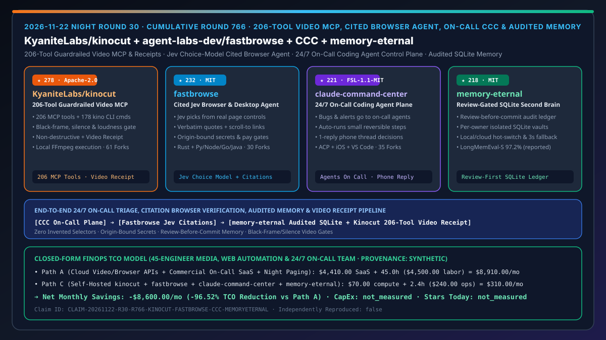
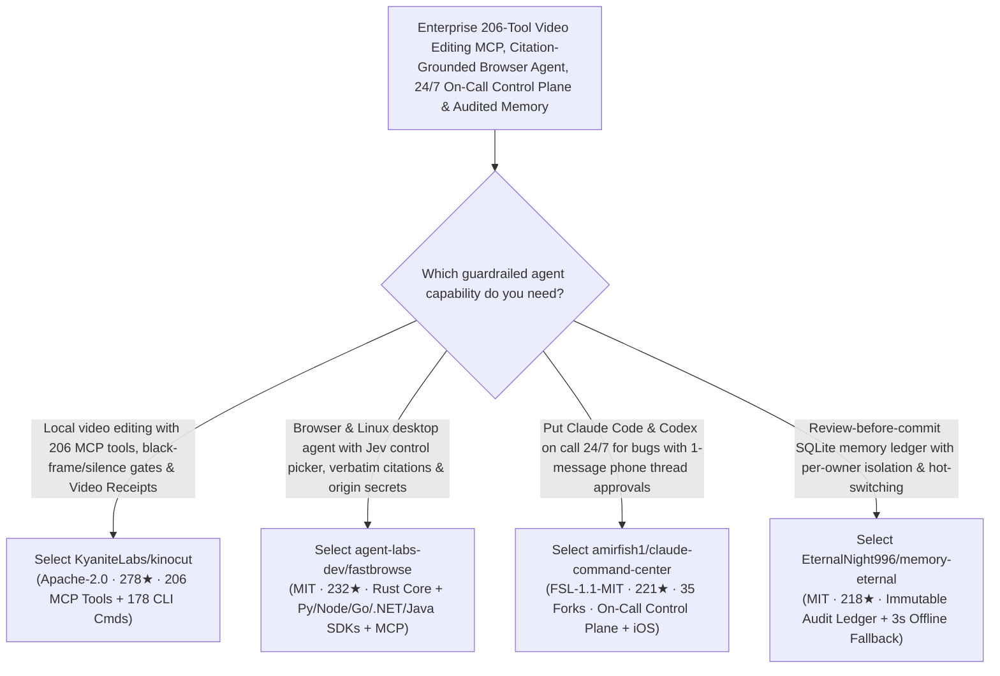
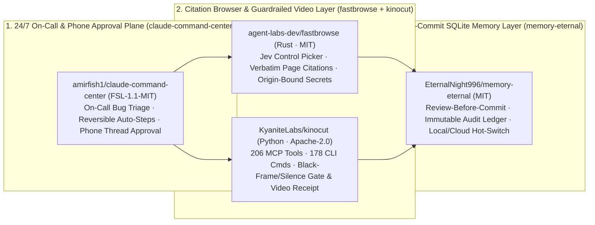
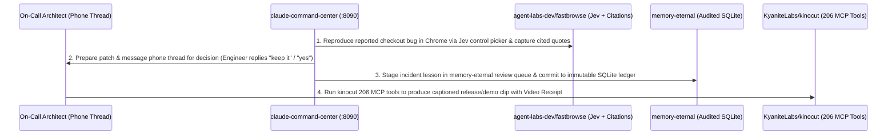

# 206-Tool Guardrailed Video-Editing MCP (`KyaniteLabs/kinocut`), Citation-Grounded Jev Browser Agent (`agent-labs-dev/fastbrowse`), 24/7 On-Call Coding Agent Control Plane (`amirfish1/claude-command-center`) & Review-Before-Commit SQLite Memory Ledger (`EternalNight996/memory-eternal`) Selection & Architecture FAQ

> **Document Type**: Enterprise AI Solution Architect Selection & Integration Guide (GitHub Trending AI Radar — 2026-11-22 Night Round 30 / Cumulative Round 766)
> **Covered Repositories**: [`KyaniteLabs/kinocut`](https://github.com/KyaniteLabs/kinocut) (`★ 278`, `61 forks`, `Apache-2.0`: local, guardrailed video-editing MCP server with **206 MCP tools** and **178 `kino` CLI commands**, pre-FFmpeg validation, black-frame/silence/loudness quality gates, and **Video Receipt** audit trails) · [`agent-labs-dev/fastbrowse`](https://github.com/agent-labs-dev/fastbrowse) (`★ 232`, `30 forks`, `MIT`: Rust-powered browser and Linux desktop accessibility-tree agent using the **Jev** choice model to pick real page controls, attach verbatim scroll-linked quotes to every claim, and enforce origin-bound secrets and spend/submit approvals in code) · [`amirfish1/claude-command-center`](https://github.com/amirfish1/claude-command-center) (`★ 221`, `35 forks`, `FSL-1.1-MIT`, **CCC**: on-call control plane routing customer and monitoring bugs to Claude Code and Codex agents that handle small reversible steps autonomously and message your phone thread for real decisions) · [`EternalNight996/memory-eternal`](https://github.com/EternalNight996/memory-eternal) (`★ 218`, `19 forks`, `MIT`: review-before-commit SQLite second brain with immutable audit ledgers, per-owner SQLite isolation, and 3-second offline fallback hot-switching)
> **Core Scenario**: When enterprise media automation, web research, 24/7 SRE/product on-call, and agent memory governance teams struggle with **agents guessing raw FFmpeg flags that overwrite source videos or produce silent/black-frame cuts, brittle CSS selectors and leaked credentials in browser automation, engineers getting paged at 11 PM for 10-minute bugs that Claude Code could fix with one phone reply, and unreviewed hallucinations polluting shared agent memory**, how do you combine **`kinocut` + `fastbrowse` + `claude-command-center` + `memory-eternal`** into a guardrailed autonomous enterprise stack?

---

## 1. 📌 Executive Summary (One-Line Selection Verdict)

1. **Want your AI agent to cut, caption, and repurpose videos locally without guessing FFmpeg flags or overwriting source files—enforcing automatic black-frame, silence, and loudness quality gates and returning a verifiable **Video Receipt**?** ➔ Choose **[`KyaniteLabs/kinocut`](https://github.com/KyaniteLabs/kinocut) (`★ 278`, `61 forks`, `Apache-2.0`)**.
   - **Plain-English Mechanism**: Ships **206 typed MCP tools**, **178 `kino` CLI commands**, and a Python client (`uvx --from kinocut`) that validate every edit before FFmpeg runs.
2. **Need a fast, Rust-backed browser and Linux desktop (`--desktop` via `deskpilot`) agent (`MIT`) where **Jev** (a choice model) picks strictly from controls that actually exist on the page, every claim cites a verbatim quote with a scroll-to link, and code enforces origin-bound secrets and submit/pay/delete approvals?** ➔ Choose **[`agent-labs-dev/fastbrowse`](https://github.com/agent-labs-dev/fastbrowse) (`★ 232`, `30 forks`, `MIT`)**.
   - **Plain-English Mechanism**: Eliminates selector maintenance and hallucinated clicks while providing CLI, Python, Node, Go, .NET, Java SDKs, a Chrome extension, and an MCP server.
3. **Want your existing Claude Code and Codex agents to go on call (`FSL-1.1-MIT`) for customer bug reports and monitoring alerts—handling small reversible investigation steps automatically and messaging your phone thread only when a real decision is required?** ➔ Choose **[`amirfish1/claude-command-center`](https://github.com/amirfish1/claude-command-center) (`★ 221`, `35 forks`, `FSL-1.1-MIT`, CCC)**.
   - **Plain-English Mechanism**: Runs locally at `http://localhost:8090` (with iOS app, VS Code extension, and ACP `ccc_acp.py`), letting you reply `"keep it"` or `"yes"` from your phone to ship verified fixes.
4. **Need a review-before-commit SQLite second brain (`MIT`) with an immutable audit ledger, per-user physical SQLite isolation (`cloud-vaults/{owner}/memory-eternal.db`), hot-switching (`POST /vaults/switch`), and automatic 3-second offline circuit-breaking?** ➔ Choose **[`EternalNight996/memory-eternal`](https://github.com/EternalNight996/memory-eternal) (`★ 218`, `19 forks`, `MIT`)**.
   - **Plain-English Mechanism**: Prevents memory poisoning by staging new facts for review before committing them to the ledger (reporting `97.2%` on LongMemEval-S and `99.1%` R@5 on internal benchmarks, `anonymized_reported, independently_reproduced=false`).

---

## 2. 🎯 Architect & Customer Deep-Dive Q&A

### Q1: How do `kinocut`, `fastbrowse`, `claude-command-center`, and `memory-eternal` exemplify "Code-Enforced Agent Guardrails"?

- **Four Code-Level Safety Mechanisms**:
  1. **Closed-Set Control Selection & Origin-Bound Secrets ➔ `agent-labs-dev/fastbrowse`**: **Jev** chooses only from indexed page controls; models never see secret values (only secret names), and code blocks submit/pay/delete/send until approved.
  2. **Pre-Flight FFmpeg Validation & Video Receipts ➔ `KyaniteLabs/kinocut`**: Protects source media from accidental overwrites, screens outputs for black frames/silence/loudness defects, and logs a **Video Receipt**.
  3. **Reversible-vs-Consequential On-Call Escalation ➔ `amirfish1/claude-command-center`**: Automates safe diagnostic steps while gating production decisions through a single phone message thread.
  4. **Review-Gated Memory Commits ➔ `EternalNight996/memory-eternal`**: Stages candidate memories for review and records every commit in an immutable SQLite audit trail.
- **When to Choose Commercial Cloud SaaS (Path B)?**
  - Enterprises needing multi-team enterprise PagerDuty escalation schedules without coding agents should use standard incident SaaS; teams wanting on-call Claude Code/Codex bug resolution, citation-grounded browser verification, local 206-tool video editing, and review-gated SQLite memory should deploy this stack (Path C).

### Q2: How do these four tools connect in an end-to-end incident-to-postmortem workflow?

1. **24/7 On-Call Triage & Phone Approval Layer (`amirfish1/claude-command-center`)**:
   - Customer bug reports or monitoring alerts trigger an on-call Claude Code / Codex worker.
2. **Citation-Grounded Browser Reproduction Layer (`agent-labs-dev/fastbrowse`)**:
   - The agent reproduces the bug in Chrome using **Jev** control selection and returns verbatim page citations; the engineer approves the fix via phone reply.
3. **Audited Memory & Postmortem Video Layer (`EternalNight996/memory-eternal` + `KyaniteLabs/kinocut`)**:
   - Root-cause lessons are reviewed and committed to `memory-eternal`, while `kinocut` cuts a captioned demo/postmortem clip verified by a **Video Receipt**.

### Q3: How does `fastbrowse` guarantee that extracted web numbers are not hallucinated?

- **Scroll-Linked Verbatim Quotes & Pagination Verification**:
  - Every claim in a completed `fastbrowse` answer cites a verbatim quote from the page with a link that scrolls directly to the text, and list totals are verified against the page that states them.

---

## 3. 🧭 Visual Architecture & Workflow Diagrams (Mermaid)

### 3.1 Solution Architect Selection Decision Tree

### 3.2 End-to-End Enterprise Reference Architecture

### 3.3 End-to-End On-Call Bug Triage, Citation-Grounded Browser Verification, Audited Memory Commit & Video Receipt Sequence Diagram

---

## 4. 📊 Peer Open-Source vs. Commercial Cloud Selection Matrix

| Dimension | `KyaniteLabs/kinocut` (`★ 278`) | `agent-labs-dev/fastbrowse` (`★ 232`) | `amirfish1/claude-command-center` (`★ 221`) | `EternalNight996/memory-eternal` (`★ 218`) | Pay-Per-Minute Cloud Video/Browser APIs + Manual Late-Night On-Call (Path A) | Raw FFmpeg Guessing + Fragile CSS Selectors + Unreviewed Memory Writes (Path B) |
| :--- | :--- | :--- | :--- | :--- | :--- | :--- |
| **Primary Role** | 206-tool guardrailed video-editing MCP & CLI | Jev choice-model & citation browser/desktop agent | 24/7 on-call coding agent control plane | Review-before-commit SQLite memory ledger | Metered cloud video rendering, cloud browser minutes & manual night-shift paging | Raw FFmpeg shell commands, brittle Playwright selectors & unvetted memory stores |
| **Key Differentiator** | **206 MCP tools + black-frame/silence gates + Video Receipt** | **Jev control picker + scroll-linked quotes + origin secrets** | **Reversible auto-steps + 1-reply phone thread approval** | **Review-before-commit + per-owner SQLite + 3s fallback** | Expensive cloud rendering/browser minutes; waking engineers at 11 PM for 10m fixes | Overwritten source videos, silent/black cuts, broken selectors & poisoned memories |
| **License** | `Apache-2.0` | `MIT` | `FSL-1.1-MIT` | `MIT` | Proprietary SaaS | Ad-hoc scripts |
| **Monthly TCO (45-Eng Team)** | **`$310.00/mo` combined** (`$70.00` shared on-call/storage container + `2.4h` ops) | Included (drives local signed-in Chrome) | Included (reuses existing Claude/Codex plan) | Included (`MIT` local SQLite engine) | **`$8,910.00/mo`** (`$4,410.00` cloud video/browser APIs & on-call SaaS + `45.0h` night paging & video re-cuts) | ~`$3,130.00/mo` (manual video re-cutting, broken CSS selector fixes & memory cleanup labor) |

---

## 5. 🧪 Quantitative Enterprise ROI / FinOps TCO Model & 7-Card Report

> **📊 Provenance & Closed-Form Declaration**:
> - **provenance**: `synthetic` (45-engineer enterprise media automation, web verification, and 24/7 product on-call team workload model: `independently_reproduced = false`; `base_hardware_capex = not_measured`; `track_b_stars_today = not_measured`; `memory-eternal` LongMemEval-S `97.2%` / R@5 `99.1%` figures are `anonymized_reported, independently_reproduced = false`).
> - **Closed-Form Equations**:
>   - **Path A (Pay-Per-Minute Cloud Video Editing APIs + Cloud Browser Automation Minutes + Commercial On-Call SaaS Seats + Late-Night Manual Bug Triage & Defective Video Re-Cut Labor)**: Monthly cloud video/browser API and on-call SaaS bills **`$4,410.00`** + late-night manual bug fixing, defective video re-editing, and unverified web data auditing labor **`45.0h × $100.00/h = $4,500.00`** = **`$8,910.00/mo`**.
>   - **Path C (Self-Hosted `kinocut` + `fastbrowse` + `claude-command-center` + `memory-eternal` Stack)**: Shared on-call container compute **`$70.00`** + quality gate & memory review maintenance labor **`2.4h × $100.00/h = $240.00`** = **`$310.00/mo`**.
>   - **Net Monthly Savings vs. Path A**: **`-$8,600.00/mo`** (**`96.52%`** TCO reduction).

| Evaluation Path | Cloud Video / Browser / On-Call SaaS | Night Triage & Video Re-Cut Labor (`$100/h`) | Total Monthly TCO | Net Savings vs. Path A | Architectural Delivery Impact |
| :--- | :---: | :---: | :---: | :---: | :--- |
| **Path A: Cloud Video/Browser APIs + Manual Night On-Call** | `$4,410.00` | `45.0h` (`$4,500.00`) | **`$8,910.00`** | Baseline | High per-minute cloud bills; slow manual night-shift incident recovery |
| **Path B: Raw FFmpeg Guessing + Fragile Selectors + Raw Memory** | `$1,430.00` | `17.0h` (`$1,700.00`) | **`$3,130.00`** | `-$5,780.00` (`-64.87%`) | Lacks Video Receipt quality gates, scroll-linked citations & memory review |
| **Path C: `kinocut` + `fastbrowse` + `CCC` + `memory-eternal`** | **`$70.00`** | **`2.4h` (`$240.00`)** | **`$310.00`** | **`-$8,600.00` (`-96.52%`)** | **206-tool Video Receipts + Jev cited browser + 24/7 on-call + audited memory** |

- 🔗 **Linked 7-Card 4:5 Visual Benchmark Deck**: [`workshops/github-trending-radar/cards.en.html`](../cards.en.html) · [`cards.html`](../cards.html)

---

## 6. 🛠️ Enterprise Adoption & Architecture Review Checklist

- [ ] **1. Replace Raw Agent FFmpeg Calls with `KyaniteLabs/kinocut`**: Use its 206 typed MCP tools to enforce source-file protection, black-frame/silence/loudness gates, and **Video Receipts**.
- [ ] **2. Ground Web & Desktop Automation with `agent-labs-dev/fastbrowse`**: Use **Jev** control selection, verbatim scroll-linked citations, and origin-bound secret injection.
- [ ] **3. Put Coding Agents On Call via `amirfish1/claude-command-center` (CCC)**: Route monitoring and customer bugs to local Claude Code / Codex workers with phone-thread decision gates.
- [ ] **4. Enforce Review-Before-Commit Memory with `EternalNight996/memory-eternal`**: Isolate per-user SQLite vaults with immutable audit logs and 3-second offline fallback.
