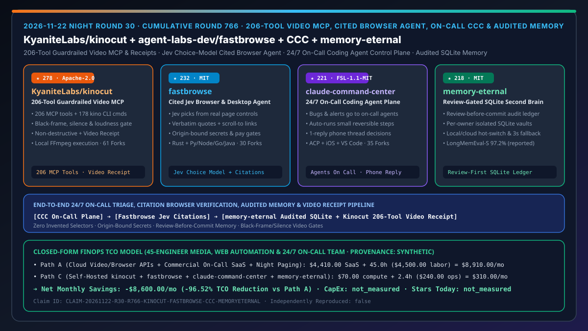
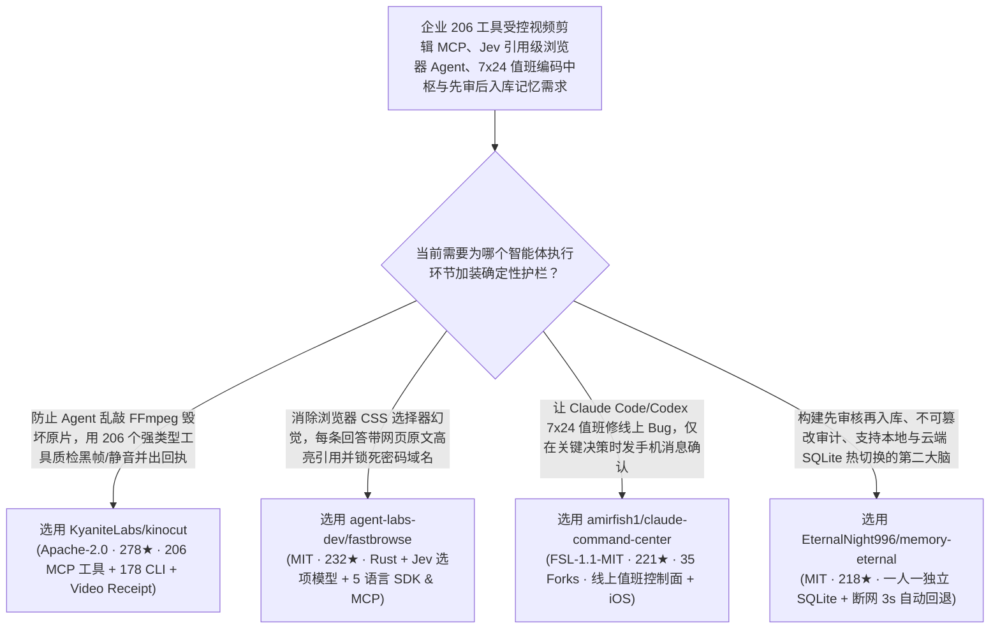
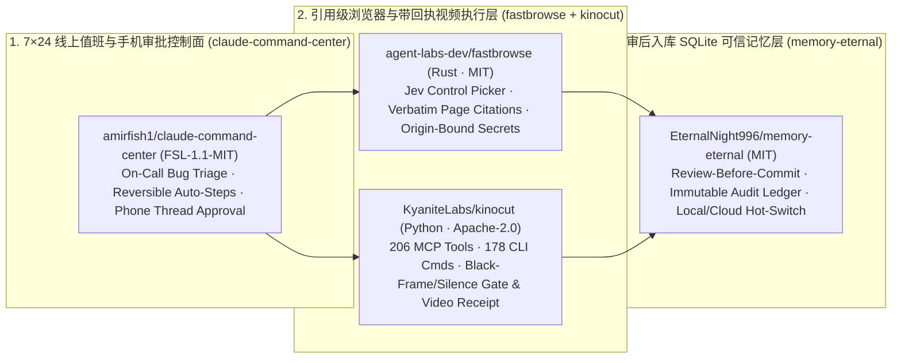
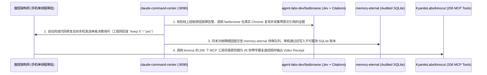

# 206 工具带回执护栏视频剪辑 MCP（`KyaniteLabs/kinocut`）、Jev 选项模型与原文引用浏览器/桌面 Agent（`agent-labs-dev/fastbrowse`）、7×24 线上故障值班编码中枢（`amirfish1/claude-command-center`）与先审后入库 SQLite 可信记忆账本（`EternalNight996/memory-eternal`）选型与集成架构 FAQ

> **文档类型**：企业 AI 解决方案架构师（AI Solution Architect）选型决策指南（GitHub Trending AI 雷达 2026-11-22 Night Round 30 / 累计第 766 轮）
> **覆盖项目**：[`KyaniteLabs/kinocut`](https://github.com/KyaniteLabs/kinocut)（`★ 278`、`61 forks`、`Apache-2.0`，含 **206 个 MCP 工具与 178 个 `kino` CLI 命令**的带护栏本地视频剪辑服务，执行前预检 FFmpeg 参数、拦截黑帧/静音/响度异常并输出 **Video Receipt** 审计回执）· [`agent-labs-dev/fastbrowse`](https://github.com/agent-labs-dev/fastbrowse)（`★ 232`、`30 forks`、`MIT`，基于 Rust 核心与 **Jev 选项模型**的零选择器幻觉浏览器与 Linux 桌面无障碍树 Agent，每条结论附带可跳转原文引用并由代码层锁死凭证域名与支付/删除审批）· [`amirfish1/claude-command-center`](https://github.com/amirfish1/claude-command-center)（`★ 221`、`35 forks`、`FSL-1.1-MIT`，“CCC”，让 Claude Code 与 Codex 替你 7×24 小时值班修线上 Bug 的控制面，小步可逆操作自主处理，仅在关键决策时发消息到你手机并在同一对话线程确认）· [`EternalNight996/memory-eternal`](https://github.com/EternalNight996/memory-eternal)（`★ 218`、`19 forks`、`MIT`，“先审核再入库 + 不可篡改审计账本”的本地/云端热切换 SQLite 记忆中枢，官方披露 LongMemEval-S `97.2%` / R@5 `99.1%`）
> **核心场景**：当企业全渠道内容生产、Web 自动化采集、夜间 SRE/研发值班与智能体记忆治理团队面临**“让大模型裸写 FFmpeg 剪视频经常覆盖原片或剪出黑屏静音废片、传统 Playwright/视觉浏览器 Agent 瞎编 CSS 选择器且填表密码容易跨站泄露、半夜 11 点线上小 Bug 必须把工程师叫醒开电脑跑 Claude Code、以及未审核的脏记忆直接写进知识库导致后续全盘污染”**四大痛点时，如何组合**`kinocut` + `fastbrowse` + `claude-command-center` + `memory-eternal`** 构建“有回执、有引用、可值班、先审后入库”的高可靠企业智能体体系？

---

## 一、📌 核心结论速览（选型一句话结论）

1. **想让 Claude Code、Cursor 或 Hermes 自动帮你把长访谈剪成带字幕的竖屏短视频，但绝不允许它瞎猜 FFmpeg 参数覆盖原片，且必须在交付前自动拦截黑帧（Black Frames）、静音段（Silence）与响度超标，并附上一份记录全过程的“视频回执（Video Receipt）”** ➔ 选 **[`KyaniteLabs/kinocut`](https://github.com/KyaniteLabs/kinocut)（`★ 278`，`61 forks`，`Apache-2.0`）**。
   - **通俗原理**：在本地提供多达 **206 个强类型 MCP 工具**与 **178 个 `kino` CLI 命令**，所有剪辑默认写入新文件并经过自动质量门禁（Quality Gates）检验，零云端上传与积分消耗。
2. **想给智能体配一个“绝不会点空、每句话都有网页原文高亮跳转链接、密码只允许填在声明域名上、且碰到提交/付款/删除自动停下等代码放行”的极速浏览器与桌面客户端 Agent** ➔ 选 **[`agent-labs-dev/fastbrowse`](https://github.com/agent-labs-dev/fastbrowse)（`★ 232`，`30 forks`，`MIT`）**。
   - **通俗原理**：用 Rust 将当前页面控件索引为候选项，由专门的 **Jev 选项模型（Choice Model）** 从真实存在的控件中做选择（彻底告别维护脆弱的 CSS/XPath 选择器），同时提供 Python/Node/Go/.NET/Java 多语言 SDK 与 Chrome 扩展。
3. **半夜 11 点客户报错或监控告警触发，想让待命的 Claude Code 或 Codex 智能体自动接单定位并修好 Bug——小步可逆操作自己做主，遇到真正需要拍板的选择只在手机线程里问你一句（比如你回一句 `keep it` 或 `yes` 就自动合并上线）** ➔ 选 **[`amirfish1/claude-command-center`](https://github.com/amirfish1/claude-command-center)（`★ 221`，`35 forks`，`FSL-1.1-MIT`）**。
   - **通俗原理**：把工单与监控告警接入本地 `:8090` 控制面（支持 ACP 协议、iOS App 与 VS Code 插件），真正实现“Your agents are on call. You are not.”。
4. **想给企业里的多个智能体装一个“先审核再入库、自带防篡改审计账本、支持本地与私有云端单用户独立 SQLite 库毫秒级热切换（`POST /vaults/switch`）、断网 3 秒自动熔断回退本地”的可信第二大脑** ➔ 选 **[`EternalNight996/memory-eternal`](https://github.com/EternalNight996/memory-eternal)（`★ 218`，`19 forks`，`MIT`）**。
   - **通俗原理**：支持一人一独立 SQLite 物理隔离（`cloud-vaults/{owner}/memory-eternal.db`）与分片断点续传，官方披露在 LongMemEval-S 达 `97.2%`、自建集 R@5 达 `99.1%`（`anonymized_reported, independently_reproduced=false`）。

---

## 二、🎯 客户与架构师灵魂拷问 Q&A（深度架构拆解）

### Q1：这四个项目为什么被称为“智能体确定性护栏（Deterministic Guardrails）四剑客”？

- **四大核心领域的确定性约束设计**：
  1. **网页与桌面操作护栏 ➔ `agent-labs-dev/fastbrowse`**：不让生成式模型自由编造选择器，而是让 **Jev** 在页面真实 ARIA 控件集中做闭集选择；凭证对模型只暴露变量名且锁死目标 Origin，付款/删除/发送由确定性代码拦截。
  2. **多媒体剪辑护栏 ➔ `KyaniteLabs/kinocut`**：用 206 个强类型 MCP 工具封装 FFmpeg，强制源片只读保护、黑帧/静音/LUFS 响度自动质检与 **Video Receipt** 变更回执。
  3. **夜间值班运维护栏 ➔ `amirfish1/claude-command-center`**：严格区分“可逆小步调查（自动放行）”与“关键业务决策（推送手机单线程审批）”。
  4. **长期记忆入库护栏 ➔ `EternalNight996/memory-eternal`**：引入“待审队列（Review-Before-Commit）”与不可篡改审计账本，杜绝脏数据污染长期记忆。
- **何时直接用商业云 SaaS 方案（Path B）？**
  - 若团队仅需简单的公有云 PagerDuty 电话呼叫人工值班，可沿用传统 SaaS；若希望由本地 Claude Code/Codex 接管初步线上 Bug 排障、用带原文引用的浏览器 Agent 核验业务流程、并在本地零成本完成受控视频剪辑与可信记忆管理，则采用本轮开源栈（Path C）。

### Q2：典型企业级“线上值班接单 (`CCC`) ➔ 浏览器带引用复现 (`fastbrowse`) ➔ 审核入库沉淀记忆 (`memory-eternal`) ➔ 自动生成复盘演示视频 (`kinocut`)”架构怎么搭？

1. **7×24 值班告警接入与手机审批层（`amirfish1/claude-command-center`）**：
   - 监控或客户报障进入 CCC（`:8090`），唤醒值班编码 Agent。
2. **真实 Chrome 复现与带原文引用验证层（`agent-labs-dev/fastbrowse`）**：
   - 值班 Agent 调用 `fastbrowse` 在真实浏览器中按 ARIA 控件复现问题并附带页面引用证明，修复后推送手机线程由工程师回复 `yes` 确认。
3. **经验审核入库与复盘视频自动剪辑层（`EternalNight996/memory-eternal` + `KyaniteLabs/kinocut`）**：
   - 排障经验经人工/规则审核写入 `memory-eternal` SQLite 账本；若需制作客户演示或复盘短视频，调用 `kinocut` 的 206 个 MCP 工具自动裁剪、加字幕并生成 **Video Receipt**。

### Q3：`fastbrowse` 是如何防止模型把企业登录密码或 API Key 填到钓鱼网站上的？

- **代码级 Origin 强绑定 + 模型零明文可见**：
  - 大模型在上下文中只能看到密钥的引用名称（Name），而底层的 Rust/代码执行器只有在当前浏览器页面域名与该密钥预声明的 Origin 100% 匹配时才会执行自动填充。

---

## 三、🧭 直观可视化图解（Mermaid 决策树 + 集成架构 + 时序图）

### 3.1 架构师选型决策树

### 3.2 企业端到端生产集成参考架构图

### 3.3 夜间故障接单、`fastbrowse` 引用级核验、`memory-eternal` 审核入库与 `kinocut` 演示剪辑时序图

---

## 四、📊 同类开源与商业云服务横向选型决策矩阵

| 对比维度 | `KyaniteLabs/kinocut` (`★ 278`) | `agent-labs-dev/fastbrowse` (`★ 232`) | `amirfish1/claude-command-center` (`★ 221`) | `EternalNight996/memory-eternal` (`★ 218`) | 商业云端剪辑 API + 商业云浏览器按分钟计费 + 夜间人工值班加班 (Path A) | 裸跑 FFmpeg 命令 + 脆弱 CSS 选择器脚本 + 未审核自动写记忆 (Path B) |
| :--- | :--- | :--- | :--- | :--- | :--- | :--- |
| **核心能力定位** | 206 工具带质量门禁与回执的视频剪辑 MCP | Jev 选项模型与原文引用浏览器/桌面 Agent | 7×24 线上 Bug 值班编码控制面 | 先审核再入库的 SQLite 可信记忆账本 | 按渲染分钟数和浏览器时长高额收费的云服务与高昂夜间人工值班成本 | 极易覆盖原片或剪出黑屏的裸脚本、频繁点空的爬虫与被污染的记忆库 |
| **核心技术突破** | **206 MCP 工具 + 黑帧/静音/响度门禁 + Video Receipt** | **Jev 闭集选控件零选择器维护 + 逐句原文跳转引用 + 锁域名密码** | **可逆操作自动做 + 关键决策手机单线程确认** | **先审后入库 + 一人一独立 SQLite + 本地/云端无刷热切** | 云端视频剪辑与云浏览器按量计费昂贵；半夜叫醒工程师恢复慢 | 裸写 FFmpeg 报错率高；未审核记忆一旦写入幻觉将长期毒害后续会话 |
| **开源协议** | `Apache-2.0` | `MIT` | `FSL-1.1-MIT` | `MIT` | 闭源商业 SaaS | 内部零散脚本 |
| **月度 TCO（45 人团队）** | **组合仅 `$310.00/月`**（`$70.00` 本地常驻值班与存储容器 + `2.4h` 维护） | 同左（直接驱动本地已登录 Chrome） | 同左（复用现有 Claude/Codex 订阅） | 同左（本地 SQLite 零月租） | **`$8,910.00/月`**（`$4,410.00` 云视频/云浏览器 API 与值班软件席位 + `45.0h` 夜间救火与重剪废片） | 约 `$3,130.00/月`（大量人工重剪黑屏静音视频、修补失效 CSS 选择器与清理脏记忆工时） |

---

## 五、🧪 应用落地定量收益/TCO 对比与 7-Card 报告

> **📊 数据来源与闭式核算声明（Provenance & Closed-Form Schema）**：
> - **provenance**: `synthetic`（基于 45 人企业全渠道内容工程、Web 自动化验证与 7×24 研发值班团队月度工作负载模型：`independently_reproduced = false`；硬件采购基线 `base_hardware_capex = not_measured`；Track B 单日增量 `track_b_stars_today = not_measured`；`memory-eternal` 披露的 LongMemEval-S `97.2%` / R@5 `99.1%` 归类为 `anonymized_reported, independently_reproduced = false`）。
> - **核算公式**：
>   - **Path A（采购按分钟计费的商业云端视频剪辑 API + 商业云端浏览器自动化时长包 + 商业 On-Call 告警席位 + 工程师夜间被叫醒手动修 Bug、重剪黑屏/静音废片与人工核查无引用网页采集结果人工）**：月度云端视频/浏览器 API 与值班软件账单 **`$4,410.00`** + 夜间人工排障、重剪废片与核实无出处采集数据人工 **`45.0h × $100.00/h = $4,500.00`** = **`$8,910.00/月`**。
>   - **Path C（自建 `kinocut` + `fastbrowse` + `claude-command-center` + `memory-eternal` 开源护栏栈）**：共享值班容器开销 **`$70.00`** + 质量门禁与记忆审核队列维护人工 **`2.4h × $100.00/h = $240.00`** = **`$310.00/月`**。
>   - **净节省（Net Savings vs Path A）**：**`-$8,600.00/月`**（成本降低 **`96.52%`**）。

| 评估方案 | 云视频/云浏览器/值班 SaaS 与算力 | 夜间救火与废片返工人工（`$100/h`） | 月度总 TCO | 相对 Path A 净节省 | 关键架构交付指标 |
| :--- | :---: | :---: | :---: | :---: | :--- |
| **Path A：商业云视频剪辑 API + 云浏览器 + 夜间人工值班** | `$4,410.00` | `45.0h` (`$4,500.00`) | **`$8,910.00`** | Baseline | 按分钟云 API 昂贵；半夜人工响应慢且容易剪出废片 |
| **Path B：裸写 FFmpeg + 脆弱 CSS 选择器 + 无审核记忆** | `$1,430.00` | `17.0h` (`$1,700.00`) | **`$3,130.00`** | `-$5,780.00` (`-64.87%`) | 缺少 Video Receipt 质检门禁、原文跳转引用与先审后入库账本 |
| **Path C：`kinocut` + `fastbrowse` + `CCC` + `memory-eternal`** | **`$70.00`** | **`2.4h` (`$240.00`)** | **`$310.00`** | **`-$8,600.00` (`-96.52%`)** | **206 工具视频回执 + Jev 引用级浏览器 + 7×24 值班 + 审核记忆** |

- 🔗 **关联 7-Card 4:5 视觉评测报告**：[`workshops/github-trending-radar/cards.html`](../cards.html) · [`cards.en.html`](../cards.en.html)

---

## 六、🛠️ 企业引入与架构评审 Checklist

- [ ] **1. 视频自动化接入 `KyaniteLabs/kinocut`**：严禁 Agent 直接裸调 FFmpeg 覆盖原片，统一走 206 个强类型 MCP 工具并核验黑帧/静音门禁与 **Video Receipt**。
- [ ] **2. 浏览器与桌面采集切换至 `agent-labs-dev/fastbrowse`**：利用 Jev 选项模型消除 CSS 选择器维护负担，强制开启密钥 Origin 绑定与支付/删除动作拦截。
- [ ] **3. 开启 `amirfish1/claude-command-center` (CCC) 夜间值班辅助**：将线上告警接入本地 Claude Code / Codex 值班队列，通过手机线程审批关键变更。
- [ ] **4. 部署 `EternalNight996/memory-eternal` 治理智能体长期记忆**：启用“先审核再入库”机制与单用户独立 SQLite 物理隔离。
