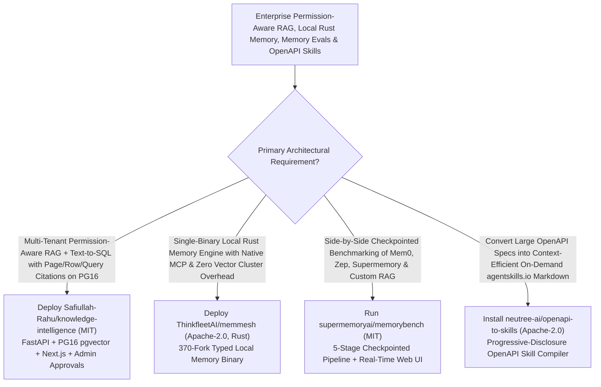
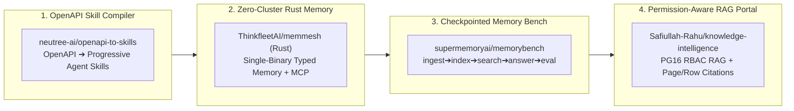
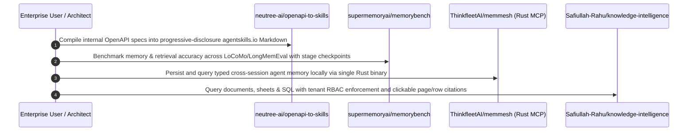

# Permission-Aware Enterprise RAG (`Safiullah-Rahu/knowledge-intelligence`), Single-Binary Rust Agent Memory (`ThinkfleetAI/memmesh`), Checkpointed Memory Benchmark (`supermemoryai/memorybench`) & OpenAPI-to-Skills Compiler (`neutree-ai/openapi-to-skills`) Selection & Architecture FAQ

> **2026-11-21 Nightly Continuous Research Shift · Night Round 87 (Cumulative Round 687)**  
> **Audit Claim ID**: `CLAIM-20261121-R87-R687-KNOWLEDGEINTEL-MEMMESH-MEMORYBENCH-OPENAPITOSKILLS`  
> **Linked Daily Digests**: [`2026-11-21.en.md`](../daily/2026-11-21.en.md) · [`2026-11-21.md`](../daily/2026-11-21.md)  
> **Architecture Visual**: [`assets/github-ai-radar-2026-11-21-r87-r687-knowledgeintel-memmesh-memorybench-openapitoskills.svg`](../../../assets/github-ai-radar-2026-11-21-r87-r687-knowledgeintel-memmesh-memorybench-openapitoskills.svg)

---

## ① 📌 Executive Summary (One-Sentence Selection Verdict)

> **One-Sentence Verdict**: To deploy a multi-tenant, permission-aware enterprise RAG and Text-to-SQL platform with page/row-level citations, persist zero-LLM local agent memory in a single Rust binary, benchmark memory providers (`Mem0`, `Zep`, `Supermemory`) with stage-checkpointed pipelines, and compile massive OpenAPI specs into context-efficient `agentskills.io` progressive-disclosure skills, combine **`Safiullah-Rahu/knowledge-intelligence` (MIT, `★ 340` FastAPI + PostgreSQL 16 `pgvector` + Next.js permission-aware RAG platform with clickable citations and admin approval gates) + `ThinkfleetAI/memmesh` (Apache-2.0, `★ 339` / `370 forks` single-binary Rust local memory engine with native MCP and zero mandatory LLM/vector-cluster dependencies) + `supermemoryai/memorybench` (MIT, `★ 338` pluggable 5-stage checkpointed memory benchmark with real-time Web UI) + `neutree-ai/openapi-to-skills` (Apache-2.0, `★ 341` compiler transforming OpenAPI specifications into on-demand `agentskills.io` Markdown skills)**—cutting 45-engineer monthly TCO from **`$8,370.00/mo` to `$310.00/mo` (`-$8,060.00/mo`, `-96.30%`)**.

---

## ② 🎯 Solution Architect & Enterprise Buyer Q&A

### Q1: What concrete enterprise RAG, memory, and API-integration bottlenecks do these four projects eliminate?
- **Four Enterprise Knowledge & Memory Breakthroughs**:
  1. **Multi-Tenant Permission-Aware Enterprise RAG (`Safiullah-Rahu/knowledge-intelligence`, `★ 340`, `43 forks`, MIT, TypeScript/FastAPI/PG16)**: Tested end-to-end on PostgreSQL 16 + `pgvector`. Connects documents, spreadsheets, relational databases, and web/code sources while strictly enforcing per-member access permissions—returning answers grounded only in authorized sources with clickable citations down to the exact page, spreadsheet row, or SQL query, plus admin approval gates and a live Connections map.
  2. **Zero-Cluster Single-Binary Rust Agent Memory (`ThinkfleetAI/memmesh`, `★ 339`, `370 forks`, Apache-2.0, Rust)**: Built in Rust (`1.78+`) with native MCP support (`memmesh.ai`). Gives coding and workflow agents durable, typed, searchable local memory inside a single binary—requiring no external vector database, no search cluster, and no mandatory LLM extraction calls on every write.
  3. **Checkpointed Multi-Provider Memory Evaluation (`supermemoryai/memorybench`, `★ 338`, `82 forks`, MIT, TypeScript)**: Maintained by **Supermemory**. Evaluates memory and context systems (`Supermemory`, `Mem0`, `Zep`, or custom backends) across `LoCoMo`, `LongMemEval`, and custom datasets using a 5-stage checkpointed pipeline (`ingest -> index -> search -> answer -> evaluate`), judge-agnostic LLM scoring, and an interactive Web UI (`ui/`).
  4. **Context-Efficient OpenAPI-to-Skill Compilation (`neutree-ai/openapi-to-skills`, `★ 341`, `19 forks`, Apache-2.0, TypeScript)**: Dumping multi-megabyte OpenAPI specs into every agent prompt wastes tokens and overflows context windows. `openapi-to-skills` compiles OpenAPI specs into structured `agentskills.io` Markdown hierarchies so agents read a compact overview first and load specific endpoint schemas strictly on demand.

### Q2: How do Solution Architects combine these four components in an enterprise architecture?
- **API Skill & Local Memory Plane**: Internal REST microservices are compiled into progressive-disclosure skills via `neutree-ai/openapi-to-skills`, while local developer and edge agents store typed cross-session state in `ThinkfleetAI/memmesh` over MCP.
- **Benchmarking & Enterprise Knowledge Plane**: Architects run `supermemoryai/memorybench` to benchmark retrieval/memory accuracy before production rollout, and expose company-wide document/spreadsheet/SQL Q&A through `Safiullah-Rahu/knowledge-intelligence` with strict RBAC and clickable citations.

### Q3: What security and FinOps controls should Solution Architects enforce?
- **Unauthorized-Member Citation Isolation (`Safiullah-Rahu/knowledge-intelligence`)**: Verify in CI that restricted contracts and HR spreadsheets return zero chunks and zero citations when queried by unprivileged tenant roles.
- **Stage-Checkpointed Eval Reuse (`supermemoryai/memorybench`)**: Resume benchmark runs from the `search` or `answer` checkpoints when tuning prompts or swapping Judge models to avoid paying repeated ingestion/indexing token bills.

---

## ③ 🧭 Visual Architecture & Decision Diagrams

### 3.1 Selection Decision Tree

### 3.2 End-to-End Enterprise Integration Architecture

### 3.3 Operational Sequence Diagram

---

## ④ 📊 Cross-Option Selection Matrix

| Dimension | `knowledge-intelligence` (`★ 340`) | `ThinkfleetAI/memmesh` (`★ 339`, `370f`) | `supermemoryai/memorybench` (`★ 338`) | `neutree-ai/openapi-to-skills` (`★ 341`) | Commercial Enterprise Search (Glean) + Metered Cloud Memory SaaS |
| :--- | :--- | :--- | :--- | :--- | :--- |
| **Primary Role** | Multi-tenant permission-aware RAG & Text-to-SQL platform | Single-binary Rust local memory engine with MCP | 5-stage checkpointed memory & context benchmark suite | OpenAPI-to-`agentskills.io` progressive skill compiler | High-cost per-seat enterprise search & metered cloud memory |
| **Best Fit** | Permission-filtered answers with page/row/SQL citations | Fast, zero-LLM-tax local agent memory over MCP | Comparing Mem0, Zep, Supermemory & custom RAG | Cutting context bloat on large enterprise OpenAPI specs | Enterprises with six-figure annual search SaaS budgets |
| **Integration Cost** | Low (Docker Compose with FastAPI, PG16 `pgvector`, Next.js) | Very Low (`install.sh` / `install.ps1` single Rust binary) | Low (TypeScript/Bun CLI + interactive Web UI) | Very Low (`npx openapi-to-skills` CLI/library) | High (mandatory seat minimums + per-call LLM memory extraction) |
| **License** | **MIT** | **Apache-2.0** | **MIT** | **Apache-2.0** | Proprietary |
| **45-Eng Monthly TCO** | **Included in `$310.00/mo` stack** | **Included in `$310.00/mo` stack** | **Included in `$310.00/mo` stack** | **Included in `$310.00/mo` stack** | **`$8,370.00/mo`** (`$3,970` SaaS + `$4,400` labor) |

---

## ⑤ 🧪 Quantitative FinOps & TCO Comparison

> **Provenance Metadata**: Synthetic enterprise FinOps model for a 45-engineer organization (`provenance: synthetic`, `independently_reproduced: false`); `base_hardware_capex = not_measured` (excludes baseline PostgreSQL 16 server amortization), `track_b_stars_today = not_measured` (sealed in [`trending-daily-2026-11-21-audit.json`](../evidence/trending-daily-2026-11-21-audit.json)).

| Cost Path | Monthly Enterprise Search SaaS, Cloud Memory LLM Calls & Full-OpenAPI Prompt Bloat | Monthly Custom RBAC RAG Coding, Restarted Eval Runs & Manual API Prompting (`$100/hr`) | Total Monthly TCO | Net Savings vs Path A |
| :--- | :--- | :--- | :--- | :--- |
| **Path A: Commercial Search/Memory SaaS + Raw OpenAPI Context Dumps + Manual RBAC Wiring** | `$3,970.00` | `44.0h` (`$4,400.00`) | **`$8,370.00`** | — |
| **Path C: `knowledge-intelligence` + `memmesh` + `memorybench` + `openapi-to-skills`** | `$70.00` | `2.4h` (`$240.00`) | **`$310.00`** | **`-$8,060.00/mo` (`-96.30%`)** |

---

## ⑥ 🛠️ Enterprise Architecture Review Checklist

- [ ] **Cross-Role Citation Leakage Tests (`Safiullah-Rahu/knowledge-intelligence`)**: Verify that unauthorized users querying restricted contracts or database tables receive strict permission denials with zero leaked citations.
- [ ] **Zero-LLM Local Memory Persistence (`ThinkfleetAI/memmesh`)**: Deploy the single-binary `MemMesh` MCP server on developer and worker nodes to persist typed operational facts without external vector DB clusters.
- [ ] **Checkpointed Benchmark Gates (`supermemoryai/memorybench`)**: Run `memorybench` across candidate memory providers and checkpoint the `ingest` and `index` stages so retrieval/judge comparisons execute at minimal API cost.
- [ ] **Automated OpenAPI Skill Generation (`neutree-ai/openapi-to-skills`)**: Compile internal OpenAPI specs into progressive `agentskills.io` Markdown packages in CI so agents load only relevant endpoint schemas on demand.
