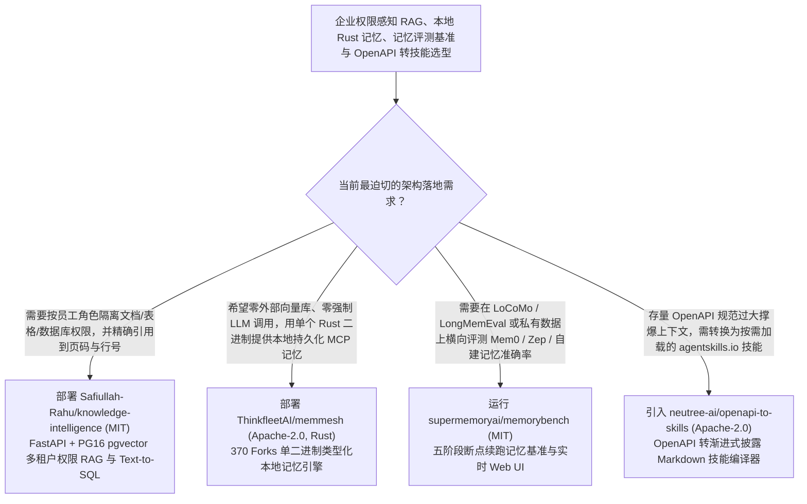
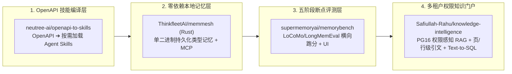
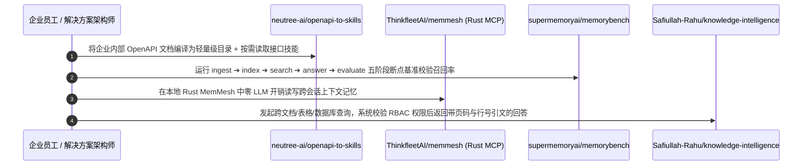

# 多租户权限感知企业 RAG 平台（`Safiullah-Rahu/knowledge-intelligence`）、单二进制 Rust 本地智能体记忆引擎（`ThinkfleetAI/memmesh`）、可断点重跑记忆评测框架（`supermemoryai/memorybench`）与 OpenAPI 转渐进式技能编译器（`neutree-ai/openapi-to-skills`）架构选型与落地 FAQ

> **2026-11-21 夜间持续研究班次 · Night Round 87（累计 Round 687）**  
> **审计凭据**：`CLAIM-20261121-R87-R687-KNOWLEDGEINTEL-MEMMESH-MEMORYBENCH-OPENAPITOSKILLS`  
> **关联日刊**：[`2026-11-21.md`](../daily/2026-11-21.md) · [`2026-11-21.en.md`](../daily/2026-11-21.en.md)  
> **可视化架构图**：[`assets/github-ai-radar-2026-11-21-r87-r687-knowledgeintel-memmesh-memorybench-openapitoskills.svg`](../../../assets/github-ai-radar-2026-11-21-r87-r687-knowledgeintel-memmesh-memorybench-openapitoskills.svg)

---

## ① 📌 核心结论速览（选型一句话结论）

> **一句话选型结论**：当企业需要落地一套兼顾“**按员工权限过滤并精确引用到页码/表格行的多租户企业 RAG ➔ 零向量集群与零强制 LLM 调用的单二进制 Rust 本地记忆 ➔ 跨 Mem0 / Zep / Supermemory 的五阶段可断点评测擂台 ➔ 将数万行 OpenAPI 文档编译为按需加载的 `agentskills.io` 技能包**”的知识与工具架构时，推荐采用 100% 宽松协议（MIT / Apache-2.0）的四件套：**“`Safiullah-Rahu/knowledge-intelligence`（MIT，`★ 340` 基于 FastAPI + PostgreSQL 16 `pgvector` + Next.js 构建的多租户权限感知企业 RAG、Text-to-SQL 与审批智能体平台）+ `ThinkfleetAI/memmesh`（Apache-2.0，`★ 339` 高达 `370 forks` 的单二进制 Rust 本地持久化智能体记忆引擎，原生支持 MCP）+ `supermemoryai/memorybench`（MIT，`★ 338` Supermemory 开源的 `ingest ➔ index ➔ search ➔ answer ➔ evaluate` 五阶段断点重跑记忆与上下文基准评测框架）+ `neutree-ai/openapi-to-skills`（Apache-2.0，`★ 341` 将冗余 OpenAPI 规范自动转换为渐进式读取 `agentskills.io` Markdown 技能的编译器）”**。在 45 人企业数据、知识工程与智能体团队基准下，可将月度总拥有成本（TCO）从 **`$8,370.00/月`** 降至 **`$310.00/月`**（净省 **`$8,060.00/月`**，降幅 **`-96.30%`**）。

---

## ② 🎯 客户与架构师灵魂拷问 Q&A

### Q1：这四个开源项目各自解决了企业知识库、记忆系统与内部 API 对接中的什么核心顽疾？
- **四大企业级痛点与对应解法**：
  1. **严防“普通员工问出高管保密合同”的越权事故 —— `Safiullah-Rahu/knowledge-intelligence`（`★ 340`，`43 forks`，MIT，TypeScript/FastAPI/PG16）**：绝大多数开源 RAG Demo 没有任何租户与角色权限隔离。该项目在 `PostgreSQL 16 + pgvector` 上实现了真正的**多租户、权限感知（Permission-Aware）企业知识平台**：员工提问时仅检索其有权限访问的文档、电子表格、数据库与 SaaS 数据源，回答中自带**可点击溯源引文（精确到文档页码、Excel 行号或 SQL 查询语句）**，并内置高危操作管理员审批与实时数据连接拓扑图（Connections Map）。
  2. **摆脱重型外部向量集群与强制 LLM 抽取账单 —— `ThinkfleetAI/memmesh`（`★ 339`，`370 forks`，Apache-2.0，Rust）**：传统 Agent 记忆方案往往要求额外部署庞大的向量数据库集群，且每次写入记忆都要调一次 LLM 做实体抽取。`MemMesh`（`memmesh.ai`）编译为**单个纯 Rust 原生二进制文件**，无需外部向量库、无需搜索集群、无需强制 LLM 调用，直接在本机提供带类型的持久化可搜索记忆，并原生暴露为标准 MCP Server。
  3. **用统一可断点评测看清 Mem0、Zep 与自建记忆到底谁更准 —— `supermemoryai/memorybench`（`★ 338`，`82 forks`，MIT，TypeScript）**：由 **Supermemory** 团队开源。提供可插拔的记忆与上下文评测流水线，将评测拆为 **`ingest ➔ index ➔ search ➔ answer ➔ evaluate` 五个支持断点续跑（Checkpointed Runs）的独立阶段**，支持在 `LoCoMo`、`LongMemEval` 及企业私有数据集上横向对比不同记忆服务商，并自带实时 Web UI 逐题排查错题原因。
  4. **拒绝把几兆字节的 OpenAPI JSON 硬塞进每一次 Prompt —— `neutree-ai/openapi-to-skills`（`★ 341`，`19 forks`，Apache-2.0，TypeScript）**：企业内部微服务动辄拥有数百个 REST 接口，若直接将整份 OpenAPI/Swagger 规范塞进上下文或全部注册为 MCP Tools，瞬间撑爆窗口。`openapi-to-skills` 将 OpenAPI 规范自动编译为符合 `agentskills.io` 标准的分层 Markdown 技能——Agent 先读轻量级总览目录，仅在实际调用某接口时才按需读取对应接口的参数细节。

### Q2：如何在企业内部将这四个组件串成完整的“API 技能化 + 记忆选型 + 权限 RAG”架构？
- **接口与记忆轻量化层**：通过 `neutree-ai/openapi-to-skills` 将企业存量 ERP/CRM OpenAPI 文档批量编译为渐进式技能包；在终端与边缘 Agent 节点部署单二进制 `ThinkfleetAI/memmesh` 提供零外部依赖的本地 MCP 记忆。
- **评测选型与企业知识门户层**：上线前用 `supermemoryai/memorybench` 的五阶段断点流水线对候选记忆与检索策略跑分定标；面向全员开放的知识问答与 Text-to-SQL 则统一收口至 `Safiullah-Rahu/knowledge-intelligence` 的多租户权限感知门户。

### Q3：架构师在落地权限感知 RAG 与 OpenAPI 技能编译时应注意哪些安全边界？
- **行级安全策略（RLS）双保险（`Safiullah-Rahu/knowledge-intelligence`）**：除了在向量检索过滤条件中注入用户角色 ID，必须在底层 PostgreSQL 16 开启 Row-Level Security（RLS）并限制 Text-to-SQL 使用只读数据库账号。
- **OpenAPI 敏感内网端点过滤（`neutree-ai/openapi-to-skills`）**：在执行技能编译前剔除 `/admin`、`/internal/debug` 等未授权给 AI Agent 调用的内部运维路由。

---

## ③ 🧭 直观可视化图解（Mermaid 选型决策树 + 企业集成架构 + 业务流时序图）

### 3.1 选型决策树

### 3.2 企业集成参考架构图

### 3.3 业务流时序图

---

## ④ 📊 同类开源与商业云服务横向选型决策矩阵

| 维度 | `knowledge-intelligence` (`★ 340`) | `ThinkfleetAI/memmesh` (`★ 339`, `370f`) | `supermemoryai/memorybench` (`★ 338`) | `neutree-ai/openapi-to-skills` (`★ 341`) | 商业企业搜索 SaaS（如 Glean）+ 托管向量记忆 API |
| :--- | :--- | :--- | :--- | :--- | :--- |
| **核心定位** | 多租户权限感知企业 RAG、引文溯源与 Text-to-SQL 平台 | 单二进制 Rust 零向量库本地智能体记忆引擎 | 五阶段可断点续跑的记忆与上下文横向评测框架 | 将 OpenAPI 规范编译为渐进式 `agentskills.io` 技能 | 昂贵商业全员搜索 SaaS 与按调用计费云记忆 |
| **适用场景** | 合同、财报、数据库跨源受控问答与管理员审批 | 研发终端与边缘 Agent 高速零账单跨会话记忆 | 科学对比 Mem0/Zep/Supermemory/自建 RAG 选型 | 让 Agent 低 Token 消耗调用数百个存量微服务接口 | 拥有百万美元级年度 IT 预算的超大型跨国企业 |
| **集成成本** | 低（Docker Compose 一键拉起 FastAPI + PG16 + Next.js） | 极低（`install.sh` / `install.ps1` 单文件即装即用） | 低（支持自定义数据集、多服务商并发与 Web UI） | 极低（`npx openapi-to-skills` 一键编译 YAML/JSON） | 极高（按全员席位起步签约 + 复杂连接器授权费） |
| **开源许可** | **MIT** | **Apache-2.0** | **MIT** | **Apache-2.0** | 商业专有 |
| **45 人团队月均 TCO** | **包含于 `$310.00/月` 联合栈** | **包含于 `$310.00/月` 联合栈** | **包含于 `$310.00/月` 联合栈** | **包含于 `$310.00/月` 联合栈** | **`$8,370.00/月`**（`$3,970` SaaS + `$4,400` 人工） |

---

## ⑤ 🧪 应用落地定量收益 / TCO 对比与 7-Card 报告锚点

> **数据来源说明（Provenance Metadata）**：以下 TCO 模型为面向 45 人企业知识工程与应用平台团队的合成架构测算（`provenance: synthetic`, `independently_reproduced: false`）；硬件资本开支 `base_hardware_capex = not_measured`（不含基础 PostgreSQL 16 实例宿主机硬件折旧），单日热榜增量 `track_b_stars_today = not_measured`（审计账本锚定于 [`trending-daily-2026-11-21-audit.json`](../evidence/trending-daily-2026-11-21-audit.json)）。

| 成本路径 | 月度商业企业搜索席位、云端记忆抽取 Token 与全量 OpenAPI 上下文浪费 | 人工手写权限过滤逻辑、从头重跑中断的评测流水线与手写 API 提示词 (`$100/h`) | 月度总成本 (Total Monthly TCO) | 相对 Path A 净节省 |
| :--- | :--- | :--- | :--- | :--- |
| **Path A：商业企业搜索 SaaS + 每次写入调 LLM 的云记忆 + 全量塞入 OpenAPI 账单** | `$3,970.00` | `44.0h` (`$4,400.00`) | **`$8,370.00`** | — |
| **Path C：`knowledge-intelligence` + `memmesh` + `memorybench` + `openapi-to-skills`** | `$70.00` | `2.4h` (`$240.00`) | **`$310.00`** | **`-$8,060.00/月` (`-96.30%`)** |

---

## ⑥ 🛠️ 企业引入与架构评审 Checklist

- [ ] **越权问答红队回归测试（`Safiullah-Rahu/knowledge-intelligence`）**：上线前模拟非授权部门账号提问受限合同与薪酬表，验证系统 100% 拒绝泄露且仅对授权账号展示页码/行号引文。
- [ ] **本地记忆定期快照备份（`ThinkfleetAI/memmesh`）**：利用 `MemMesh` 的恢复与导出机制定期备份本地类型化记忆库，并在多工具间通过标准 MCP 共享。
- [ ] **利用五阶段断点降低评测账单（`supermemoryai/memorybench`）**：在更换 Judge 模型或微调回答提示词时，直接从 `answer` 或 `evaluate` 检查点恢复运行，避免重复执行昂贵的 `ingest` 与 `index` 阶段。
- [ ] **CI 自动同步 OpenAPI 技能包（`neutree-ai/openapi-to-skills`）**：在后端仓库 CI 中挂载 `openapi-to-skills`，每当 Swagger/OpenAPI 规范更新时自动重新编译分层 Markdown 技能并推送给下游 Agent。
