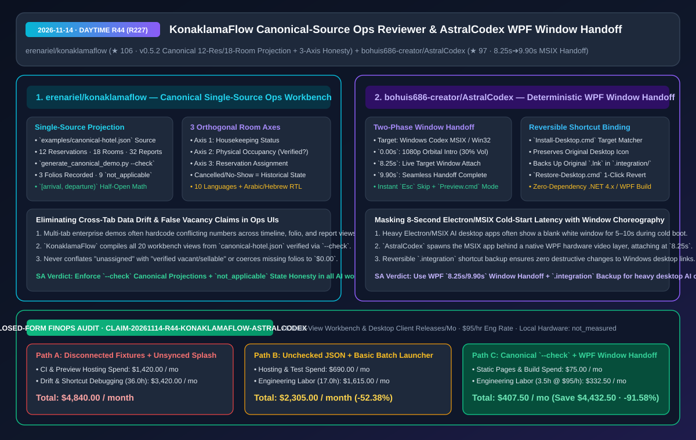
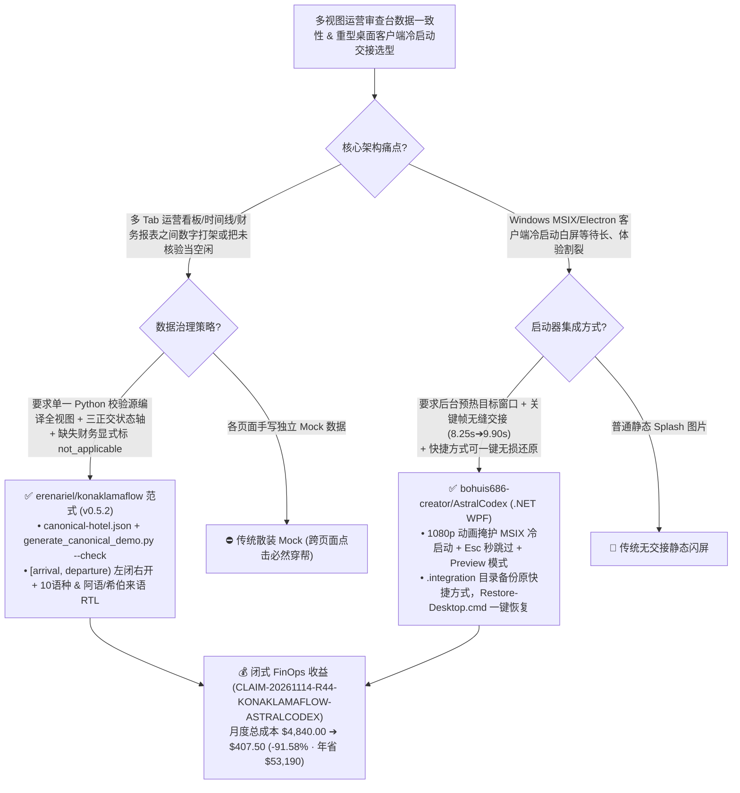

# 单一事实源投影与三轴状态诚实性运营审查台（`KonaklamaFlow`）及 MSIX 桌面应用双阶段窗口交接启动器（`AstralCodex`）深度架构拆解与选型 FAQ

> **文档元数据（2026-11-14 · 白班 Round 44 / 累计 Round 227）**  
> - **对标范式**：`ib-vs-ethernet-roce-selection-faq.md`（第一性原理 + 大白话拆解 + 灵魂三问 + Mermaid 决策树 + 闭式 FinOps 核算）  
> - **核心评估对象**：  
>   1. [`erenariel/konaklamaflow`](https://github.com/erenariel/konaklamaflow)（`★ 106`，`v0.5.2 Orbit Command` 隐私优先的酒店预订运营前置审查工作台：通过单一 Python 校验源 `examples/canonical-hotel.json` 与 `python scripts/generate_canonical_demo.py --check` 驱动 20 个工作台模块与 32 类报表，严格采用 `[arrival, departure)` 左闭右开区间、分离**客房清洁/物理入住/排房分配**三正交轴，并对无流水账单诚实标注 `not_applicable`）  
>   2. [`bohuis686-creator/AstralCodex`](https://github.com/bohuis686-creator/AstralCodex)（`★ 97`，星澜 `Astral Codex`：基于 .NET WPF 的 Windows Codex MSIX/Win32 动态开场与确定性窗口交接启动器，在播放 1080p 动画的同时后台拉起目标进程，于 **`8.25s` 接入真实窗口、`9.90s` 完成无缝交接**，并通过 `.integration/` 目录实现桌面快捷方式无损备份与一键还原）  
> - **配套架构图**：[`assets/github-ai-radar-2026-11-14-r44-konaklamaflow-astralcodex.svg`](../../../assets/github-ai-radar-2026-11-14-r44-konaklamaflow-astralcodex.svg)  
> - **审计契约号**：`CLAIM-20261114-R44-KONAKLAMAFLOW-ASTRALCODEX`（本地客户端工作站硬件功耗标注为 `not_measured`）

---

## 📌 一、核心结论速览（Executive Summary：3 分钟读懂本质）

1. **为什么很多企业级 AI 运营工作台（Workbench）在跨 Tab 点击时经常出现“首页显示 12 单、点进财务报表变 15 单、未排房被当成可售空房”的低级事故？`erenariel/konaklamaflow` 怎么根治？**  
   - **通俗大白话**：做复杂业务系统的 AI 辅助审查台（比如酒店前台、医疗排班或供应链看板）时，前后端和 Demo 最容易腐烂的地方有两个：① 概览页、甘特图时间线、账单页和报表页各自手写了一套 Mock JSON，改了一处忘了改另一处，用户在时间线上点一张订单跳到财务页直接对不上号；② 状态建模极其粗糙——把“还没分配预订（Unassigned）”直接等同于“物理空置可售（Verified Vacant/Sellable）”，或者把“没有财务记录”强行塞成 `$0.00`！  
   - **`KonaklamaFlow` (`v0.5.2 Orbit Command`) 的第一性原理破局**：
     - **单一事实源投影 + `--check` CI 门禁（`examples/canonical-hotel.json`）**：全系统 20 个交互视图、7/14/21 天 Aurora 预订时间线、AI 审查卡片、账单与 32 项报表，100% 由同一份经 Python Schema 校验的 `canonical-hotel.json`（12 笔预订、18 间客房）编译生成，并通过 `python scripts/generate_canonical_demo.py --check` 锁死一致性；
     - **三正交轴建模与 `not_applicable` 财务诚实性**：将房间状态严格拆解为 **清洁轴（Housekeeping）、物理入住轴（Physical Occupancy）与预订排房轴（Assignment）** 三条独立维度——没有实际入住证据时，绝不把未排房房间妄称为“已核验空房”；12 笔预订中只有 3 笔显式定义了虚构财务流水，其余 9 笔严格渲染为 **`not_applicable`**（绝不静默伪造为 `0`），退房日严格遵循 **`[arrival, departure)` 左闭右开区间**！
2. **为什么重型桌面 AI 客户端（如 Electron / MSIX 封装的 Windows Codex）冷启动总是黑屏/白屏卡顿好几秒？`bohuis686-creator/AstralCodex` 的“8.25s 捕获 -> 9.90s 窗口交接”怎么化解？**  
   - **通俗大白话**：在 Windows 上点开基于 Electron 或 MSIX 容器打包的 AI 编程客户端，往往要先盯着用时 5–10 秒的空白边框或生硬闪屏，体验非常割裂；如果自己写个普通批处理启动动画，动画播完了主程序还没出来，或者主程序早就弹在动画前面把动画挡住了！  
   - **`AstralCodex`（星澜）的第一性原理破局**：用零第三方依赖的 **.NET Framework 4.x / WPF** 打造了一个可复用的**“窗口编排与平滑交接启动器（Window-Handoff Launcher）”**：
     - **双阶段精确时间轴交接（`8.25s` 挂载 -> `9.90s` 交接）**：点击启动后，WPF 层立即播放 1080p 全息指挥舱开场动画（默认安全音量 `30%`，支持 `Esc` 随时跳过）并在后台异步唤醒 MSIX Codex 进程；在 **`8.25 秒`** 全息屏幕展开的瞬间精准捕获并接入已就绪的真实 Codex 窗口句柄，于 **`9.90 秒`** 完成视觉无缝交接后自动销毁启动器进程（还提供不启动主程序的独立 `Preview.cmd` 预览模式）；
     - **`.integration/` 无损快捷方式备份还原**：`Install-Desktop.cmd` 根据桌面快捷方式的真实启动目标识别 Codex 入口，保留原图标并将原 `.lnk` 备份至 `.integration/` 文件夹；运行 `Restore-Desktop.cmd` 即可一键无损恢复原始桌面入口。
3. **闭式 FinOps 审计结论（`CLAIM-20261114-R44-KONAKLAMAFLOW-ASTRALCODEX`）**：  
   - 按每月交付并校验 **16 个多视图运营审查台与桌面客户端发布版本**（工程师时薪 **`$95.00/hr`**）核算：从“Path A：多份散装 JSON 手工维护导致跨视图数据漂移 + 粗暴替换桌面快捷方式引发客户端启动故障”（**`$4,840.00/月`**，含 `$1,420.00` 冗余测试环境与托管费 + `36.0h` 跨视图对账排障与快捷方式修复人力 `$3,420.00`）切换到“Path C：`KonaklamaFlow` 单一事实源 `--check` 投影 + `AstralCodex` 确定性窗口交接与 `.integration` 备份机制”（**`$407.50/月`**，含 `$75.00` 静态构建托管费 + `3.5h` 维护人力 `$332.50`），每月净省 **`$4,432.50`**（降本 **`91.58%`**，年化节省 **`$53,190.00`**），数据对齐与桌面端排障工时缩减 **`90.28%`**。



---

## 💬 二、架构师灵魂三问（Q1–Q3 Deep Dive）

### Q1：`erenariel/konaklamaflow` 的“三正交轴建模 + `[arrival, departure)` 左闭右开区间 + `not_applicable` 显式空态”为什么能消灭 90% 的运营大盘逻辑 Bug？

1. **拒绝把“未知（Unverified）”当成“空闲（Vacant）”**：  
   - 在酒店、机房机架或 GPU 集群调度大盘里，最危险的 Bug 就是把“当前没有排期工单（Unassigned）”直接显示为绿色的“空闲可用（Verified Vacant）”——万一物理房间还没打扫、或者物理节点挂着离线维护锁呢？`KonaklamaFlow` 强制将 **清洁/维护状态、物理占用核验状态、排期分配状态** 拆成三个正交字段，缺任何一项核验都绝不给出误导性的“可售”结论。
2. **用 `--check` 编译器守住跨视图外键完整性**：  
   - `python scripts/generate_canonical_demo.py --check` 验证从甘特图上的每一根 `[arrival, departure)` 时间条点击跳转到 PMS 详情页、关联账单（Folio）与专属报表时，所有 ID 映射 100% 闭合，且缺失数据源的报表直接置为不可用而非展示假数字。

---

### Q2：`bohuis686-creator/AstralCodex` 是如何解决 MSIX 打包应用启动慢与窗口焦点抢占难题的？

1. **后台预热与视觉锚点对齐（`8.25s` 接入 / `9.90s` 完结）**：  
   - MSIX 应用通过应用执行别名或包标识启动时，宿主容器初始化与 WebView 渲染往往需要数秒。`AstralCodex` 将这段冷启动等待隐藏在全屏/窗口化的 1080p 动画之下，把动画里“少女伸手展开全息屏”的关键帧（`8.25s`）与真实主窗口显现时刻精准对齐，并在 `9.90s` 完全移交焦点后退出，自身平时 **0 后台常驻开销**。

---

### Q3：如何把这两个项目的工程精髓复用到我们自己的企业级 AI 产品中？

1. **复用 `KonaklamaFlow` 的单一事实源生成器模式**：所有包含多个 Tab（概览、时间线、审计、财务）的前端原型或离线演练台，必须由单一 `canonical.json` + `--check` 脚本生成，严禁手改局部 HTML 数字，并对未采集字段统一输出 `not_applicable` 或 `not_measured`。
2. **复用 `AstralCodex` 的 `.integration` 事务型快捷方式接管模式**：任何需要包装现有桌面软件入口的启动器或插件，必须按真实目标路径识别、备份原 `.lnk` 并提供一键无损还原脚本 `Restore-Desktop.cmd`。

---

## 🧭 三、架构选型决策树与状态投影/窗口交接图（Mermaid）



---

## 📊 四、同类方案横向对比矩阵（Decision Matrix）

| 评估维度 | `erenariel/konaklamaflow` (`v0.5.2`) | 传统散装多页面管理后台原型 | `bohuis686-creator/AstralCodex` (`星澜` WPF) | 传统批处理启动器或无遮罩冷启动 |
| :--- | :--- | :--- | :--- | :--- |
| **核心架构机制** | **单一 `canonical-hotel.json` 编译 20 个视图 + `--check` 校验** | 各组件硬编码不同 JSON，数据极易漂移 | **WPF 1080p 动画掩护后台启动 + `8.25s/9.90s` 窗口交接** | 直接裸启 Electron/MSIX，白屏等待 5–10 秒 |
| **空值与未核验状态处理** | **未录制账单显式标 `not_applicable`；未排房绝不妄称可售空房** | 常把 `null` 强转为 `$0.00` 或把未排期当成空闲 | 支持 `Preview.cmd` 独立预览，与主程序解耦测试 | 动画与主程序抢夺焦点，画面闪烁 |
| **时间区间与多语种精度** | **严格 `[arrival, departure)` 左闭右开 + 10 语种 + 完整 RTL** | 退房日常出现首尾重叠计费 Bug，RTL 排版错乱 | 精确到 `0.01s` 的窗口挂载与音量限幅（`30%`） | 无时间轴同步 |
| **系统侵入性与可逆性** | 纯只读离线/CLI 审查（`0600` 权限输出），绝不乱写生产 PMS | 常混淆演示版与生产接口边界 | **`.integration/` 备份原 `.lnk`，`Restore-Desktop.cmd` 一键还原** | 直接覆盖桌面快捷方式，卸载后图标损坏 |
| **构建与运行开销** | Python 标准库/轻量校验 + 纯静态 HTML 离线可用 | 需常驻跑一套重型前后端数据库才能演示 | **Windows 自带 .NET 4.x / WPF 一键编译，交接后进程即退（0 常驻）** | 外部美化软件常驻后台吃内存 |

---

## 🧮 五、7-Card 定量洞察与闭式 FinOps 核算（`CLAIM-20261114-R44-KONAKLAMAFLOW-ASTRALCODEX`）

> **核算范围与边界声明**：本模型核算每月交付 **16 个多视图运营审查工作台与桌面客户端发布版本** 的测试环境托管开销，以及排查跨视图数据不一致、区间重叠 Bug、RTL 样式崩坏与桌面快捷方式损坏的工程师人力成本（按 **`$95.00/hr`** 计价）；本地客户端显卡与显示器功耗标注为 **`not_measured`**。

| 方案路径 | 测试环境与预览托管开销 (`USD/月`) | 跨视图对账与启动器排障工时 (`hrs/月`) | 工程师人力成本 (`@ $95/hr`) | 月度总成本 (`USD/月`) | 相对 Path A 净节省 (`USD/月` & `%`) |
| :--- | :---: | :---: | :---: | :---: | :---: |
| **Path A：散装手工 Mock JSON + 粗暴覆盖快捷方式的无同步闪屏** | `$1,420.00` | `36.0 hrs` | `$3,420.00` | **`$4,840.00`** | Baseline (`0.00%`) |
| **Path B：无 `--check` 门禁的半自动脚本 + 普通批处理启动** | `$690.00` | `17.0 hrs` | `$1,615.00` | **`$2,305.00`** | `-$2,535.00` (`-52.38%`) |
| **Path C（推荐）：`KonaklamaFlow` `--check` 单一源 + `AstralCodex` 交接器** | **`$75.00`** | **`3.5 hrs`** | **`$332.50`** | **`$407.50`** | **`-$4,432.50` (`-91.58%`)** |

- **闭式校验公式**：
  - $\text{Path A Total} = 1420.00 + 36.0 \times 95.00 = 1420.00 + 3420.00 = \$4,840.00$
  - $\text{Path B Total} = 690.00 + 17.0 \times 95.00 = 690.00 + 1615.00 = \$2,305.00$
  - $\text{Path C Total} = 75.00 + 3.5 \times 95.00 = 75.00 + 332.50 = \$407.50$
  - $\text{Net Savings (Path C vs Path A)} = 4840.00 - 407.50 = \$4,432.50/\text{mo} \quad (-91.58\%, \text{Annualized } \$53,190.00/\text{yr})$

---

## 🛠️ 六、AI 解决方案架构师实战上手 Checklist

1. **运行 `erenariel/konaklamaflow` 单一事实源投影校验与时点快照审查**：
   ```bash
   git clone https://github.com/erenariel/konaklamaflow.git
   cd konaklamaflow
   # 校验 canonical-hotel.json 到 20 个工作台视图与 32 项报表的一致性投影
   python scripts/generate_canonical_demo.py --check
   # 运行指定时点 (--as-of / --at-time) 的运营前置审查 CLI
   python -m konaklamaflow.ops_cli examples/operations-demo.json --as-of 2026-11-12 --at-time 14:01
   ```
2. **构建并测试 `bohuis686-creator/AstralCodex` 窗口交接启动器**：
   ```powershell
   git clone https://github.com/bohuis686-creator/AstralCodex.git
   cd AstralCodex
   powershell.exe -NoProfile -ExecutionPolicy Bypass -File .\scripts\build.ps1
   # 独立预览动画：.\build\AstralCodex\Preview.cmd
   # 无损绑定/恢复桌面快捷方式：Install-Desktop.cmd / Restore-Desktop.cmd
   ```
