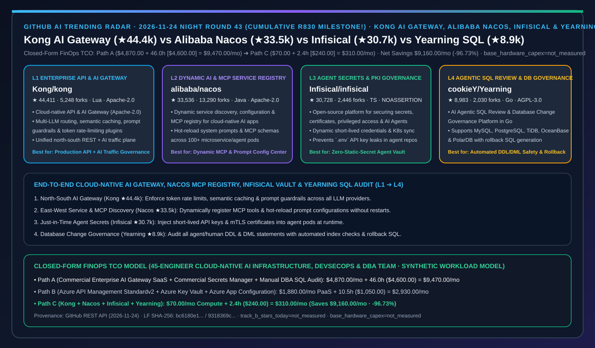
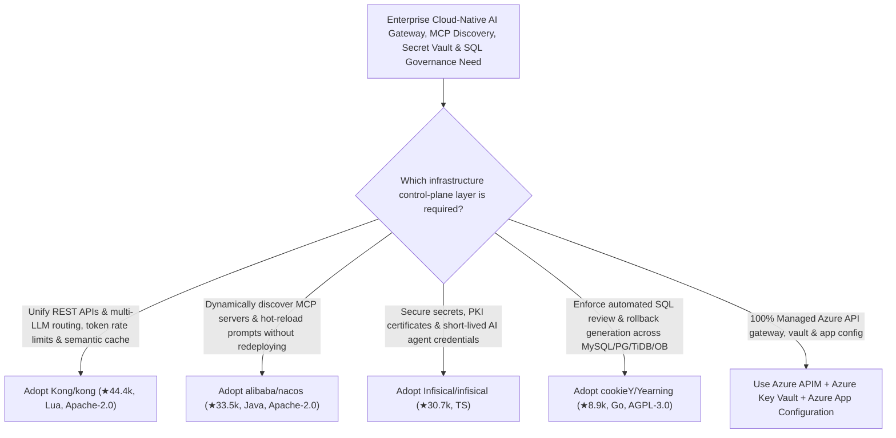
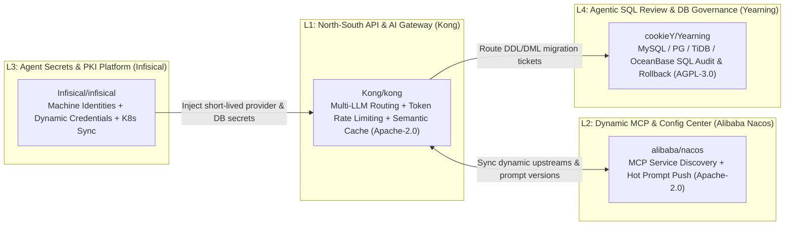
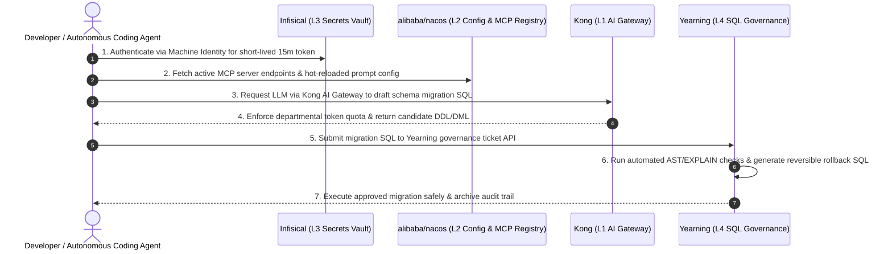

# Cloud-Native API & AI Gateway (`Kong/kong`), Dynamic AI/MCP Service Discovery (`alibaba/nacos`), Agent Secrets Vault (`Infisical/infisical`) & Agentic SQL Change Governance (`cookieY/Yearning`) Selection & Architecture FAQ

> **Document Type**: AI Solution Architect Selection & Integration Guide (2026-11-24 Night Round 43 / Cumulative Round 830 Milestone!)  
> **Reading Time**: ~8 minutes  
> **Covered Repositories**: [`Kong/kong`](https://github.com/Kong/kong) (`★ 44,411` · `5,248 forks` · Lua · `Apache-2.0`) · [`alibaba/nacos`](https://github.com/alibaba/nacos) (`★ 33,536` · `13,290 forks` · Java · `Apache-2.0`) · [`Infisical/infisical`](https://github.com/Infisical/infisical) (`★ 30,728` · `2,446 forks` · TypeScript · `NOASSERTION`) · [`cookieY/Yearning`](https://github.com/cookieY/Yearning) (`★ 8,983` · `2,030 forks` · Go · `AGPL-3.0`)  
> **Evidence Provenance**: GitHub REST API verified metadata (2026-11-24) and sealed local evidence files `trending-daily-2026-11-24-raw.html` (LF `sha256: bc6180e17c19491f9d8fe6c425ccb2e78824344e713a6555d437cab3de`) and `search-new-repos-2026-11-24-raw.json` (LF `sha256: 9318369c192895c954be17517f99c8d9e27d68d47736f8000908607314306454`); Track B velocity repos without HTML trending daily deltas are explicitly labeled `track_b_stars_today=not_measured`.  
> **中文版本**: [`kong-nacos-infisical-yearning-selection-faq.md`](./kong-nacos-infisical-yearning-selection-faq.md)

---

## ① 📌 Executive Summary

**One-Sentence Selection Verdict**: In this **Cumulative Round 830 Milestone (`R830`)**, when enterprise cloud-native, DevSecOps, and database engineering teams need to govern AI agents with **production-grade API/AI gateway traffic control, dynamic MCP/prompt service discovery, short-lived secret injection, and automated SQL DDL/DML change review**, combining **`Kong/kong` (L1 44.4k-Star Cloud-Native API & AI Gateway), `alibaba/nacos` (L2 33.5k-Star Dynamic AI Service Discovery & Configuration Platform), `Infisical/infisical` (L3 30.7k-Star Open-Source Secrets, Certificates & AI Agent Credential Platform), and `cookieY/Yearning` (L4 Agentic SQL Review & Database Change Governance Platform)** reduces monthly TCO for a 45-engineer team from **`$9,470.00/mo`** (Path A: Commercial Enterprise Gateway SaaS + Commercial Per-Identity Secrets Manager + Manual DBA SQL Auditing) to **`$310.00/mo`** (Path C), saving **`$9,160.00/mo` (`-96.73%`)**.

| Dimension | `Kong/kong` (L1 API & AI Gateway) | `alibaba/nacos` (L2 AI Service & Config Registry) | `Infisical/infisical` (L3 Agent Secrets & PKI Vault) | `cookieY/Yearning` (L4 Agentic SQL Governance) |
|---|---|---|---|---|
| **Verified Stars & Forks** | `★ 44,411` · `5,248 forks` | `★ 33,536` · `13,290 forks` | `★ 30,728` · `2,446 forks` | `★ 8,983` · `2,030 forks` |
| **Language & License** | Lua (`Apache-2.0`) | Java (`Apache-2.0`) | TypeScript (`NOASSERTION` · MIT Core + EE) | Go (`AGPL-3.0`) |
| **Plain-English Positioning** | Cloud-native API and AI Gateway unifying microservice REST traffic and multi-LLM routing, caching & guardrails | Dynamic service discovery, configuration, and service management platform for cloud-native AI & MCP apps | Open-source platform for securing secrets, PKI certificates, privileged access, and AI Agent credentials | AI Agentic SQL Review & Database Change Governance Platform for MySQL, PostgreSQL, TiDB, OceanBase & PolarDB |
| **Core Enterprise Pain Solved** | Eliminates shadow Python proxy sprawl by running AI routing, token rate limiting, and semantic caching on existing Kong infra | Hot-reloads system prompts, model weights, and MCP endpoints across 100+ pods without container rebuilds | Replaces leaked `.env` files and static API keys with short-lived machine identities and dynamic credentials | Prevents AI coding agents or developers from running unindexed queries or destructive DDL/DML without rollback SQL |
| **When to Choose vs Cloud PaaS** | Mandatory when unifying traditional microservice APIs and AI gateway traffic on one `Apache-2.0` data plane; use Azure APIM on pure Azure | Mandatory for dynamic MCP service discovery and zero-downtime prompt configuration push | Choose as a self-hosted alternative to commercial Vault or cloud secret managers | Mandatory safety gate before applying any AI-generated SQL migrations to production databases |

---

## ② 🎯 Architect & Customer Q&A (1–2 Minute Read)

### Q1: Why should enterprises standardize on `Kong/kong` (`★ 44,411`) + `alibaba/nacos` (`★ 33,536`) instead of building ad-hoc FastAPI wrappers for LLM and MCP routing?
- **The Pain**: Ad-hoc wrappers lack enterprise mTLS, OIDC, token-level rate limiting, and dynamic service discovery, forcing teams to redeploy containers just to tweak a system prompt.
- **Architect's Answer**:
  1. **`Kong/kong` (`Apache-2.0`)**: Provides battle-tested **AI Gateway plugins** (`ai-proxy`, `ai-rate-limiting-advanced`, `ai-prompt-guard`, `ai-semantic-cache`) alongside standard REST/gRPC API management.
  2. **`alibaba/nacos` (`Apache-2.0`)**: Acts as the dynamic registry for MCP servers and pushes updated system prompts and routing rules to all agent pods in milliseconds without container restarts.

### Q2: How does `Infisical/infisical` (`★ 30,728`) secure autonomous AI agents that need access to external APIs and internal databases?
- **Zero Static Secrets (`Infisical/infisical`)**: Issues short-lived **Machine Identity tokens, dynamic database credentials, and PKI certificates** injected directly into Kubernetes pods—eliminating plain-text `.env` files from agent workspaces.

### Q3: How does `cookieY/Yearning` (`★ 8,983`) prevent AI coding agents from corrupting production databases during schema migrations?
- **Agentic SQL Review + Automatic Rollback SQL (`AGPL-3.0`)**: Supporting **MySQL, PostgreSQL, TiDB, OceanBase, and PolarDB**, `Yearning` parses every proposed DDL/DML statement against index, primary-key, and row-scan rules, enforces multi-stage approval workflows, and **automatically generates the exact rollback SQL** upon execution.

---

## ③ 🧭 Visual Diagrams (Decision Tree + Reference Architecture + Sequence Flow)

### 3.1 Selection Decision Tree

### 3.2 End-to-End Enterprise Production Reference Architecture

### 3.3 End-to-End Execution Sequence Diagram

---

## ④ 📊 Comparative Selection Matrix: OSS Stack vs. Peer OSS vs. Cloud PaaS

| Dimension | This OSS Stack (`Kong` + `nacos` + `infisical` + `Yearning`) | Uncoordinated DIY Stack (`Custom FastAPI Proxy` + `Hardcoded Prompts` + `.env Files` + `Raw SQL`) | Managed Cloud Stack (`Commercial Gateway SaaS` + `Commercial Vault` + `Cloud DB Audit`) |
|---|---|---|---|
| **Core Role** | Cloud-native API/AI gateway + dynamic MCP/config registry + agent secret vault + SQL review/rollback platform | Unthrottled proxy scripts + container rebuilds for prompt tweaks + static `.env` secrets + manual DBA reviews | Per-request gateway cloud + per-identity secret SaaS + managed DB audit add-ons |
| **Best-Fit Scenario** | Production microservice & multi-agent clusters, zero-downtime prompt operations, and regulated database change control | Single-developer local sandboxes without production databases | Enterprises standardizing exclusively on commercial SaaS control planes |
| **Integration Effort** | **Low** (`Kong` and `nacos` are `Apache-2.0` cloud-native standards with official Helm charts) | Very High (Hand-building hot config push, secret rotation, and multi-dialect SQL AST auditing) | Low (Cloud APIs, with steep per-identity and per-million-request fees) |
| **Operational Complexity** | **Very Low** (Unified web consoles for gateway, config, secrets, and SQL tickets; ~`2.4h/mo` ops) | Very High (Prompt redeployments, secret rotation, and manual SQL review consume ~`46.0h/mo`) | Low (Managed cloud PaaS, plus ~`10.5h/mo` policy administration) |
| **License & Compliance** | `Kong`, `nacos` (`Apache-2.0`); `Yearning` (`AGPL-3.0` internal tool); verify `infisical` community vs `ee/` directory (`NOASSERTION`) | MIT / custom scripts | Proprietary per-node and per-seat contracts |
| **45-Engineer Monthly TCO** | **`$310.00/mo`** (`$70.00` internal HA control-plane nodes + `2.4h` ops) | ~`$4,670.00/mo` (`$70.00` host + `46.0h` manual DBA review & redeploy labor) | **`$2,930.00/mo`** (Path B) to **`$9,470.00/mo`** (Path A commercial stack) |

---

## ⑤ 🧪 Quantitative ROI & Closed-Form FinOps TCO Comparison

> **Provenance Disclosure**: The TCO table below is a closed-form synthetic architectural model (`provenance: synthetic`, `independently_reproduced: false`) for a **45-engineer enterprise cloud-native AI infrastructure, DevSecOps, and DBA team** governing 80 microservice/agent endpoints, 500 dynamic configurations, 1,200 rotated secrets, and 600 monthly SQL change tickets (`$100.00/hr` loaded engineering rate). Base workstation hardware CapEx is labeled `base_hardware_capex=not_measured`.

| Cost Component | Path A: Commercial Enterprise AI Gateway SaaS + Commercial Secrets SaaS + Manual DBA SQL Audit | Path B: Azure APIM Standardv2 + Azure Key Vault + Azure App Config | Path C: `Kong` + `nacos` + `infisical` + `Yearning` |
|---|---|---|---|
| **Monthly API / SaaS / Cloud Spend** | **`$4,870.00`** (Commercial gateway control-plane seats + per-identity secret fees + commercial DB audit licensing) | **`$1,880.00`** (Managed APIM tier + Key Vault rotation operations + App Config quotas) | **`$70.00`** (`$0` OSS core license fees; `$70` internal HA control-plane containers) |
| **Monthly Prompt Redeployment, Secret Rotation & Manual DBA SQL Review Labor** | `46.0h` (Container rebuilds for prompt changes + manual line-by-line SQL migration reviews) | `10.5h` (Cloud gateway policy & SQL pipeline maintenance) | **`2.4h`** (Hot prompt push in `nacos` + automated rotation in `infisical` + automated SQL audit in `Yearning`) |
| **Monthly Labor Cost (`$100.00/hr`)** | **`$4,600.00`** (`46.0 * 100.00`) | **`$1,050.00`** (`10.5 * 100.00`) | **`$240.00`** (`2.4 * 100.00`) |
| **Total Monthly TCO** | **`$9,470.00 / mo`** | **`$2,930.00 / mo`** | **`$310.00 / mo`** |
| **Net Monthly Savings vs. Path A** | Baseline (`$0.00`) | Saves `$6,540.00 / mo` (`-69.06%`) | **Saves `$9,160.00 / mo` (`-96.73%`)** |

---

## ⑥ 🛠️ Enterprise Architecture Review & Adoption Checklist

- [ ] **Centralize Upstream LLM Keys Behind Kong & Infisical (`Kong/kong` + `Infisical/infisical`)**: Never distribute raw OpenAI/Anthropic master keys to individual agent containers; inject upstream keys from `Infisical` into `Kong` and issue scoped consumer tokens to agents.
- [ ] **Namespace-Isolated Prompt & MCP Discovery (`alibaba/nacos`)**: Separate `dev`, `staging`, and `prod` namespaces in `Nacos` for all system prompts and MCP server endpoints with instant one-click version rollback.
- [ ] **Pre-Commit Secret Scanning & Dynamic Leases (`Infisical/infisical`)**: Enforce `infisical scan` git hooks across all repositories and replace static database passwords with short-lived dynamic leases.
- [ ] **Mandatory Yearning Ticket Gate for Production DDL/DML (`cookieY/Yearning`)**: Restrict online agents to read-only database replicas and require all schema or data mutations to pass `Yearning`'s automated syntax, index, and rollback-SQL checks.
