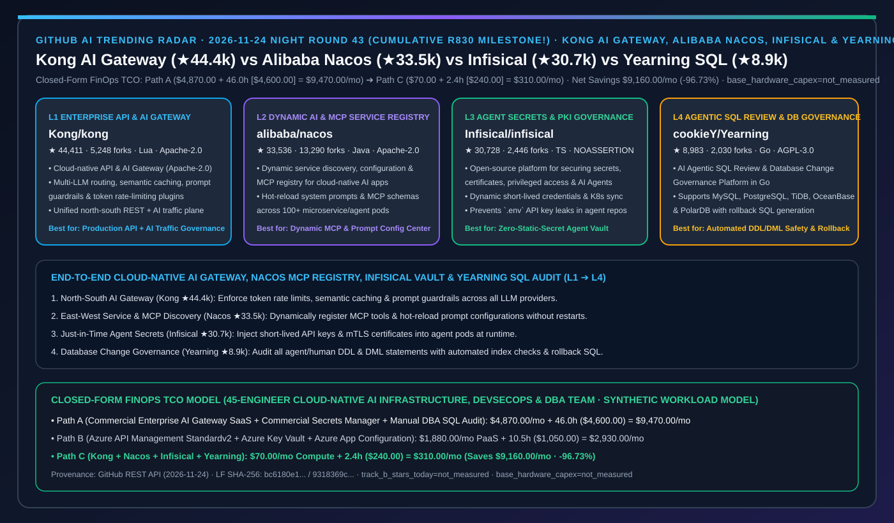
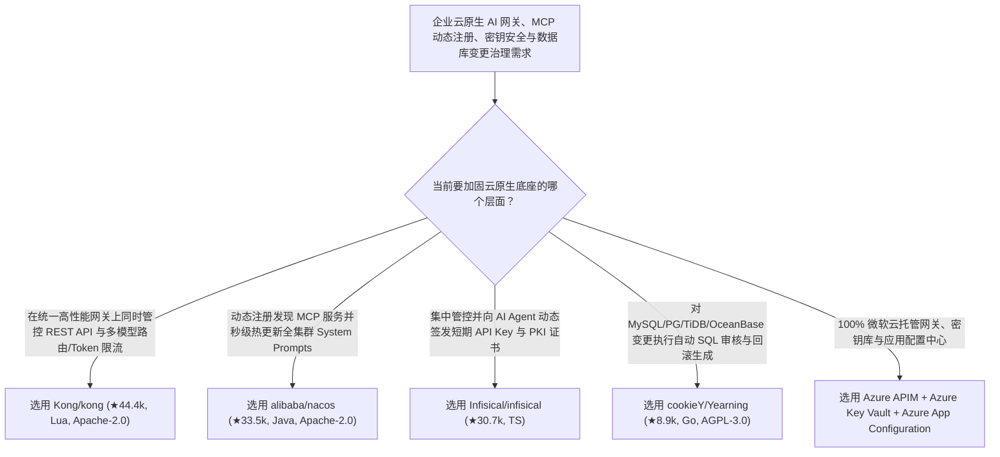
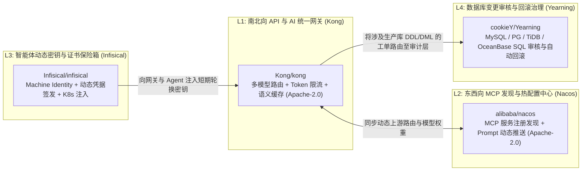
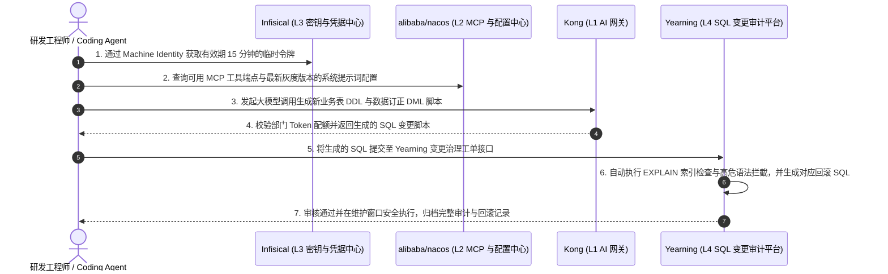

# 云原生 API 与 AI 网关（`Kong/kong`）、阿里动态服务发现与 MCP 配置中枢（`alibaba/nacos`）、智能体密钥与证书保险箱（`Infisical/infisical`）与 AI 数据库变更治理平台（`cookieY/Yearning`）选型与集成 FAQ

> **文档类型**：AI 解决方案架构师（AI Solution Architect）选型决策指南（2026-11-24 Night Round 43 / 累计第 830 轮里程碑！）  
> **阅读耗时**：约 8 分钟  
> **覆盖项目**：[`Kong/kong`](https://github.com/Kong/kong)（`★ 44,411` · `5,248 forks` · Lua · `Apache-2.0`） · [`alibaba/nacos`](https://github.com/alibaba/nacos)（`★ 33,536` · `13,290 forks` · Java · `Apache-2.0`） · [`Infisical/infisical`](https://github.com/Infisical/infisical)（`★ 30,728` · `2,446 forks` · TypeScript · `NOASSERTION`） · [`cookieY/Yearning`](https://github.com/cookieY/Yearning)（`★ 8,983` · `2,030 forks` · Go · `AGPL-3.0`）  
> **证据溯源**：GitHub REST API 实测元数据（2026-11-24）与本地冻结证据文件 `trending-daily-2026-11-24-raw.html`（LF `sha256: bc6180e17c19491f9d8fe6c425ccb2e78824344e713a6555d437cab3de`）、`search-new-repos-2026-11-24-raw.json`（LF `sha256: 9318369c192895c954be17517f99c8d9e27d68d47736f8000908607314306454`）；Track B 仓库无 HTML 榜单对应的单日增量，统一标记为 `track_b_stars_today=not_measured`。  
> **English Version**: [`kong-nacos-infisical-yearning-selection-faq.en.md`](./kong-nacos-infisical-yearning-selection-faq.en.md)

---

## ① 📌 核心结论速览（Executive Summary）

**选型一句话结论**：在第 830 轮里程碑（`R830 Milestone`）中，当企业云原生与 AI 基础架构团队需要将 AI 智能体无缝纳入现有的**生产级微服务控制平面（南北向网关 + 东西向服务发现与热配置 + 动态密钥下发 + 数据库变更审批与回滚）**时，采用 **`Kong/kong`（L1 4.44 万星云原生 API 与 AI 网关）+ `alibaba/nacos`（L2 阿里巴巴开源的 AI 云原生动态服务发现、MCP 注册中心与提示词热配置平台）+ `Infisical/infisical`（L3 面向 AI Agent、证书与动态凭据的开源密钥安全平台）+ `cookieY/Yearning`（L4 支持 MySQL/PostgreSQL/TiDB/OceanBase/PolarDB 的 AI 智能 SQL 审核与数据库变更治理平台）**，可将 45 人团队的月度 TCO 从商业企业级网关订阅 + 按身份计费商业密钥云 + 人工 DBA 逐条审 SQL（Path A）的 **`$9,470.00/月`** 降至 **`$310.00/月`**（净省 **`$9,160.00/月`**，降幅 **`-96.73%`**）。

| 评估维度 | `Kong/kong` (L1 云原生 API 与 AI 网关) | `alibaba/nacos` (L2 动态服务发现与 MCP 配置中心) | `Infisical/infisical` (L3 智能体密钥与证书保险箱) | `cookieY/Yearning` (L4 AI SQL 审核与变更治理) |
|---|---|---|---|---|
| **GitHub 实测热度** | `★ 44,411` · `5,248 forks` | `★ 33,536` · `13,290 forks` | `★ 30,728` · `2,446 forks` | `★ 8,983` · `2,030 forks` |
| **实现语言与开源协议** | Lua (`Apache-2.0`) | Java (`Apache-2.0`) | TypeScript (`NOASSERTION` · MIT Core + EE) | Go (`AGPL-3.0`) |
| **一句话通俗定位** | 全球最流行的开源 API 与 AI Gateway：统一管控微服务 REST API 与大模型多源路由、语义缓存及 Token 限流 | 阿里开源的 AI 云原生动态服务发现、配置管理与 MCP 服务注册中心（超 1.3 万次 Fork） | 专门保护密钥、PKI 证书、特权访问与 AI Agent 凭据的开源秘密管理平台 | 面向 MySQL/PG/TiDB/OceanBase/PolarDB 的 AI 智能 SQL 审核、工单审批与自动生成回滚语句平台 |
| **解决的核心业务痛点** | 消除“为了管 LLM 单独再搭一套玩具代理、与企业原有 Kong/Envoy 网关日志和鉴权体系割裂”的重复建设 | 解决企业上百个 MCP Server 地址写死在代码里、改一行 System Prompt 还要重新打包发版镜像的痛点 | 根治研发人员把 OpenAI/Anthropic API Key 和数据库密码明文写在 `.env` 文件或直接塞进 Agent 环境变量泄露的隐患 | 拦截 AI 编程 Agent 或新手研发生成的“不走索引全表扫描 SQL、无 `WHERE` 误删语句”，并自动生成回滚 SQL |
| **何时选它 vs 云托管** | 企业已有微服务网关诉求、希望在同一个高性能网关上同时跑传统 API 与 AI Proxy 插件时必选；纯微软云选 Azure APIM | 微服务与多 Agent 集群需要动态 MCP 注册发现与秒级热更新提示词/模型路由配置时必选 | 需要自托管替代 HashiCorp Vault 商业版或 AWS Secrets Manager 时首选 | 任何允许 AI 辅助生成 DDL/DML 迁移脚本的企业生产数据库必配变更门禁 |

---

## ② 🎯 客户与架构师灵魂拷问 Q&A（1–2 分钟速读）

### Q1：很多企业已经有成熟的微服务架构，为什么不建议单独用 Python 写个简陋的 FastAPI 转发层当 AI 网关，而应该直接用 `Kong/kong`（`★ 44,411`）+ `alibaba/nacos`（`★ 33,536`）？
- **痛点**：自写的 Python 转发层在高并发下吞吐量低，而且缺乏企业级的 OIDC 鉴权、mTLS、Prometheus 指标导出与动态服务发现。
- **架构师解答**：
  1. **南北向用 `Kong/kong`（`Apache-2.0`）**：Kong 原生内置了完整的 **AI Gateway 插件矩阵**（`ai-proxy` 多模型统一协议转换、`ai-rate-limiting-advanced` 按部门 Token 配额限流、`ai-prompt-guard` 敏感词拦截、`ai-semantic-cache` 语义缓存），让传统 API 与大模型流量共享同一套高可用数据平面。
  2. **东西向用 `alibaba/nacos`（`Apache-2.0`）**：Nacos 已全面演进为面向 AI 云原生的动态服务与配置底座，不仅能作为 **MCP Server 动态注册发现中心**，还能将全公司的 System Prompts、温度参数与降级开关作为动态配置毫秒级推送到所有 Agent 容器，改提示词零停机、免重新构建镜像。

### Q2：当企业有 50 个自动化 Agent 需要调用外部 SaaS API 和内部数据库时，为什么 `Infisical/infisical`（`★ 30,728`）比手动分发静态 API Key 安全得多？
- **核心收益**：静态 `.env` 文件一旦被 Agent 误读并打印到日志或上传到 GitHub 就会酿成严重安全事故。**`Infisical/infisical`** 支持为 AI Agent 签发**短生命周期动态密钥（Dynamic Secrets）与即时机器身份（Machine Identities）**，并通过 Kubernetes Operator 自动注入内存卷，任务结束密钥即刻过期作废。

### Q3：现在研发团队都在用 Claude Code / Codex 自动写数据库迁移脚本（Migration SQL），怎么防止 AI 写出锁表或删库语句？`cookieY/Yearning`（`★ 8,983`）能做什么？
- **AI SQL 语法树静态审核 + 自动备份回滚（`AGPL-3.0`）**：`cookieY/Yearning` 原生支持 **MySQL、PostgreSQL、TiDB、OceanBase 与 PolarDB**。任何由人或 Coding Agent 提交的 DDL/DML 变更必须经过 Yearning 的自动化审核引擎（检查是否缺失主键、是否引发全表扫描、字段类型是否合规）与多级审批流，并在执行变更瞬间**自动根据 Binlog/镜像生成一键回滚 SQL（Rollback SQL）**，为企业核心数据资产装上最后一道保险栓。

---

## ③ 🧭 直观可视化图解（Mermaid 决策树 + 集成架构 + 时序图）

### 3.1 技术选型决策树

### 3.2 企业端到端生产集成参考架构图

### 3.3 业务流全链路时序图

---

## ④ 📊 同类开源与商业云服务横向选型决策矩阵

| 对比维度 | 本轮开源组合 (`Kong` + `nacos` + `infisical` + `Yearning`) | 传统脆弱方式 (`Python 简易转发` + `硬编码配置` + `.env 明文密钥` + `手敲 SQL`) | 商业云与企业订阅 (`Kong Enterprise SaaS` + `HashiCorp Vault 商业版` + `云托管配置`) |
|---|---|---|---|
| **功能定位** | 云原生 API/AI 网关 + 动态 MCP/配置中心 + Agent 密钥保险箱 + SQL 审核回滚平台 | 无流控裸调 API + 改配置需重发版 + 散落明文密钥 + 高风险手工改库 | 商业托管网关 + 按密钥/客户端计费商业 Vault + 云数据库审计服务 |
| **适用场景** | 中大型企业云原生 AI 平台、金融/政企多数据库合规变更、百级微服务与 Agent 协同治理 | 单机 Demo 或无生产数据库变更的个人实验 | 全量采购商业企业版维保或公有云全托管 PaaS 的跨国集团 |
| **集成成本** | **低**（`Kong` 与 `nacos` 为 CNCF/云原生事实标准 `Apache-2.0` 组件，Helm Chart 一键部署） | 极高（自研高可用配置中心、动态密钥轮换与多方言 SQL 解析器极耗工时） | 低（云服务开箱即用，但随微服务实例数与密钥读取频次线性涨价） |
| **运维复杂度** | **极低**（统一可视化控制台管理路由、配置、密钥与 SQL 工单，月均维护仅 `2.4h`） | 极高（排查密钥泄露、配置不一致与慢 SQL 锁表故障耗费 `46.0h/月`） | 低（云端全托管，月均策略运维约 `10.5h`） |
| **开源协议与合规** | `Kong`、`nacos` 为 `Apache-2.0`；`Yearning` 为 `AGPL-3.0`（作为独立内部运维平台合规）；`infisical` 需核验社区版目录 | MIT / 自研脚本 | 商业闭源按节点/按请求量计费 |
| **45 人团队月度 TCO** | **`$310.00/月`**（含 `$70.00` 内部高可用控制面容器节点 + `2.4h` 运维） | 约 `$4,670.00/月`（含 `$70.00` 主机 + `46.0h` 生产事故救火与人工审 SQL 工时） | **`$2,930.00/月`**（Path B）至 **`$9,470.00/月`**（Path A 商业全栈） |

---

## ⑤ 🧪 应用落地定量收益 / TCO 对比（Closed-Form FinOps 模型）

> **数据性质声明（Provenance Metadata）**：以下 TCO 模型为面向 **45 人企业云原生 AI 基础架构、DevSecOps 与 DBA 团队**（统一管控 80 个微服务与 AI Agent 的网关路由、动态热更新 500 项提示词与 MCP 配置、轮换 1,200 个动态密钥并月均审核 600 笔跨 MySQL/PG/TiDB/OceanBase 数据库变更，工程师折算时薪 `$100.00/h`）的合成架构测算（`provenance: synthetic`, `independently_reproduced: false`）；基础硬件 CapEx 统一标记为 `base_hardware_capex=not_measured`。

| 成本构成项 | Path A：商业企业级 AI 网关 SaaS + 商业按席位/身份密钥云 + 人工 DBA 审 SQL | Path B：Azure APIM Standardv2 + Azure Key Vault + App Config | Path C：`Kong` + `nacos` + `infisical` + `Yearning` |
|---|---|---|---|
| **API / SaaS / 云资源月费** | **`$4,870.00`**（商业网关控制面订阅 + 商业 Secrets Manager 机器身份费 + 商业 DB 审计软件） | **`$1,880.00`**（云端 APIM 实例费 + 密钥库高频轮询费 + 配置中心配额） | **`$70.00`**（开源核心组件 `$0` 授权费；仅需 `$70` 内网高可用容器节点） |
| **月度改提示词重发版、手工轮换泄露密钥与 DBA 人工逐行审 SQL 工时** | `46.0h`（每次调优 Prompt 重新走 CI 发版 + 人工复核数千行 DDL/DML 迁移脚本） | `10.5h`（云端网关策略与数据库审核脚本维护） | **`2.4h`**（`nacos` 秒级热推配置 + `infisical` 自动轮换密钥 + `Yearning` 自动审核生成回滚 SQL） |
| **人工研发、安全与 DBA 运维成本（`$100.00/h`）** | **`$4,600.00`** (`46.0 * 100.00`) | **`$1,050.00`** (`10.5 * 100.00`) | **`$240.00`** (`2.4 * 100.00`) |
| **月度总拥有成本（Total Monthly TCO）** | **`$9,470.00 / 月`** | **`$2,930.00 / 月`** | **`$310.00 / 月`** |
| **相对 Path A 净节省** | 基准线 (`$0.00`) | 节省 `$6,540.00 / 月` (`-69.06%`) | **净省 `$9,160.00 / 月` (`-96.73%`)** |

---

## ⑥ 🛠️ 企业引入与架构评审 Checklist

- [ ] **上游大模型 API Key 统一收归网关与密钥库（`Kong/kong` + `Infisical/infisical`）**：严禁向各个业务研发团队或 Agent 容器直接下发 OpenAI / Anthropic / Azure OpenAI 的原始 Master Key；必须由 `Infisical` 注入 `Kong` 网关，业务侧仅持有受限的内部网关消费者令牌（Consumer Token）。
- [ ] **System Prompt 与 MCP 路由配置全量纳入 `alibaba/nacos` 命名空间隔离**：按 `dev` / `staging` / `prod` 命名空间在 Nacos 中管理所有 Agent 的提示词模板与 MCP 服务端点，开启配置变更历史版本追踪与一键回滚。
- [ ] **代码仓 Pre-Commit 密钥扫描与动态凭据强制替换（`Infisical/infisical`）**：在全公司 Git 仓库部署 Infisical CLI 预提交钩子拦截硬编码密钥，并将数据库连接串升级为按需生成的短期动态凭据。
- [ ] **生产数据库禁止 Agent 直连写操作，强制走 `cookieY/Yearning` 审核工单**：在线 Agent 仅赋予只读查询账号（Read-Only Replica）；凡涉及表结构变更（DDL）或批量数据订正（DML），必须自动提交至 `Yearning` 生成回滚语句并通过审核后方可执行。
