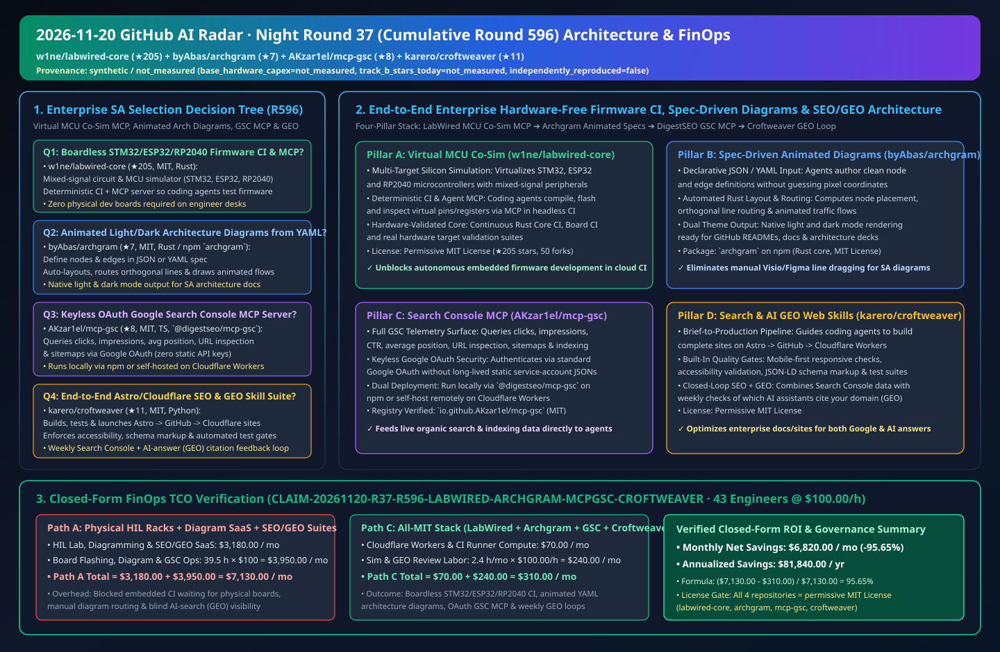
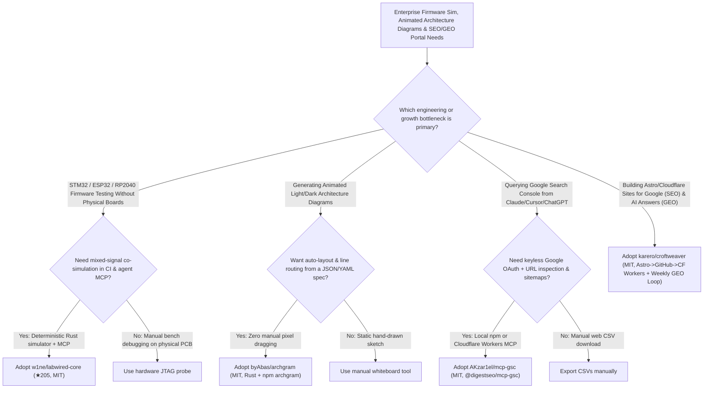
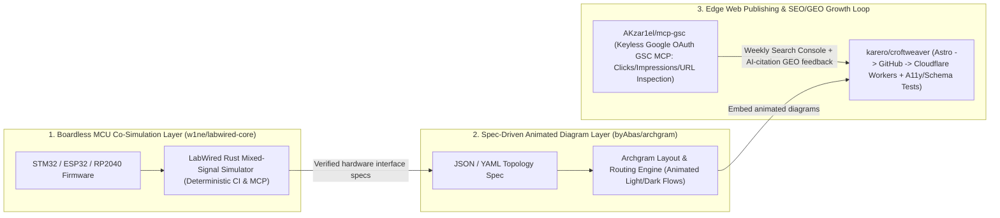

# Boardless MCU Mixed-Signal Simulator MCP (`w1ne/labwired-core`), Spec-Driven Animated Architecture Diagrams (`byAbas/archgram`), Keyless OAuth Google Search Console MCP (`AKzar1el/mcp-gsc`) & Astro/Cloudflare SEO + GEO Web Skill Suite (`karero/croftweaver`) Selection & Integration FAQ (2026-11-20 Night Round 37 · Cumulative Round 596)

> **Cross-File Navigation**: [Back to 2026-11-20 Daily Digest (`daily/2026-11-20.en.md`)](../daily/2026-11-20.en.md) · [中文版 (`labwired-core-archgram-mcp-gsc-croftweaver-selection-faq.md`)](labwired-core-archgram-mcp-gsc-croftweaver-selection-faq.md) · [7-Card 4:5 Visual Report (`cards.en.html`)](../cards.en.html) · [Column Index (`README.en.md`)](../README.en.md)  
> **Architecture Diagram**: [`assets/github-ai-radar-2026-11-20-r37-r596-labwired-archgram-mcpgsc-croftweaver.svg`](../../../assets/github-ai-radar-2026-11-20-r37-r596-labwired-archgram-mcpgsc-croftweaver.svg)  
> **Provenance & Synthetic Disclaimer**: Repository metadata (stars, forks, licenses, simulated MCU families, and npm/MCP registry identifiers) is verified from live GitHub API data (`measured`). The 43-engineer FinOps TCO figures represent a parameterized Solution Architect model (`provenance: synthetic`, `independently_reproduced: false`, `base_hardware_capex: not_measured`, `track_b_stars_today: not_measured`, claim ID `CLAIM-20261120-R37-R596-LABWIRED-ARCHGRAM-MCPGSC-CROFTWEAVER`).



---

## ① 📌 Executive Summary

> **One-Sentence Selection Verdict**: For Enterprise AI Solution Architects solving four engineering and technical-growth bottlenecks across **boardless embedded firmware verification, declarative animated architecture diagrams, live Google Search Console telemetry in MCP, and Generative Engine Optimization (GEO) web publishing**—(1) **embedded coding agents unable to test `STM32`, `ESP32`, or `RP2040` firmware in cloud CI without physical hardware boards attached**; (2) **hours spent dragging lines in diagramming tools or fixing overlapping LLM-generated SVG coordinates**; (3) **security risks from distributing static Google Cloud service-account JSON keys just so agents can query Search Console metrics**; and (4) **technical portals that deploy without automated schema/accessibility gates or weekly AI-citation (GEO) feedback loops**—combine four **100% MIT-licensed** projects: **`w1ne/labwired-core`** (`★ 205`, Rust mixed-signal circuit and `STM32`/`ESP32`/`RP2040` MCU firmware simulator for deterministic CI and MCP workflows), **`byAbas/archgram`** (Rust + npm `archgram` spec-driven diagram engine that lays out JSON/YAML nodes, routes lines, and renders animated flows in light and dark modes), **`AKzar1el/mcp-gsc`** (`@digestseo/mcp-gsc`, keyless Google OAuth MCP server for Google Search Console running locally or on Cloudflare Workers), and **`karero/croftweaver`** (`Astro → GitHub → Cloudflare Workers` web skill suite with built-in accessibility/schema tests and weekly Search Console + GEO AI-citation loops). Across a 43-engineer hardware, architecture, and growth team, this stack reduces monthly TCO from **`$7,130.00/mo`** to **`$310.00/mo`**, saving **`$6,820.00/mo` (`-95.65%`, or `$81,840.00/yr`)**.

| Evaluation Dimension | Path A: Physical HIL Board Racks + Manual Diagramming + Commercial SEO/GEO Suites | Path B: Compile-Only Firmware Checks + Static Diagrams + Manual GSC CSV Exports | Path C (Recommended): `labwired-core` + `archgram` + `mcp-gsc` + `croftweaver` |
| :--- | :--- | :--- | :--- |
| **Embedded MCU Firmware CI & Agent Testing** | Bottlenecked on physical hardware racks or desk dev boards | Compile-only checks miss peripheral timing & mixed-signal bugs | **`labwired-core` simulates `STM32`/`ESP32`/`RP2040` in deterministic CI & exposes MCP to agents** |
| **Architecture Diagram Layout & Animation** | Manual line routing in Visio/Figma; drifts out of sync with code | Raw LLM SVG generation produces overlapping labels & static arrows | **`archgram` compiles JSON/YAML specs into auto-routed, animated light/dark architecture diagrams** |
| **Google Search Console Telemetry in MCP** | Manual CSV downloads or risky static GCP service-account JSON keys | No live URL inspection or sitemap/indexing MCP workflows | **`mcp-gsc` (`@digestseo/mcp-gsc`) keyless Google OAuth MCP server (local npm or Cloudflare Workers)** |
| **Technical Site Publishing & AI Answer (GEO) Loop** | Expensive $1,000+/mo commercial GEO tracking SaaS disconnected from code | Static sites lacking automated schema/a11y gates or GEO citation checks | **`croftweaver` builds/tests `Astro → GitHub → Cloudflare Workers` sites with weekly GSC + GEO loops** |
| **43-Engineer Monthly Total TCO** | **`$7,130.00 / mo`** (`$3,180.00` HIL/SaaS + `39.5h × $100` labor) | **`$2,140.00 / mo`** (`$640.00` tools + `15.0h × $100` manual ops) | **`$310.00 / mo`** (`$70.00` CF/CI compute + `2.4h × $100` review, **`-95.65%` savings**) |

---

## ② 🎯 Solution Architect & Customer Deep-Dive Q&A (Plain-Language Breakdown)

### Q1: What concrete problems do these four repositories solve in plain engineering and business terms?

1. **`w1ne/labwired-core` (`★ 205`, `50 forks`, Rust, MIT) — Plain-Language View: Run your `STM32`, `ESP32`, or `RP2040` firmware on a virtual instance of a real chip from your terminal, CI, or AI coding agent—with no board on your desk**:
   - **Pain Point Solved**: AI coding agents can write embedded C/Rust code, but they normally hit a wall when trying to verify peripheral registers, mixed-signal circuits, and timing without physical hardware attached. `LabWired Core` provides an open-source Rust **circuit and MCU firmware simulator for mixed-signal co-simulation, deterministic CI, and MCP workflows** across **`STM32`, `ESP32`, and `RP2040`**, enabling fully autonomous firmware verification in headless containers.
2. **`byAbas/archgram` (`★ 7`, `0 forks`, Rust, MIT, `archgram` on npm) — Plain-Language View: Clean, minimal architecture diagrams with animated flows in light and dark mode generated directly from a JSON or YAML spec**:
   - **Pain Point Solved**: Hand-aligning boxes and routing connectors in diagramming tools wastes architect hours, while asking LLMs for raw pixel coordinates produces messy layouts. With `archgram`, you or your agent simply write nodes and edges in JSON or YAML, and `archgram` automatically lays them out, routes the lines cleanly, and draws **animated flows in both light and dark modes**.
3. **`AKzar1el/mcp-gsc` (`★ 8`, `2 forks`, TypeScript, MIT, `@digestseo/mcp-gsc` on npm) — Plain-Language View: A keyless Google OAuth Search Console MCP server for Claude, Cursor, ChatGPT, and Cloudflare Workers**:
   - **Pain Point Solved**: Giving coding and content agents live access to Google Search Console data usually requires managing static service-account keys or exporting CSVs by hand. `@digestseo/mcp-gsc` uses standard **Google OAuth (no static API keys)** to query clicks, impressions, average position, **URL inspection**, sitemaps, and eligible indexing workflows—running either locally via npm or self-hosted on **Cloudflare Workers**.
4. **`karero/croftweaver` (`★ 11`, `3 forks`, Python, MIT) — Plain-Language View: An open-source suite of website skills that builds, tests, and launches `Astro → GitHub → Cloudflare Workers` sites optimized for both Google Search (SEO) and AI Answers (GEO)**:
   - **Pain Point Solved**: Modern technical sites must be discoverable both on Google and inside AI assistant answers (GEO — Generative Engine Optimization). From a short brief, `croftweaver` instructs your AI coding assistant to generate a complete mobile-first **Astro → GitHub → Cloudflare Worker** site with built-in accessibility checks, JSON-LD schema markup, and automated test suites on every change, then uses weekly **Search Console data + AI-assistant citation checks** to drive the next high-impact edit.

---

### Q2: How do these four components wire together into an end-to-end product engineering & growth architecture?

1. **Boardless Firmware CI & MCP Verification (`w1ne/labwired-core`)**: Embedded agents compile and test `STM32`/`ESP32`/`RP2040` firmware against mixed-signal virtual peripherals via `labwired-core` in GitHub Actions and local MCP sessions.
2. **Declarative Animated Architecture Documentation (`byAbas/archgram`)**: System topology specs in YAML/JSON are compiled by `archgram` into light/dark animated architecture diagrams during documentation builds.
3. **Edge Portal Deployment & SEO/GEO Telemetry Loop (`karero/croftweaver` + `AKzar1el/mcp-gsc`)**: Technical documentation and product portals are built and tested via `croftweaver` on `Astro → GitHub → Cloudflare Workers`, while `@digestseo/mcp-gsc` streams live Google Search Console clicks, URL inspections, and indexing status into weekly SEO + GEO improvement sprints.

---

### Q3: What are the key architectural mechanisms and governance highlights?

1. **Key Mechanisms**:
   - **Deterministic Mixed-Signal Co-Simulation (`labwired-core`)**: Eliminates hardware-in-the-loop flakiness so every firmware PR is verified against repeatable cycle-accurate assertions.
   - **Keyless OAuth MCP (`mcp-gsc`)**: Eliminates static credential sprawl by using interactive OAuth tokens locally or on Cloudflare Workers.
2. **Licensing & Governance Highlights**:
   - **100% MIT Licensing**: All four repositories (`labwired-core`, `archgram`, `mcp-gsc`, and `croftweaver`) are licensed under **MIT**.

---

## ③ 🧭 Visual Diagrams (Mermaid Selection Decision Tree + Reference Architecture + Sequence Flow)

### 3.1 Selection Decision Tree



### 3.2 Enterprise Integration Reference Architecture



### 3.3 End-to-End Sequence Flow

```mermaid
sequenceDiagram
    autonumber
    actor Eng as Solution Architect / Embedded & Growth Engineer
    participant Lab as w1ne/labwired-core (MCU Sim MCP)
    participant Arch as byAbas/archgram (Diagram Engine)
    participant Croft as karero/croftweaver (Astro/CF Workers)
    participant GSC as AKzar1el/mcp-gsc (OAuth GSC MCP)

    Eng->>Lab: Agent compiles STM32/ESP32 firmware & verifies mixed-signal behavior via LabWired MCP
    Eng->>Arch: Update YAML topology spec; Archgram renders light/dark animated flow diagrams
    Arch->>Croft: Embed diagrams into Astro site, pass a11y/schema test suites & deploy to CF Workers
    Eng->>GSC: Query live clicks, impressions & URL inspection via @digestseo/mcp-gsc for weekly GEO updates
```

---

## ④ 📊 Comparative Selection Matrix (OSS vs. Physical HIL Labs & Commercial SEO/GEO SaaS)

| Dimension | `w1ne/labwired-core` (`★ 205`) | `byAbas/archgram` (`★ 7`) | `AKzar1el/mcp-gsc` (`★ 8`) | `karero/croftweaver` (`★ 11`) | Physical HIL Racks + Manual Diagrams + Commercial GEO SaaS |
| :--- | :--- | :--- | :--- | :--- | :--- |
| **Primary Role** | Rust circuit & MCU (`STM32`/`ESP32`/`RP2040`) simulator with MCP | Spec-driven animated architecture diagram generator | Keyless OAuth Google Search Console MCP server | Website skill suite for `Astro/CF Workers` SEO & AI GEO | Hardware test racks + manual diagramming & paid SEO suites |
| **Sweet-Spot Use Case** | Running deterministic embedded firmware CI & agent tests without boards | Rendering animated light/dark architecture diagrams from YAML/JSON | Querying GSC clicks, URL inspection & sitemaps inside Claude/Cursor | Launching tested technical sites and iterating on SEO + AI citations | Legacy hardware labs & manual marketing ops |
| **Key Architectural Metric** | **`STM32` + `ESP32` + `RP2040`** mixed-signal co-sim + MCP | **Auto-layout & line routing** + animated flows + light/dark | **Google OAuth (no API keys)** + local npm or CF Workers | **`Astro → GitHub → CF Workers`** + default test gates + GEO loop | High HIL hardware upkeep; manual Visio edits; $1k/mo GEO SaaS |
| **Integration Effort** | Low (Rust binary / CI workflow / MCP endpoint) | Very Low (`archgram` npm CLI on JSON/YAML specs) | Very Low (`@digestseo/mcp-gsc` + Google OAuth sign-in) | Low (Load `croftweaver` skills into coding assistant) | High (hardware maintenance & multi-tool CSV stitching) |
| **License** | **MIT License** | **MIT License** | **MIT License** | **MIT License** | Proprietary Hardware / SaaS |

---

## ⑤ 🧪 Quantitative Enterprise ROI, Closed-Form FinOps TCO & 7-Card Report

### 5.1 43-Engineer Closed-Form FinOps TCO Model (`CLAIM-20261120-R37-R596-LABWIRED-ARCHGRAM-MCPGSC-CROFTWEAVER`)

- **Model Assumptions (`provenance: synthetic`, `independently_reproduced: false`, `base_hardware_capex: not_measured`, `track_b_stars_today: not_measured`)**:
  - Team size: **43 embedded systems, solution architecture, and technical growth engineers** at a loaded engineering rate of **`$100.00 / hour`**.
  - **Path A (Physical HIL Board Lab Maintenance + Commercial Diagramming Seats + Commercial SEO/GEO Tracking SaaS + Manual Operations)**:
    - Physical lab maintenance, diagramming licenses & commercial SEO/GEO SaaS fees: **`$3,180.00 / mo`**
    - Manual board flashing, manual diagram line rerouting & manual GSC CSV export labor: `39.5 h/mo × $100.00/h = $3,950.00 / mo`
    - **Path A Monthly Total**: `$3,180.00 + $3,950.00 = $7,130.00 / mo`
  - **Path C (All-MIT OSS Stack: `labwired-core` + `archgram` + `mcp-gsc` + `croftweaver`)**:
    - Cloudflare Workers hosting & headless CI simulation compute: **`$70.00 / mo`**
    - Simulation test review & weekly SEO/GEO PR approval labor: `2.4 h/mo × $100.00/h = $240.00 / mo`
    - **Path C Monthly Total**: `$70.00 + $240.00 = $310.00 / mo`
  - **Closed-Form Savings Verification**:
    $$\text{Monthly Net Savings} = \$7,130.00 - \$310.00 = \$6,820.00\text{ / mo}\quad(\text{Annualized: }\$81,840.00\text{ / yr})$$
    $$\text{Percentage Savings} = \frac{\$7,130.00 - \$310.00}{\$7,130.00} = \frac{\$6,820.00}{\$7,130.00} = 95.65\%$$

| Cost Component | Path A (Physical HIL Racks & Commercial GEO SaaS) | Path C (R596 All-MIT OSS Stack) | Closed-Form Delta / ROI |
| :--- | :--- | :--- | :--- |
| **Lab Maintenance / SaaS / Compute Fees** | `$3,180.00 / mo` | **`$70.00 / mo`** | `- $3,110.00 / mo` |
| **Engineering & Growth Ops Labor (`@ $100.00/h`)** | `39.5 h × $100.00 = $3,950.00 / mo` | **`2.4 h × $100.00 = $240.00 / mo`** | `- $3,710.00 / mo` (`37.1 h/mo` saved) |
| **Monthly Total TCO** | **`$7,130.00 / mo`** | **`$310.00 / mo`** | **`$6,820.00 / mo` saved (`-95.65%`)** |
| **Annualized Total TCO** | `$85,560.00 / yr` | **`$3,720.00 / yr`** | **`$81,840.00 / yr` saved** |

---

## ⑥ 🛠️ Enterprise Adoption & Architecture Review Checklist

- [ ] **1. `w1ne/labwired-core` Boardless CI & MCP Rollout**: Wire `STM32`, `ESP32`, and `RP2040` firmware repositories into `labwired-core` deterministic CI runners and expose its MCP server to embedded coding agents.
- [ ] **2. `byAbas/archgram` Declarative Diagram Pipeline**: Store architecture node/edge specs as versioned YAML/JSON in Git and run `archgram` in CI to render light/dark animated flow diagrams.
- [ ] **3. `AKzar1el/mcp-gsc` Keyless Google OAuth Integration**: Connect `@digestseo/mcp-gsc` via Google OAuth (locally or on Cloudflare Workers) so agents can inspect URLs, sitemaps, and search queries without static service-account keys.
- [ ] **4. `karero/croftweaver` Weekly SEO + GEO Iteration Loop**: Use `croftweaver` to enforce accessibility, schema markup, and automated test gates on `Astro → GitHub → Cloudflare Workers` sites, reviewing GSC and AI-citation telemetry weekly.
