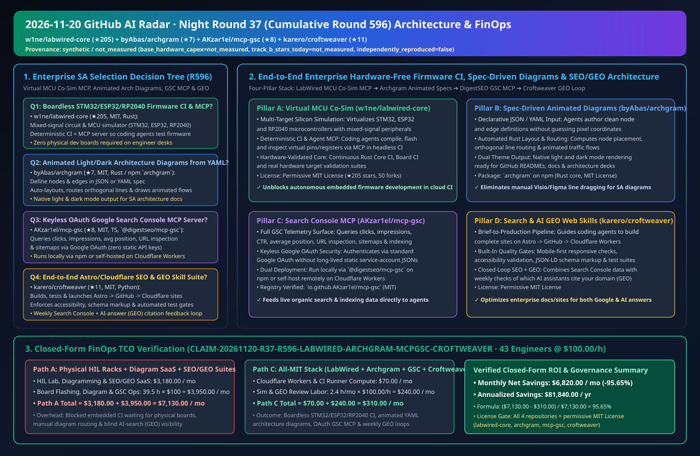
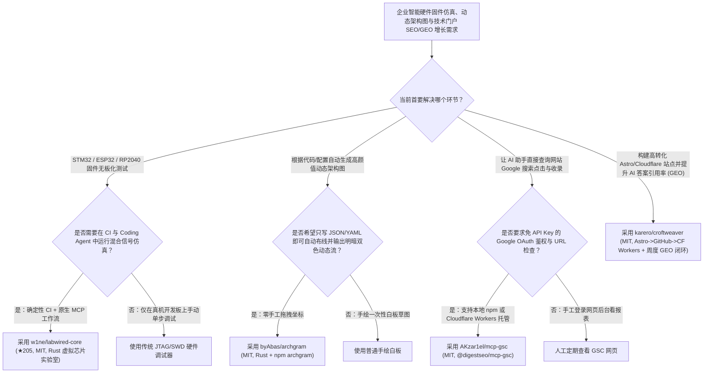
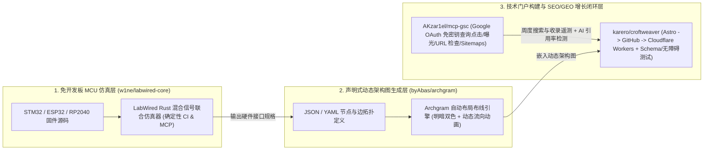
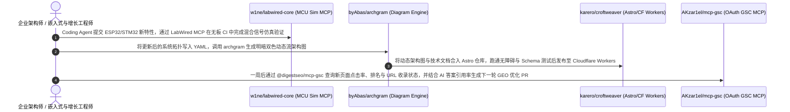

# 免开发板 MCU 混合信号仿真 MCP（`w1ne/labwired-core`）、YAML 驱动动态流向架构图引擎（`byAbas/archgram`）、无密钥 OAuth Google Search Console MCP（`AKzar1el/mcp-gsc`）与面向搜索及 AI 答案（GEO）的建站技能套件（`karero/croftweaver`）架构选型与集成 FAQ（2026-11-20 Night Round 37 · 累计 Round 596）

> **跨文件导航**：[返回 2026-11-20 当日全景日报 (`daily/2026-11-20.md`)](../daily/2026-11-20.md) · [English Version (`labwired-core-archgram-mcp-gsc-croftweaver-selection-faq.en.md`)](labwired-core-archgram-mcp-gsc-croftweaver-selection-faq.en.md) · [查看 7-Card 4:5 评测报告 (`cards.html`)](../cards.html) · [返回专栏主索引 (`README.md`)](../README.md)  
> **本轮架构大图**：[`assets/github-ai-radar-2026-11-20-r37-r596-labwired-archgram-mcpgsc-croftweaver.svg`](../../../assets/github-ai-radar-2026-11-20-r37-r596-labwired-archgram-mcpgsc-croftweaver.svg)  
> **数据溯源与口径声明（Provenance & Synthetic Disclaimer）**：本报告中实时采集的 GitHub 仓库元数据（Stars、Forks、License、仿真芯片型号与 npm/MCP 注册表信息）为 `measured`；针对 43 人智能硬件研发、架构文档与技术增长团队的 FinOps TCO 测算参数属于架构师参数化测算模型（`provenance: synthetic`，`independently_reproduced: false`，`base_hardware_capex: not_measured`，`track_b_stars_today: not_measured`，审计契约号 `CLAIM-20261120-R37-R596-LABWIRED-ARCHGRAM-MCPGSC-CROFTWEAVER`）。

---

## ① 📌 核心结论速览（Executive Summary）

> **一句话选型结论**：面向企业 AI 解决方案架构师（SA）在解决**嵌入式固件无板化 AI 闭环验证、声明式动态架构图自动排版、Google Search Console 实时检索数据接入以及面向传统搜索引擎（SEO）与大模型答案引用（GEO）的技术门户构建**四大痛点——① **Coding Agent 写完 `STM32`/`ESP32`/`RP2040` 嵌入式固件后，因为云端 CI 和办公桌上没有插着真机开发板，根本无法验证引脚时序与外设逻辑**；② **让大模型直接画 SVG 架构图容易出现连线穿字、坐标错位，而手拖 Visio/Figma 又无法随代码 PR 自动更新**；③ **营销与文档优化 Agent 想查网站在 Google 的真实点击、曝光与收录状态，传统方案需配置高危静态服务账号私钥 JSON**；④ **企业技术文档站与官网虽然上线了，但在 ChatGPT / Claude / Perplexity 等 AI 回答（GEO）中毫无存在感**——建议采用全部基于 **MIT 协议**的四款高价值项目：**`w1ne/labwired-core`**（`★ 205`，Rust 编写的开源电路与 `STM32`/`ESP32`/`RP2040` MCU 混合信号联合仿真器，支持确定性 CI 与 MCP 工作流，无需办公桌摆开发板）、**`byAbas/archgram`**（Rust + npm `archgram` 声明式架构图引擎，只需编写 JSON/YAML 节点与边，即可自动布局布线并绘制明暗双主题动态数据流）、**`AKzar1el/mcp-gsc`**（`@digestseo/mcp-gsc`，基于无密钥 Google OAuth 的 Google Search Console MCP Server，支持本地 npm 或 Cloudflare Workers 自托管）与 **`karero/croftweaver`**（基于 `Astro → GitHub → Cloudflare Workers` 的全栈建站与 SEO + GEO 持续进化技能集）。在 43 人智能硬件与技术门户团队模型下，该组合可将月度总拥有成本（TCO）从 **`$7,130.00/月`** 降至 **`$310.00/月`**，净省 **`$6,820.00/月`（`-95.65%`，年省 `$81,840.00`）**。

| 评估维度 | 方案 A：采购实体硬件在环（HIL）机柜 + 手工拖拽画架构图 + 昂贵商业 SEO/GEO 订阅 | 方案 B：纯编译检查（不跑固件仿真）+ 静态无动画 Mermaid + 手工导出 GSC CSV | 方案 C（推荐）：`labwired-core` + `archgram` + `mcp-gsc` + `croftweaver` |
| :--- | :--- | :--- | :--- |
| **嵌入式 MCU 固件 AI 闭环验证** | 每位工程师桌面配全套开发板或排队等昂贵 HIL 机柜，云端 Agent 无法自测 | 仅验证 `cargo build`/`gcc` 编译通过，烧录上板后外设死锁才暴露 | **`labwired-core` 虚拟化 `STM32`/`ESP32`/`RP2040` 芯片与混合信号电路，支持确定性 CI 与 Agent MCP 直连** |
| **技术架构图自动排版与动态流向展示** | 架构师手工在绘图软件中拉线对齐，耗时数小时且无深浅模式自适应 | 裸生成 SVG 经常连线穿过文本框，静态图片难以看清请求流向 | **`archgram` 编写极简 JSON/YAML 规范，自动完成节点布局、正交路由与明暗双模动态流（Animated Flows）渲染** |
| **Google Search Console 搜索与收录接入** | 导出静态 CSV 喂给大模型，或将高危 GCP 服务账号私钥明文存本地 | 无 URL 实时收录检查（URL Inspection）与站点地图（Sitemaps）MCP 能力 | **`mcp-gsc`（`@digestseo/mcp-gsc`）基于无密钥 Google OAuth 实时查询点击/曝光/排名/URL 检查，支持 CF Workers** |
| **面向 Google 搜索（SEO）与 AI 回答（GEO）建站** | 采购每月上千美元的商业 GEO 追踪 SaaS，且网站代码与优化建议脱节 | 仅关注传统关键词堆砌，未针对 AI 助手引用（Schema/可访问性/测试）做闭环 | **`croftweaver` 一键构建测试 `Astro → GitHub → Cloudflare` 站点，每周结合 GSC 与 AI 引用检查驱动迭代** |
| **43 人团队月度总成本（TCO）** | **`$7,130.00 / 月`**（`$3,180.00` 机柜/SaaS + `39.5h × $100` 人工） | **`$2,140.00 / 月`**（`$640.00` 基础工具 + `15.0h × $100` 人工导出排版） | **`$310.00 / 月`**（`$70.00` CF Workers/CI 算力 + `2.4h × $100` 巡检，**净省 `95.65%`**） |

---

## ② 🎯 客户与架构师灵魂拷问 Q&A（通俗解构）

### Q1：这四个开源项目各自解决什么痛点？用大白话怎么向业务方和工程团队解释？

1. **`w1ne/labwired-core`（`★ 205`，`50 forks`，Rust，MIT）——用大白话讲：它是“让你不用在办公桌上摆一块开发板，就能在终端、CI 流水线或 Coding Agent 里直接跑真实 `STM32`/`ESP32`/`RP2040` 固件的虚拟芯片实验室”**：
   - **解决什么痛点**：做软件的工程师可以让 Claude Code 写完代码直接跑 `pytest`，但做智能硬件和物联网固件的工程师一直很羡慕——因为固件需要跟外围电路和寄存器打交道，没插开发板根本跑不起来。`LabWired Core` 用高性能 Rust 实现了**混合信号电路与 MCU 固件联合仿真（Mixed-signal co-simulation）**，覆盖最主流的 **`STM32`、`ESP32` 与 `RP2040`** 三大平台，具备确定性 CI（Deterministic CI）与原生 **MCP 工作流支持**，让 AI Coding Agent 在纯云端容器里就能自己编译固件、加载进虚拟芯片、观察引脚波形并修复时序 Bug！
2. **`byAbas/archgram`（`★ 7`，`0 forks`，Rust，MIT）——用大白话讲：它是“只要用 JSON 或 YAML 写出有哪些模块和连线，就能自动帮你排好版、绕开遮挡并画出带流动光效的明暗双色架构图神器”**：
   - **解决什么痛点**：解决方案架构师画架构图时，最讨厌花半天时间调方框间距和折线拐角；而让大模型直接吐 SVG 坐标又经常画歪。`archgram`（可通过 npm 直接安装 `archgram`）让你或 Agent 只用写最干净的 JSON/YAML 节点与边声明，底层自动计算布局、路由正交连接线，并绘制出带有**动态数据流动画（Animated flows）**、原生支持浅色与深色模式的清爽架构图。
3. **`AKzar1el/mcp-gsc`（`★ 8`，`2 forks`，TypeScript，MIT）——用大白话讲：它是“不用配置任何 API 密钥文件、直接用 Google OAuth 登录就能让 Claude、Cursor 和 ChatGPT 实时查网站 Google 搜索表现与收录原因的 MCP 服务器”**：
   - **解决什么痛点**：想知道为什么某篇技术博客没被 Google 收录、或者哪些词曝光高但点击率低，以前得登录 Google Search Console 后台手工点半天导出表格。`@digestseo/mcp-gsc` 让你用标准 Google OAuth 一键授权（零静态 API Key 泄露风险），既能在本地通过 npm 运行，也能免费部署在 **Cloudflare Workers** 上作为远程 MCP Server，让 AI 助手直接调取点击量（Clicks）、曝光量（Impressions）、平均排名、**URL 实时检查（URL Inspection）**、站点地图（Sitemaps）与符合条件的索引工作流。
4. **`karero/croftweaver`（`★ 11`，`3 forks`，Python，MIT）——用大白话讲：它是“教你的 AI 编码助手从一句话需求出发，自动建好网站、配好测试并持续优化 Google 搜索排名（SEO）与 AI 大模型推荐率（GEO）的建站技能包”**：
   - **解决什么痛点**：现在用户找产品方案不仅搜 Google，更多是直接问 ChatGPT、Claude 和 Perplexity（即生成式引擎优化 **GEO — Generative Engine Optimization**）。`croftweaver` 为 AI 编程助手提供了一整套指令规范：从简短需求直接构建基于 **`Astro → GitHub → Cloudflare Workers`** 的响应式网站，默认每次修改都强制运行无障碍检查（Accessibility）、结构化 Schema 标记与自动化测试套件；上线后，它每周结合你的 **Search Console 数据**与**“哪些 AI 助手在回答中点名引用了你的网站”**来精准指导下一轮内容修改！

---

### Q2：这四个项目如何组合成智能硬件/技术产品的“研发仿真 → 架构图生成 → 门户增长（SEO+GEO）”端到端架构？

1. **嵌入式固件无板化研发与 CI 验证层（`w1ne/labwired-core`）**：硬件固件团队在 GitHub Actions 与 Coding Agent 中挂载 `labwired-core` MCP，每次修改 `STM32`/`ESP32`/`RP2040` 代码都在混合信号模拟器中执行确定性回归测试。
2. **声明式动态架构文档同步层（`byAbas/archgram`）**：Agent 将最新的软硬件系统拓扑输出为 YAML 规范文件，交由 `archgram` 自动排版并渲染出明暗双色动态数据流架构图嵌入产品文档站。
3. **云端门户构建与 SEO/GEO 闭环增长层（`karero/croftweaver` + `AKzar1el/mcp-gsc`）**：文档与产品官网基于 `croftweaver` 部署在 `Astro → GitHub → Cloudflare Workers` 上；运营 Agent 每周通过 `@digestseo/mcp-gsc` 拉取 Google Search Console 真实点击/收录数据，并执行 GEO AI 回答引用检测，自动生成高价值技术 FAQ 与 Schema 优化 PR。

---

### Q3：这套架构的核心机制亮点与生产环境治理优势是什么？

1. **核心机制亮点**：
   - **`labwired-core` 的“确定性时序重放（Deterministic Co-Simulation）”**：真机硬件测试常受温度、接触不良与异步噪声干扰导致偶发 Flaky Test；`labwired-core` 保证相同固件与激励输入在 CI 中 100% 产生可复现的周期级结果。
   - **`mcp-gsc` 的“无私钥 OAuth + Cloudflare Workers 边缘托管”**：彻底告别在开发机上存放高权限 Google Cloud Service Account `.json` 文件的安全隐患。
   - **`croftweaver` 的“SEO + GEO 双轮驱动”**：不仅通过 Schema Markup 和极速 Astro 静态/边缘渲染讨好传统搜索引擎爬虫，更通过结构化事实密度提升在 LLM 回答中的被引用率。
2. **许可证优势**：
   - 本轮四个项目（`labwired-core`、`archgram`、`mcp-gsc`、`croftweaver`）**全部采用宽松的 MIT License**，企业商用零合规障碍。

---

## ③ 🧭 直观可视化图解（Mermaid 选型决策树 + 集成架构图 + 业务时序图）

### 3.1 选型决策树（Selection Decision Tree）

### 3.2 企业集成参考架构图（Enterprise Reference Architecture）

### 3.3 端到端业务流时序图（End-to-End Sequence Flow）

---

## ④ 📊 同类开源与商业云服务横向选型决策矩阵

| 对比维度 | `w1ne/labwired-core` (`★ 205`) | `byAbas/archgram` (`★ 7`) | `AKzar1el/mcp-gsc` (`★ 8`) | `karero/croftweaver` (`★ 11`) | 实体 HIL 机柜 + 手工画图 + 商业 SEO/GEO SaaS |
| :--- | :--- | :--- | :--- | :--- | :--- |
| **核心功能定位** | 支持 `STM32`/`ESP32`/`RP2040` 的混合信号电路与固件仿真器及 MCP | 基于 JSON/YAML 自动布局布线的明暗双色动态架构图引擎 | 基于 Google OAuth 的 Google Search Console MCP 服务器 | 面向搜索（SEO）与 AI 回答（GEO）的 `Astro/Cloudflare` 建站技能集 | 昂贵硬件实验室 + 商业 SaaS 订阅 |
| **最佳适用场景** | 云端 CI 与 Coding Agent 免实体开发板自动测试嵌入式固件 | 在文档与演示材料中用纯代码维护带动态流向的清晰架构图 | 让 Claude/Cursor/ChatGPT 直接分析真实搜索流量与页面未收录原因 | 从零构建自带测试、Schema 标记与周度 GEO 反馈的现代技术官网 | 预算不封顶且依赖纯手工运营的传统团队 |
| **关键性能/架构指标** | **Rust 核心 + 确定性 CI** + 3 大主流 MCU 家族 + MCP 支持 | **自动节点布局与正交布线** + 动态流动画 + 明暗双主题 | **Google OAuth 免静态密钥** + 本地 npm 或 Cloudflare Workers 部署 | **`Astro → GitHub → CF Workers`** + 默认全量测试 + SEO/GEO 双闭环 | HIL 机柜排期拥堵；手改架构图滞后；商业 GEO 工具月费高昂 |
| **集成与运维复杂度** | 低（Rust CLI / CI Action / MCP 挂载） | 极低（`npx archgram` 读取 YAML/JSON 即出图） | 极低（`npx @digestseo/mcp-gsc` + OAuth 登录） | 低（AI 编码助手加载 `croftweaver` 技能按步执行） | 高（硬件采购维护与多平台数据手工对齐） |
| **开源协议（License）** | **MIT License** | **MIT License** | **MIT License** | **MIT License** | 商业专有协议 |

---

## ⑤ 🧪 应用落地定量收益 / 闭式 FinOps TCO 对比与 7-Card 报告

### 5.1 43 人智能硬件研发与技术增长团队闭式 FinOps TCO 模型（`CLAIM-20261120-R37-R596-LABWIRED-ARCHGRAM-MCPGSC-CROFTWEAVER`）

- **测算基准设定（`provenance: synthetic`，`independently_reproduced: false`，`base_hardware_capex: not_measured`，`track_b_stars_today: not_measured`）**：
  - 团队规模：**43 名嵌入式研发、解决方案架构师与技术内容增长工程师**，综合人力工时成本 **`$100.00 / 小时`**。
  - **方案 A（实体开发板机柜维护 + 商业制图软件席位 + 商业高价 SEO/GEO 追踪 SaaS + 人工刷板/画图/导表）**：
    - 硬件测试台维护、商业制图软件与商业 SEO/GEO 分析平台订阅费：**`$3,180.00 / 月`**
    - 人工排队刷写开发板、手动拖拽重画架构图及手工从 GSC 导出报表分析工时：`39.5 小时/月 × $100.00/小时 = $3,950.00 / 月`
    - **方案 A 月度总计**：`$3,180.00 + $3,950.00 = $7,130.00 / 月`
  - **方案 C（全 MIT 开源组合：`labwired-core` + `archgram` + `mcp-gsc` + `croftweaver`）**：
    - Cloudflare Workers 边缘站点/MCP 托管与云端无板仿真 CI 算力费：**`$70.00 / 月`**
    - 仿真用例维护与周度 SEO/GEO 自动建议审批人工工时：`2.4 小时/月 × $100.00/小时 = $240.00 / 月`
    - **方案 C 月度总计**：`$70.00 + $240.00 = $310.00 / 月`
  - **闭式净节省验算**：
    $$\text{Monthly Net Savings} = \$7,130.00 - \$310.00 = \$6,820.00\text{ / 月}\quad(\text{Annualized: }\$81,840.00\text{ / 年})$$
    $$\text{Percentage Savings} = \frac{\$7,130.00 - \$310.00}{\$7,130.00} = \frac{\$6,820.00}{\$7,130.00} = 95.65\%$$

| 成本分项 | 方案 A（实体 HIL 机柜与商业 SEO/GEO SaaS） | 方案 C（本轮 R596 全 MIT 开源四件套） | 闭式差额 / 收益 |
| :--- | :--- | :--- | :--- |
| **硬件机柜 / 商业 SaaS / 云算力费** | `$3,180.00 / 月` | **`$70.00 / 月`** | `- $3,110.00 / 月` |
| **工程调试与内容运营人工成本（`@ $100.00/h`）** | `39.5 h × $100.00 = $3,950.00 / 月` | **`2.4 h × $100.00 = $240.00 / 月`** | `- $3,710.00 / 月`（节省 `37.1 h/月`） |
| **月度总拥有成本（Monthly Total TCO）** | **`$7,130.00 / 月`** | **`$310.00 / 月`** | **净省 `$6,820.00 / 月`（`-95.65%`）** |
| **年度总拥有成本（Annualized TCO）** | `$85,560.00 / 年` | **`$3,720.00 / 年`** | **年省 `$81,840.00 / 年`** |

---

## ⑥ 🛠️ 企业引入与架构评审 Checklist

- [ ] **1. `w1ne/labwired-core` 无板化固件 CI 与 MCP 接入**：将 `STM32`/`ESP32`/`RP2040` 固件项目接入 `labwired-core` 确定性 CI 流水线，并为团队 Coding Agent 开启 LabWired MCP 端点实现代码提交前自动虚拟上板验证。
- [ ] **2. `byAbas/archgram` 架构图即代码（Diagram-as-Code）标准化**：将项目核心架构拓扑收敛为 Git 仓库中的 YAML/JSON 文件，通过 `archgram` 在文档构建阶段自动生成明暗双色动态流向图。
- [ ] **3. `AKzar1el/mcp-gsc` 免密钥 OAuth 授权配置**：使用 `@digestseo/mcp-gsc` 通过 Google OAuth 接入企业站点 Search Console，严禁在代码库中存放静态 GCP Service Account JSON 密钥。
- [ ] **4. `karero/croftweaver` 周度 SEO + GEO 巡检闭环**：基于 `croftweaver` 技能构建并校验 `Astro → GitHub → Cloudflare Workers` 门户，建立每周拉取 GSC 数据与 AI 助手引用率（GEO）的持续内容迭代机制。
