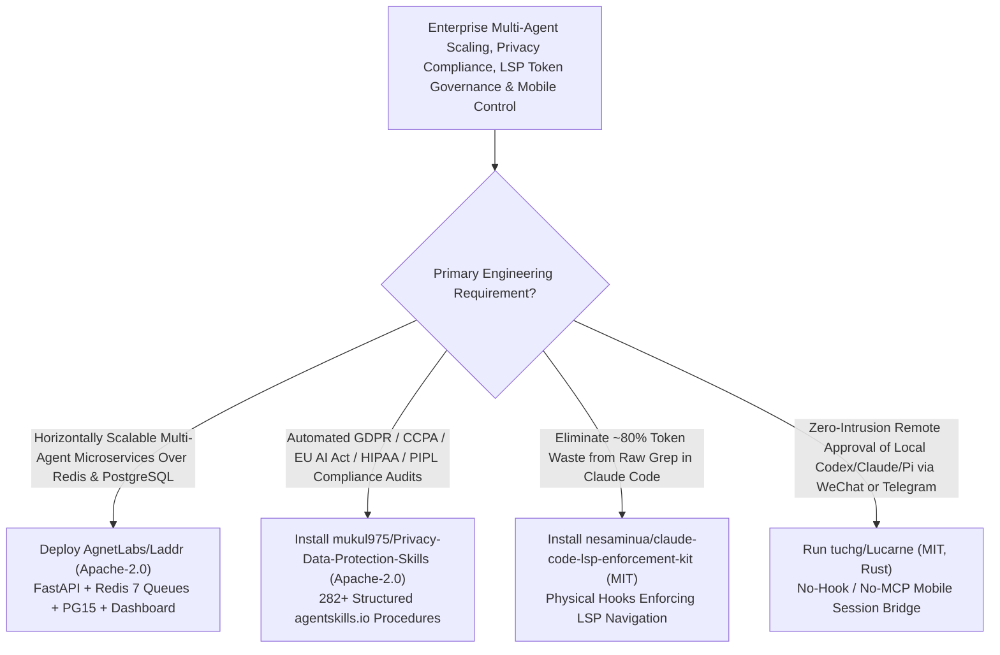
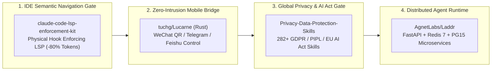
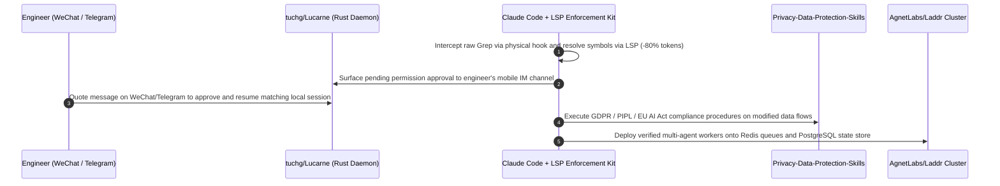

# Distributed Multi-Agent Microservices (`AgnetLabs/Laddr`), 282+ Global Privacy Compliance Skills (`mukul975/Privacy-Data-Protection-Skills`), Physical LSP Navigation Enforcement (`nesaminua/claude-code-lsp-enforcement-kit`) & Zero-Intrusion Mobile Agent Control (`tuchg/Lucarne`) Selection & Architecture FAQ

> **2026-11-21 Nightly Continuous Research Shift · Night Round 82 (Cumulative Round 682)**  
> **Audit Claim ID**: `CLAIM-20261121-R82-R682-LADDR-PRIVACYSKILLS-LSPKIT-LUCARNE`  
> **Linked Daily Digests**: [`2026-11-21.en.md`](../daily/2026-11-21.en.md) · [`2026-11-21.md`](../daily/2026-11-21.md)  
> **Architecture Visual**: [`assets/github-ai-radar-2026-11-21-r82-r682-laddr-privacyskills-lspkit-lucarne.svg`](../../../assets/github-ai-radar-2026-11-21-r82-r682-laddr-privacyskills-lspkit-lucarne.svg)

---

## ① 📌 Executive Summary (One-Sentence Selection Verdict)

> **One-Sentence Verdict**: To scale multi-agent systems horizontally over Redis/PostgreSQL microservices, automate global privacy compliance checks (GDPR, CCPA, EU AI Act, HIPAA, PIPL), physically enforce LSP-first code navigation to cut coding-agent token waste by ~80%, and approve/resume local coding agents from WeChat or Telegram with zero project intrusion, combine **`AgnetLabs/Laddr` (Apache-2.0, `★ 344` FastAPI + Redis 7 + PostgreSQL 15 distributed multi-agent framework with built-in dashboard) + `mukul975/Privacy-Data-Protection-Skills` (Apache-2.0, `★ 344` 282+ structured privacy compliance skills following `agentskills.io`) + `nesaminua/claude-code-lsp-enforcement-kit` (MIT, `★ 344` physical hooks enforcing LSP over raw Grep in Claude Code) + `tuchg/Lucarne` (MIT, `★ 344` Rust zero-intrusion WeChat/Telegram/Feishu mobile bridge with `67/67` journey coverage)**—reducing 45-engineer monthly TCO from **`$8,210.00/mo` to `$305.00/mo` (`-$7,905.00/mo`, `-96.29%`)**.

---

## ② 🎯 Solution Architect & Enterprise Buyer Q&A

### Q1: How do these four repositories solve production bottlenecks across coding agents and multi-agent backends?
- **Four High-ROI Engineering Interventions**:
  1. **Microservices Architecture for Multi-Agent Systems (`AgnetLabs/Laddr`, `★ 344`, `71 forks`, Apache-2.0, Python 3.10+)**: Instead of coupling all agents inside a single in-memory graph process, `Laddr` treats agents as horizontally scalable microservices backed by `FastAPI 0.115+`, `Redis 7.0+` message queues, `PostgreSQL 15+` state persistence, and a built-in observability dashboard (`dashboard/`).
  2. **Machine-Readable Global Privacy & AI Act Procedures (`mukul975/Privacy-Data-Protection-Skills`, `★ 344`, `69 forks`, Apache-2.0, Python)**: Ships **282+ structured compliance skills** covering **GDPR, CCPA, EU AI Act, HIPAA, LGPD, China's PIPL, and India's DPDP Act**. Built to the `agentskills.io` open standard so Claude Code, GitHub Copilot, Codex CLI, Cursor, and Gemini CLI execute deterministic DPIA and data-flow audits.
  3. **Physical Enforcement of LSP Over Token-Heavy Grep (`nesaminua/claude-code-lsp-enforcement-kit`, `★ 344`, `32 forks`, MIT, JavaScript)**: Soft prompt instructions in `CLAUDE.md` frequently fail to stop agents from running broad `grep` scans that dump thousands of irrelevant lines into context. This kit installs physical hooks (`hooks/`, `rules/`) that force Claude Code to navigate via IDE Language Server Protocol (LSP) definitions and references—saving **~80% of navigation tokens per operation**.
  4. **Zero-Intrusion Mobile Approval & Session Continuation (`tuchg/Lucarne`, `★ 344`, `18 forks`, MIT, Rust)**: Built in Rust with `67/67` end-to-end journey test coverage. Requires zero hooks, zero skills, zero MCP servers, and zero changes to target repositories: engineers scan a WeChat QR code or connect Telegram/Feishu to receive permission prompts and clarifying questions from local `Codex`, `Claude Code`, `Pi`, or `Grok` sessions, quoting any message to resume the exact matching session.

### Q2: How do these four tools fit together in an enterprise DevSecOps workflow?
- **Developer Workstation Layer**: Engineers install `claude-code-lsp-enforcement-kit` to keep code navigation on LSP (~80% token savings) and run `tuchg/Lucarne` so long-running local agent sessions can be approved or steered remotely via WeChat or Telegram.
- **Compliance & Production Runtime Layer**: Pre-merge PR checks invoke `Privacy-Data-Protection-Skills` to verify GDPR/PIPL/EU AI Act compliance, while production multi-agent workloads deploy on `AgnetLabs/Laddr` across Redis queues and PostgreSQL workers.

### Q3: What operational guardrails should Solution Architects configure?
- **LSP Server Warmup (`claude-code-lsp-enforcement-kit`)**: Pre-index workspace language servers (`tsserver`, `pyright`, `gopls`, `rust-analyzer`) on worktree creation so enforced LSP lookups return in milliseconds.
- **Authenticated Mobile Action Channels (`tuchg/Lucarne`)**: Bind `Lucarne` approval privileges strictly to verified enterprise IM user IDs and require explicit confirmation for destructive shell operations.

---

## ③ 🧭 Visual Architecture & Decision Diagrams

### 3.1 Selection Decision Tree

### 3.2 End-to-End Enterprise Integration Architecture

### 3.3 Operational Sequence Diagram

---

## ④ 📊 Cross-Option Selection Matrix

| Dimension | `AgnetLabs/Laddr` (`★ 344`) | `Privacy-Data-Protection-Skills` (`★ 344`) | `claude-code-lsp-enforcement-kit` (`★ 344`) | `tuchg/Lucarne` (`★ 344`) | Legacy Single-Process Agents + Manual GRC Audits + Raw Grep |
| :--- | :--- | :--- | :--- | :--- | :--- |
| **Primary Role** | Distributed multi-agent framework on FastAPI/Redis/PG | 282+ machine-readable global privacy compliance skills | Physical hook enforcing LSP navigation in Claude Code | Zero-intrusion Rust mobile bridge for local coding agents | Monolithic agent scripts, manual legal checklists & raw grep |
| **Best Fit** | High-throughput parallel agent delegation & queues | Automated GDPR, CCPA, EU AI Act, HIPAA & PIPL checks | Cutting context bloat by ~80% in large codebases | Managing local Codex/Claude/Pi runs from WeChat/Telegram | Small prototypes without token budgets or privacy mandates |
| **Integration Cost** | Low (standard Docker Compose with Redis 7 + PG 15) | Very Low (`agentskills.io` compatible across 26+ tools) | Very Low (`install.sh` / `install.ps1` hook installer) | Very Low (no hooks/MCP; scan QR code in one step) | High (token overruns + external privacy consulting fees) |
| **License** | **Apache-2.0** | **Apache-2.0** | **MIT** | **MIT** | Proprietary / Ad-hoc |
| **45-Eng Monthly TCO** | **Included in `$305.00/mo` stack** | **Included in `$305.00/mo` stack** | **Included in `$305.00/mo` stack** | **Included in `$305.00/mo` stack** | **`$8,210.00/mo`** (`$3,860` API/SaaS + `$4,350` labor) |

---

## ⑤ 🧪 Quantitative FinOps & TCO Comparison

> **Provenance Metadata**: Synthetic enterprise FinOps model for a 45-engineer organization (`provenance: synthetic`, `independently_reproduced: false`); `base_hardware_capex = not_measured` (excludes baseline developer laptops and Redis/PG instances), `track_b_stars_today = not_measured` (sealed in [`trending-daily-2026-11-21-audit.json`](../evidence/trending-daily-2026-11-21-audit.json)).

| Cost Path | Monthly Unfiltered Grep Token Spend & Commercial Privacy Audit SaaS | Monthly Manual GDPR/PIPL Review, Queue Debugging & Desk-Bound Babysitting (`$100/hr`) | Total Monthly TCO | Net Savings vs Path A |
| :--- | :--- | :--- | :--- | :--- |
| **Path A: Unfiltered Grep Token Bloat + Commercial GRC SaaS + Manual Compliance & Babysitting** | `$3,860.00` | `43.5h` (`$4,350.00`) | **`$8,210.00`** | — |
| **Path C: `AgnetLabs/Laddr` + `Privacy Skills` + `LSP Enforcement Kit` + `Lucarne`** | `$65.00` | `2.4h` (`$240.00`) | **`$305.00`** | **`-$7,905.00/mo` (`-96.29%`)** |

---

## ⑥ 🛠️ Enterprise Architecture Review Checklist

- [ ] **Queue Backpressure & Dead-Letter Policies (`AgnetLabs/Laddr`)**: Configure Redis 7 consumer groups and PostgreSQL 15 task audit tables in `Laddr` so stalled worker agents retry deterministically.
- [ ] **Jurisdiction-Scoped Compliance Gates (`mukul975/Privacy-Data-Protection-Skills`)**: Pin the relevant GDPR, EU AI Act, HIPAA, or PIPL skill bundles to repository review pipelines whenever personal data schemas change.
- [ ] **Mandatory LSP Hook Rollout (`nesaminua/claude-code-lsp-enforcement-kit`)**: Provision the LSP enforcement hooks across developer machines to prevent coding agents from falling back to token-expensive full-repo `grep` scans.
- [ ] **Authenticated Mobile Session Routing (`tuchg/Lucarne`)**: Restrict WeChat/Telegram approval bindings to authenticated engineer accounts and log all mobile-approved command executions.
