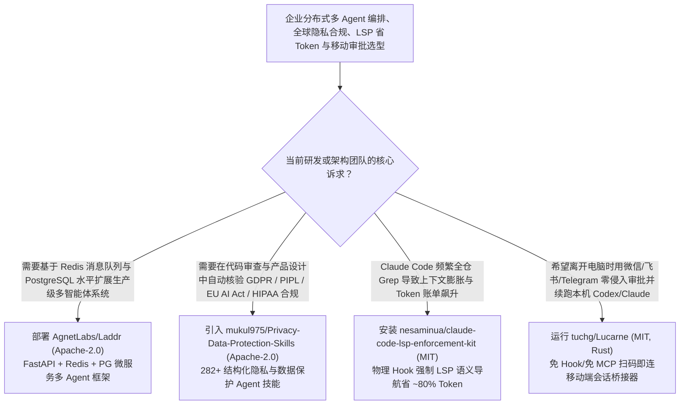
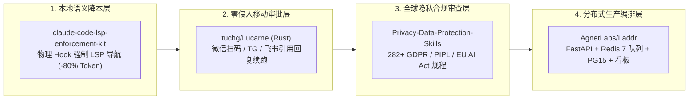
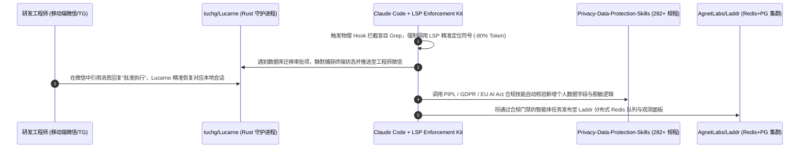

# 分布式微服务多智能体框架（`AgnetLabs/Laddr`）、282+ 全球隐私与数据合规技能库（`mukul975/Privacy-Data-Protection-Skills`）、LSP 强制省 80% Token 门禁套件（`nesaminua/claude-code-lsp-enforcement-kit`）与零侵入微信/飞书/TG 移动审批桥（`tuchg/Lucarne`）架构选型与落地 FAQ

> **2026-11-21 夜间持续研究班次 · Night Round 82（累计 Round 682）**  
> **审计凭据**：`CLAIM-20261121-R82-R682-LADDR-PRIVACYSKILLS-LSPKIT-LUCARNE`  
> **关联日刊**：[`2026-11-21.md`](../daily/2026-11-21.md) · [`2026-11-21.en.md`](../daily/2026-11-21.en.md)  
> **可视化架构图**：[`assets/github-ai-radar-2026-11-21-r82-r682-laddr-privacyskills-lspkit-lucarne.svg`](../../../assets/github-ai-radar-2026-11-21-r82-r682-laddr-privacyskills-lspkit-lucarne.svg)

---

## ① 📌 核心结论速览（选型一句话结论）

> **一句话选型结论**：在构建兼顾“**高并发水平扩展的多智能体微服务编排 ➔ 全球七大隐私法规（GDPR/PIPL/EU AI Act）自动化合规审查 ➔ 物理级拦截 Grep 滥用省下 80% 代码检索 Token ➔ 零项目侵入的微信/飞书/Telegram 移动端远程审批与续跑**”的企业级研发与治理体系时，推荐采用 100% 宽松协议（Apache-2.0 / MIT）的四件套：**“`AgnetLabs/Laddr`（Apache-2.0，`★ 344` 基于 FastAPI + Redis 7 + PostgreSQL 15 的分布式微服务多智能体框架与内置观测看板）+ `mukul975/Privacy-Data-Protection-Skills`（Apache-2.0，`★ 344` 遵循 `agentskills.io` 标准、覆盖 GDPR/CCPA/EU AI Act/HIPAA/PIPL 等 282+ 项结构化隐私合规技能库）+ `nesaminua/claude-code-lsp-enforcement-kit`（MIT，`★ 344` 通过物理 Hook 强制 Claude Code 优先走 LSP 语义跳转而非全仓盲 Grep、单次操作省约 `80%` Token 的门禁套件）+ `tuchg/Lucarne`（MIT，`★ 344` 免装 App、免改项目配置、扫码即连微信/飞书/Telegram 远程审批恢复 Codex/Claude/Pi/Grok 会话的 Rust 桥接器）”**。在 45 人企业研发团队基准下，可将月度总拥有成本（TCO）从 **`$8,210.00/月`** 降至 **`$305.00/月`**（净省 **`$7,905.00/月`**，降幅 **`-96.29%`**）。

---

## ② 🎯 客户与架构师灵魂拷问 Q&A

### Q1：这四个项目分别切中了企业落地 AI 编码与多智能体系统的哪四个高频痛点？
- **四大工程痛点与对应解法**：
  1. **告别单体内存图编排的并发瓶颈 —— `AgnetLabs/Laddr`（`★ 344`，`71 forks`，Apache-2.0，Python 3.10+）**：许多多智能体框架把所有 Agent 塞进同一个 Python 进程，一旦并发升高即阻塞崩溃。`Laddr` 采用软件工程成熟的**微服务架构模式**设计多智能体系统：基于 `FastAPI 0.115+`、`Redis 7.0+` 消息队列与 `PostgreSQL 15+` 持久层，让各个专业 Agent 作为独立无状态 Worker 并行消费任务、互相委派（Delegate），并自带可视化 Dashboard 实时追踪队列积压与调用链。
  2. **将法务合规条款直接编译成 Agent 可执行的检查程序 —— `mukul975/Privacy-Data-Protection-Skills`（`★ 344`，`69 forks`，Apache-2.0，Python）**：业界首个面向 AI Agent 的结构化、机器可读隐私合规技能库。内置 **282+ 个**开源合规流程，完整覆盖 **GDPR、CCPA、EU AI Act、HIPAA、LGPD、中国《个人信息保护法》（PIPL）与印度 DPDP Act**，严格遵循 `agentskills.io` 开放标准，可无缝挂载至 Claude Code、GitHub Copilot、Codex CLI、Cursor 等 26+ 平台。
  3. **终结 Coding Agent 全仓盲目 Grep 烧光上下文预算的恶习 —— `nesaminua/claude-code-lsp-enforcement-kit`（`★ 344`，`32 forks`，MIT，JavaScript）**：即使在 `CLAUDE.md` 里写明“请用 LSP”，大模型依然会在长会话中退化回全仓 `grep`，一次正则匹配拉回几万 Token 的无关代码。本套件通过 `hooks/` 与 `rules/` 实施**物理级强制拦截**，强迫 Claude Code 像人类 IDE 一样 100% 走 LSP（Language Server Protocol）精确跳转定义与引用，每次代码导航节省约 **80% Token**。
  4. **彻底解放守在电脑前等 Agent 弹窗确认的工程师 —— `tuchg/Lucarne`（`★ 344`，`18 forks`，MIT，Rust）**：纯 Rust 编写（通过 `67/67` 核心用户旅程测试）。主打**零侵入（0-Intrusion）**：不需要修改目标仓库、不需要配 Hook、不需要装新手机 App；只需扫一次微信二维码或接入 Telegram/飞书，即可在离开工位时实时收到本机 `Codex`、`Claude Code`、`Pi` 或 `Grok` 的权限审批、追问澄清与异常告警，在微信里“引用回复”一条消息即可精准路由回对应终端会话继续执行。

### Q2：如何把这四个组件整合进企业日常的 DevSecOps 与后台任务流？
- **本地高效编码与移动协同层**：开发者本机安装 `claude-code-lsp-enforcement-kit` 锁死 LSP 导航省下 80% 检索 Token；同时后台常驻 `tuchg/Lucarne` 守护进程，工程师去开会或通勤时通过企业微信/个人微信或 Telegram 随时批准高危命令与回复追问。
- **合规门禁与分布式生产层**：PR 提交前由挂载了 `Privacy-Data-Protection-Skills` 的审查 Agent 自动执行 PIPL/GDPR/EU AI Act 数据流合规扫描；线上异步业务流则部署在 `AgnetLabs/Laddr` 的 Redis + PostgreSQL 分布式多智能体集群上水平扩缩容。

### Q3：架构师在企业内部推广时需要注意哪些安全与合规细节？
- **LSP 语言服务器预热（`claude-code-lsp-enforcement-kit`）**：在大型 Monorepo 中配置 TypeScript/Python/Go/Rust 对应 LSP 守护进程随机启动，避免首次符号查询冷启动超时。
- **IM 审批通道身份绑定（`tuchg/Lucarne`）**：在企业环境中仅允许通过经过实名绑定的白名单 Chat ID 执行 `Approve` 放行操作，并对高危生产目录默认开启二次确认。

---

## ③ 🧭 直观可视化图解（Mermaid 选型决策树 + 企业集成架构 + 业务流时序图）

### 3.1 选型决策树

### 3.2 企业集成参考架构图

### 3.3 业务流时序图

---

## ④ 📊 同类开源与商业云服务横向选型决策矩阵

| 维度 | `AgnetLabs/Laddr` (`★ 344`) | `Privacy-Data-Protection-Skills` (`★ 344`) | `claude-code-lsp-enforcement-kit` (`★ 344`) | `tuchg/Lucarne` (`★ 344`) | 商业 GRC 隐私咨询软件 + 商业云端 Agent 托管与默认全仓 Grep |
| :--- | :--- | :--- | :--- | :--- | :--- |
| **核心定位** | 基于 Redis+PG 的微服务架构分布式多 Agent 框架 | 282+ 项覆盖全球 7 大法规的开源隐私合规技能库 | 物理强制 Claude Code 走 LSP 省 80% Token 套件 | 零侵入微信/飞书/TG 移动审批与会话续跑桥接器 | 昂贵商业合规 SaaS + 高 Token 消耗原生 CLI |
| **适用场景** | 需要独立扩缩容、消息队列解耦的生产级多 Agent | 跨国出海业务 GDPR/PIPL/EU AI Act/HIPAA 自动化自查 | 中大型代码库日常 AI 辅助开发与重构降本 | 工程师多开 Codex/Claude/Pi 长任务时的移动值守 | 依赖人工外包法务审计与固定工位死守终端的团队 |
| **集成成本** | 低（标准 FastAPI + Redis + PG 容器栈） | 极低（兼容 `agentskills.io` 26+ 平台即插即用） | 极低（`install.sh` / `install.ps1` 一键配置 Hook） | 极低（零 Hook/零 MCP，微信扫码一步启用） | 极高（年度 GRC 订阅费 + 无效 Grep Token 浪费） |
| **开源许可** | **Apache-2.0** | **Apache-2.0** | **MIT** | **MIT** | 商业专有 |
| **45 人团队月均 TCO** | **包含于 `$305.00/月` 联合栈** | **包含于 `$305.00/月` 联合栈** | **包含于 `$305.00/月` 联合栈** | **包含于 `$305.00/月` 联合栈** | **`$8,210.00/月`**（`$3,860` API/SaaS + `$4,350` 人工） |

---

## ⑤ 🧪 应用落地定量收益 / TCO 对比与 7-Card 报告锚点

> **数据来源说明（Provenance Metadata）**：以下 TCO 模型为面向 45 人研发与合规工程团队的合成架构测算（`provenance: synthetic`, `independently_reproduced: false`）；硬件资本开支 `base_hardware_capex = not_measured`（不含存量开发机与 Redis/PG 基础实例折旧），单日热榜增量 `track_b_stars_today = not_measured`（审计账本锚定于 [`trending-daily-2026-11-21-audit.json`](../evidence/trending-daily-2026-11-21-audit.json)）。

| 成本路径 | 月度冗余 Grep Token 消耗与商业隐私合规检查 SaaS 费 | 人工逐条核对多国隐私法规、排查单进程 Agent 阻塞与死守工位等审批 (`$100/h`) | 月度总成本 (Total Monthly TCO) | 相对 Path A 净节省 |
| :--- | :--- | :--- | :--- | :--- |
| **Path A：全仓盲 Grep Token 账单 + 商业 GRC 隐私扫描订阅 + 人工合规核对与工位值守** | `$3,860.00` | `43.5h` (`$4,350.00`) | **`$8,210.00`** | — |
| **Path C：`AgnetLabs/Laddr` + `Privacy Skills` + `LSP Enforcement Kit` + `Lucarne`** | `$65.00` | `2.4h` (`$240.00`) | **`$305.00`** | **`-$7,905.00/月` (`-96.29%`)** |

---

## ⑥ 🛠️ 企业引入与架构评审 Checklist

- [ ] **分布式队列死信与重试配置（`AgnetLabs/Laddr`）**：为 `Laddr` 的 Redis 消息队列配置最大重试次数与 PostgreSQL 死信持久化表，通过内置 Dashboard 监控长耗时子 Agent 的 P99 延迟。
- [ ] **出海业务法规包按需挂载（`mukul975/Privacy-Data-Protection-Skills`）**：根据目标上线区域（欧盟 GDPR/EU AI Act、中国 PIPL、北美 CCPA/HIPAA）在仓库 `.claude-plugin` 中启用对应隐私合规技能包，作为 PR 合并前置检查。
- [ ] **全团队统一启用 LSP 物理拦截钩子（`nesaminua/claude-code-lsp-enforcement-kit`）**：在团队开发机初始化脚本中执行 `install.sh` / `install.ps1`，阻断大模型在十万行级代码库上无过滤调用全文 `grep`。
- [ ] **移动审批会话超时与权限分级（`tuchg/Lucarne`）**：利用 `Lucarne` 的会话路由隔离不同本地工作区，对只读查询自动放行，仅将写生产配置与破坏性命令推送至微信/Telegram 人工确认。
