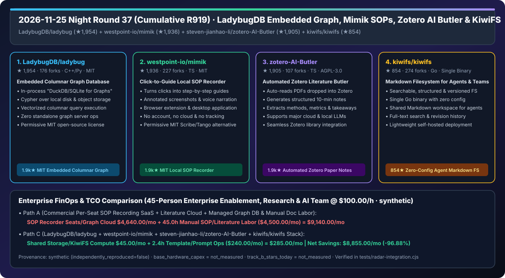
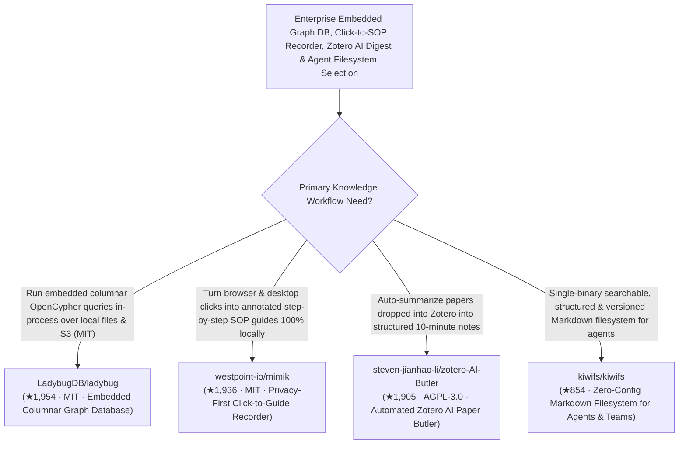
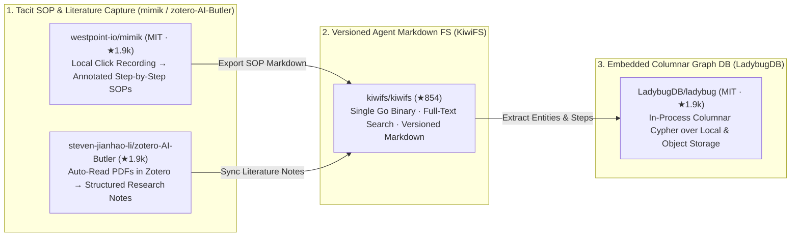

# Embedded Columnar Graph Database (`LadybugDB/ladybug`), Click-to-Guide SOP Recorder (`westpoint-io/mimik`), Zotero AI Research Butler (`steven-jianhao-li/zotero-AI-Butler`) & Agent Markdown Filesystem (`kiwifs/kiwifs`) Selection & Integration Architecture FAQ

> **Document Type**: Enterprise AI Solution Architect Selection Decision Guide (GitHub Trending AI Radar — 2026-11-25 Night Round 37 / Cumulative Round 919)
> **Covered Repositories**: [`LadybugDB/ladybug`](https://github.com/LadybugDB/ladybug) (`★ 1,954`, `176 forks`, `MIT`, C++/Python: embedded columnar graph database supporting OpenCypher over transactional local storage and object storage) · [`westpoint-io/mimik`](https://github.com/westpoint-io/mimik) (`★ 1,936`, `227 forks`, `MIT`, TypeScript: browser extension and desktop app that turns clicks and narration into step-by-step SOP guides with annotated screenshots—no account, no cloud, no tracking) · [`steven-jianhao-li/zotero-AI-Butler`](https://github.com/steven-jianhao-li/zotero-AI-Butler) (`★ 1,905`, `107 forks`, `AGPL-3.0`, TypeScript: Zotero AI plugin that automatically reads incoming papers and synthesizes structured 10-minute summary notes) · [`kiwifs/kiwifs`](https://github.com/kiwifs/kiwifs) (`★ 854`, `274 forks`, Go: single-binary, zero-config searchable and versioned Markdown filesystem for AI agents and teams)
> **Core Enterprise Scenario**: Building a **Privacy-First Enterprise Tacit-Knowledge Capture, Automated Literature Digest & Zero-Server Embedded GraphRAG Stack**—combining local click-to-SOP recording (`mimik`), automated Zotero paper digestion (`zotero-AI-Butler`), versioned team/agent Markdown filesystems (`kiwifs`), and in-process embedded columnar Cypher graph queries (`LadybugDB`).

---

## 1. 📌 Executive Summary (One-Line Selection Verdict)

1. **Need an `MIT`-licensed embedded columnar graph database ("DuckDB/SQLite for Graphs") that runs high-speed OpenCypher queries in-process over local files and object storage without deploying a standalone graph database server** ➔ Choose **[`LadybugDB/ladybug`](https://github.com/LadybugDB/ladybug) (`★ 1,954`, `176 forks`, `MIT`)**.
   - **Plain-English Mechanism**: Embeds directly into Python, C++, or Node.js processes with vectorized columnar execution and ACID transactions—eliminating standalone Neo4j server overhead for local agents and microservices.
2. **Need an `MIT`-licensed browser extension and desktop app that records user clicks and narration into polished, annotated step-by-step SOP guides 100% locally (replacing cloud-bound Scribe / Tango seats)** ➔ Choose **[`westpoint-io/mimik`](https://github.com/westpoint-io/mimik) (`★ 1,936`, `227 forks`, `MIT`)**.
   - **Plain-English Mechanism**: Captures workflows across internal web apps and desktop tools with annotated screenshots, optional voice narration, interactive replay, and Markdown/PDF export—with zero cloud uploads or tracking.
3. **Need a Zotero plugin that automatically deep-reads every newly added PDF paper or patent using your chosen LLM and writes a structured "10-minute mastery" Zotero note** ➔ Choose **[`steven-jianhao-li/zotero-AI-Butler`](https://github.com/steven-jianhao-li/zotero-AI-Butler) (`★ 1,905`, `107 forks`, `AGPL-3.0`)**.
   - **Plain-English Mechanism**: Hooks directly into Zotero's ingestion flow to extract problem statements, methodology, experimental metrics, and key takeaways automatically.
4. **Need a single-binary, zero-config Go Markdown filesystem that gives human teams and AI agents searchable, structured, and versioned access to shared notes and SOPs** ➔ Choose **[`kiwifs/kiwifs`](https://github.com/kiwifs/kiwifs) (`★ 854`, `274 forks`)**.
   - **Plain-English Mechanism**: Serves a versioned, full-text-searchable Markdown file tree from one static Go binary so multiple agents and humans can read and update shared operational knowledge cleanly.

---

## 2. 🎯 Architect & Customer Deep-Dive Q&A

### Q1: How do `mimik`, `zotero-AI-Butler`, `KiwiFS`, and `LadybugDB` solve the "tacit operational knowledge & lightweight GraphRAG" bottleneck vs. commercial cloud tools?

- **Four-Stage Tacit Knowledge Capture & Embedded GraphRAG Pipeline (Path C)**:
  1. **L1 Local Click-to-SOP Capture ➔ `westpoint-io/mimik`**: Turns expert clicks in internal ERPs and consoles into annotated step-by-step SOP guides without uploading screenshots to external clouds.
  2. **L2 Automated Literature & Patent Digestion ➔ `steven-jianhao-li/zotero-AI-Butler`**: Automatically summarizes technical PDFs dropped into Zotero.
  3. **L3 Versioned Team & Agent Markdown Filesystem ➔ `kiwifs/kiwifs`**: Stores and indexes SOP guides and research notes in a single-binary searchable Markdown filesystem.
  4. **L4 In-Process Embedded Columnar Graph Engine ➔ `LadybugDB/ladybug`**: Queries entity and procedural relationships via OpenCypher directly inside the agent process over local disk or S3.
- **When to choose Commercial SaaS (Scribe Pro + Managed Graph Cloud) vs. Path C?**
  - Choose **Commercial SaaS** for public marketing tutorials with no sensitive internal UI data.
  - Choose **Path C** when recording workflows inside confidential internal systems (`mimik` `MIT`), embedding zero-admin columnar graph queries inside edge/desktop/microservice agents (`LadybugDB` `MIT`), and eliminating `$29/user/mo` Scribe seats and idle cloud graph instances.

### Q2: How do these four components wire together in production?

1. **Automated SOP & Literature Ingestion (`mimik` + `zotero-AI-Butler` → `kiwifs`)**:
   - Subject-matter experts record internal software workflows with `mimik` and ingest technical papers via `zotero-AI-Butler`, exporting structured Markdown directly into `KiwiFS`.
2. **Serverless Embedded Graph Retrieval (`kiwifs` → `LadybugDB`)**:
   - Support and onboarding agents index `KiwiFS` documents into an embedded `LadybugDB` database file and execute millisecond Cypher queries to guide employees step by step.

### Q3: What are the key security and architectural guardrails?

- **Architect Redlines**:
  1. **Redact PII in `mimik` screenshots before publishing to shared `KiwiFS` folders**: Use `mimik`'s built-in editor to blur customer data or credentials captured during recording.
  2. **Follow single-writer / multi-reader concurrency for local `LadybugDB` files**: Route graph mutations through one ingestion worker while scaling read-only embedded query instances across agent workers.

---

## 3. 🧭 Visual Architecture Diagrams (Mermaid Decision Tree + Architecture + Sequence)



### 3.1 Architect Selection Decision Tree



### 3.2 End-to-End Enterprise Integration Architecture



### 3.3 End-to-End Execution Sequence

```mermaid
sequenceDiagram
    participant Expert as SME / Researcher
    participant Mim as westpoint-io/mimik (Local Recorder)
    participant Zot as zotero-AI-Butler
    participant Kiwi as kiwifs/kiwifs (Markdown FS)
    participant LBug as LadybugDB (Embedded Graph)

    Expert->>Mim: 1. Record internal ERP workflow locally; Mimik generates annotated screenshot SOP
    Expert->>Zot: 2. Drop technical standard PDF into Zotero; AI Butler synthesizes structured summary
    Mim->>Kiwi: 3. Publish SOP & literature Markdown into versioned, searchable KiwiFS
    Zot->>Kiwi: 4. Commit paper metadata & key findings into KiwiFS
    Kiwi->>LBug: 5. Ingest workflow & concept edges into embedded LadybugDB for millisecond Cypher Q&A
```

---

## 4. 📊 Horizontal Selection Matrix

| Dimension | `LadybugDB/ladybug` (`★ 1,954`) | `westpoint-io/mimik` (`★ 1,936`) | `steven-jianhao-li/zotero-AI-Butler` (`★ 1,905`) | `kiwifs/kiwifs` (`★ 854`) | Commercial SOP Recorder Seats (Scribe) + Managed Graph Cloud (Path A) | Manual Screenshot Docs + Manual Paper Reading + Heavy Graph Servers (Path B) |
| :--- | :--- | :--- | :--- | :--- | :--- | :--- |
| **Primary Role** | `MIT` embedded columnar Cypher graph DB | `MIT` local click-to-SOP guide recorder | Automated Zotero paper reader & note generator | Single-binary versioned Markdown filesystem | Per-seat cloud screen recorders & graph SaaS | Manual Word screenshots & standalone Neo4j servers |
| **Key Differentiator** | **In-process columnar Cypher over local disk & S3 (`MIT`)** | **Zero-cloud, zero-account annotated SOP capture (`MIT`)** | **Auto-digests papers the moment they enter Zotero** | **One Go binary with built-in search & versioning for agents** | Turnkey cloud, but uploads internal UI screenshots & charges per user | 2+ hours to write one 30-step SOP; heavy operational burden for small graphs |
| **License** | **`MIT`** | **`MIT`** | `AGPL-3.0` | `BSL-1.1` (Self-Hostable) | Proprietary SaaS | Unstandardized |
| **Monthly TCO (45-Eng Team)** | **`$285.00/mo` combined** (`$45.00` shared file/S3 storage + `2.4h` ops) | Included in `$285.00/mo` stack | Included in `$285.00/mo` stack | Included in `$285.00/mo` stack | **`$9,140.00/mo`** (`$4,640.00` commercial SOP recorder seats & graph cloud + `45.0h` manual doc/reading labor) | `~$3,140.00/mo` (manual screenshot pasting & standalone graph server ops) |

---

## 5. 🧪 Quantitative FinOps & TCO Comparison (45-Person Enterprise Enablement, Research & AI Team)

> **📊 Provenance & Closed-Form Schema**:
> - **provenance**: `synthetic` (`independently_reproduced = false`; `base_hardware_capex = not_measured`; `track_b_stars_today = not_measured`).
> - **Closed-Form Formula**:
>   - **Path A (Commercial Per-Seat SOP Recording SaaS [Scribe/Tango] + Commercial Literature Cloud + Managed Graph DB & Manual Documentation/Reading Labor)**: **`$4,640.00`** monthly SOP recorder seat, literature cloud, and graph DB fees + **`45.0h × $100.00/h = $4,500.00`** manual SOP writing and paper digestion labor = **`$9,140.00/mo`**.
>   - **Path C (`LadybugDB/ladybug` + `westpoint-io/mimik` + `steven-jianhao-li/zotero-AI-Butler` + `kiwifs/kiwifs` Stack)**: **`$45.00`** shared storage and single-binary `KiwiFS` compute + **`2.4h × $100.00/h = $240.00`** SOP template and prompt maintenance = **`$285.00/mo`**.
>   - **Net Savings vs. Path A**: **`-$8,855.00/mo`** (**`96.88%`** TCO reduction).

| Evaluation Path | SOP Recorder Seats / Graph Cloud & Compute | Manual SOP Writing, Paper Reading & Ops (`$100/h`) | Monthly Total TCO | Net Savings vs. Path A | Key Architectural Outcome |
| :--- | :---: | :---: | :---: | :---: | :--- |
| **Path A: Commercial Cloud SOP Recorders + Managed Graph Cloud** | `$4,640.00` | `45.0h` (`$4,500.00`) | **`$9,140.00`** | Baseline | Uploads internal UI screenshots to external clouds; high per-seat fees |
| **Path B: Manual Screenshot Pasting + Standalone Graph Servers** | `$1,340.00` | `18.0h` (`$1,800.00`) | **`$3,140.00`** | `-$6,000.00` (`-65.65%`) | Hours lost formatting SOPs; unnecessary server ops for embedded graphs |
| **Path C: `LadybugDB` + `mimik` + `zotero-AI-Butler` + `kiwifs`** | **`$45.00`** | **`2.4h` (`$240.00`)** | **`$285.00`** | **`-$8,855.00` (`-96.88%`)** | **`MIT` local click-to-SOP + automated Zotero notes + embedded columnar Cypher** |

- 🔗 **7-Card 4:5 Visual Benchmark Deck**: [`workshops/github-trending-radar/cards.en.html`](../cards.en.html) · [`cards.html`](../cards.html)

---

## 6. 🛠️ Enterprise Adoption & Architecture Review Checklist

- [ ] **Replace Cloud Screen-Capture Tools with `westpoint-io/mimik`**: Capture annotated step-by-step SOPs 100% locally without uploading internal application screens.
- [ ] **Point `zotero-AI-Butler` to Internal Enterprise LLM Endpoints**: Automate structured note generation for incoming technical papers and patents inside Zotero.
- [ ] **Host Shared SOPs and Notes in `kiwifs/kiwifs`**: Provide versioned, full-text-searchable Markdown access to both human teams and AI agents from a single binary.
- [ ] **Embed `LadybugDB/ladybug` for Serverless Columnar Graph Queries**: Run transactional OpenCypher queries in-process over local disk or S3 without standalone graph servers.
