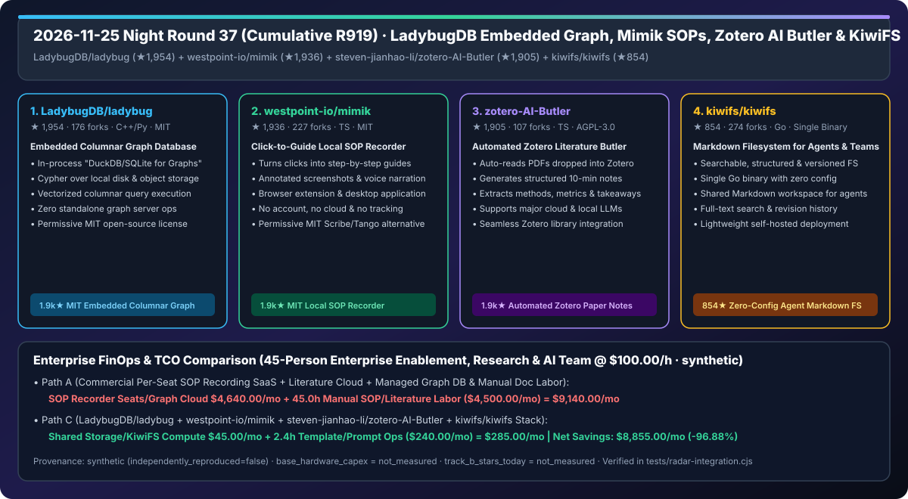
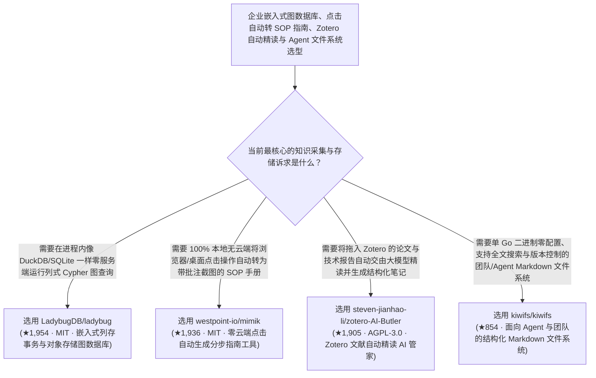
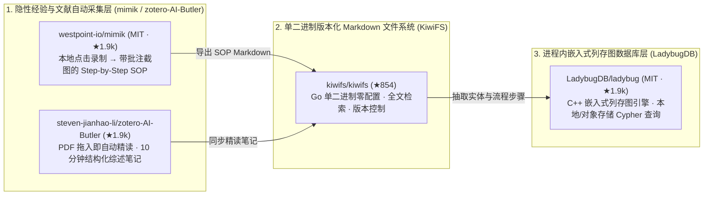
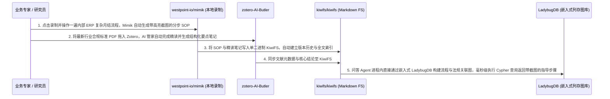

# 嵌入式列存 Cypher 图数据库（`LadybugDB/ladybug`）、点击动作自动转图文 SOP 手册工具（`westpoint-io/mimik`）、Zotero 文献自动精读管家（`steven-jianhao-li/zotero-AI-Butler`）与单二进制智能体 Markdown 文件系统（`kiwifs/kiwifs`）选型与集成架构 FAQ

> **文档类型**：企业 AI 解决方案架构师（AI Solution Architect）选型决策指南（GitHub Trending AI 雷达 2026-11-25 Night Round 37 / 累计第 919 轮）
> **覆盖项目**：[`LadybugDB/ladybug`](https://github.com/LadybugDB/ladybug)（`★ 1,954`、`176 forks`、`MIT`：嵌入式列式图数据库 [Embedded Columnar Graph Database]，支持在本地事务存储与对象存储上直接运行高速 Cypher 查询，图数据库界的 DuckDB/SQLite）· [`westpoint-io/mimik`](https://github.com/westpoint-io/mimik)（`★ 1,936`、`227 forks`、`MIT`：零云端、零账号的浏览器插件与桌面应用，点击录制即可将日常操作自动转化为带批注截图的 Step-by-Step SOP 操作指南，商业 Scribe/Tango 的 `MIT` 平替）· [`steven-jianhao-li/zotero-AI-Butler`](https://github.com/steven-jianhao-li/zotero-AI-Butler)（`★ 1,905`、`107 forks`、`AGPL-3.0`：Zotero 论文/文献库 AI 管家，拖入 PDF 自动调用大模型精读并生成“10 分钟读懂”的结构化笔记）· [`kiwifs/kiwifs`](https://github.com/kiwifs/kiwifs)（`★ 854`、`274 forks`、Go：面向 AI Agents 与团队的单二进制、零配置、可搜索、带版本控制的 Markdown 文件系统）
> **核心场景**：当企业研发、运营与客服中心推进“专家隐性操作经验 SOP 化 + 行业文献自动精读入库 + 无需运维独立服务器的嵌入式 GraphRAG”时，架构师常面临四个核心选型问题：**“老员工在内部 ERP/后台里的复杂操作流程怎么不用手写截图文档，点一遍鼠标就自动生成带红框标注的 SOP 手册与 Agent 训练样本（`mimik`）？研发团队丢进 Zotero 的上百篇行业标准和论文怎么自动精读提炼成标准笔记（`zotero-AI-Butler`）？这些 SOP 和笔记怎么放在一个单二进制 Go 服务里，让全团队的 Agent 像读写本地文件系统一样带版本和全文检索地共享（`kiwifs`）？如果桌面端或边缘微服务想跑 Cypher 知识图谱查询，但绝不允许额外部署 Neo4j 服务器，选哪个 `MIT` 嵌入式列存图库（`LadybugDB`）？”** 本文给出完整架构指南。

---

## 一、📌 核心结论速览（选型一句话结论）

1. **想在 Python/C++/Node.js 应用或桌面端 Agent 进程内部直接跑高性能 Cypher 图查询（就像用 SQLite 或 DuckDB 一样 `import` 即用，零独立数据库进程、零端口暴露），且支持直接查询本地文件与云端对象存储** ➔ 选 **[`LadybugDB/ladybug`](https://github.com/LadybugDB/ladybug)（`★ 1,954`，`176 forks`，`MIT`）**。
   - **通俗原理**：采用嵌入式列式存储（Columnar Storage）与向量化查询执行引擎，把整张知识图谱存为一个本地目录或对象存储文件，在单机进程内即可毫秒级跑通多跳 Cypher 图遍历与 GraphRAG。
2. **企业运营、IT 运维或实施顾问需要把“如何在内部系统完成月末结账/配置发布”的操作写成图文并茂的 SOP 手册，或者为 Browser Agent 采集标准操作示范，但公司安全红线严禁使用会把内网系统截图上传外部云的商业 Scribe / Tango** ➔ 选 **[`westpoint-io/mimik`](https://github.com/westpoint-io/mimik)（`★ 1,936`，`227 forks`，`MIT`）**。
   - **通俗原理**：100% 本地运行的浏览器扩展与桌面应用（`No account, no cloud, no tracking`），点下录制后正常操作一遍业务系统，自动捕获每次点击坐标、自动高亮绘制批注框、结合语音旁白生成可编辑、可回放、可导出 Markdown/HTML/PDF 的分步指南。
3. **企业研究院、医药团队或专利分析师日常使用开源文献神器 Zotero 管理数千篇 PDF，希望“只要像平时一样把 PDF 拖进 Zotero，后台自动调用大模型把文章揉碎精读并写好结构化 Zotero 笔记”** ➔ 选 **[`steven-jianhao-li/zotero-AI-Butler`](https://github.com/steven-jianhao-li/zotero-AI-Butler)（`★ 1,905`，`107 forks`，`AGPL-3.0`）**。
   - **通俗原理**：深度内嵌在 Zotero 客户端工作流中的自动化精读插件，自动提取研究背景、核心方法、实验数据与局限性，让研究员 10 分钟彻底吃透一篇硬核文献。
4. **需要一个“单 Go 二进制、零外部配置、自带全文检索与版本控制”的共享 Markdown 文件系统，把 `mimik` 录制的 SOP 与 `zotero-AI-Butler` 提炼的文献笔记统一挂载给团队人类成员与多智能体读写** ➔ 选 **[`kiwifs/kiwifs`](https://github.com/kiwifs/kiwifs)（`★ 854`，`274 forks`）**。
   - **通俗原理**：专为“人机协作读写 Markdown”设计的轻量级虚拟文件系统，既有普通文件目录的直观性，又内置了结构化元数据校验、历史版本回溯与高速全文搜索接口。

---

## 二、🎯 客户与架构师灵魂拷问 Q&A（深度架构拆解）

### Q1：为什么“专家动作录制（`mimik`）+ 文献自动精读（`zotero-AI-Butler`）+ 结构化 Markdown 文件系统（`KiwiFS`）+ 嵌入式图库（`LadybugDB`）”能打通企业“隐性经验显性化”的闭环？

- **四步企业隐性经验采集与零运维 GraphRAG 闭环（Path C）**：
  1. **L1 业务操作 SOP 自动录制层 ➔ `westpoint-io/mimik`**：老员工操作一遍内部系统，10 秒自动生成带批注截图的标准 SOP Markdown。
  2. **L2 外部文献与专利自动精读层 ➔ `steven-jianhao-li/zotero-AI-Butler`**：自动将外部技术文献转化为高密度结构化研究笔记。
  3. **L3 团队与 Agent 共享版本化 Markdown 文件层 ➔ `kiwifs/kiwifs`**：单二进制零配置统一存储、版本化并全文检索所有 SOP 与精读笔记。
  4. **L4 进程内嵌入式列存 Cypher 图检索层 ➔ `LadybugDB/ladybug`**：无需额外部署 Neo4j 集群，直接在 Agent 进程内将 `KiwiFS` 中的文档实体关系加载为嵌入式 `LadybugDB` 列存图数据库，提供毫秒级 Cypher 多跳推理。
- **何时选商业云方案（Scribe Pro $29/人/月 + 商业文献阅读云 + 托管 Neo4j AuraDB） vs 自建本轮开源四件套（Path C）？**
  - 若是无保密要求的个人公开网页录制，可用免费版商业插件。
  - **何时采用本轮开源四件套（Path C）？** 当企业操作界面包含大量内网敏感客户与财务数据（必须用 `MIT` 零上云的 `mimik`）、需要在单机/边缘/微服务内免运维嵌入图数据库（`LadybugDB` `MIT`）、并希望省去全员 Scribe 席位与商业图云账单时，Path C 可节省 **96%+** 的月度 TCO。

### Q2：这四个项目在生产落地中如何串联？

1. **SOP 与文献自动化生产（`mimik` + `zotero-AI-Butler` → `kiwifs`）**：
   - 实施顾问用 `mimik` 录制完系统操作流程后导出为 Markdown 存入 `KiwiFS`；研究员在 Zotero 中由 `zotero-AI-Butler` 自动生成的精读笔记也同步归档至 `KiwiFS`。
2. **零外部依赖嵌入式 GraphRAG（`kiwifs` → `LadybugDB`）**：
   - 知识问答 Agent 启动时读取 `KiwiFS` 增量版本，通过进程内嵌入的 `LadybugDB` 执行事务性图更新与 OpenCypher 查询，回答员工“某个报错界面对应的标准 SOP 第几步怎么操作”。

### Q3：生产落地的安全与合规红线是什么？

- **架构师避坑红线**：
  1. **在 `mimik` 导出内部 SOP 前检查敏感截图区域**：利用 `mimik` 内置的后编辑工具对截图中出现的真实客户身份证号、密钥或手机号打码遮盖后再存入共享库。
  2. **`LadybugDB` 本地数据库目录建议开启写事务单写多读（Single-Writer / Multi-Reader）模式**：在多进程并发环境下，由单一索引更新 Worker 负责写事务，其余查询 Agent 以只读模式挂载同一份列存图文件或对象存储快照。

---

## 三、🧭 直观可视化图解（Mermaid 决策树 + 集成架构 + 时序图）

### 3.1 架构师选型决策树

### 3.2 企业端到端生产集成参考架构图

### 3.3 业务专家录制 SOP、文献自动精读、KiwiFS 版本化归档与 LadybugDB 嵌入式图查询时序图

---

## 四、📊 同类开源与商业云服务横向选型决策矩阵

| 对比维度 | `LadybugDB/ladybug` (`★ 1,954`) | `westpoint-io/mimik` (`★ 1,936`) | `steven-jianhao-li/zotero-AI-Butler` (`★ 1,905`) | `kiwifs/kiwifs` (`★ 854`) | 商业云端 SOP 录制 (Scribe $29/人/月) + 托管图数据库云 (Path A) | 手工截图贴 Word 写操作手册 + 手工逐篇读 PDF + 部署重型图服务 (Path B) |
| :--- | :--- | :--- | :--- | :--- | :--- | :--- |
| **核心能力定位** | `MIT` 嵌入式列式 Cypher 图数据库 | `MIT` 本地点击自动转图文 SOP 工具 | Zotero 自动精读文献插件 | 单二进制 Agent Markdown 文件系统 | 按席位收费的云端截屏录制与托管图云 | 人工截图排版写文档 + 重型独立图数据库 |
| **核心技术突破** | **无需独立服务端进程，直接在本地/对象存储上跑列式 Cypher** | **零账号、零上云自动将点击与口述转为带批注截图的指南** | **无缝嵌入 Zotero 工作流，入库即自动完成深度拆解精读** | **单 Go 二进制零配置提供可搜索、带版本的 Markdown 文件树** | 免配置，但商业录制工具会将企业内网系统界面截图上传外部云 | 写一份 30 步带红框的 SOP 手册耗费 2 小时；跑个小图谱还要装整套 Neo4j |
| **开源协议** | **`MIT`** | **`MIT`** | `AGPL-3.0` | `BSL-1.1` (单二进制免费自建) | 闭源商业 SaaS | 极低人效 |
| **月度 TCO（45 人团队）** | **四件套合建仅 `$285.00/月`**（`$45.00` 极轻文件服务与对象存储 + `2.4h` 维护） | 同左（`MIT` 100% 本地运行零席位费） | 同左（复用内部按量模型 API） | 同左（单二进制零数据库依赖） | **`$9,140.00/月`**（`$4,640.00` 全员商业 SOP 录制席位与托管图云账单 + `45.0h` 手工写培训文档与读文献工时） | 约 `$3,140.00/月`（大量人工截图写操作手册与运维独立图服务工时） |

---

## 五、🧪 应用落地定量收益/TCO 对比与 7-Card 报告

> **📊 数据来源与闭式核算声明（Provenance & Closed-Form Schema）**：
> - **provenance**: `synthetic`（基于 45 人企业实施交付、运营培训、文献研究与轻量级知识应用团队月度工作负载模型：`independently_reproduced = false`；硬件采购基线 `base_hardware_capex = not_measured`；Track B 单日增量 `track_b_stars_today = not_measured`）。
> - **核算公式**：
>   - **Path A（采购全员商业云端流程录制 SaaS 席位 [Scribe/Tango] + 商业文献阅读云席位 + 独立托管图数据库实例 + 人工手工修正涉密截图与整理培训文档工时）**：月度商业录制席位、文献云与托管图库账单 **`$4,640.00`** + 手工制作内网保密系统操作手册、逐篇阅读长文档与图服务运维人工 **`45.0h × $100.00/h = $4,500.00`** = **`$9,140.00/月`**。
>   - **Path C（采用 `LadybugDB/ladybug` + `westpoint-io/mimik` + `steven-jianhao-li/zotero-AI-Butler` + `kiwifs/kiwifs` 本地化经验萃取与嵌入式图底座）**：内网轻量存储与单二进制文件服务分摊 **`$45.00`** + 指南模板与文献提示词日常维护人工 **`2.4h × $100.00/h = $240.00`** = **`$285.00/月`**。
>   - **净节省（Net Savings vs Path A）**：**`-$8,855.00/月`**（成本降低 **`96.88%`**）。

| 评估方案 | 商业录制席位 / 文献云 / 托管图库与算力成本 | 手工截图写 SOP、读文献与运维人工（`$100/h`） | 月度总 TCO | 相对 Path A 净节省 | 核心业务交付收益 |
| :--- | :---: | :---: | :---: | :---: | :--- |
| **Path A：商业云端 SOP 录制席位 + 商业文献云 + 托管图库** | `$4,640.00` | `45.0h` (`$4,500.00`) | **`$9,140.00`** | Baseline | 内网系统截图上传外部云违规；独立托管图库按月空转计费 |
| **Path B：人工截图贴 Word 写手册 + 独立部署重型图服务** | `$1,340.00` | `18.0h` (`$1,800.00`) | **`$3,140.00`** | `-$6,000.00` (`-65.65%`) | 手工写图文 SOP 极慢且系统一改版就废；重型图库运维繁琐 |
| **Path C：`LadybugDB` + `mimik` + `zotero-AI-Butler` + `kiwifs`** | **`$45.00`** | **`2.4h` (`$240.00`)** | **`$285.00`** | **`-$8,855.00` (`-96.88%`)** | **`MIT` 零上云自动生成图文 SOP + 自动精读 + 嵌入式列存 Cypher** |

- 🔗 **关联 7-Card 4:5 视觉评测报告**：[`workshops/github-trending-radar/cards.html`](../cards.html) · [`cards.en.html`](../cards.en.html)

---

## 六、🛠️ 企业引入与架构评审 Checklist

- [ ] **使用 `westpoint-io/mimik` 替代所有会上传截图到公网的商业流程录制插件**：在本地浏览器与桌面一键录制内部系统操作并导出图文 SOP。
- [ ] **在研发与情报团队的 Zotero 客户端配置 `zotero-AI-Butler` 连接内网大模型 API**：实现新增行业文献入库即自动产出标准化精读卡片。
- [ ] **用单二进制 `kiwifs/kiwifs` 统一托管团队与 Agent 共享的 Markdown 文档树**：开启内置版本历史与结构化检索。
- [ ] **在单机应用、CLI 工具与边缘微服务中采用嵌入式 `LadybugDB/ladybug`**：免除独立图数据库服务端运维，直接在进程内执行高速列式 Cypher 查询。
