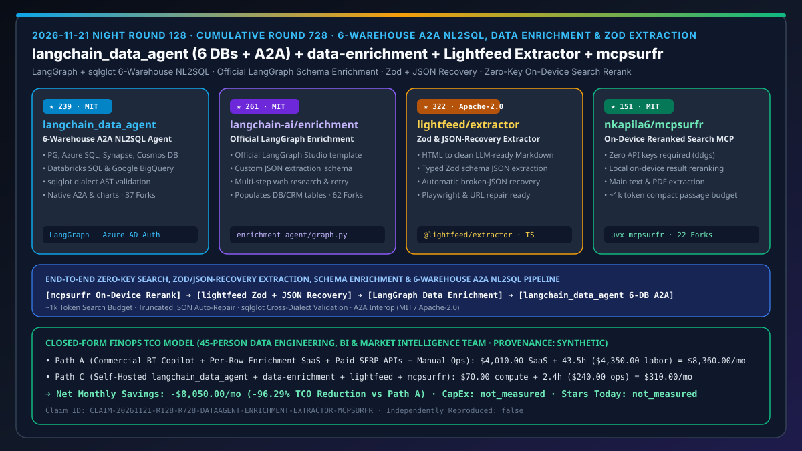
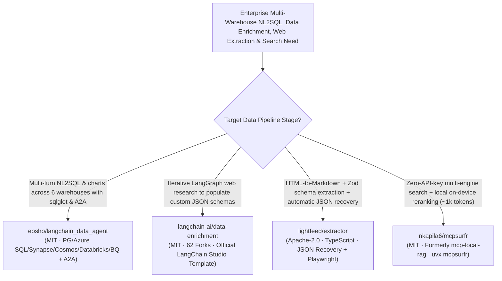
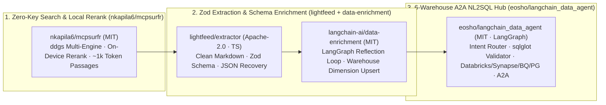
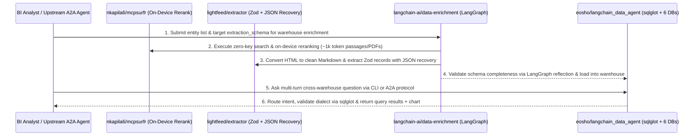

# 6-Database A2A NL2SQL Agent (`eosho/langchain_data_agent`), Official LangGraph Data Enrichment (`langchain-ai/data-enrichment`), Zod/JSON-Recovery Web Extractor (`lightfeed/extractor`) & Zero-Key On-Device Reranked Search MCP (`nkapila6/mcpsurfr`) Selection & Architecture FAQ

> **Document Type**: Enterprise AI Solution Architect Selection & Integration Guide (GitHub Trending AI Radar — 2026-11-21 Night Round 128 / Cumulative Round 728)
> **Covered Repositories**: [`eosho/langchain_data_agent`](https://github.com/eosho/langchain_data_agent) (`★ 239`, `37 forks`, `MIT` — LangGraph + Azure OpenAI multi-agent NL2SQL platform supporting PostgreSQL, Azure SQL, Azure Synapse, Cosmos DB, Databricks SQL & BigQuery with `sqlglot` validation, chart generation & A2A protocol) · [`langchain-ai/data-enrichment`](https://github.com/langchain-ai/data-enrichment) (`★ 261`, `62 forks`, `MIT` — official LangChain LangGraph Studio template for iterative web-research data enrichment against user-defined JSON schemas) · [`lightfeed/extractor`](https://github.com/lightfeed/extractor) (`★ 322`, `10 forks`, `Apache-2.0` — TypeScript LLM web data extractor with clean HTML-to-Markdown, Zod schemas, automatic JSON recovery & Playwright integration) · [`nkapila6/mcpsurfr`](https://github.com/nkapila6/mcpsurfr) (`★ 151`, `22 forks`, `MIT` — zero-API-key web search & PDF MCP server with on-device result reranking and `~1k token` passage budgeting, formerly `mcp-local-rag`)
> **Core Scenario**: How enterprise data engineering, BI, and market-intelligence architects build a unified external-to-internal data pipeline: **running zero-API-key web search with local on-device reranking (`mcpsurfr`)**, **extracting deeply nested web records against Zod schemas with automatic JSON recovery (`lightfeed/extractor`)**, **populating structured entity tables via LangGraph reflection loops (`langchain-ai/data-enrichment`)**, and **serving multi-turn `sqlglot`-validated NL2SQL queries and charts across 6 enterprise data warehouses over the A2A protocol (`langchain_data_agent`)**.

---

## 1. 📌 Executive Summary (One-Line Selection Verdict)

1. **Need a multi-agent NL2SQL platform powered by LangGraph and Azure OpenAI (with Azure AD auth) that routes natural-language questions across PostgreSQL, Azure SQL, Azure Synapse, Cosmos DB, Databricks SQL, and Google BigQuery with `sqlglot` validation, charts, and A2A protocol support** ➔ Choose **[`eosho/langchain_data_agent`](https://github.com/eosho/langchain_data_agent) (`★ 239`, `37 forks`, `MIT`)**.
   - **Plain-English Mechanism**: Separates **Intent Detection** (routing user questions to the right YAML-configured database agent) from **Data Agent Execution** (generating SQL, validating syntax across dialects via **`sqlglot`**, executing with retry logic, supporting multi-turn follow-ups, rendering charts, and interoperating with external agents via the **A2A protocol**).
2. **Need an official LangChain / LangGraph Studio template (`62 forks`) that takes a research topic and a target JSON `extraction_schema` to iteratively enrich CRM, vendor, or data-warehouse records from the web** ➔ Choose **[`langchain-ai/data-enrichment`](https://github.com/langchain-ai/data-enrichment) (`★ 261`, `62 forks`, `MIT`)**.
   - **Plain-English Mechanism**: Exported from `src/enrichment_agent/graph.py`, this LangGraph workflow searches the web, reads candidate pages, extracts structured fields matching your schema, and loops with self-reflection when required attributes are still missing.
3. **Need a token-efficient TypeScript library (`@lightfeed/extractor`) that converts noisy HTML into clean Markdown, extracts structured data via Zod schemas, and automatically repairs truncated or malformed nested JSON** ➔ Choose **[`lightfeed/extractor`](https://github.com/lightfeed/extractor) (`★ 322`, `10 forks`, `Apache-2.0`)**.
   - **Plain-English Mechanism**: Strips boilerplate and URL tracking parameters into LLM-ready Markdown, enforces **Zod schemas** with token-budget tracking, runs **JSON Recovery** to salvage broken/truncated nested JSON outputs, repairs relative/escaped URLs, and integrates directly with Playwright and `@lightfeed/browser-agent`.
4. **Need a zero-API-key web search MCP server (`uvx mcpsurfr`, formerly `mcp-local-rag`) that reranks multi-engine results locally on your machine and returns compact `~1k token` passages or PDF text** ➔ Choose **[`nkapila6/mcpsurfr`](https://github.com/nkapila6/mcpsurfr) (`★ 151`, `22 forks`, `MIT`)**.
   - **Plain-English Mechanism**: Queries multiple search engines via `ddgs` with zero API keys, **reranks candidates locally on-device**, extracts main text and PDFs from top hits, and outputs either tight `~1k token` passages (`search`) or shared-budget full pages (`rag_search_ddgs` / `deep_research`).

---

## 2. 🎯 Architect & Customer Deep-Dive Q&A

### Q1: Why do enterprise data enrichment and NL2SQL pipelines break on raw HTML bloat, truncated JSON, and dialect-specific SQL errors—and how does this four-project stack fix them?

- **Four End-to-End Data Engineering Safeguards**:
  1. **Zero-Key Search with Local Reranking (`nkapila6/mcpsurfr`)**: Eliminates per-query search API bills and context pollution by reranking search hits on-device and returning ~1,000-token top passages.
  2. **HTML Denoising & Broken-JSON Recovery (`lightfeed/extractor`)**: Converts raw DOM trees into clean Markdown, validates against Zod schemas, and recovers malformed/truncated JSON payloads without wasting full LLM retries.
  3. **Iterative Schema-Driven Enrichment (`langchain-ai/data-enrichment`)**: Uses LangGraph state loops to verify completeness against a target `extraction_schema` before writing records to the warehouse.
  4. **Cross-Dialect `sqlglot` Validation & A2A Routing (`eosho/langchain_data_agent`)**: Validates generated SQL against PostgreSQL, Azure SQL, Synapse, Cosmos DB, Databricks, or BigQuery dialects using `sqlglot` before execution.
- **When to Choose Managed Cloud Services (Path B)**:
  - If all enterprise tables live inside a single lakehouse (such as Microsoft Fabric OneLake or Databricks Unity Catalog) without external web enrichment needs, use **Microsoft Fabric Copilot / Databricks Genie**.

### Q2: How do we wire an end-to-end Web Enrichment to Multi-Warehouse A2A NL2SQL architecture?

1. **Zero-Key Search & On-Device Reranking Layer (`nkapila6/mcpsurfr`)**:
   - Attach `mcpsurfr` via MCP to provide key-free web and PDF discovery reranked locally within a ~1k-token budget.
2. **Playwright + Zod Extraction & JSON Recovery Layer (`lightfeed/extractor`)**:
   - Convert target HTML pages to clean Markdown and extract typed Zod objects with automatic JSON recovery.
3. **LangGraph Iterative Data Enrichment Layer (`langchain-ai/data-enrichment`)**:
   - Orchestrate multi-step research and reflection loops until target warehouse dimension schemas are fully populated.
4. **Multi-Warehouse `sqlglot` NL2SQL & A2A Layer (`eosho/langchain_data_agent`)**:
   - Route natural-language and A2A queries across PostgreSQL, Azure SQL, Synapse, Cosmos DB, Databricks SQL, and BigQuery with Azure AD auth and chart generation.

### Q3: What are the database security boundaries of this stack?

- **Key Strengths**:
  - **100% Permissive Open Source (`MIT` and `Apache-2.0`)**.
- **Database Guardrails**:
  - Always bind `eosho/langchain_data_agent` to read-only database roles/views with Azure AD Managed Identity, statement timeouts, and row-limit caps, keeping `sqlglot` AST validation enabled for every dialect.

---

## 3. 🧭 Visual Architecture & Decision Diagrams

### 3.1 Solution Architect Selection Decision Tree

### 3.2 End-to-End Enterprise Reference Architecture

### 3.3 On-Device Reranked Search, Zod/JSON Recovery, LangGraph Enrichment & Cross-Warehouse `sqlglot` Query Sequence

---

## 4. 📊 Peer Open-Source vs Commercial Cloud Selection Matrix

| Dimension | `langchain_data_agent` (`★ 239`) | `langchain-ai/data-enrichment` (`★ 261`) | `lightfeed/extractor` (`★ 322`) | `nkapila6/mcpsurfr` (`★ 151`) | Commercial BI Copilot + Enrichment & Scraper SaaS (Path A) | Single-Warehouse Native Assistant (Path B) |
| :--- | :--- | :--- | :--- | :--- | :--- | :--- |
| **Core Role** | 6-warehouse A2A NL2SQL & chart agent | Official LangGraph structured enrichment template | TypeScript Zod & JSON-recovery web extractor | Zero-key on-device reranked search MCP | Per-seat BI Copilot + Clay/ZoomInfo + paid SERP APIs | Databricks Genie / Snowflake Cortex |
| **Architectural Edge** | **6 enterprise DBs + Azure AD + `sqlglot` + A2A protocol** | **Iterative schema reflection in LangGraph Studio (`62 forks`)** | **Clean Markdown + Zod schemas + nested JSON recovery** | **Zero API keys + local device rerank + `~1k token` budget** | High per-row enrichment & per-seat BI licensing costs | Locked to one warehouse; no web enrichment or cross-DB A2A |
| **License** | `MIT` | `MIT` | `Apache-2.0` | `MIT` | Proprietary SaaS | Proprietary Cloud PaaS |
| **Monthly TCO (45-Eng Team)** | **`$310.00/mo` combined** (`$70.00` compute + `2.4h` ops) | Included in `$310.00/mo` stack | Included in `$310.00/mo` stack | Included in `$310.00/mo` stack | **`$8,360.00/mo`** (`$4,010.00` SaaS/APIs + `43.5h` labor) | `~$2,750.00/mo` (warehouse serverless compute units) |

---

## 5. 🧪 Quantitative ROI / FinOps TCO Model & 7-Card Report

> **📊 Provenance & Closed-Form Audit Declaration**:
> - **Provenance**: `synthetic` (45-person enterprise data engineering, BI analytics & market intelligence workload model; `independently_reproduced = false`; `base_hardware_capex = not_measured`; `track_b_stars_today = not_measured`).
> - **Closed-Form Equations**:
>   - **Path A (Commercial Per-Seat BI NL2SQL Copilot + Per-Record Data Enrichment SaaS + Metered Web Scraper/Search APIs + Manual SQL Dialect & Broken-JSON Engineering)**: Monthly SaaS & metered API fees **`$4,010.00`** + manual SQL debugging & schema cleanup labor **`43.5h × $100.00/h = $4,350.00`** = **`$8,360.00/mo`**.
>   - **Path C (Self-Hosted `eosho/langchain_data_agent` + `langchain-ai/data-enrichment` + `lightfeed/extractor` + `nkapila6/mcpsurfr`)**: Shared container compute **`$70.00`** + YAML warehouse & Zod schema maintenance **`2.4h × $100.00/h = $240.00`** = **`$310.00/mo`**.
>   - **Net Savings vs Path A**: **`-$8,050.00/mo`** (**`96.29%`** cost reduction).

| Architecture Option | API / SaaS / Compute | Data & BI Engineering Labor (`$100/h`) | Total Monthly TCO | Net Savings vs Path A | Key Architectural Outcome |
| :--- | :---: | :---: | :---: | :---: | :--- |
| **Path A: Commercial BI Seats + Per-Row Enrichment SaaS** | `$4,010.00` | `43.5h` (`$4,350.00`) | **`$8,360.00`** | Baseline | Expensive per-credit enrichment & SERP bills |
| **Path B: Single-Warehouse AI Assistant + Custom Scrapers** | `$1,450.00` | `13.0h` (`$1,300.00`) | **`$2,750.00`** | `-$5,610.00` (`-67.11%`) | Lacks 6-DB `sqlglot` A2A routing, JSON recovery & local rerank |
| **Path C: `data_agent` + `enrichment` + `extractor` + `mcpsurfr`** | **`$70.00`** | **`2.4h` (`$240.00`)** | **`$310.00`** | **`-$8,050.00` (`-96.29%`)** | **6-DB `sqlglot` A2A NL2SQL + Zod/JSON recovery + zero-key rerank** |

- 🔗 **7-Card 4:5 Visual Report**: [`workshops/github-trending-radar/cards.en.html`](../cards.en.html) · [`cards.html`](../cards.html)

---

## 6. 🛠️ Enterprise Adoption & Architecture Review Checklist

- [ ] **1. Deploy `nkapila6/mcpsurfr` for Zero-Key On-Device Reranked Search**: Use `uvx mcpsurfr` to keep search discovery local, free of API keys, and bounded to `~1k token` passages.
- [ ] **2. Standardize Web Extraction on `lightfeed/extractor`**: Convert HTML to clean Markdown and enforce Zod schemas with automatic JSON recovery for nested structures.
- [ ] **3. Run Iterative Entity Enrichment with `langchain-ai/data-enrichment`**: Use the official LangGraph template to validate and backfill missing structured fields before warehouse ingestion.
- [ ] **4. Gate Multi-Warehouse NL2SQL with `eosho/langchain_data_agent`**: Connect read-only Azure AD / database credentials across PostgreSQL, Azure SQL, Synapse, Cosmos DB, Databricks, and BigQuery with `sqlglot` dialect validation and A2A interoperability.
