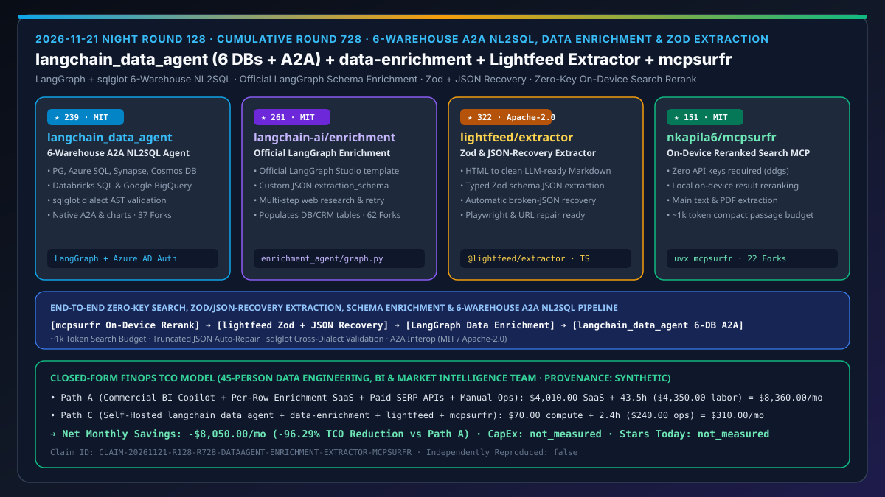
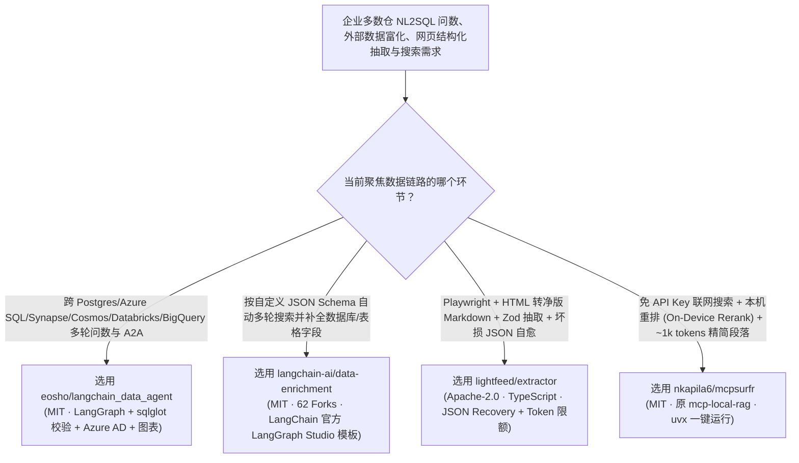
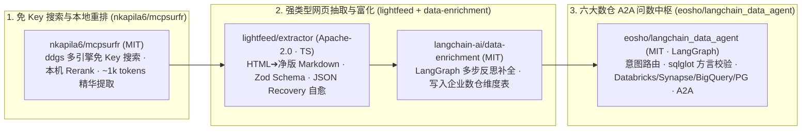
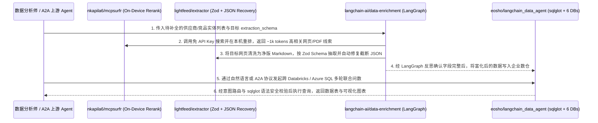

# 跨 6 大数仓 A2A NL2SQL 智能体（`eosho/langchain_data_agent`）、LangGraph 官方结构化数据富化模板（`langchain-ai/data-enrichment`）、带 JSON 自愈的 Zod 网页抽取库（`lightfeed/extractor`）与免 Key 本地重排搜索 MCP（`nkapila6/mcpsurfr`）选型与集成架构 FAQ

> **文档类型**：企业 AI 解决方案架构师（AI Solution Architect）选型决策指南（GitHub Trending AI 雷达 2026-11-21 Night Round 128 / 累计第 728 轮）
> **覆盖项目**：[`eosho/langchain_data_agent`](https://github.com/eosho/langchain_data_agent)（`★ 239`、`37 forks`、`MIT`，基于 LangGraph + Azure OpenAI + `sqlglot` 方言校验、支持 PostgreSQL/Azure SQL/Synapse/Cosmos DB/Databricks/BigQuery 并原生支持 A2A 协议的多智能体 NL2SQL 平台）· [`langchain-ai/data-enrichment`](https://github.com/langchain-ai/data-enrichment)（`★ 261`、`62 forks`、`MIT`，LangChain 官方出品、按用户自定义 `extraction_schema` 自动联网检索并补全数据库/表格缺失字段的 LangGraph Studio 模板）· [`lightfeed/extractor`](https://github.com/lightfeed/extractor)（`★ 322`、`10 forks`、`Apache-2.0`，支持 HTML 转净版 Markdown、Zod 强类型抽取、嵌套 JSON 截断自愈与 Playwright 联动的 TypeScript 抽取引擎）· [`nkapila6/mcpsurfr`](https://github.com/nkapila6/mcpsurfr)（`★ 151`、`22 forks`、`MIT`，原名 `mcp-local-rag`、免 API Key 多引擎搜索并在本机执行结果重排与 PDF/正文 `~1k tokens` 精简提取的 MCP Server）
> **核心场景**：当企业数据工程（Data Engineering）、商业智能（BI）与市场情报团队希望构建“内外数仓联动的智能数据助手”时，如何打通**“免 API Key 本地重排全网搜索（`mcpsurfr`）”➔“Playwright + Zod 强类型网页抽取与坏损 JSON 自愈（`lightfeed/extractor`）”➔“LangGraph 循环反思补全结构化实体表（`data-enrichment`）”➔“跨 Databricks/Synapse/BigQuery/Postgres 经 `sqlglot` 安全校验的 A2A 多轮 NL2SQL 问数与图表生成（`langchain_data_agent`）”**？

---

## 一、📌 核心结论速览（选型一句话结论）

1. **想让业务人员用自然语言跨 PostgreSQL、Azure SQL、Azure Synapse、Cosmos DB、Databricks SQL 与 Google BigQuery 六大异构数仓做多轮追问与自动画图，且强制经过 `sqlglot` 语法安全校验并对外暴露标准 A2A 协议接口** ➔ 选 **[`eosho/langchain_data_agent`](https://github.com/eosho/langchain_data_agent)（`★ 239`，`37 forks`，`MIT`）**。
   - **通俗原理**：基于 LangGraph 与 Azure OpenAI（支持 Azure AD 企业身份鉴权）构建的多智能体问数平台。它包含两层状态图：① **Intent Detection Graph（意图路由图）**——根据问题上下文自动分发给 YAML 配置的对应数仓子 Agent；② **Data Agent Graph（执行图）**——生成 SQL 后先用 **`sqlglot` 做跨方言 AST 静态校验**，安全执行并支持多轮上下文追问（如“那它的平均值是多少？”）、自然语言生成可视化图表，以及通过 **A2A 协议**与其他企业 Agent 互联。
2. **想将非结构化的互联网信息自动按指定的 JSON Schema 提取、校验并回填到企业 CRM、供应商名录或数仓维度表中（Data Enrichment）** ➔ 选 **[`langchain-ai/data-enrichment`](https://github.com/langchain-ai/data-enrichment)（`★ 261`，`62 forks`，`MIT`）**。
   - **通俗原理**：由 LangChain 官方团队维护的 LangGraph Studio 标准模板（`src/enrichment_agent/graph.py`）。输入研究主题 `topic` 和目标 `extraction_schema`，Agent 会自动规划搜索词、抓取网页、提取结构化字段，并执行自我审查（Reflection）——若发现关键字段缺失则自动改写查询开启下一轮补充检索，直至满足 Schema 要求。
3. **想在生产级 TypeScript / Playwright 数据采集中，用最少 Token 从杂乱 HTML 中按 Zod Schema 提取深度嵌套 JSON，并自动修复大模型输出的截断/语法损坏 JSON 与相对链接** ➔ 选 **[`lightfeed/extractor`](https://github.com/lightfeed/extractor)（`★ 322`，`10 forks`，`Apache-2.0`）**。
   - **通俗原理**：NPM 包 `@lightfeed/extractor` 针对生产级网页抽取做了四大工程加固：① **HTML 转高信噪比 LLM-ready Markdown**（自动剔除导航栏噪音与 URL 追踪参数）；② **Zod Schema + Token 预算控制**；③ **JSON Recovery（坏损 JSON 自动消毒与恢复，解决深层嵌套数组截断报错）**；④ **URL 修复与 `@lightfeed/browser-agent` / Playwright 无缝集成**。
4. **想给本地或内网大模型装上“零 API Key 成本、结果在本机重排（On-Device Reranking）、支持 PDF 提取且默认把每次搜索结果控制在 `~1k tokens` 以内”的轻量联网搜索 MCP** ➔ 选 **[`nkapila6/mcpsurfr`](https://github.com/nkapila6/mcpsurfr)（`★ 151`，`22 forks`，`MIT`）**。
   - **通俗原理**：原名 `mcp-local-rag`（一键启动：`uvx mcpsurfr`）。它通过 `ddgs` 聚合多搜索引擎（无需购买商用搜索 API Key），在本地设备端完成语义重排（Re-rank on device），抓取高分网页正文与 PDF，并提供两种模式：`search`（仅返回最核心的 `~1k tokens` 精华段落，极省上下文）和 `rag_search_ddgs / deep_research`（共享 Token 预算的全文深度检索）。

---

## 二、🎯 客户与架构师灵魂拷问 Q&A（深度架构拆解）

### Q1：为什么企业做“外部竞品情报采集 + 内部数仓联合问数”时，最怕网页垃圾标签烧穿 Token、JSON 解析崩溃以及手写 SQL 语法错误？这四个项目是如何闭环解决的？

- **四重数据智能工程防线**：
  1. **搜索阶段免 Key 且本地重排省 Token（`nkapila6/mcpsurfr`）**：不把几十页搜索引擎广告塞进主模型，而是在本机完成 Rerank 后只输出约 `1,000 tokens` 的高密度证据块。
  2. **抽取阶段 HTML 降噪与 JSON 截断自愈（`lightfeed/extractor`）**：将复杂 DOM 清洗为净版 Markdown，用 Zod 约束输出，并通过内置 **JSON Recovery** 救回因输出长度限制而半途截断的深层 JSON。
  3. **入库阶段多轮反思补全缺失字段（`langchain-ai/data-enrichment`）**：通过 LangGraph 状态机自动校验提取结果是否填满目标 Schema，未填满则自动发起补充搜索。
  4. **问数阶段 `sqlglot` 方言校验与 A2A 路由（`eosho/langchain_data_agent`）**：在执行 SQL 前用 `sqlglot` 校验 Databricks / Synapse / BigQuery / Postgres 方言合法性，杜绝语法报错与危险语句。
- **何时直接用云厂商托管方案（Path B）？**
  - 若企业数据 100% 存储在单一云数仓（如 Microsoft Fabric OneLake 或 Databricks Unity Catalog）且无需外部网页富化，直接使用 **Microsoft Fabric Copilot / Databricks Genie** 即可。

### Q2：典型企业级“全网本地重排搜索 (`mcpsurfr`) + Zod 强类型抽取 (`lightfeed`) + LangGraph 数据富化 (`data-enrichment`) + 6 大数仓 A2A 问数 (`langchain_data_agent`)”架构怎么搭？

1. **零成本联网搜索与本地重排层（`nkapila6/mcpsurfr`）**：
   - 通过 `uvx mcpsurfr` 为采集 Agent 提供免 Key 搜索、PDF 解析与本机 Rerank（单次 `~1k tokens`）。
2. **动态网页渲染与 Zod 结构化抽取层（`lightfeed/extractor` + Playwright）**：
   - 针对动态网页，用 Playwright 渲染后交由 `@lightfeed/extractor` 转换为净版 Markdown，按 Zod Schema 抽取并经过 JSON Recovery 校验。
3. **多步反思数据富化编排层（`langchain-ai/data-enrichment`）**：
   - 运行 LangGraph 数据富化图，将采集到的外部市场/客户情报按标准 Schema 补全并写入企业数仓。
4. **多数仓意图路由与 A2A NL2SQL 问数层（`eosho/langchain_data_agent`）**：
   - 通过 Azure AD 鉴权连接内部 PostgreSQL、Azure SQL、Synapse、Cosmos DB、Databricks 与 BigQuery，经 `sqlglot` 校验后返回多轮问数结果与可视化图表，并通过 A2A 协议赋能上层业务 Agent。

### Q3：这套架构的适用边界是什么？

- **核心优势**：
  - **100% 宽松开源协议（`MIT` 与 `Apache-2.0`）**，打通外部非结构化网页到内部六大企业数仓的完整数据链。
- **生产安全建议**：
  - `eosho/langchain_data_agent` 连接生产数仓时，数据库账号（或 Azure AD Managed Identity）必须严格限制为只读视图权限（`SELECT` only），并设置查询超时（Query Timeout）与扫描行数上限。

---

## 三、🧭 直观可视化图解（Mermaid 决策树 + 集成架构 + 时序图）

### 3.1 架构师选型决策树

### 3.2 企业端到端生产集成参考架构图

### 3.3 免 Key 搜索重排、Zod/JSON 自愈抽取、LangGraph 数据富化与跨数仓 `sqlglot` 问数时序图

---

## 四、📊 同类开源与商业云服务横向选型决策矩阵

| 对比维度 | `langchain_data_agent` (`★ 239`) | `langchain-ai/data-enrichment` (`★ 261`) | `lightfeed/extractor` (`★ 322`) | `nkapila6/mcpsurfr` (`★ 151`) | 商业 BI 问数席位 + 商业数据富化/爬虫 API (Path A) | 单一数仓内置 AI 助手 (Path B) |
| :--- | :--- | :--- | :--- | :--- | :--- | :--- |
| **核心能力定位** | 跨 6 大数仓 A2A NL2SQL 与图表平台 | LangChain 官方结构化数据富化模板 | 带 JSON 自愈的 TS/Zod 网页抽取库 | 免 Key 本地重排联网搜索 MCP | 商业 BI Copilot + Clay/ZoomInfo + 商用搜索 API | Databricks Genie / Snowflake Cortex |
| **核心技术突破** | **支持 6 大异构数仓 + `sqlglot` 校验 + 原生 A2A 协议** | **LangGraph 循环反思补全，直通 LangGraph Studio** | **HTML 降噪转 Markdown + 截断 JSON 自动修复** | **零 API Key 费用 + 本机重排 + `~1k tokens` 极省上下文** | 按每条富化记录与每个 BI 席位双向高额收费 | 仅限单一数仓内部表，无法跨 6 种数据库或抓取外部网页富化 |
| **开源协议** | `MIT` | `MIT` | `Apache-2.0` | `MIT` | 闭源商业 SaaS | 闭源云服务 |
| **月度 TCO（45 人团队）** | **组合仅 `$310.00/月`**（`$70.00` 容器算力 + `2.4h` 运维） | 同左（开源模板零授权费） | 同左（NPM 库零许可费） | 同左（免搜索 API Key 费用） | **`$8,360.00/月`**（`$4,010.00` SaaS/API 费 + `43.5h` 人工清洗） | 约 `$2,750.00/月`（数仓无服务器计算 CU 消耗） |

---

## 五、🧪 应用落地定量收益/TCO 对比与 7-Card 报告

> **📊 数据来源与闭式核算声明（Provenance & Closed-Form Schema）**：
> - **provenance**: `synthetic`（基于 45 人企业数据工程、商业智能分析与市场情报团队工作负载模型：`independently_reproduced = false`；硬件采购基线 `base_hardware_capex = not_measured`；Track B 单日增量 `track_b_stars_today = not_measured`）。
> - **核算公式**：
>   - **Path A（商业跨库 BI 问数席位 + 商业按行计费数据富化 SaaS + 商业网页抽取与搜索 API + 数据工程师手工修复损坏 JSON 与编写跨方言 SQL）**：月度 SaaS 与按量 API 费用 **`$4,010.00`** + 数据清洗与 SQL 排障人工 **`43.5h × $100.00/h = $4,350.00`** = **`$8,360.00/月`**。
>   - **Path C（自建 `eosho/langchain_data_agent` + `langchain-ai/data-enrichment` + `lightfeed/extractor` + `nkapila6/mcpsurfr` 开源数据智能栈）**：轻量工作流容器算力 **`$70.00`** + YAML 数仓配置与 Schema 维护 **`2.4h × $100.00/h = $240.00`** = **`$310.00/月`**。
>   - **净节省（Net Savings vs Path A）**：**`-$8,050.00/月`**（成本降低 **`96.29%`**）。

| 评估方案 | API / SaaS / 算力成本 | 数据工程与 BI 人工（`$100/h`） | 月度总 TCO | 相对 Path A 净节省 | 关键架构交付指标 |
| :--- | :---: | :---: | :---: | :---: | :--- |
| **Path A：商业 BI 席位 + 按条计费数据富化 SaaS + 商业搜索 API** | `$4,010.00` | `43.5h` (`$4,350.00`) | **`$8,360.00`** | Baseline | 按富化条数和搜索次数计费昂贵；复杂嵌套 JSON 常解析失败 |
| **Path B：单一云数仓内置问答 + 自写正则爬虫脚本** | `$1,450.00` | `13.0h` (`$1,300.00`) | **`$2,750.00`** | `-$5,610.00` (`-67.11%`) | 无法跨 6 大数仓 A2A 路由，缺乏 JSON 自愈与本机搜索重排 |
| **Path C：`data_agent` + `enrichment` + `extractor` + `mcpsurfr`** | **`$70.00`** | **`2.4h` (`$240.00`)** | **`$310.00`** | **`-$8,050.00` (`-96.29%`)** | **6 大数仓 `sqlglot` A2A 问数 + Zod/JSON 自愈 + 免 Key 重排** |

- 🔗 **关联 7-Card 4:5 视觉评测报告**：[`workshops/github-trending-radar/cards.html`](../cards.html) · [`cards.en.html`](../cards.en.html)

---

## 六、🛠️ 企业引入与架构评审 Checklist

- [ ] **1. 使用 `nkapila6/mcpsurfr` 替代高成本外部搜索 API**：通过 `uvx mcpsurfr` 启用免 Key 多引擎搜索与本地设备端重排（On-Device Reranking），将单次检索上下文控制在 `~1k tokens`。
- [ ] **2. 在采集流水线引入 `lightfeed/extractor` 保障结构化抽取高可用**：先将 HTML 转为净版 LLM-ready Markdown，再用 Zod Schema 配合 JSON Recovery 自动修复深层嵌套截断错误。
- [ ] **3. 基于 `langchain-ai/data-enrichment` 自动化数仓维度表补全**：利用 LangGraph 循环反思机制按自定义 `extraction_schema` 自动补全外部实体属性。
- [ ] **4. 部署 `eosho/langchain_data_agent` 统一跨数仓 A2A 问数**：配置只读 Azure AD / 数据库凭据与 `sqlglot` 方言静态校验，统一纳管 PostgreSQL、Azure SQL、Synapse、Cosmos DB、Databricks 与 BigQuery。
