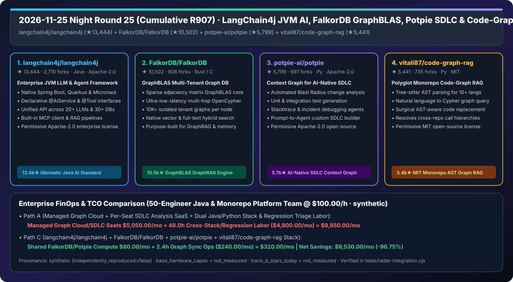
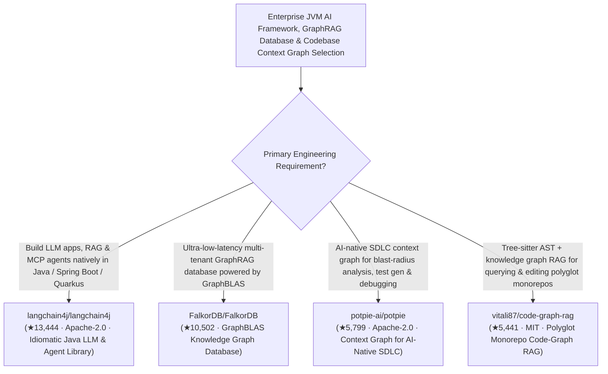
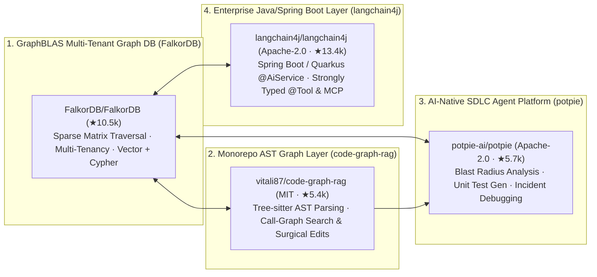

# Enterprise JVM LLM Framework (`langchain4j/langchain4j`), GraphBLAS Multi-Tenant Graph DB (`FalkorDB/FalkorDB`), AI-Native SDLC Context Graph (`potpie-ai/potpie`) & Monorepo Code-Graph RAG (`vitali87/code-graph-rag`) Selection & Integration Architecture FAQ

> **Document Type**: Enterprise AI Solution Architect Selection Decision Guide (GitHub Trending AI Radar — 2026-11-25 Night Round 25 / Cumulative Round 907)
> **Covered Repositories**: [`langchain4j/langchain4j`](https://github.com/langchain4j/langchain4j) (`★ 13,444`, `2,710 forks`, `Apache-2.0`, Java: idiomatic open-source Java library for building LLM-powered applications, RAG, and MCP-enabled agents on the JVM with native Spring Boot and Quarkus integration) · [`FalkorDB/FalkorDB`](https://github.com/FalkorDB/FalkorDB) (`★ 10,502`, `608 forks`, Rust/C: ultra-fast, multi-tenant knowledge graph database powered by GraphBLAS sparse matrix operations for GraphRAG and agent memory) · [`potpie-ai/potpie`](https://github.com/potpie-ai/potpie) (`★ 5,799`, `697 forks`, `Apache-2.0`, Python: Context Graph for AI-Native SDLC providing prebuilt and custom agents for debugging, blast-radius detection, and unit/integration test generation) · [`vitali87/code-graph-rag`](https://github.com/vitali87/code-graph-rag) (`★ 5,441`, `735 forks`, `MIT`, Python: multi-language monorepo RAG and surgical code editor combining Tree-sitter AST parsing with knowledge graph queries)
> **Core Enterprise Scenario**: Empowering **Enterprise Java/Spring Boot Engineering & Large Monorepo Teams** with native JVM agent orchestration (`langchain4j`), low-latency multi-tenant GraphRAG storage (`FalkorDB`), AST-backed multi-language code graph search (`code-graph-rag`), and automated SDLC blast-radius & test generation agents (`potpie`).

---

## 1. 📌 Executive Summary (One-Line Selection Verdict)

1. **Need an `Apache-2.0`, idiomatic Java framework to build LLM agents, tool calling (including MCP), and RAG directly inside Spring Boot, Quarkus, or Micronaut without spinning up a separate Python backend** ➔ Choose **[`langchain4j/langchain4j`](https://github.com/langchain4j/langchain4j) (`★ 13,444`, `2,710 forks`, `Apache-2.0`)**.
   - **Plain-English Mechanism**: Lets Java developers declare `@AiService` interfaces and `@Tool`-annotated methods that integrate natively with Spring dependency injection, type safety, and enterprise security filters.
2. **Need an ultra-low-latency, multi-tenant graph database purpose-built for GraphRAG and agent memory using sparse matrix linear algebra (`GraphBLAS`)** ➔ Choose **[`FalkorDB/FalkorDB`](https://github.com/FalkorDB/FalkorDB) (`★ 10,502`, `608 forks`)**.
   - **Plain-English Mechanism**: Represents knowledge graphs as sparse adjacency matrices under the hood, delivering millisecond multi-hop OpenCypher traversals, vector search, and thousands of isolated tenant graphs per instance.
3. **Need an `Apache-2.0` AI-Native SDLC platform that builds a semantic context graph of your codebase to power automated Blast Radius analysis, unit/integration test generation, and production incident debugging** ➔ Choose **[`potpie-ai/potpie`](https://github.com/potpie-ai/potpie) (`★ 5,799`, `697 forks`, `Apache-2.0`)**.
   - **Plain-English Mechanism**: Continuously indexes repository call graphs so specialized SDLC agents can trace cross-service dependencies and generate targeted tests on every pull request.
4. **Need an `MIT`-licensed Tree-sitter + Knowledge Graph RAG system to query, understand, and surgically edit massive polyglot monorepos** ➔ Choose **[`vitali87/code-graph-rag`](https://github.com/vitali87/code-graph-rag) (`★ 5,441`, `735 forks`, `MIT`)**.
   - **Plain-English Mechanism**: Parses multi-language ASTs (Java, Python, TS, Go, Rust, C++) into a graph database so coding agents can traverse real call hierarchies and inheritance trees instead of relying on blind text chunking.

---

## 2. 🎯 Architect & Customer Deep-Dive Q&A

### Q1: Why does naive vector chunking fail on enterprise monorepos, and how does this four-project stack modernize Java & SDLC workflows?

- **Four-Layer Graph-Powered JVM & SDLC Architecture (Path C)**:
  1. **L1 High-Speed Multi-Tenant Graph Engine ➔ `FalkorDB/FalkorDB`**: Powers millisecond OpenCypher + vector hybrid traversals via GraphBLAS sparse matrices.
  2. **L2 Polyglot Monorepo AST Code Graph ➔ `vitali87/code-graph-rag`**: Extracts exact function calls, imports, and class hierarchies via Tree-sitter into the graph.
  3. **L3 AI-Native SDLC Agent Suite ➔ `potpie-ai/potpie`**: Runs automated Blast Radius checks, test generation, and debugging agents over the codebase context graph.
  4. **L4 Native JVM/Spring Boot Agent Runtime ➔ `langchain4j/langchain4j`**: Embeds production AI services and MCP tools directly inside core Java microservices.
- **When to choose Commercial Cloud Graph DBs & Proprietary SDLC SaaS vs. Path C?**
  - Choose **Commercial SaaS** for small teams without on-prem source-code restrictions.
  - Choose **Path C** when modernizing large Java/Spring Boot estates (`langchain4j`), keeping proprietary monorepo call graphs inside the corporate VPC (`code-graph-rag` + `potpie`), and running high-density multi-tenant GraphRAG on `FalkorDB`.

### Q2: How do these four components integrate in production?

1. **In-Process Spring Boot GraphRAG (`langchain4j` → `FalkorDB`)**:
   - Java microservices use `LangChain4j` `@AiService` components to query `FalkorDB` knowledge graphs and execute strongly typed `@Tool` business methods.
2. **Automated PR Blast-Radius & Test Generation (`code-graph-rag` + `potpie`)**:
   - On every PR, `code-graph-rag` updates the AST graph in `FalkorDB`, and `potpie` traverses downstream callers to post a Blast Radius report and generate missing JUnit tests.

### Q3: What are the key production guardrails?

- **Architect Redlines**:
  1. **Perform incremental AST graph updates on Git diffs**: Update only modified files and their edges in `code-graph-rag` / `potpie` rather than re-indexing the entire monorepo on every commit.
  2. **Guard mutating `@Tool` methods in `LangChain4j`**: Enforce Spring Security method-level authorization (`@PreAuthorize`) on every `@Tool` exposed to LLM agents.

---

## 3. 🧭 Visual Architecture Diagrams (Mermaid Decision Tree + Architecture + Sequence)



### 3.1 Architect Selection Decision Tree



### 3.2 End-to-End Enterprise Integration Architecture



### 3.3 End-to-End Execution Sequence

```mermaid
sequenceDiagram
    participant Dev as Java Architect / Developer
    participant LC4J as langchain4j (Spring Boot Service)
    participant CGR as vitali87/code-graph-rag
    participant Falk as FalkorDB (GraphBLAS Engine)
    participant Pot as potpie-ai/potpie (SDLC Agent)

    Dev->>LC4J: 1. Modify core Spring Boot @AiService & @Tool business interface in PR
    LC4J->>CGR: 2. Trigger CI webhook; code-graph-rag incrementally parses AST diff via Tree-sitter
    CGR->>Falk: 3. Update class hierarchy & cross-service call edges in FalkorDB
    Pot->>Falk: 4. Run multi-hop Cypher traversal to identify 6 affected downstream callers
    Pot-->>Dev: 5. Post Blast Radius report & generated JUnit regression tests on PR
```

---

## 4. 📊 Horizontal Selection Matrix

| Dimension | `langchain4j/langchain4j` (`★ 13,444`) | `FalkorDB/FalkorDB` (`★ 10,502`) | `potpie-ai/potpie` (`★ 5,799`) | `vitali87/code-graph-rag` (`★ 5,441`) | Managed Cloud Graph DB + Per-Seat SDLC SaaS + Separate Python Sidecars (Path A) | Naive Vector Chunking on Code + Manual Call-Chain Search (Path B) |
| :--- | :--- | :--- | :--- | :--- | :--- | :--- |
| **Primary Role** | `Apache-2.0` Java/JVM LLM & Agent library | GraphBLAS ultra-fast multi-tenant graph DB | `Apache-2.0` AI-native SDLC context graph | `MIT` monorepo AST code-graph RAG | Metered cloud graph DB & proprietary SDLC SaaS | Flat text chunking & manual `grep` searches |
| **Key Differentiator** | **Native Spring Boot / Quarkus `@AiService`, `@Tool` & MCP** | **Sparse-matrix GraphBLAS speed + 10K+ tenant subgraphs** | **Prebuilt Blast Radius, test-gen & debugging SDLC agents** | **Tree-sitter polyglot AST graph + natural-language Cypher** | Managed cloud, but expensive graph RAM tiers & Java/Python stack split | Misses cross-file call chains, causing production regressions |
| **License** | **`Apache-2.0`** | Open-Source Self-Hostable | **`Apache-2.0`** | **`MIT`** | Proprietary SaaS | Unstandardized |
| **Monthly TCO (50-Eng Team)** | **`$320.00/mo` combined** (`$80.00` FalkorDB/Potpie compute + `2.4h` ops) | Included in `$320.00/mo` stack | Included in `$320.00/mo` stack | Included in `$320.00/mo` stack | **`$9,850.00/mo`** (`$5,050.00` cloud graph DB/SDLC seats + `48.0h` cross-stack/regression labor) | `~$3,650.00/mo` (debugging missed downstream breaking changes) |

---

## 5. 🧪 Quantitative FinOps & TCO Comparison (50-Engineer Java & Monorepo Platform Team)

> **📊 Provenance & Closed-Form Schema**:
> - **provenance**: `synthetic` (`independently_reproduced = false`; `base_hardware_capex = not_measured`; `track_b_stars_today = not_measured`).
> - **Closed-Form Formula**:
>   - **Path A (Commercial Managed Graph Cloud + Per-Seat SDLC Analysis SaaS + Dual Java/Python Stack Maintenance & Regression Debugging Labor)**: **`$5,050.00`** monthly cloud graph and SDLC seat fees + **`48.0h × $100.00/h = $4,800.00`** cross-language maintenance and downstream regression troubleshooting labor = **`$9,850.00/mo`**.
>   - **Path C (`langchain4j/langchain4j` + `FalkorDB/FalkorDB` + `potpie-ai/potpie` + `vitali87/code-graph-rag` Stack)**: **`$80.00`** shared `FalkorDB` and `Potpie` container compute + **`2.4h × $100.00/h = $240.00`** incremental graph sync maintenance = **`$320.00/mo`**.
>   - **Net Savings vs. Path A**: **`-$9,530.00/mo`** (**`96.75%`** TCO reduction).

| Evaluation Path | Managed Graph Cloud / SDLC Seats & Compute | Cross-Stack Ops & Regression Triage (`$100/h`) | Monthly Total TCO | Net Savings vs. Path A | Key Architectural Outcome |
| :--- | :---: | :---: | :---: | :---: | :--- |
| **Path A: Managed Graph Cloud + Commercial SDLC Seats + Python Sidecars** | `$5,050.00` | `48.0h` (`$4,800.00`) | **`$9,850.00`** | Baseline | High cloud graph RAM bills; costly Java/Python stack split |
| **Path B: Naive Text-Chunk Code RAG + Manual Dependency Checks** | `$1,550.00` | `21.0h` (`$2,100.00`) | **`$3,650.00`** | `-$6,200.00` (`-62.94%`) | Blind to multi-hop call hierarchies; frequent breaking PRs |
| **Path C: `langchain4j` + `FalkorDB` + `potpie` + `code-graph-rag`** | **`$80.00`** | **`2.4h` (`$240.00`)** | **`$320.00`** | **`-$9,530.00` (`-96.75%`)** | **Idiomatic Spring Boot AI + GraphBLAS DB + AST Blast-Radius SDLC** |

- 🔗 **7-Card 4:5 Visual Benchmark Deck**: [`workshops/github-trending-radar/cards.en.html`](../cards.en.html) · [`cards.html`](../cards.html)

---

## 6. 🛠️ Enterprise Adoption & Architecture Review Checklist

- [ ] **Standardize JVM AI Orchestration on `LangChain4j` `@AiService`**: Keep AI orchestration inside existing Spring Boot / Quarkus services with native Java type safety.
- [ ] **Use `FalkorDB` Multi-Tenant Subgraphs for Per-Repo / Per-Tenant Isolation**: Host hundreds of isolated code and knowledge graphs on a single GraphBLAS instance.
- [ ] **Automate PR Blast-Radius & Test Generation with `potpie-ai/potpie`**: Catch downstream breaking changes before merge.
- [ ] **Equip Coding Agents with `vitali87/code-graph-rag`**: Combine Tree-sitter AST call graphs with semantic search across polyglot monorepos.
