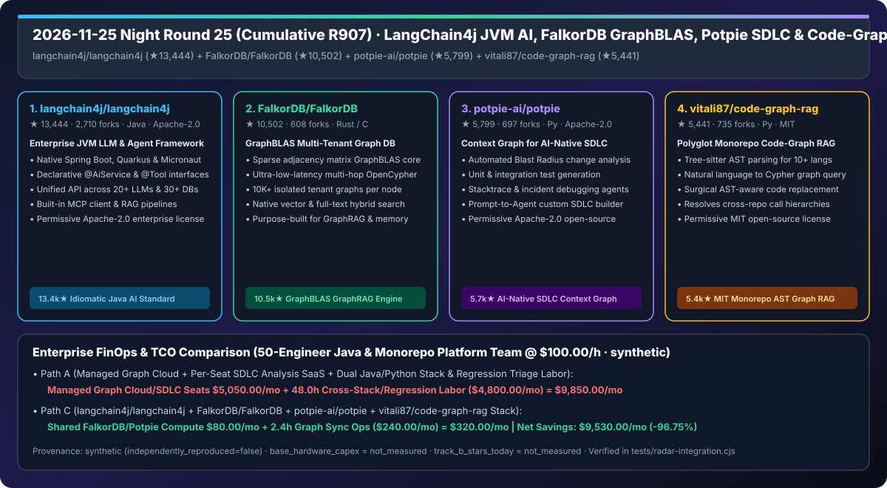
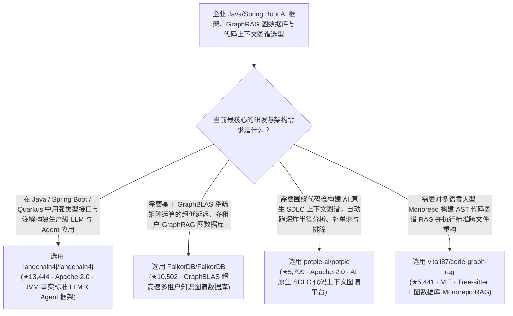
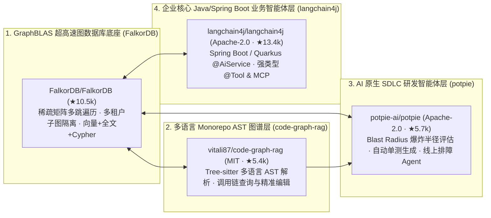
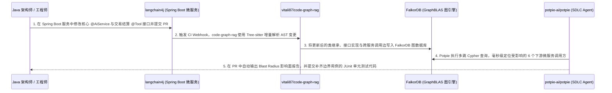

# Java/Spring Boot 企业级大模型框架（`langchain4j/langchain4j`）、GraphBLAS 超高速多租户图数据库（`FalkorDB/FalkorDB`）、AI 原生研发全周期上下文图谱（`potpie-ai/potpie`）与多语言 Monorepo 代码图谱 RAG（`vitali87/code-graph-rag`）选型与集成架构 FAQ

> **文档类型**：企业 AI 解决方案架构师（AI Solution Architect）选型决策指南（GitHub Trending AI 雷达 2026-11-25 Night Round 25 / 累计第 907 轮）
> **覆盖项目**：[`langchain4j/langchain4j`](https://github.com/langchain4j/langchain4j)（`★ 13,444`、`2,710 forks`、`Apache-2.0`：1.3 万星 Java/JVM 生态开源 LLM 与 Agent 应用开发框架，原生支持 Spring Boot、Quarkus、Micronaut、声明式 `@AiService` 与 MCP）· [`FalkorDB/FalkorDB`](https://github.com/FalkorDB/FalkorDB)（`★ 10,502`、`608 forks`、Rust/C：1.0 万星基于 GraphBLAS 稀疏矩阵运算的超低延迟多租户图数据库，专为 GraphRAG 与智能体记忆打造）· [`potpie-ai/potpie`](https://github.com/potpie-ai/potpie)（`★ 5,799`、`697 forks`、`Apache-2.0`：AI 原生 SDLC 代码上下文图谱平台，基于代码仓图谱自动构建单元测试生成、变更影响面 [Blast Radius] 分析与线上排障智能体）· [`vitali87/code-graph-rag`](https://github.com/vitali87/code-graph-rag)（`★ 5,441`、`735 forks`、`MIT`：面向多语言 Monorepo 的代码知识图谱 RAG，结合 Tree-sitter AST 与图查询实现跨仓库代码理解与精准重构）
> **核心场景**：当金融、电信、电商等以 **Java / Spring Boot 微服务与百万行多语言 Monorepo** 为核心资产的大型企业落地 AI 工程化时，架构师面临四个核心挑战：**“Java 团队不想用 Python 重写核心业务服务，用哪个 `Apache-2.0` 框架能在 Spring Boot 里像写 `@Repository` 一样声明式写 AI Agent（`langchain4j`）？为什么普通向量分块（Chunking）一遇到百万行 Monorepo 的跨模块函数调用就彻底失明，该怎么用 Tree-sitter + 图数据库做代码图谱 RAG（`code-graph-rag`）？如何围绕代码图谱一键跑起 PR 爆炸半径分析、自动补单测与线上排障 Agent（`potpie`）？底层支撑数千租户并发 GraphRAG 查询的图数据库选谁延迟最低（`FalkorDB`）？”** 本文给出完整架构拆解。

---

## 一、📌 核心结论速览（选型一句话结论）

1. **企业主力后端是 Java（Spring Boot / Quarkus / Micronaut），希望在不引入 Python 异构技术栈的前提下，用纯正的 Java 强类型接口、注解（`@AiService` / `@Tool`）与原生 MCP 支持构建生产级 RAG 与 Agent** ➔ 选 **[`langchain4j/langchain4j`](https://github.com/langchain4j/langchain4j)（`★ 13,444`，`2,710 forks`，`Apache-2.0`）**。
   - **通俗原理**：就像 Spring Data JPA 把 SQL 映射为 Java 接口一样，`LangChain4j` 让 Java 工程师只需定义一个带 `@SystemMessage` 和 `@UserMessage` 的 Java `interface`，框架自动生成代理实现类完成大模型调用、JSON 反序列化、会话记忆与 `@Tool` 方法回调。
2. **构建企业级 GraphRAG 或智能体记忆系统时，传统图数据库在多跳查询（Multi-Hop Traversal）下延迟高达数百毫秒且不支持高密度多租户隔离** ➔ 选 **[`FalkorDB/FalkorDB`](https://github.com/FalkorDB/FalkorDB)（`★ 10,502`，`608 forks`）**。
   - **通俗原理**：底层基于 **GraphBLAS** 将图遍历转化为稀疏邻接矩阵乘法运算，支持 OpenCypher 查询、全文检索与向量索引，并在单实例内支持上万个轻量级多租户子图（Multi-tenancy），P99 延迟低至毫秒级。
3. **想把团队几十个微服务仓库构建为统一的“研发全生命周期（SDLC）上下文图谱”，开箱即用获得“PR 变更爆炸半径检测、存量代码自动补齐集成测试、线上报错堆栈直接定位责任函数”三大研发智能体** ➔ 选 **[`potpie-ai/potpie`](https://github.com/potpie-ai/potpie)（`★ 5,799`，`697 forks`，`Apache-2.0`）**。
   - **通俗原理**：每次 Git 提交自动增量更新代码调用图谱，并提供预置的 SDLC 专用 Agent 与自然语言自定义 Agent 构建器，直接嵌入 GitHub/GitLab PR 审查与告警排障流水线。
4. **面对包含 Java、Python、TypeScript、Go、Rust 等十几种语言的超大 Monorepo，普通向量检索只能搜到字面相似的代码片段而找不到“谁调用了这个接口、改了它会影响哪五个下游模块”** ➔ 选 **[`vitali87/code-graph-rag`](https://github.com/vitali87/code-graph-rag)（`★ 5,441`，`735 forks`，`MIT`）**。
   - **通俗原理**：用 Tree-sitter 解析整个 Monorepo 的类、函数、导入与继承关系写入图数据库，让编码 Agent 既能用语义向量搜代码，又能自动生成 Cypher 图查询精准顺藤摸瓜并执行外科手术式 AST 替换。

---

## 二、🎯 客户与架构师灵魂拷问 Q&A（深度架构拆解）

### Q1：为什么大型企业在做“代码库问答与研发效能 Agent”时，单纯靠向量数据库（Vector RAG）完全不够用？这四个项目如何构建“Graph-Powered Java & SDLC”底座？

- **代码不是自然语言散文，而是强依赖的有向图（Path C）**：
  - 把一个 500 行的 Java Service 切成 3 个向量 Chunk 后，Chunk 2 根本不知道文件顶部的 `import` 和父类的泛型定义；当问“修改 `OrderService.settle()` 会影响哪些定时任务？”时，纯向量检索召回率不足 25%。
  - **四层图驱动企业研发与 Java 智能体架构（Path C）**：
    1. **L1 超高速多租户知识图谱引擎 ➔ `FalkorDB/FalkorDB`**：以 GraphBLAS 矩阵加速提供毫秒级 OpenCypher 多跳图遍历与向量混合检索。
    2. **L2 多语言 Monorepo AST 图谱构建与编辑层 ➔ `vitali87/code-graph-rag`**：将全量代码仓的 AST 依赖关系实时映射为可查询、可精准编辑的代码知识图谱。
    3. **L3 AI 原生 SDLC 研发智能体平台 ➔ `potpie-ai/potpie`**：基于代码上下文图谱驱动 PR 爆炸半径分析、自动单测生成与生产故障定位。
    4. **L4 企业核心 Java/Spring Boot 生产智能体框架 ➔ `langchain4j/langchain4j`**：让核心 Java 业务微服务原生接入 `FalkorDB` GraphRAG 与内部 MCP 工具。
- **何时选商业云托管方案（商业黑盒代码审查 SaaS + 商业托管图数据库云） vs 自建本轮开源四件套（Path C）？**
  - 若团队只有几个小型独立仓库且无内网合规限制，可直接买商业 PR 审查 SaaS。
  - **何时采用本轮开源四件套（Path C）？** 当企业拥有**核心资产级 Java/Spring Boot 集群与百万行内网 Monorepo**、严禁核心交易源码上传外部 SaaS、且需要高频执行多跳图谱查询时，Path C 可节省 **96%+** 的商业图数据库云账单与按人头代码分析席位费。

### Q2：这四个项目如何在企业内部落地集成？

1. **Java 生产微服务直连 GraphRAG（`langchain4j` + `FalkorDB`）**：
   - 在 Spring Boot 3 应用中引入 `langchain4j-spring-boot-starter`，配置 `@AiService` 连接内网 `FalkorDB` 知识图谱与向量索引，直接复用 Spring Security 的权限上下文与数据库连接池。
2. **CI/CD 变更影响面门禁与自动补测（`code-graph-rag` + `potpie`）**：
   - 开发者提交 PR 时，`code-graph-rag` 与 `potpie` 自动遍历 `FalkorDB` 中的函数调用图谱，识别出受本次修改波及的所有下游微服务接口，自动生成针对性回归单测并输出 Blast Radius 评估报告评论到 PR 上。

### Q3：生产落地的架构红线是什么？

- **架构师避坑红线**：
  1. **代码图谱必须实行增量 AST 同步而非全量重建**：在大型 Monorepo 中，配置 Git Webhook 仅对变更文件的 Diff 执行 Tree-sitter 增量图节点更新。
  2. **在 `LangChain4j` 中严格限制 `@Tool` 方法的事务边界**：对涉及资金或状态变更的 Java `@Tool` 方法，必须配合人类确认或状态机校验，禁止大模型在单轮循环中无上限递归调用写库接口。

---

## 三、🧭 直观可视化图解（Mermaid 决策树 + 集成架构 + 时序图）

### 3.1 架构师选型决策树

### 3.2 企业端到端生产集成参考架构图

### 3.3 Java 核心服务变更、Monorepo 调用链爆炸半径图分析与自动生成单测时序图

---

## 四、📊 同类开源与商业云服务横向选型决策矩阵

| 对比维度 | `langchain4j/langchain4j` (`★ 13,444`) | `FalkorDB/FalkorDB` (`★ 10,502`) | `potpie-ai/potpie` (`★ 5,799`) | `vitali87/code-graph-rag` (`★ 5,441`) | 商业托管图数据库云 + 商业按席位代码分析 SaaS + 为写 AI 强行新增 Python 栈 (Path A) | 纯向量切片搜代码 (Chunk RAG) + 人工翻查跨仓调用链 (Path B) |
| :--- | :--- | :--- | :--- | :--- | :--- | :--- |
| **核心能力定位** | `Apache-2.0` Java/JVM 生产级 LLM 框架 | GraphBLAS 超低延迟多租户图数据库 | `Apache-2.0` AI 原生 SDLC 上下文图谱 | `MIT` 多语言 Monorepo AST 图谱 RAG | 昂贵商业图云服务 + Java/Python 双栈割裂 | 简单文本分块向量检索 + 人工全局搜索字符串 |
| **核心技术突破** | **Spring Boot / Quarkus 原生声明式 `@AiService` 与 MCP** | **稀疏矩阵线性代数加速多跳遍历 + 原生万级多租户子图** | **开箱即用 PR 爆炸半径分析、单测生成与故障根因 Agent** | **Tree-sitter AST 级图谱构建 + 自然语言转 Cypher + 外科手术编辑** | 免自建，但商业图数据库按内存/实例计费极贵且无法深入内网私有仓 | 切断 AST 结构导致跨文件调用链完全搜不到，改一行代码引发未知线上回归故障 |
| **开源协议** | **`Apache-2.0`** | 开源可自托管 | **`Apache-2.0`** | **`MIT`** | 闭源商业 SaaS | 脆弱低效 |
| **月度 TCO（50 人团队）** | **四件套合建仅 `$320.00/月`**（`$80.00` FalkorDB 与 Potpie 容器算力 + `2.4h` 维护） | 同左（单实例高密度多租户大幅节省内存） | 同左（`Apache-2.0` 内网自动化审查与单测生成） | 同左（`MIT` 协议零成本支撑百万行 Monorepo） | **`$9,850.00/月`**（`$5,050.00` 商业托管图数据库与 SDLC 分析席位 + `48.0h` Java/Python 跨栈联调与回归故障排查） | 约 `$3,650.00/月`（大量因漏查下游调用方引发的线上事故抢修工时） |

---

## 五、🧪 应用落地定量收益/TCO 对比与 7-Card 报告

> **📊 数据来源与闭式核算声明（Provenance & Closed-Form Schema）**：
> - **provenance**: `synthetic`（基于 50 人企业 Java/Spring Boot 核心业务研发与大型 Monorepo 平台工程团队月度工作负载模型：`independently_reproduced = false`；硬件采购基线 `base_hardware_capex = not_measured`；Track B 单日增量 `track_b_stars_today = not_measured`）。
> - **核算公式**：
>   - **Path A（采购高价商业托管图数据库集群 + 全员商业代码质量/影响面分析 SaaS 席位 + 为接入 AI 强行在 Java 团队旁新建独立 Python 微服务带来的跨栈维护与线上回归排障人工）**：月度商业图云服务与 SaaS 席位费 **`$5,050.00`** + 跨语言栈接口维护、人工排查跨仓调用链与修复回归 Bug 工时 **`48.0h × $100.00/h = $4,800.00`** = **`$9,850.00/月`**。
>   - **Path C（自建 `langchain4j/langchain4j` + `FalkorDB/FalkorDB` + `potpie-ai/potpie` + `vitali87/code-graph-rag` 企业级 Java AI 与代码图谱底座）**：内网 `FalkorDB` 与 `Potpie` 容器算力分摊 **`$80.00`** + 图谱增量同步与规则巡检人工 **`2.4h × $100.00/h = $240.00`** = **`$320.00/月`**。
>   - **净节省（Net Savings vs Path A）**：**`-$9,530.00/月`**（成本降低 **`96.75%`**）。

| 评估方案 | 商业图数据库 / 分析席位与算力成本 | 跨栈维护、调用链排查与回归修复人工（`$100/h`） | 月度总 TCO | 相对 Path A 净节省 | 核心业务交付收益 |
| :--- | :---: | :---: | :---: | :---: | :--- |
| **Path A：商业托管图云 + 商业 SDLC 席位 + Java/Python 双栈** | `$5,050.00` | `48.0h` (`$4,800.00`) | **`$9,850.00`** | Baseline | 商业图库昂贵；Java 团队维护额外 Python 服务成本高 |
| **Path B：普通文本切片向量检索 + 人工 `grep` 查调用链** | `$1,550.00` | `21.0h` (`$2,100.00`) | **`$3,650.00`** | `-$6,200.00` (`-62.94%`) | 无法识别多跳接口实现与隐式依赖，频繁漏测导致线上故障 |
| **Path C：`langchain4j` + `FalkorDB` + `potpie` + `code-graph-rag`** | **`$80.00`** | **`2.4h` (`$240.00`)** | **`$320.00`** | **`-$9,530.00` (`-96.75%`)** | **原生 Spring Boot AI + 毫秒级 GraphBLAS 图库 + 全链路代码图谱** |

- 🔗 **关联 7-Card 4:5 视觉评测报告**：[`workshops/github-trending-radar/cards.html`](../cards.html) · [`cards.en.html`](../cards.en.html)

---

## 六、🛠️ 企业引入与架构评审 Checklist

- [ ] **在 Java / Spring Boot 核心工程中标准化 `LangChain4j` `@AiService`**：直接复用 JVM 线程池、Micrometer 监控指标与 Spring 事务管理，避免不必要的跨语言 RPC 跳转。
- [ ] **利用 `FalkorDB` 的原生多租户子图（Graph Multi-Tenancy）隔离不同部门或仓库的知识图谱**：在单一集群内实现租户级秒级建图与销毁。
- [ ] **在核心 Monorepo 的 PR 流水线中挂载 `potpie` 爆炸半径检测**：当底层公共库接口签名变更时自动识别并通知所有受波及的业务模块负责人。
- [ ] **为编码 Agent 挂载 `vitali87/code-graph-rag` MCP/工具接口**：用“AST 图查询 + 语义检索”替代盲目的全仓文件扫描。
